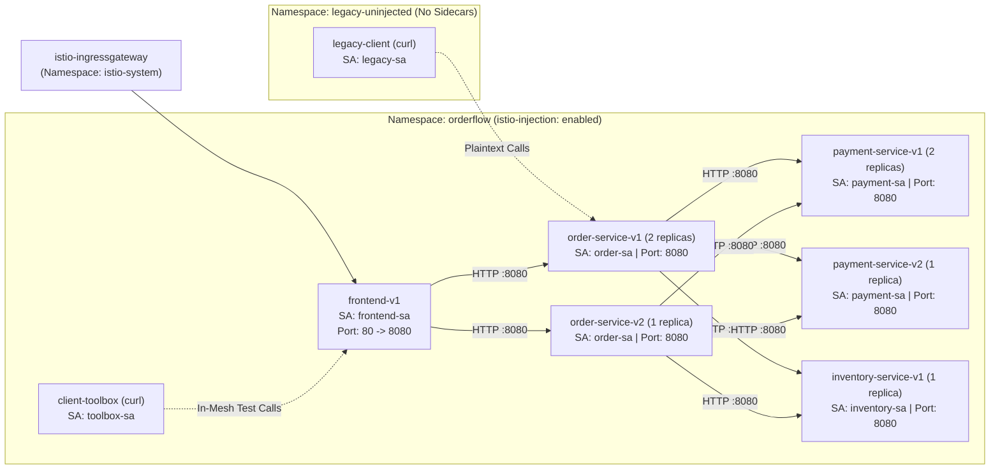

# Module 00: Environment Setup & Reference Microservices Architecture

Before diving into Istio's internals, we need a realistic Kubernetes cluster and a multi-tier microservices platform that mirrors real enterprise architectures rather than isolated `hello-world` containers.

In this module, you will:
1. Understand how multi-node Kubernetes topology labels (`region`, `zone`) and NodePort/LoadBalancer mappings interact with Istio.
2. Compare Istio installation methods (`istioctl` + `IstioOperator`, Helm charts) and built-in configuration profiles (`default`, `demo`, `minimal`, `ambient`).
3. Deploy the **OrderFlow E-Commerce & Payment Platform**—a 5-service call graph (`frontend` $\rightarrow$ `order-service` $\rightarrow$ `payment-service` & `inventory-service`) that propagates distributed trace headers and returns structured JSON call trees.

---

## 1. Why Installation Profiles Matter: Learning vs. Production

When running `istioctl install`, Istio applies a built-in **configuration profile** unless overridden by an `IstioOperator` resource. Choosing the wrong profile in production is one of the most common operational mistakes.

| Profile | Components Installed | Key Defaults & Behavior | Target Environment |
| :--- | :--- | :--- | :--- |
| **`default`** | `istiod`, `istio-ingressgateway` | Production-safe defaults, 1% trace sampling, standard resource requests, no egress gateway. | **Production baseline** (customizable via `IstioOperator` or Helm). |
| **`demo`** | `istiod`, `istio-ingressgateway`, `istio-egressgateway` | 100% trace sampling, verbose access logging, minimal CPU/memory requests (`10m` CPU). | **Never use in production.** High trace sampling and tiny resource requests cause CPU throttling under load. |
| **`minimal`** | `istiod` only | Control plane only; gateways are deployed separately as standalone workloads. | **Enterprise GitOps** where gateways are managed by separate teams/namespaces. |
| **`ambient`** | `istiod`, `istio-cni`, `ztunnel` | Enables sidecarless Ambient Data Plane mode (`ztunnel` L4 DaemonSet + `istio-cni`). | **Ambient Mesh deployments** (covered in Module 01). |

### Our Course Approach
Instead of blindly installing `--set profile=demo`, we start from the **`default` (production) profile** in [`manifests/istio-operator-demo-vs-prod.yaml`](./manifests/istio-operator-demo-vs-prod.yaml) and explicitly configure each setting (`accessLogFile`, `ISTIO_META_DNS_CAPTURE`, `extensionProviders`, `egressGateways`) so you see exactly which knobs control Istio's runtime behavior.

---

## 2. The "OrderFlow" Reference Microservices Architecture

Throughout Modules 01–08, we use the **OrderFlow** platform in the `orderflow` namespace. Every service runs `nicholasjackson/fake-service`, a purpose-built microservice simulator used in production service mesh benchmarks that:
- Makes **real upstream HTTP/gRPC calls** defined in `UPSTREAM_URIS`.
- Automatically propagates **W3C (`traceparent`) and B3 (`x-b3-*`) distributed tracing headers**.
- Returns a nested **JSON call graph** showing the exact pod IP, version, HTTP status code, and latency of every hop in the request chain.

### Key Architectural Details to Notice
1. **Replica Skew (`v1` has 2 replicas, `v2` has 1 replica)**:
   Both `order-service` and `payment-service` have **2 pods of `v1`** and **1 pod of `v2`** behind a single Kubernetes `Service`. Without Istio `VirtualService` rules, traffic splits **66.7% to `v1` and 33.3% to `v2`** purely because of pod count! In Module 02, you will decouple traffic routing from replica count.
2. **Dedicated `ServiceAccount` per Service**:
   Every microservice runs under its own Kubernetes `ServiceAccount` (`frontend-sa`, `order-sa`, `payment-sa`, `inventory-sa`). Istio's Certificate Authority (`istiod`) encodes this into each pod's X.509 certificate SAN as a SPIFFE URI (`spiffe://cluster.local/ns/orderflow/sa/order-sa`), which powers cryptographic mTLS and L7 `AuthorizationPolicy` in Module 04.
3. **Explicit Service Port Naming (`http-web`, `http-api`)**:
   Every Kubernetes `Service` port in [`base-platform.yaml`](./manifests/base-platform.yaml) uses the `http-<suffix>` naming convention. This disables Envoy's costly protocol sniffing and unlocks full Layer-7 features immediately.

---

## Next Step
Proceed to [**LAB.md**](./LAB.md) to provision the cluster, install Istio, deploy the OrderFlow platform, and verify end-to-end call graphs.

