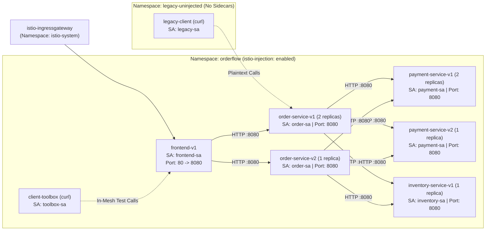

[Fellowship Portal](../README.md) | [Week 01 Guide](../fellowship/week-01-platform-onboarding/WEEK.md) | [Guided Lab (LAB.md)](./LAB.md) | [Next: Module 01 ->](../01-architecture-and-internals/README.md)

# Module 00: Environment Setup & The OrderFlow Reference Architecture

> **Version & Fellowship Context**
> - **Authoritative Baseline**: Istio `1.32.0` | Envoy `v1.40` | Kubernetes `v1.36+` (Supported: `1.33`–`1.37`) | Gateway API `v1.6.1` — see [`../VERSIONS.md`](../VERSIONS.md) and [`../COMPATIBILITY.md`](../COMPATIBILITY.md).
> - **Fellowship Cohort 01 Mapping**: Complete this module alongside **[Week 01: Platform Onboarding (`NP-101`)](../fellowship/week-01-platform-onboarding/WEEK.md)**.
> - **Estimated Completion Time**: `45 mins` (Reading + Cluster & Platform Provisioning Lab)
> - **Prerequisites**: Docker (`27.x+`), `kind` (`v0.27+`), `kubectl` (`v1.36+`), `istioctl` (`v1.32.0`), `helm` (`v3.17+`), `jq`, and `openssl`.

### Module Learning Objectives
By the end of this module, you will be able to:
1. Explain how multi-node Kubernetes topology labels (`region`, `zone`), CNI plugins (including **Cilium CNI** socket-LB compatibility), and NodePort/LoadBalancer mappings interact with Istio `1.32.0`.
2. Evaluate Istio `1.32.0` installation methods (**Official Helm Charts** for production GitOps vs. **`istioctl install`** with local `IstioOperator` input) and configuration profiles (`default`, `demo`, `minimal`, `ambient`), explaining why the removed in-cluster `IstioOperator` controller and `profile=demo` are banned in production.
3. Deploy and verify the **OrderFlow E-Commerce & Payment Platform**—a multi-tier microservices call graph (`frontend` $\rightarrow$ `order-service` $\rightarrow$ `payment-service` & `inventory-service`) that propagates distributed trace headers and returns structured JSON call trees.

---

## 1. NovaPay Engineering Context & Alex Morgan's Briefing

### 1.1 What Is Happening at NovaPay?
At **NovaPay**, our core checkout and payment processing pipeline—**`orderflow`**—processes thousands of payment authorizations per second across multiple availability zones (`us-east-1a`, `us-east-1b`, `us-east-1c`). As we prepare for our upcoming **PCI-DSS Level 1 audit** and **Black Friday peak checkout volume**, Platform Engineering must establish a deterministic, auditable Istio `1.32.0` foundation before migrating production payment traffic.

Isolated `hello-world` containers (`httpbin` or single `nginx` pods) fail to expose the real failure modes that wake platform engineers up at 3:00 AM:
- Multi-hop latency amplification across cascading HTTP/gRPC calls (`frontend` $\rightarrow$ `order-service` $\rightarrow$ `payment-service`).
- Replica skew where `v1` has 2 pods and `v2` has 1 pod behind a single Kubernetes `Service`.
- Uninjected legacy callers (`legacy-uninjected`) communicating with mTLS-protected mesh workloads.
- Misnamed `Service` ports causing Envoy protocol-sniffing timeouts.

### 1.2 Alex Morgan's Briefing & Mental Model Analogy

> **Alex Morgan (Senior Platform Engineer — Mentor Briefing)**
> *"Welcome to the Platform Engineering team at NovaPay. Before we write a single `VirtualService` or mTLS policy, we need our proving ground stood up right—and we need to clear up two dangerous misconceptions I see in almost every service mesh migration.*
>
> *First: think of standard Kubernetes networking (`kube-proxy` + `Service` ClusterIPs) like **unmanaged city intersections with passive street signs**. Once a TCP connection leaves a pod, the kernel flips a coin at `SYN` time to pick a destination IP, and from that moment on, Kubernetes is blind. It doesn't know if the packet carries an HTTP `503`, a forged identity, or 10,000 multiplexed gRPC requests pinned to a dying pod. An Istio service mesh replaces those passive street signs with **an intelligent, programmable air-traffic control tower (`istiod`) in constant radio contact with an onboard co-pilot (`envoy` or `ztunnel`) inside every aircraft**.*
>
> *Second: we have two non-negotiable rules in Ticket `NP-101`:*
> 1. ***Never run `profile=demo` in staging or production.*** *Last year, a team copied `istioctl install --set profile=demo` from a quickstart guide into a staging load-test cluster. Because `demo` sets `100%` trace sampling, unthrottled `/dev/stdout` access logging, and `10m` CPU requests, Envoy saturated node disk I/O and throttled checkout latency from `18ms` to `1,400ms`.*
> 2. ***Never deploy an in-cluster `IstioOperator` controller.*** *The old in-cluster operator required cluster-wide admin privileges and was **permanently removed in Istio 1.24+**. In Istio `1.32.0`, `kind: IstioOperator` is strictly a local CLI input file for `istioctl install -f`, while production GitOps uses official Istio Helm charts."*

---

## 2. Istio `1.32.0` Installation Methods & Configuration Profiles

### 2.1 Production GitOps (`Helm`) vs. Lab CLI (`istioctl install`)

In Istio `1.32.0`, there are two supported ways to install and upgrade the control plane and data plane components:

| Installation Method | How It Works | Target Environment |
| :--- | :--- | :--- |
| **1. Official Helm Charts (`istio/base`, `istio/istiod`, `istio/cni`, `istio/ztunnel`, `istio/gateway`)** | Standard Helm charts rendered directly by Helm, ArgoCD, or Flux using a declarative `values.yaml` (see [`manifests/helm-values-prod.yaml`](./manifests/helm-values-prod.yaml)). | **Recommended Production & GitOps Standard in Istio `1.32.0`.** Integrates natively with enterprise GitOps pipelines and revision-based canary upgrades (`istio.io/rev`). |
| **2. `istioctl install -f <iop.yaml>`** | The `istioctl` CLI compiles a local `IstioOperator` YAML file (see [`manifests/istio-operator-demo-vs-prod.yaml`](./manifests/istio-operator-demo-vs-prod.yaml)) in memory and applies the resulting Kubernetes manifests directly to the API server. | **Interactive Labs, Rapid Prototyping & CLI-Driven Operations.** |

> [!WARNING]
> **Historical Context — Removal of the In-Cluster `IstioOperator` Controller (Istio 1.24+)**
> Prior to Istio 1.24, Istio included an optional *in-cluster* `IstioOperator` controller pod that watched `IstioOperator` CRs inside the cluster and mutated the control plane automatically. Because running a privileged controller with cluster-wide RBAC permissions inside the cluster posed severe security and upgrade risks, the in-cluster `IstioOperator` controller was **deprecated in Istio 1.23 and permanently removed in Istio 1.24**.
>
> In **Istio `1.32.0`**, `kind: IstioOperator` (`install.istio.io/v1alpha1`) is strictly a **client-side configuration schema consumed by `istioctl install -f`**. For declarative GitOps reconciliation in production, always use the official **Istio Helm charts** ([`manifests/helm-values-prod.yaml`](./manifests/helm-values-prod.yaml)).

### 2.2 Why Installation Profiles Matter: Learning vs. Production

When running `istioctl install` or configuring Helm values, Istio applies a built-in **configuration profile** unless overridden. Choosing the wrong profile in production is one of the most common operational mistakes.

| Profile | Components Installed | Key Defaults & Behavior | Target Environment |
| :--- | :--- | :--- | :--- |
| **`default`** | `istiod`, `istio-ingressgateway` (in `istioctl`) | Production-safe defaults, `1%` trace sampling, standard resource requests (`100m` CPU / `128Mi` RAM), no egress gateway. | **Production baseline** (customizable via Helm `values.yaml` or `IstioOperator`). |
| **`demo`** | `istiod`, `istio-ingressgateway`, `istio-egressgateway` | `100%` trace sampling, verbose access logging, minimal CPU/memory requests (`10m` CPU / `40Mi` RAM). | **Never use in production.** High trace sampling and tiny resource requests cause severe CPU throttling under load. |
| **`minimal`** | `istiod` only | Control plane only; gateways are deployed separately as standalone workloads. | **Enterprise GitOps** where gateways are managed by separate teams/namespaces or via Kubernetes Gateway API (`v1.6.1`). |
| **`ambient`** | `istiod`, `istio-cni`, `ztunnel` | Enables sidecarless Ambient Data Plane mode (`ztunnel` L4 DaemonSet + `istio-cni`). | **Ambient Mesh deployments** (covered in [Module 01 Lesson 04](../01-architecture-and-internals/lessons/04-ambient-mode-ztunnel-and-waypoints.md)). |

### 2.3 Cilium CNI Compatibility Requirements (Istio `1.32.0` Sidecar & Ambient Modes)

If your Kubernetes `v1.36+` cluster runs **Cilium CNI** (especially with eBPF `kubeProxyReplacement=true`), you **must** configure two critical Cilium settings so Cilium's eBPF programs do not bypass Istio's `istio-cni` netns redirection (`ztunnel`) or Envoy `iptables` socket interception:

1. **`cni.exclusive=false`**: Allows `istio-cni` to chain cleanly after Cilium in `/etc/cni/net.d/` so Istio can hook pod network namespaces at pod startup.
2. **`socketLB.hostNamespaceOnly=true`**: Restricts Cilium's eBPF socket-level load balancing (`bpf_sockaddr`) to the host network namespace only. Without this setting, Cilium rewrites Service ClusterIPs inside the pod's socket layer *before* packets ever reach Envoy (`:15001`) or `ztunnel` (`:15008`), breaking Istio mTLS, L7 routing, and Ambient HBONE tunnels!

### Our Engineering Approach
Instead of blindly installing `--set profile=demo`, we provide both a production Helm configuration in [`manifests/helm-values-prod.yaml`](./manifests/helm-values-prod.yaml) and a customized `default`-derived `IstioOperator` specification in [`manifests/istio-operator-demo-vs-prod.yaml`](./manifests/istio-operator-demo-vs-prod.yaml) that explicitly configures each setting (`accessLogFile`, `ISTIO_META_DNS_CAPTURE`, `extensionProviders`, `egressGateways`) so you see exactly which knobs control Istio's runtime behavior.

---

## 3. The NovaPay `OrderFlow` Reference Microservices Architecture

Throughout Modules 00–09, we operate the **OrderFlow** checkout platform in the `orderflow` namespace. Every service runs `nicholasjackson/fake-service`, a purpose-built microservice simulator used in production service mesh benchmarks that:
- Makes **real upstream HTTP/gRPC calls** defined in `UPSTREAM_URIS`.
- Automatically propagates **W3C (`traceparent`) and B3 (`x-b3-*`) distributed tracing headers**.
- Returns a nested **JSON call graph** showing the exact pod IP, version, HTTP status code, and latency of every hop in the request chain.

### 3.1 6-Part Step-by-Step Architecture Walkthrough

1. **What initiates the operation?**
   An external customer call arriving via `istio-ingressgateway` (or an internal diagnostic probe from `client-toolbox` / `legacy-client`) sends an HTTP GET request to `http://frontend.orderflow.svc.cluster.local`.
2. **Which component receives it?**
   Inside the `orderflow` namespace (labeled `istio-injection=enabled`), every pod contains both the application container and an injected `istio-proxy` (`envoy` `v1.40`) sidecar container. The `frontend-v1` pod's Envoy proxy intercepts the inbound request on port `:15006`, forwards it to the local `frontend` container on `:8080`, and then intercepts `frontend`'s outbound call to `http://order-service.orderflow.svc.cluster.local:8080` on port `:15001`.
3. **What information is exchanged?**
   `frontend-v1` calls `order-service:8080`, propagating W3C (`traceparent`) and B3 (`x-b3-traceid`, `x-b3-spanid`) headers. `order-service` fans out concurrently to `inventory-service:8080` and `payment-service:8080`. Each Envoy proxy negotiates automatic SPIFFE mTLS (`spiffe://cluster.local/ns/orderflow/sa/<service-account>`) with its upstream peer and returns a nested JSON payload recording its pod IP, start/end timestamps, HTTP status code, and upstream call tree.
4. **What changes in the system?**
   Because both `order-service` and `payment-service` run **2 replicas of `v1`** and **1 replica of `v2`** behind a single Kubernetes `Service` selector (`app: order-service` and `app: payment-service`), Envoy's Endpoint Discovery Service (`EDS`) pool for each service contains 3 healthy Pod IPs—resulting in a baseline `66.7%` (`v1`) / `33.3%` (`v2`) traffic distribution until L7 routing policies are applied in Module 02.
5. **How can you observe/verify it on your cluster?**
   - Check injected container readiness (`2/2` in `orderflow` vs. `1/1` in `legacy-uninjected`):
     `kubectl get pods -n orderflow && kubectl get pods -n legacy-uninjected`
   - Trace the live multi-hop JSON call graph:
     `kubectl exec -n orderflow deploy/client-toolbox -c toolbox -- curl -s http://frontend.orderflow.svc.cluster.local | jq .`
   - Verify xDS synchronization across all proxies:
     `istioctl proxy-status`
6. **What happens if a component fails?**
   - If `payment-service-v2` returns an HTTP `500` or times out, `order-service` captures the upstream error code inside its JSON `upstream_calls` block and propagates failure status back to `frontend-v1`.
   - If a `Service` port in [`manifests/base-platform.yaml`](./manifests/base-platform.yaml) lacks an explicit protocol prefix (`name: http-api` or `appProtocol: http`), Envoy falls back to protocol sniffing, risking timeouts on server-first protocols and disabling deterministic L7 telemetry until corrected.

### 3.2 Three Production Design Choices Built Into `base-platform.yaml`
1. **Replica Skew (`v1` has 2 replicas, `v2` has 1 replica)**:
   Both `order-service` and `payment-service` run **2 pods of `v1`** and **1 pod of `v2`** behind a single Kubernetes `Service`. Without Istio `VirtualService` rules, traffic splits **66.7% to `v1` and 33.3% to `v2`** purely because of pod count. In [Module 02](../02-service-discovery-and-routing/README.md), you will decouple traffic routing from replica count.
2. **Dedicated `ServiceAccount` per Service (PCI-DSS Requirement)**:
   As Maya Patel (Principal Security Engineer) mandated in `NP-101`, every microservice runs under its own Kubernetes `ServiceAccount` (`frontend-sa`, `order-sa`, `payment-sa`, `inventory-sa`). Istio's Certificate Authority (`istiod`) encodes this into each pod's X.509 certificate SAN as a SPIFFE URI (`spiffe://cluster.local/ns/orderflow/sa/order-sa`), which powers cryptographic mTLS and L7 `AuthorizationPolicy` in Module 04.
3. **Explicit Service Port Naming (`http-web`, `http-api`)**:
   Every Kubernetes `Service` port in [`manifests/base-platform.yaml`](./manifests/base-platform.yaml) uses the `http-<suffix>` naming convention. This disables Envoy's costly protocol sniffing and unlocks full Layer-7 features immediately.

---

## 4. Knowledge Check (Engineering Judgment)

Test your understanding before moving to the hands-on lab.

### Question 1: In-Cluster `IstioOperator` vs. Helm in Istio `1.32.0`
A backend engineer opens a Pull Request to install Istio `1.32.0` in NovaPay's production cluster by committing a `kind: IstioOperator` YAML resource directly into ArgoCD, expecting an in-cluster operator to reconcile it. What happens when ArgoCD tries to apply this resource, and what is the correct architecture?

Check Answer & Engineering Explanation

**Answer:**
The deployment will fail (or the resource will sit inert if an old CRD exists) because the **in-cluster `IstioOperator` controller was deprecated in Istio 1.23 and permanently removed in Istio 1.24**.
- In Istio `1.32.0`, `kind: IstioOperator` (`install.istio.io/v1alpha1`) is strictly a **client-side CLI input schema** parsed in memory by `istioctl install -f`.
- For declarative GitOps reconciliation in ArgoCD or Flux, NovaPay must use the official **Istio Helm charts** (`istio/base`, `istio/istiod`, `istio/cni`, `istio/gateway`) with declarative `values.yaml` files (as shown in [`manifests/helm-values-prod.yaml`](./manifests/helm-values-prod.yaml)).

### Question 2: Cilium CNI eBPF Socket Load Balancing Conflict
Your Kubernetes `v1.36` cluster uses Cilium CNI with `kubeProxyReplacement=true`. After installing Istio `1.32.0`, you notice that pod-to-pod calls to Kubernetes `Service` ClusterIPs intermittently bypass Envoy's outbound policies or break Ambient Mode `HBONE` tunnels. Which two Cilium settings must be configured and why?

Check Answer & Engineering Explanation

**Answer:**
You must configure:
1. **`cni.exclusive=false`**: Allows `istio-cni` to chain cleanly after Cilium in `/etc/cni/net.d/` so Istio can configure pod network namespaces at sandbox creation.
2. **`socketLB.hostNamespaceOnly=true`**: By default, Cilium's eBPF socket load balancer (`bpf_sockaddr`) hooks the `connect()` syscall inside every pod network namespace and rewrites the destination `Service` ClusterIP to a backend Pod IP *before* the packet enters the Linux network stack where `iptables` or `ztunnel` sockets operate. Restricting `socketLB` to the host namespace ensures packets inside pod network namespaces retain their original `SO_ORIGINAL_DST` ClusterIP for Envoy (`:15001`) and `ztunnel` (`:15008`).

### Question 3: `ServiceAccount` Identity & Zero-Trust Policy Impact
Why does Maya Patel forbid microservices in `orderflow` from sharing the `default` Kubernetes `ServiceAccount`, even before we write any `AuthorizationPolicy` in Module 04?

Check Answer & Engineering Explanation

**Answer:**
In Istio, workload identity is **not** based on Pod IP or Deployment labels (`app: order-service`) because IPs are ephemeral and labels can be modified by anyone with pod edit permissions. Instead, `istiod` validates the pod's projected `ServiceAccount` JWT and issues an X.509 certificate whose Subject Alternative Name (SAN) is `spiffe://cluster.local/ns/<namespace>/sa/<serviceaccount>`. If `frontend`, `order-service`, and `payment-service` all used the `default` `ServiceAccount`, they would share the identical cryptographic identity (`spiffe://cluster.local/ns/orderflow/sa/default`), making it impossible to restrict `payment-service` to only accept calls from `order-service`.

---

## 5. Key Takeaways, Definition of Done & Authoritative References

### Key Takeaways
- **`IstioOperator` is a CLI schema, not an in-cluster controller**: Use `istioctl install -f` for interactive lab clusters and official **Istio Helm charts** for production GitOps.
- **Never run `profile=demo` in production**: Its `100%` trace sampling and `10m` CPU requests cause severe proxy throttling under load.
- **Identity starts at the `ServiceAccount` and L7 starts at Port Naming**: Dedicated `ServiceAccounts` establish cryptographic SPIFFE identities, and `http-*`/`grpc-*` port names enable deterministic L7 processing.

### Module 00 Definition of Done
- [ ] You can explain why `profile=demo` and the removed in-cluster `IstioOperator` controller are banned in NovaPay production.
- [ ] Your 4-node multi-zone `kind` cluster (`us-east-1a`, `us-east-1b`, `us-east-1c`) is running Kubernetes `v1.36+` with Gateway API `v1.6.1` Standard CRDs installed.
- [ ] Istio `1.32.0` (`istiod`, `istio-ingressgateway`, `istio-egressgateway`) is running and healthy in `istio-system`.
- [ ] All 9 pods in `orderflow` report `2/2 Running` (`istio-proxy` injected), `legacy-client` in `legacy-uninjected` reports `1/1 Running`, and `istioctl proxy-status` reports `SYNCED` across all proxies.

### Authoritative References
- [Istio 1.32 Installation Guides (Helm & `istioctl`)](https://istio.io/latest/docs/setup/install/)
- [Istio 1.32 Configuration Profiles](https://istio.io/latest/docs/setup/additional-setup/config-profiles/)
- [Istio Application Requirements: Explicit Port Naming & ServiceAccounts](https://istio.io/latest/docs/ops/deployment/application-requirements/)
- [Cilium CNI & Istio Compatibility Configuration](https://istio.io/latest/docs/ambient/install/platform-prerequisites/#cilium)

---

## Next Step
Proceed to [**Module 00 Guided Lab (`LAB.md`)**](./LAB.md) to provision the multi-zone cluster, install Istio `1.32.0`, deploy the `orderflow` platform, and complete the failure-injection troubleshooting challenge.
