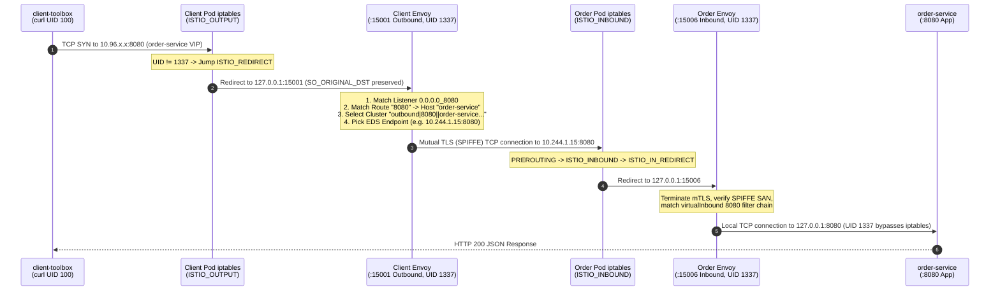

# Module 01 Lab: Inspecting Envoy Internals, `iptables`, xDS & Ambient Mode

## Learning Objectives
By the end of this lab, you will be able to:
1. Verify how `istiod`'s `MutatingAdmissionWebhook` mutates a Pod specification and injects `istio-init` and `istio-proxy`.
2. Inspect live `iptables` NAT chains (`ISTIO_INBOUND`, `ISTIO_OUTPUT`, `ISTIO_REDIRECT`, `UID 1337` loop avoidance) inside a running workload's network namespace.
3. Query Envoy's Admin API (`:15000/config_dump` and `:15000/clusters`) and use `istioctl proxy-config` (`listener`, `route`, `cluster`, `endpoint`) to trace an exact packet path from `client-toolbox` to `order-service`.
4. Deploy a workload in **Istio Ambient Mode**, observe zero-sidecar L4 mTLS over HBONE (`:15008`) via `ztunnel`, and attach an L7 **Waypoint Proxy**.

---

## Prerequisites
- Kubernetes cluster running with Istio installed (including `ztunnel` and `istio-cni` if testing Ambient Mode) from Module 00.
- The `orderflow` namespace deployed with `frontend`, `order-service` (`v1`, `v2`), `payment-service` (`v1`, `v2`), `inventory-service` (`v1`), and `client-toolbox`.
- Verify all pods in `orderflow` show `2/2` containers ready:
  ```bash
  kubectl get pods -n orderflow
  ```

---

## Architecture & Expected Traffic Flow



---

## Step-by-Step Implementation

### Step 1: Inspect MutatingAdmissionWebhook Injection & Pod Containers

First, apply the sidecar inspection manifest to ensure our baseline diagnostic resources are present:

```bash
kubectl apply -f /home/chan/Documents/Istio/01-architecture-and-internals/manifests/sidecar-demo.yaml
```

Check the namespace label that triggers `istiod`'s `MutatingAdmissionWebhook`:

```bash
kubectl get namespace orderflow --show-labels
```

**Expected Output:**
```text
NAME        STATUS   AGE   LABELS
orderflow   Active   15m   istio-injection=enabled,kubernetes.io/metadata.name=orderflow
```

Now inspect the injected containers and security context of an `order-service-v1` pod:

```bash
ORDER_POD=$(kubectl get pod -n orderflow -l app=order-service,version=v1 -o jsonpath='{.items[0].metadata.name}')
kubectl get pod -n orderflow "$ORDER_POD" -o jsonpath='{range .spec.initContainers[*]}InitContainer: {.name} (RunAsUser: {.securityContext.runAsUser}, Capabilities: {.securityContext.capabilities.add}){"\n"}{end}'
```

**Expected Output:**
```text
InitContainer: istio-init (Image: docker.io/istio/proxyv2:1.2x.x, Capabilities: ["NET_ADMIN","NET_RAW"])
Container: order-service (Image: nicholasjackson/fake-service:v0.26.2, RunAsUser: )
Container: istio-proxy (Image: docker.io/istio/proxyv2:1.2x.x, RunAsUser: 1337)
```
> **Note**: If your cluster was installed with `istio-cni` enabled, the `initContainer` will be named `istio-validation` with **no** `NET_ADMIN` capability, and `RunAsUser: 1337` on `istio-proxy` remains identical!

Verify that inside the `istio-proxy` container, `pilot-agent` runs as PID 1 and spawns `envoy` as a child process:

```bash
kubectl exec -n orderflow "$ORDER_POD" -c istio-proxy -- ps aux
```

**Expected Output:**
```text
USER         PID %CPU %MEM    VSZ   RSS TTY      STAT START   TIME COMMAND
istio-p+       1  0.2  0.4 761248 41200 ?        Ssl  10:00   0:01 /usr/local/bin/pilot-agent proxy sidecar --domain orderflow.svc.cluster.local ...
istio-p+      18  0.5  0.8 892416 74120 ?        Sl   10:00   0:03 /usr/local/bin/envoy -c etc/istio/proxy/envoy-rev.json ...
```

---

### Step 2: Inspect Live `iptables` NAT Chains Inside the Pod

Let's view the exact arguments passed to `istio-iptables` and inspect the live `nat` table rules inside the pod's network namespace.

If `istio-init` ran, inspect its logs to see the exact `iptables-restore` table that was programmed:

```bash
kubectl logs -n orderflow "$ORDER_POD" -c istio-init
```

You can also view the live active `iptables` rules using an ephemeral debug container (or `istio-iptables` dump from logs):

```bash
kubectl debug -it -n orderflow "$ORDER_POD" --image=nicolaka/netshoot --target=istio-proxy -- iptables -t nat -L -n -v
```

**Expected Output:**
```text
Chain PREROUTING (policy ACCEPT 0 packets, 0 bytes)
 pkts bytes target     prot opt in     out     source               destination         
  142  8520 ISTIO_INBOUND  tcp  --  *      *       0.0.0.0/0            0.0.0.0/0           

Chain OUTPUT (policy ACCEPT 0 packets, 0 bytes)
 pkts bytes target     prot opt in     out     source               destination         
  215 12900 ISTIO_OUTPUT  tcp  --  *      *       0.0.0.0/0            0.0.0.0/0           

Chain ISTIO_INBOUND (1 references)
 pkts bytes target     prot opt in     out     source               destination         
    0     0 RETURN     tcp  --  *      *       0.0.0.0/0            0.0.0.0/0            tcp dpt:15008
    0     0 RETURN     tcp  --  *      *       0.0.0.0/0            0.0.0.0/0            tcp dpt:15090
   84  5040 RETURN     tcp  --  *      *       0.0.0.0/0            0.0.0.0/0            tcp dpt:15021
    2   120 RETURN     tcp  --  *      *       0.0.0.0/0            0.0.0.0/0            tcp dpt:15020
   56  3360 ISTIO_IN_REDIRECT  tcp  --  *      *       0.0.0.0/0            0.0.0.0/0           

Chain ISTIO_IN_REDIRECT (3 references)
 pkts bytes target     prot opt in     out     source               destination         
   56  3360 REDIRECT   tcp  --  *      *       0.0.0.0/0            0.0.0.0/0            redir ports 15006

Chain ISTIO_OUTPUT (1 references)
 pkts bytes target     prot opt in     out     source               destination         
   56  3360 RETURN     all  --  *      lo      127.0.0.6            0.0.0.0/0           
    0     0 ISTIO_IN_REDIRECT  all  --  *      lo      0.0.0.0/0           !127.0.0.1            owner UID match 1337
    0     0 RETURN     all  --  *      lo      0.0.0.0/0            0.0.0.0/0            ! owner UID match 1337
  112  6720 RETURN     all  --  *      *       0.0.0.0/0            0.0.0.0/0            owner UID match 1337
    0     0 ISTIO_IN_REDIRECT  all  --  *      lo      0.0.0.0/0           !127.0.0.1            owner GID match 1337
    0     0 RETURN     all  --  *      lo      0.0.0.0/0            0.0.0.0/0            ! owner GID match 1337
    0     0 RETURN     all  --  *      *       0.0.0.0/0            0.0.0.0/0            owner GID match 1337
    0     0 RETURN     all  --  *      *       0.0.0.0/0            127.0.0.1           
   47  2820 ISTIO_REDIRECT  all  --  *      *       0.0.0.0/0            0.0.0.0/0           

Chain ISTIO_REDIRECT (1 references)
 pkts bytes target     prot opt in     out     source               destination         
   47  2820 REDIRECT   tcp  --  *      *       0.0.0.0/0            0.0.0.0/0            redir ports 15001
```

#### What Happens Internally Here?
Notice the rule `RETURN all -- * lo 127.0.0.6 0.0.0.0/0` in `ISTIO_OUTPUT`. Why `127.0.0.6`?
When Envoy's `virtualInbound` (`15006`) forwards an inbound request to the application container on port `8080`, Envoy binds its outbound local socket source IP to **`127.0.0.6`**. This guarantees that the packet does not match `127.0.0.1` self-call rules and cleanly traverses `lo` to the application without re-triggering inbound redirection!

---

### Step 3: Trace a Packet Through Envoy xDS (`LDS` -> `RDS` -> `CDS` -> `EDS`)

Let's trace what happens when `client-toolbox` runs `curl http://order-service:8080`.

First, get the pod name of `client-toolbox` and the ClusterIP of `order-service`:

```bash
TOOLBOX_POD=$(kubectl get pod -n orderflow -l app=client-toolbox -o jsonpath='{.items[0].metadata.name}')
ORDER_VIP=$(kubectl get svc -n orderflow order-service -o jsonpath='{.spec.clusterIP}')
echo "Toolbox Pod: $TOOLBOX_POD | order-service ClusterIP: $ORDER_VIP"
```

#### 3.1 Inspect Listeners (LDS) on `client-toolbox`

Check the virtual listeners that intercept port `15001` and port `8080`:

```bash
istioctl proxy-config listener "$TOOLBOX_POD.orderflow" --port 15001
istioctl proxy-config listener "$TOOLBOX_POD.orderflow" --port 8080
```

**Expected Output:**
```text
ADDRESS       PORT  MATCH                                     DESTINATION
0.0.0.0       15001 ALL                                       PassthroughCluster
0.0.0.0       8080  Trans: raw_buffer; App: http/1.1,h2c      Route: 8080
0.0.0.0       8080  ALL                                       PassthroughCluster
```
Notice how `0.0.0.0:8080` matches HTTP traffic (`App: http/1.1,h2c`) and sends it to **`Route: 8080`**.

#### 3.2 Inspect Routes (RDS) for Route `8080`

Now inspect `Route: 8080` on `client-toolbox`:

```bash
istioctl proxy-config route "$TOOLBOX_POD.orderflow" --name 8080
```

**Expected Output:**
```text
NAME     VHOST NAME                                       DOMAINS                                         MATCH     VIRTUAL SERVICE
8080     frontend.orderflow.svc.cluster.local:8080        frontend, frontend.orderflow + 1 more...        /*        
8080     inventory-service.orderflow.svc.cluster.local:8080 inventory-service, inventory-service.orderflow... /*        
8080     order-service.orderflow.svc.cluster.local:8080   order-service, order-service:8080 + 4 more...   /*        
8080     payment-service.orderflow.svc.cluster.local:8080 payment-service, payment-service.orderflow...   /*        
```

Let's inspect the exact JSON route definition for `order-service.orderflow.svc.cluster.local:8080` to see which Cluster it routes to:

```bash
istioctl proxy-config route "$TOOLBOX_POD.orderflow" --name 8080 -o json | grep -A 18 '"name": "order-service.orderflow.svc.cluster.local:8080"'
```

**Expected Output:**
```json
"name": "order-service.orderflow.svc.cluster.local:8080",
"domains": [
    "order-service.orderflow.svc.cluster.local",
    "order-service",
    "order-service.orderflow.svc",
    "order-service.orderflow",
    "10.96.45.12"
],
"routes": [
    {
        "match": {
            "prefix": "/"
        },
        "route": {
            "cluster": "outbound|8080||order-service.orderflow.svc.cluster.local",
            "timeout": "0s",
            ...
```

#### 3.3 Inspect Clusters (CDS) for `order-service`

Now inspect the cluster `outbound|8080||order-service.orderflow.svc.cluster.local`:

```bash
istioctl proxy-config cluster "$TOOLBOX_POD.orderflow" --fqdn order-service.orderflow.svc.cluster.local
```

**Expected Output:**
```text
SERVICE FQDN                                 PORT     SUBSET     DIRECTION     TYPE     DESTINATION RULE
order-service.orderflow.svc.cluster.local    8080     -          outbound      EDS      
```

Notice `TYPE: EDS`. That means Envoy dynamically discovers the concrete pod endpoints from `istiod` via the Endpoint Discovery Service.

#### 3.4 Inspect Endpoints (EDS) for `order-service`

Let's query the EDS endpoints for that cluster:

```bash
istioctl proxy-config endpoint "$TOOLBOX_POD.orderflow" --cluster "outbound|8080||order-service.orderflow.svc.cluster.local"
```

**Expected Output:**
```text
ENDPOINT            STATUS      OUTLIER CHECK     CLUSTER
10.244.1.15:8080    HEALTHY     OK                outbound|8080||order-service.orderflow.svc.cluster.local
10.244.1.16:8080    HEALTHY     OK                outbound|8080||order-service.orderflow.svc.cluster.local
```

#### 3.5 Query Envoy's `:15000` Admin Interface Directly

Under the hood, `istioctl proxy-config` simply queries Envoy's `:15000/config_dump` endpoint. Run a direct query against `127.0.0.1:15000` inside `client-toolbox` to see live cluster connection and request counters:

```bash
kubectl exec -n orderflow "$TOOLBOX_POD" -c client-toolbox -- curl -s http://order-service:8080 > /dev/null
kubectl exec -n orderflow "$TOOLBOX_POD" -c istio-proxy -- pilot-agent request GET clusters | grep "outbound|8080||order-service.orderflow.svc.cluster.local::" | head -n 15
```

**Expected Output:**
```text
outbound|8080||order-service.orderflow.svc.cluster.local::default_priority::max_connections::4294967295
outbound|8080||order-service.orderflow.svc.cluster.local::10.244.1.15:8080::rq_active::0
outbound|8080||order-service.orderflow.svc.cluster.local::10.244.1.15:8080::rq_total::1
outbound|8080||order-service.orderflow.svc.cluster.local::10.244.1.15:8080::health_flags::healthy
outbound|8080||order-service.orderflow.svc.cluster.local::10.244.1.16:8080::rq_total::0
```

#### 3.6 Inspect Inbound Listener (`15006`) on the Server (`order-service`)

Now inspect how `order-service` receives the request on `virtualInbound` (`15006`):

```bash
istioctl proxy-config listener "$ORDER_POD.orderflow" --port 15006
```

**Expected Output:**
```text
ADDRESS     PORT  MATCH                                                                                           DESTINATION
0.0.0.0     15006 Addr: *:15006                                                                                   Non-HTTP/Non-TCP
0.0.0.0     15006 Trans: tls; App: istio-http/1.0,istio-http/1.1,istio-h2; Addr: 0.0.0.0/0:8080                   InboundPassthroughClusterIpv4
0.0.0.0     15006 Trans: raw_buffer; App: http/1.1,h2c; Addr: 0.0.0.0/0:8080                                      InboundPassthroughClusterIpv4
```
Notice how `0.0.0.0:15006` has two filter chains for port `8080`:
1. `Trans: tls; App: istio-http/1.0,istio-http/1.1,istio-h2` (matches incoming mTLS traffic from mesh peers)
2. `Trans: raw_buffer; App: http/1.1,h2c` (matches incoming plaintext traffic when `PERMISSIVE` mTLS mode is active)

---

### Step 4: Exploring Ambient Mode (`ztunnel` + Waypoint Proxy)

Now let's compare Sidecar Mode with **Istio Ambient Mode** by deploying an isolated `orderflow-ambient` namespace using `/home/chan/Documents/Istio/01-architecture-and-internals/manifests/ambient-demo.yaml`.

> **Prerequisite Check**: Verify that the `ztunnel` DaemonSet is running in `istio-system`. If your cluster was installed with `--set profile=ambient`, `ztunnel` is already active:
> ```bash
> kubectl get daemonset -n istio-system ztunnel
> ```
> *(If `ztunnel` is not installed yet, you can enable ambient components with `istioctl install --set profile=ambient --skip-confirmation` or inspect the manifests and architecture below).*

Apply the Ambient Mode demo manifest:

```bash
kubectl apply -f /home/chan/Documents/Istio/01-architecture-and-internals/manifests/ambient-demo.yaml
```

Inspect the pods in `orderflow-ambient`:

```bash
kubectl get pods -n orderflow-ambient -o wide
```

**Expected Output:**
```text
NAME                                   READY   STATUS    RESTARTS   AGE   IP            NODE
ambient-client-6b8d7f9c4-x92lk         1/1     Running   0          20s   10.244.1.22   worker-1
ambient-order-service-7c9f5b4d-m81pq   1/1     Running   0          20s   10.244.1.23   worker-1
orderflow-waypoint-5d8f9c7b6-k29vz     1/1     Running   0          20s   10.244.1.24   worker-1
```

Look closely at the `READY` column for `ambient-client` and `ambient-order-service`: **`1/1`**!
There is **no `istio-proxy` sidecar container** inside either pod.

Now verify how `ztunnel` tracks these workloads and enforces mTLS over HBONE (`:15008`):

```bash
istioctl ztunnel-config workloads
```

**Expected Output:**
```text
NAMESPACE          POD NAME                               IP            NODE       WAYPOINT           PROTOCOL
orderflow          client-toolbox-...                     10.244.1.12   worker-1   None               Istio
orderflow          order-service-v1-...                   10.244.1.15   worker-1   None               Istio
orderflow-ambient  ambient-client-6b8d7f9c4-x92lk         10.244.1.22   worker-1   orderflow-waypoint HBONE
orderflow-ambient  ambient-order-service-7c9f5b4d-m81pq   10.244.1.23   worker-1   orderflow-waypoint HBONE
```

Notice `PROTOCOL: HBONE` and `WAYPOINT: orderflow-waypoint`.

Send a test request from `ambient-client` to `ambient-order-service` and check the `ztunnel` logs to see the L4 HBONE mTLS connection in action:

```bash
kubectl exec -n orderflow-ambient deploy/ambient-client -- curl -s http://ambient-order-service:8080 | head -n 12
kubectl logs -n istio-system -l app=ztunnel --tail=10
```

**Expected Output (`ztunnel` logs):**
```text
2026-11-17T15:50:12.114Z info access connection complete src.addr=10.244.1.22:48210 src.workload="ambient-client-6b8d7f9c4-x92lk" src.namespace="orderflow-ambient" src.identity="spiffe://cluster.local/ns/orderflow-ambient/sa/ambient-client-sa" dst.addr=10.244.1.24:15008 dst.hbone_addr=10.96.114.88:8080 dst.workload="orderflow-waypoint-5d8f9c7b6-k29vz" direction="outbound" bytes_sent=145 bytes_recv=312 duration="2ms"
```

Clean up the ambient demo namespace when finished so it doesn't consume resources in subsequent modules:

```bash
kubectl delete -f /home/chan/Documents/Istio/01-architecture-and-internals/manifests/ambient-demo.yaml
```

---

## Troubleshooting Exercises

### Exercise 1: Why Did My New Pod Not Get an Envoy Sidecar (`1/1` instead of `2/2`)?
Suppose a team deploys a new service in a namespace, and the pod comes up `1/1` without `istio-proxy`. Run through the 4 root causes and verification commands:

1. **Missing Namespace Label**:
   Check `kubectl get ns <namespace> --show-labels`. Is `istio-injection=enabled` (or `istio.io/rev=<revision>`) present?
2. **Pod Annotation Explicitly Disables Injection**:
   Check `kubectl get pod <pod> -o yaml | grep sidecar.istio.io/inject`. If `sidecar.istio.io/inject: "false"` is set on the Pod template metadata (not the Deployment metadata!), webhook injection is skipped.
3. **`hostNetwork: true` is Enabled on the Pod**:
   Istio **never** injects a sidecar into a pod with `spec.hostNetwork: true` because programming `iptables` in the host's network namespace would hijack all node-level kubelet and CNI traffic!
4. **Control Plane Webhook Unreachable (Firewall / EKS Private Cluster)**:
   In managed Kubernetes clusters (like AWS EKS with custom security groups or GKE private clusters), the Kubernetes API server (running in the cloud provider's control plane VPC) must open a TCP connection to `istiod` on port **`15017`**. If a firewall blocks `:15017`, webhook calls time out. Check with:
   ```bash
   kubectl get mutatingwebhookconfigurations istio-sidecar-injector -o yaml
   ```

### Exercise 2: Detecting Configuration Sync Drift (`istioctl proxy-status`)
How do you know if all Envoy proxies in your cluster have received and acknowledged (`ACK`) the latest xDS configuration from `istiod`?

Run:
```bash
istioctl proxy-status
```

**Expected Output:**
```text
NAME                                         CLUSTER        CDS        LDS        EDS        RDS        ECDS         ISTIOD                      VERSION
client-toolbox-6d4b7c8f9-abcde.orderflow     Kubernetes     SYNCED     SYNCED     SYNCED     SYNCED     NOT SENT     istiod-7f8b9c6d5-xyz12      1.2x.x
frontend-5c7d8e9f1-fghij.orderflow           Kubernetes     SYNCED     SYNCED     SYNCED     SYNCED     NOT SENT     istiod-7f8b9c6d5-xyz12      1.2x.x
order-service-v1-8a9b0c1d2-klmno.orderflow   Kubernetes     SYNCED     SYNCED     SYNCED     SYNCED     NOT SENT     istiod-7f8b9c6d5-xyz12      1.2x.x
```
- **`SYNCED`**: Envoy acknowledged the latest configuration pushed by `istiod`.
- **`STALE`**: `istiod` sent an update, but Envoy has not acknowledged it (either due to network partition, overloaded proxy, or a rejected NACK configuration).
- **`NOT SENT`**: `istiod` has no configuration of that type (e.g., `ECDS` Extension Config Discovery Service for Wasm plugins) to send to this proxy.
