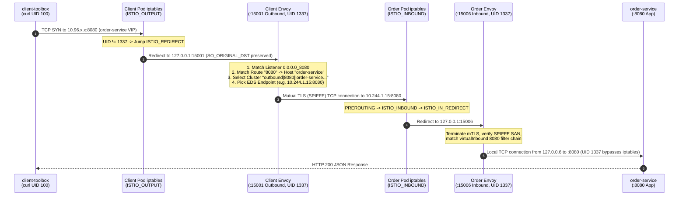

[Fellowship Portal](../README.md) | [Week 02 Guide](../fellowship/week-02-dataplane-internals-and-ambient/WEEK.md) | [Module 01 Hub (README.md)](./README.md) | [<- Lesson 01.4](./lessons/04-ambient-mode-ztunnel-and-waypoints.md) | [Next: Module 02 ->](../02-service-discovery-and-routing/README.md)

# Module 01 Lab: Inspecting Envoy `v1.40` Internals, `iptables`, xDS & Ambient Mode

> [!NOTE]
> **Execution Verification Status**
> *Statically validated against Istio `1.32.0` / Kubernetes `v1.36+` schemas. Execute the Pre-Flight and Verification steps below on your local `kind` cluster to verify runtime behavior.*

## Lab Metadata & Learning Objectives
- **Estimated Completion Time**: `45 mins`
- **Engineering Ticket Alignment**: **[Week 02 Ticket `NP-102` & Incident `INC-02`](../fellowship/week-02-dataplane-internals-and-ambient/WEEK.md)**
- **Learning Objectives**:
  1. Verify how `istiod`'s `MutatingAdmissionWebhook` mutates a Pod specification and injects `istio-init` (or `istio-validation`) and `istio-proxy` (`UID 1337`).
  2. Inspect live `iptables` NAT chains (`ISTIO_INBOUND`, `ISTIO_OUTPUT`, `ISTIO_REDIRECT`, `UID 1337` & `127.0.0.6` loop avoidance) inside a running workload's network namespace.
  3. Query Envoy's Admin API (`:15000/config_dump` and `:15000/clusters`) and use `istioctl proxy-config` (`listener`, `route`, `cluster`, `endpoint`, `secret`) to trace an exact packet path from `client-toolbox` to `order-service`.
  4. Deploy a workload in **Istio `1.32.0` Ambient Mode**, observe zero-sidecar L4 mTLS over HBONE (`:15008`) via `ztunnel`, and attach a Gateway API `v1.6.1` L7 **Waypoint Proxy**.

---

## Prerequisites & Version Baseline Pre-Flight Verification

> **Version Baseline (November 2026)**: Istio `1.32.0` | Envoy `v1.40` | Kubernetes `v1.36+` | Gateway API `v1.6.1`
> **Fellowship Reference**: **[Week 02: Data Plane Internals & Ambient Mode](../fellowship/week-02-dataplane-internals-and-ambient/WEEK.md)** | [`../VERSIONS.md`](../VERSIONS.md)

- Kubernetes `v1.36+` cluster running with Istio `1.32.0` installed (including `ztunnel` and `istio-cni` if testing Ambient Mode) from Module 00.
- The `orderflow` namespace deployed with `frontend`, `order-service` (`v1`, `v2`), `payment-service` (`v1`, `v2`), `inventory-service` (`v1`), and `client-toolbox`.
- Run the pre-flight verification check to confirm your control plane version (`1.32.0`) and verify all pods in `orderflow` show `2/2` containers ready:
  ```bash
  istioctl version
  kubectl get pods -n orderflow
  ```

---

## Architecture & Expected Traffic Flow



---

## Step-by-Step Implementation

### Step 1: Inspect `MutatingAdmissionWebhook` Injection & Pod Containers

First, apply the sidecar inspection manifest ([`manifests/sidecar-demo.yaml`](./manifests/sidecar-demo.yaml)) to ensure our baseline diagnostic resources are present:

```bash
kubectl apply -f 01-architecture-and-internals/manifests/sidecar-demo.yaml
```

Check the namespace label that triggers `istiod`'s `MutatingAdmissionWebhook`:

```bash
kubectl get namespace orderflow --show-labels
```

**Expected Output:**
```text
NAME        STATUS   AGE   LABELS
orderflow   Active   15m   istio-injection=enabled,kubernetes.io/metadata.name=orderflow
```

> [!TIP]
> **Predict Before You Execute (`securityContext` & Processes)**
> Before running the two commands below on `order-service-v1`:
> 1. What Linux `runAsUser` UID do you expect to see on the injected `istio-proxy` container?
> 2. When you run `ps aux` inside `istio-proxy`, which binary will be running as `PID 1`, and which binary will be its child process?

Now inspect the injected containers and security context of an `order-service-v1` pod:

```bash
ORDER_POD=$(kubectl get pod -n orderflow -l app=order-service,version=v1 -o jsonpath='{.items[0].metadata.name}')
kubectl get pod -n orderflow "$ORDER_POD" -o jsonpath='{range .spec.initContainers[*]}InitContainer: {.name} (RunAsUser: {.securityContext.runAsUser}, Capabilities: {.securityContext.capabilities.add}){"\n"}{end}{range .spec.containers[*]}Container: {.name} (Image: {.image}, RunAsUser: {.securityContext.runAsUser}){"\n"}{end}'
```

**Expected Output:**
```text
InitContainer: istio-init (RunAsUser: , Capabilities: ["NET_ADMIN","NET_RAW"])
Container: order-service (Image: nicholasjackson/fake-service:v0.26.2, RunAsUser: )
Container: istio-proxy (Image: docker.io/istio/proxyv2:1.32.0, RunAsUser: 1337)
```
> **Note**: If your cluster was installed with `istio-cni` enabled (or Native Sidecars `ENABLE_NATIVE_SIDECARS=true`), the initContainer will be `istio-validation` with **no** `NET_ADMIN` capability (and `istio-proxy` may appear in `initContainers` with `restartPolicy: Always`), while `RunAsUser: 1337` on `istio-proxy` remains identical!

Verify that inside the `istio-proxy` container, `pilot-agent` runs as PID 1 and spawns `envoy` (`v1.40`) as a child process:

```bash
kubectl exec -n orderflow "$ORDER_POD" -c istio-proxy -- ps aux
```

**Expected Output:**
```text
USER         PID %CPU %MEM    VSZ   RSS TTY      STAT START   TIME COMMAND
istio-p+       1  0.2  0.4 761248 41200 ?        Ssl  10:00   0:01 /usr/local/bin/pilot-agent proxy sidecar --domain orderflow.svc.cluster.local ...
istio-p+      18  0.5  0.8 892416 74120 ?        Sl   10:00   0:03 /usr/local/bin/envoy -c etc/istio/proxy/envoy-rev.json ...
```

---

### Step 2: Inspect Live `iptables` NAT Chains Inside the Pod

Let's view the exact arguments passed to `istio-iptables` and inspect the live `nat` table rules inside the pod's network namespace.

If `istio-init` ran, inspect its logs to see the exact `iptables-restore` table that was programmed:

```bash
kubectl logs -n orderflow "$ORDER_POD" -c istio-init
```

You can also view the live active `iptables` rules and packet counters using an ephemeral debug container:

```bash
kubectl debug -it -n orderflow "$ORDER_POD" --image=nicolaka/netshoot --target=istio-proxy -- iptables -t nat -L -n -v
```

**Expected Output:**
```text
Chain PREROUTING (policy ACCEPT 0 packets, 0 bytes)
 pkts bytes target     prot opt in     out     source               destination         
  142  8520 ISTIO_INBOUND  tcp  --  *      *       0.0.0.0/0            0.0.0.0/0           

Chain OUTPUT (policy ACCEPT 0 packets, 0 bytes)
 pkts bytes target     prot opt in     out     source               destination         
  215 12900 ISTIO_OUTPUT  tcp  --  *      *       0.0.0.0/0            0.0.0.0/0           

Chain ISTIO_INBOUND (1 references)
 pkts bytes target     prot opt in     out     source               destination         
    0     0 RETURN     tcp  --  *      *       0.0.0.0/0            0.0.0.0/0            tcp dpt:15008
    0     0 RETURN     tcp  --  *      *       0.0.0.0/0            0.0.0.0/0            tcp dpt:15090
   84  5040 RETURN     tcp  --  *      *       0.0.0.0/0            0.0.0.0/0            tcp dpt:15021
    2   120 RETURN     tcp  --  *      *       0.0.0.0/0            0.0.0.0/0            tcp dpt:15020
   56  3360 ISTIO_IN_REDIRECT  tcp  --  *      *       0.0.0.0/0            0.0.0.0/0           

Chain ISTIO_IN_REDIRECT (3 references)
 pkts bytes target     prot opt in     out     source               destination         
   56  3360 REDIRECT   tcp  --  *      *       0.0.0.0/0            0.0.0.0/0            redir ports 15006

Chain ISTIO_OUTPUT (1 references)
 pkts bytes target     prot opt in     out     source               destination         
   56  3360 RETURN     all  --  *      lo      127.0.0.6            0.0.0.0/0           
    0     0 ISTIO_IN_REDIRECT  all  --  *      lo      0.0.0.0/0           !127.0.0.1            owner UID match 1337
    0     0 RETURN     all  --  *      lo      0.0.0.0/0            0.0.0.0/0            ! owner UID match 1337
  112  6720 RETURN     all  --  *      *       0.0.0.0/0            0.0.0.0/0            owner UID match 1337
    0     0 ISTIO_IN_REDIRECT  all  --  *      lo      0.0.0.0/0           !127.0.0.1            owner GID match 1337
    0     0 RETURN     all  --  *      lo      0.0.0.0/0            0.0.0.0/0            ! owner GID match 1337
    0     0 RETURN     all  --  *      *       0.0.0.0/0            0.0.0.0/0            owner GID match 1337
    0     0 RETURN     all  --  *      *       0.0.0.0/0            127.0.0.1           
   47  2820 ISTIO_REDIRECT  all  --  *      *       0.0.0.0/0            0.0.0.0/0           

Chain ISTIO_REDIRECT (1 references)
 pkts bytes target     prot opt in     out     source               destination         
   47  2820 REDIRECT   tcp  --  *      *       0.0.0.0/0            0.0.0.0/0            redir ports 15001
```

---

### Step 3: Trace a Packet Through Envoy xDS (`LDS` $\rightarrow$ `RDS` $\rightarrow$ `CDS` $\rightarrow$ `EDS`)

Let's trace what happens when `client-toolbox` runs `curl http://order-service:8080`.

First, get the pod name of `client-toolbox` and the ClusterIP of `order-service`:

```bash
TOOLBOX_POD=$(kubectl get pod -n orderflow -l app=client-toolbox -o jsonpath='{.items[0].metadata.name}')
ORDER_VIP=$(kubectl get svc -n orderflow order-service -o jsonpath='{.spec.clusterIP}')
echo "Toolbox Pod: $TOOLBOX_POD | order-service ClusterIP: $ORDER_VIP"
```

> [!TIP]
> **Predict Before You Execute (xDS 4-Layer Chain)**
> Before running the `istioctl proxy-config` commands in Steps 3.1 to 3.4:
> 1. What will be the name of the RDS `Route` attached to virtual listener `0.0.0.0:8080`?
> 2. What will be the exact canonical `Cluster` name (`direction|port|subset|fqdn`) for `order-service` when no `DestinationRule` subsets exist?
> 3. How many healthy Pod IP endpoints will appear in `EDS` for `order-service` (`2` replicas of `v1` + `1` replica of `v2`)?

#### 3.1 Inspect Listeners (LDS) on `client-toolbox`

Check the virtual listeners that intercept port `15001` and port `8080`:

```bash
istioctl proxy-config listener "$TOOLBOX_POD.orderflow" --port 15001
istioctl proxy-config listener "$TOOLBOX_POD.orderflow" --port 8080
```

**Expected Output:**
```text
ADDRESS       PORT  MATCH                                     DESTINATION
0.0.0.0       15001 ALL                                       PassthroughCluster
0.0.0.0       8080  Trans: raw_buffer; App: http/1.1,h2c      Route: 8080
0.0.0.0       8080  ALL                                       PassthroughCluster
```
Notice how `0.0.0.0:8080` matches HTTP traffic (`App: http/1.1,h2c`) and sends it to **`Route: 8080`**.

#### 3.2 Inspect Routes (RDS) for Route `8080`

Now inspect `Route: 8080` on `client-toolbox`:

```bash
istioctl proxy-config route "$TOOLBOX_POD.orderflow" --name 8080
```

**Expected Output:**
```text
NAME     VHOST NAME                                       DOMAINS                                         MATCH     VIRTUAL SERVICE
8080     frontend.orderflow.svc.cluster.local:8080        frontend, frontend.orderflow + 1 more...        /*        
8080     inventory-service.orderflow.svc.cluster.local:8080 inventory-service, inventory-service.orderflow... /*        
8080     order-service.orderflow.svc.cluster.local:8080   order-service, order-service:8080 + 4 more...   /*        
8080     payment-service.orderflow.svc.cluster.local:8080 payment-service, payment-service.orderflow...   /*        
```

Let's inspect the exact JSON route definition for `order-service.orderflow.svc.cluster.local:8080` to see which Cluster it routes to:

```bash
istioctl proxy-config route "$TOOLBOX_POD.orderflow" --name 8080 -o json | grep -A 18 '"name": "order-service.orderflow.svc.cluster.local:8080"'
```

**Expected Output:**
```json
"name": "order-service.orderflow.svc.cluster.local:8080",
"domains": [
    "order-service.orderflow.svc.cluster.local",
    "order-service",
    "order-service.orderflow.svc",
    "order-service.orderflow",
    "10.96.45.12"
],
"routes": [
    {
        "match": {
            "prefix": "/"
        },
        "route": {
            "cluster": "outbound|8080||order-service.orderflow.svc.cluster.local",
            "timeout": "0s",
```

#### 3.3 Inspect Clusters (CDS) for `order-service`

Now inspect the cluster `outbound|8080||order-service.orderflow.svc.cluster.local`:

```bash
istioctl proxy-config cluster "$TOOLBOX_POD.orderflow" --fqdn order-service.orderflow.svc.cluster.local
```

**Expected Output:**
```text
SERVICE FQDN                                 PORT     SUBSET     DIRECTION     TYPE     DESTINATION RULE
order-service.orderflow.svc.cluster.local    8080     -          outbound      EDS      
```

#### 3.4 Inspect Endpoints (EDS) for `order-service`

Let's query the EDS endpoints for that cluster:

```bash
istioctl proxy-config endpoint "$TOOLBOX_POD.orderflow" --cluster "outbound|8080||order-service.orderflow.svc.cluster.local"
```

**Expected Output:**
```text
ENDPOINT            STATUS      OUTLIER CHECK     CLUSTER
10.244.1.15:8080    HEALTHY     OK                outbound|8080||order-service.orderflow.svc.cluster.local
10.244.1.16:8080    HEALTHY     OK                outbound|8080||order-service.orderflow.svc.cluster.local
10.244.2.18:8080    HEALTHY     OK                outbound|8080||order-service.orderflow.svc.cluster.local
```

#### 3.5 Query Envoy's `:15000` Admin Interface Directly

Under the hood, `istioctl proxy-config` queries Envoy's `:15000/config_dump` endpoint. Run a direct query against `127.0.0.1:15000` inside `client-toolbox` to see live cluster connection and request counters:

```bash
kubectl exec -n orderflow "$TOOLBOX_POD" -c toolbox -- curl -s http://order-service:8080 > /dev/null
kubectl exec -n orderflow "$TOOLBOX_POD" -c istio-proxy -- pilot-agent request GET clusters | grep "outbound|8080||order-service.orderflow.svc.cluster.local::" | head -n 15
```

**Expected Output:**
```text
outbound|8080||order-service.orderflow.svc.cluster.local::default_priority::max_connections::4294967295
outbound|8080||order-service.orderflow.svc.cluster.local::10.244.1.15:8080::rq_active::0
outbound|8080||order-service.orderflow.svc.cluster.local::10.244.1.15:8080::rq_total::1
outbound|8080||order-service.orderflow.svc.cluster.local::10.244.1.15:8080::health_flags::healthy
outbound|8080||order-service.orderflow.svc.cluster.local::10.244.1.16:8080::rq_total::0
```

#### 3.6 Inspect Inbound Listener (`15006`) on the Server (`order-service`)

Now inspect how `order-service` receives the request on `virtualInbound` (`15006`):

```bash
istioctl proxy-config listener "$ORDER_POD.orderflow" --port 15006
```

**Expected Output:**
```text
ADDRESS     PORT  MATCH                                                                                           DESTINATION
0.0.0.0     15006 Addr: *:15006                                                                                   Non-HTTP/Non-TCP
0.0.0.0     15006 Trans: tls; App: istio-http/1.0,istio-http/1.1,istio-h2; Addr: 0.0.0.0/0:8080                   InboundPassthroughClusterIpv4
0.0.0.0     15006 Trans: raw_buffer; App: http/1.1,h2c; Addr: 0.0.0.0/0:8080                                      InboundPassthroughClusterIpv4
```

---

### Step 4: Exploring Ambient Mode (`ztunnel` + Waypoint Proxy)

Now let's compare Sidecar Mode with **Istio `1.32.0` Ambient Mode** by deploying an isolated `orderflow-ambient` namespace using [`manifests/ambient-demo.yaml`](./manifests/ambient-demo.yaml).

> **Prerequisite Check**: Verify that the `ztunnel` DaemonSet is running in `istio-system`:
> ```bash
> kubectl get daemonset -n istio-system ztunnel
> ```
> *(If `ztunnel` is not installed yet, you can enable ambient components alongside your existing control plane or inspect the manifests and verification flow below).*

> [!TIP]
> **Predict Before You Execute (`kubectl get pods -n orderflow-ambient`)**
> When you apply `ambient-demo.yaml`, the `orderflow-ambient` namespace has `istio.io/dataplane-mode: ambient` instead of `istio-injection: enabled`.
> - What will the `READY` column show for `ambient-client` and `ambient-order-service` (`1/1` or `2/2`)?
> - Which component on the node will hold the SPIFFE X.509 certificates for `ambient-client-sa` and `ambient-order-sa`?

Apply the Ambient Mode demo manifest:

```bash
kubectl apply -f 01-architecture-and-internals/manifests/ambient-demo.yaml
```

Inspect the pods in `orderflow-ambient`:

```bash
kubectl get pods -n orderflow-ambient -o wide
```

**Expected Output:**
```text
NAME                                   READY   STATUS    RESTARTS   AGE   IP            NODE
ambient-client-6b8d7f9c4-x92lk         1/1     Running   0          20s   10.244.1.22   istio-course-worker
ambient-order-service-7c9f5b4d-m81pq   1/1     Running   0          20s   10.244.1.23   istio-course-worker
orderflow-waypoint-5d8f9c7b6-k29vz     1/1     Running   0          20s   10.244.1.24   istio-course-worker
```

Look closely at the `READY` column for `ambient-client` and `ambient-order-service`: **`1/1`**! There is **no `istio-proxy` sidecar container** inside either pod.

Now verify how `ztunnel` tracks these workloads and enforces mTLS over HBONE (`:15008`):

```bash
istioctl ztunnel-config workloads
```

**Expected Output:**
```text
NAMESPACE          POD NAME                               IP            NODE                  WAYPOINT           PROTOCOL
orderflow          client-toolbox-...                     10.244.1.12   istio-course-worker   None               Istio
orderflow          order-service-v1-...                   10.244.1.15   istio-course-worker   None               Istio
orderflow-ambient  ambient-client-6b8d7f9c4-x92lk         10.244.1.22   istio-course-worker   orderflow-waypoint HBONE
orderflow-ambient  ambient-order-service-7c9f5b4d-m81pq   10.244.1.23   istio-course-worker   orderflow-waypoint HBONE
```

Send a test request from `ambient-client` to `ambient-order-service` and check the `ztunnel` logs to see the L4 HBONE mTLS connection in action:

```bash
kubectl exec -n orderflow-ambient deploy/ambient-client -- curl -s http://ambient-order-service:8080 | head -n 12
kubectl logs -n istio-system -l app=ztunnel --tail=10
```

**Expected Output (`ztunnel` logs):**
```text
2026-11-17T15:50:12.114Z info access connection complete src.addr=10.244.1.22:48210 src.workload="ambient-client-6b8d7f9c4-x92lk" src.namespace="orderflow-ambient" src.identity="spiffe://cluster.local/ns/orderflow-ambient/sa/ambient-client-sa" dst.addr=10.244.1.24:15008 dst.hbone_addr=10.96.114.88:8080 dst.workload="orderflow-waypoint-5d8f9c7b6-k29vz" direction="outbound" bytes_sent=145 bytes_recv=312 duration="2ms"
```

---

## Step 5: Troubleshooting & Failure Injection Exercises (`INC-02`)

### Exercise 1: Diagnose the `503 UF` Loopback Binding Failure (`127.0.0.1` vs. `0.0.0.0`)
In NovaPay Incident `INC-02`, a developer deploys a new diagnostic pod in `orderflow` whose HTTP server binds strictly to `127.0.0.1:8080` (`LISTEN_ADDR=127.0.0.1:8080`) instead of `0.0.0.0:8080`. When `client-toolbox` calls the service, Envoy returns:
`HTTP/1.1 503 Service Unavailable — upstream connect error or disconnect/reset before headers. reset reason: connection failure` (`Response Flag: UF`).

Why does binding to `127.0.0.1:8080` cause a `503 UF` when Envoy's `InboundPassthroughClusterIpv4` forwards traffic from `:15006` to the application container? Try to diagnose it before opening the progressive hints!

<details>
<summary>Hint 1: Where to look</summary>

Check which IP address Envoy's `virtualInbound` (`:15006`) targets when forwarding an incoming request to the application container (`127.0.0.1:8080` vs. the Pod's `eth0` IP `10.244.x.x:8080`). You can inspect the inbound cluster behavior on `order-service-v1`.
</details>

<details>
<summary>Hint 2: Diagnostic command</summary>

Run:
```bash
istioctl proxy-config listener "$ORDER_POD.orderflow" --port 15006 -o json | grep -A 10 "InboundPassthroughCluster"
```
Notice that `InboundPassthroughClusterIpv4` forwards the connection to the original destination IP on the packet—which is the **Pod IP (`10.244.x.x:8080`)**, using source IP `127.0.0.6`!
</details>

<details>
<summary>Full Explanation & Solution</summary>

**Root Cause:**
When a client calls `order-service`, the client Envoy connects to the server pod's **Pod IP (`10.244.1.15:8080`)**. Inside the server pod, `ISTIO_IN_REDIRECT` redirects the packet to `127.0.0.1:15006`, preserving `SO_ORIGINAL_DST = 10.244.1.15:8080`.
By default, Envoy's `InboundPassthroughClusterIpv4` connects to `SO_ORIGINAL_DST` (`10.244.1.15:8080`) from source IP `127.0.0.6`. If the application process only bound to `127.0.0.1:8080` instead of `0.0.0.0:8080`, the Linux kernel rejects packets addressed to `10.244.1.15:8080` with TCP `RST`, causing Envoy to return `503 UF`!

**Fix:**
1. **Recommended**: Configure the application to bind to `0.0.0.0:8080` (`LISTEN_ADDR=0.0.0.0:8080`).
2. **Workaround (if legacy binary cannot be changed)**: Attach a `Sidecar` CRD to the workload with `ingress.defaultEndpoint: 127.0.0.1:8080` so Envoy explicitly translates the inbound target from the Pod IP to `127.0.0.1:8080`.
</details>

---

### Exercise 2: Why Did My New Pod Come Up `1/1` Instead of `2/2` in Sidecar Mode?
Suppose a team deploys a workload in a namespace, and the pod comes up `1/1` without `istio-proxy`. Walk through the progressive hints to build a 4-point diagnostic checklist:

<details>
<summary>Hint 1: Where to look</summary>

Check 4 places in order:
1. Namespace labels
2. Pod template labels/annotations
3. Pod `spec.hostNetwork`
4. API Server $\rightarrow$ `istiod:15017` webhook reachability
</details>

<details>
<summary>Hint 2: Diagnostic commands</summary>

```bash
kubectl get ns <namespace> --show-labels
kubectl get pod <pod> -n <namespace> -o yaml | grep -E "sidecar.istio.io/inject|hostNetwork"
kubectl get mutatingwebhookconfigurations istio-sidecar-injector
```
</details>

<details>
<summary>Full Explanation & Solution</summary>

The 4 root causes of missing sidecar injection are:
1. **Missing Namespace Label**: `istio-injection=enabled` (or `istio.io/rev=<tag>`) is missing on the namespace.
2. **Pod Label/Annotation Override**: `sidecar.istio.io/inject: "false"` is set on the Pod template metadata.
3. **`hostNetwork: true`**: Istio intentionally refuses to inject a sidecar into pods with `spec.hostNetwork: true` because programming `iptables` in the node's root network namespace would hijack all node traffic!
4. **Firewall Blocking `:15017`**: In private cloud clusters (EKS/GKE), if control plane firewall rules block `kube-apiserver` from reaching `istiod` on TCP port `15017`, webhook calls time out.
</details>

---

## Step 6: Cleanup / Reset Procedure

Clean up the temporary resources from `sidecar-demo.yaml` and `ambient-demo.yaml` so your cluster returns to the clean baseline `orderflow` state for Module 02:

```bash
kubectl delete -f 01-architecture-and-internals/manifests/ambient-demo.yaml --ignore-not-found
kubectl delete -f 01-architecture-and-internals/manifests/sidecar-demo.yaml --ignore-not-found
kubectl get pods -n orderflow
```

Confirm all 9 baseline pods in `orderflow` are `2/2 Running`.

---

## Production Considerations (Alex, Sarah & Maya's Checklist)

1. **Enforce `istio-cni` in Production Clusters**:
   Never grant `NET_ADMIN` or `NET_RAW` capabilities to application pods via `istio-init` in multi-tenant or PCI-DSS clusters. Enable `istio-cni` so network namespace redirection happens at the CNI layer under `PodSecurityStandards: restricted`.
2. **Monitor `istiod` xDS Push Latency & `STALE` Proxies**:
   Alert on Prometheus metric `pilot_xds_push_time` and `pilot_total_xds_rejects`. If `istioctl proxy-status` shows `STALE`, an Envoy proxy has failed to acknowledge (`ACK`) an xDS update from `istiod`.
3. **Plan `ztunnel` DaemonSet Upgrades with Node-Level Drain Discipline**:
   When running Ambient Mode, remember that restarting a `ztunnel` pod resets active L4 connections on that node. Roll `ztunnel` DaemonSet updates gradually (`maxUnavailable: 1`) during maintenance windows or alongside node drains.

---

## Next Step
Proceed to **[Module 02: Service Discovery, Traffic Routing (`VirtualService` & `DestinationRule`) & Mesh Scaling (`Sidecar`) ->](../02-service-discovery-and-routing/README.md)**!
