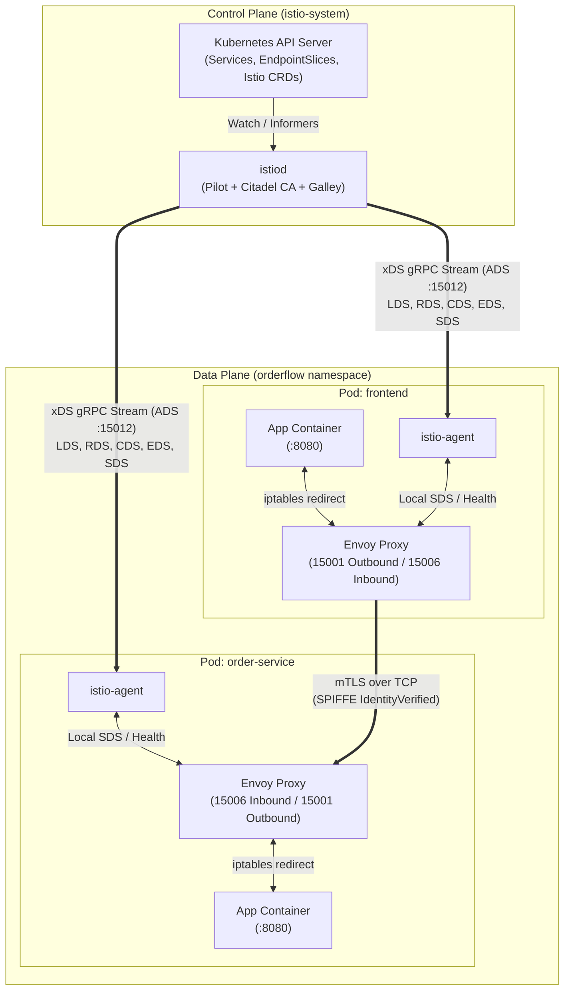

# Module 01: Istio Architecture, Envoy Internals & Dataplane Modes

## 1. Why a Service Mesh Exists

In a distributed microservices architecture like **OrderFlow**, every network call between `frontend`, `order-service`, `payment-service`, and `inventory-service` crosses an unreliable L3/L4 container network. Without a service mesh, application developers must embed resilience, security, and observability logic directly into every service using language-specific libraries (e.g., Netflix Hystrix/Resilience4j, gRPC interceptors, custom TLS reloaders):

1. **Inconsistent Implementation**: A Go service (`order-service`), a Java service (`payment-service`), and a Python service (`inventory-service`) implement retry backoff, circuit breaking, and distributed tracing differently.
2. **Operational Coupling**: Updating a TLS root certificate, changing a timeout, or rotating a JWT signing key requires rebuilding and redeploying application binaries.
3. **Lack of L7 Visibility in Kubernetes**: Standard Kubernetes `Service` and `kube-proxy` operate strictly at Layer 4 (TCP/UDP). `kube-proxy` has no concept of HTTP status codes (`503 Service Unavailable`), HTTP headers (`x-user-tier: vip`), gRPC stream multiplexing, or cryptographic workload identity.

**Istio** solves this by decoupling network infrastructure behavior from application code, moving L4/L7 traffic management, cryptographic identity (mTLS), and telemetry out-of-process into programmable network proxies.

---

## 2. Control Plane vs. Data Plane Architecture

Istio is split into two distinct planes:

### 2.1 The Control Plane (`istiod`)

Prior to Istio 1.5, the control plane was fragmented into separate microservices (`istio-pilot`, `istio-citadel`, `istio-galley`, `istio-sidecar-injector`). Modern Istio consolidates all control plane responsibilities into a single binary: **`istiod`**.

| Sub-Component | Role Inside `istiod` | How It Works Under the Hood |
| :--- | :--- | :--- |
| **Pilot** | Service discovery & xDS configuration translator | Watches Kubernetes `Service`, `EndpointSlice`, `Pod`, and Istio networking CRDs (`VirtualService`, `DestinationRule`, `Gateway`, `ServiceEntry`). Compiles this high-level state into low-level Envoy xDS protobuf configurations and pushes them over a bidirectional gRPC stream (`:15012`). |
| **Citadel (CA)** | Public Key Infrastructure (PKI) & Identity | Acts as an X.509 Certificate Authority. Validates Certificate Signing Requests (CSRs) from `istio-agent` (authenticated via Kubernetes projected `ServiceAccount` JWT tokens) and issues short-lived SPIFFE X.509 workload certificates via SDS. |
| **Galley** | Configuration validation & ingestion | Runs as a Kubernetes `ValidatingAdmissionWebhook` to reject malformed Istio CRDs at `kubectl apply` time before they can corrupt the mesh state. |
| **Sidecar Injector** | Mutating Admission Webhook | Intercepts `Pod` creation requests matching labeled namespaces (`istio-injection=enabled`) and patches the pod spec with `istio-init` (or `istio-validation`) and the `istio-proxy` container. |

### 2.2 The Data Plane (`istio-proxy` = `istio-agent` + `envoy`)

Inside every sidecar-injected pod, the `istio-proxy` container actually runs two processes:

1. **`pilot-agent` (`istio-agent`)**: PID 1 inside the `istio-proxy` container. It bootstraps Envoy, manages its lifecycle, generates private keys in memory, requests X.509 certificates from `istiod` over SDS, caches DNS queries (when DNS capture is enabled), and scrapes/merges Prometheus metrics.
2. **`envoy`**: A high-performance C++ L4/L7 proxy spawned as a child process by `pilot-agent`. All actual data plane network packets flow through Envoy.

---

## 3. Envoy Proxy Internals & The xDS API

To operate or debug Istio in production, you must understand how Envoy processes a packet and how `istiod` programs it dynamically via the **xDS (Discovery Service)** protocol over **ADS (Aggregated Discovery Service)**.

### 3.1 The Envoy Packet Processing Pipeline

```mermaid
flowchart LR
    Downstream["Downstream<br/>(Caller / App)"] --> Listener["1. Listener (LDS)<br/>VirtualInbound :15006<br/>VirtualOutbound :15001"]
    Listener --> FilterChain["2. Filter Chain Match<br/>IP / Port / ALPN / SNI"]
    FilterChain --> NetFilter["3. Network Filters<br/>http_connection_manager<br/>or tcp_proxy"]
    NetFilter --> HTTPFilters["4. HTTP Filters<br/>jwt_authn, rbac, fault,<br/>cors, router"]
    HTTPFilters --> Route["5. Route Table (RDS)<br/>VirtualHost + Match Rules<br/>(Host, Path, Headers)"]
    Route --> Cluster["6. Cluster (CDS)<br/>outbound|8080|v1|order-service<br/>(Circuit Breakers, mTLS, LB Policy)"]
    Cluster --> Endpoint["7. Endpoint (EDS)<br/>Pod IP 10.244.1.15:8080"]
    Endpoint --> Upstream["Upstream<br/>(Target Pod)"]
```

1. **Listeners (LDS — Listener Discovery Service)**:
   Named network locations (IP + Port) where Envoy accepts connections. In Istio sidecar mode, Envoy creates two primary virtual listeners (`virtualOutbound` on `0.0.0.0:15001` and `virtualInbound` on `0.0.0.0:15006`) with `use_original_dst: true`. When `iptables` redirects a packet originally destined for `10.96.45.12:8080` to `15001`, Envoy inspects the kernel's `SO_ORIGINAL_DST` socket option and hands the connection off to the internal virtual listener matching `0.0.0.0_8080` or `10.96.45.12_8080`.
2. **Filter Chains & Network Filters**:
   Each listener contains one or more Filter Chains selected by matching criteria (`destination_port`, `prefix_ranges`, `transport_protocol`, `application_protocols` like `istio-peer-exchange` or `h2`). The selected chain runs L4 filters such as `envoy.filters.network.tcp_proxy` (for raw TCP/databases) or `envoy.filters.network.http_connection_manager` (HCM, for HTTP/1.1, HTTP/2, and gRPC).
3. **HTTP Filters**:
   Inside the `http_connection_manager`, an ordered chain of L7 filters inspects and mutates requests: `envoy.filters.http.jwt_authn` (validates JWTs), `envoy.filters.http.rbac` (enforces `AuthorizationPolicy`), `envoy.filters.http.fault` (injects delays/aborts), and finally `envoy.filters.http.router` (executes routing and retries).
4. **Routes (RDS — Route Discovery Service)**:
   Linked dynamically to an HCM listener (e.g., route config `8080`). Contains `VirtualHosts` matching the HTTP `Host` / `:authority` header (e.g., `order-service.orderflow.svc.cluster.local:8080`) and ordered route rules matching paths, headers, or query parameters, forwarding to a target **Cluster** (or weighted set of clusters).
5. **Clusters (CDS — Cluster Discovery Service)**:
   Logical upstream service definitions. Istio names clusters using the format `direction|port|subset|hostname`, such as:
   `outbound|8080|v1|order-service.orderflow.svc.cluster.local`
   A Cluster defines connection pool limits, outlier detection (passive health checking), load balancing algorithm (`ROUND_ROBIN`, `LEAST_REQUEST`), and upstream TLS context (mTLS settings).
6. **Endpoints (EDS — Endpoint Discovery Service)**:
   The concrete Pod IP:Port members belonging to a Cluster (e.g., `10.244.1.18:8080`), along with locality metadata (region/zone) and health status, watched directly from Kubernetes `EndpointSlice` objects.
7. **Secrets (SDS — Secret Discovery Service)**:
   Delivers X.509 certificates, private keys, and trusted CA bundles over a local Unix Domain Socket from `istio-agent` to Envoy without ever writing private keys to disk.

### 3.2 Why ADS (Aggregated Discovery Service) Matters

If Envoy fetched LDS, RDS, CDS, and EDS over independent gRPC streams, updates would race. For example, if a new `Route` (RDS) referencing cluster `outbound|8080|v2|order-service` arrived *before* the `Cluster` (CDS) was created, Envoy would drop traffic with `503 NR`.
**ADS** multiplexes all xDS APIs over a single ordered gRPC stream (`Delta-xDS` or `State-of-the-World xDS`), allowing `istiod` to sequence updates safely:
`CDS (Clusters) -> EDS (Endpoints) -> LDS (Listeners) -> RDS (Routes)`.

---

## 4. Traffic Interception Deep Dive: `iptables` & Ports

How does a standard container (`frontend`) calling `http://order-service:8080` get transparently intercepted by Envoy without changing application code or `localhost` configurations?

### 4.1 Injection Mechanisms: `istio-init` vs. `istio-cni`

| Feature | `istio-init` (Default InitContainer) | `istio-cni` (Kubernetes CNI Plugin) |
| :--- | :--- | :--- |
| **How it works** | Runs as an `initContainer` inside every pod before app containers start, executing `pilot-agent istio-iptables` to program the pod's network namespace. | Runs as a privileged node-level `DaemonSet` plugged into the CNI chain. Programs the pod's network namespace during CNI pod sandbox setup. |
| **Linux Capabilities Required** | Requires `NET_ADMIN` and `NET_RAW` on the `istio-init` container inside *every* workload pod. | Workload pods require **zero** elevated capabilities (`NET_ADMIN`/`NET_RAW` only exist on the `istio-cni` node DaemonSet). |
| **Production Security Compliance** | Often blocked by strict enterprise PodSecurityStandards (`restricted`) or OPA Gatekeeper policies. | **Production Recommended** for multi-tenant clusters with strict security policies and required for **Ambient Mode**. |

### 4.2 Exact `iptables` NAT Chains & Loop Avoidance

When `istio-iptables` runs inside a pod's network namespace, it programs the `nat` table. Crucially, the `istio-proxy` container runs as Linux User ID (UID) **`1337`**.

Let's trace the exact chains in `iptables -t nat`:

1. **`PREROUTING` -> `ISTIO_INBOUND`**:
   Every TCP packet arriving at the pod's network interface enters `PREROUTING` and jumps to `ISTIO_INBOUND`.
   - Packets destined for SSH (`22`) or Istio operational ports (`15090` Prometheus, `15021` health check, `15020` telemetry) hit `RETURN` and go directly to the listening process.
   - All other inbound TCP traffic (e.g., to `:8080`) jumps to `ISTIO_IN_REDIRECT`, which rewrites the destination to `127.0.0.1:15006` (`virtualInbound`).
2. **Inbound Loop Avoidance (`ISTIO_OUTPUT`)**:
   Once Envoy receives the request on `15006`, verifies mTLS and RBAC policies, it opens a local TCP connection to the application on `127.0.0.1:8080` (or the pod IP `:8080`). Because this local connection originates within the pod, it traverses the kernel's `OUTPUT` -> `ISTIO_OUTPUT` chain.
   - Rule in `ISTIO_OUTPUT`: If outgoing interface is `lo` (`-o lo`) and `--uid-owner 1337`, `RETURN` (let it reach the app without redirecting back to `15001` or `15006`!).
3. **`OUTPUT` -> `ISTIO_OUTPUT` -> `ISTIO_REDIRECT`**:
   When the application container (running as e.g. UID `1000`) makes an outbound TCP call to `order-service` (`10.96.45.12:8080`), it hits `OUTPUT` -> `ISTIO_OUTPUT`:
   - It is *not* UID `1337`, and it is *not* destined for `127.0.0.1`, so it jumps to `ISTIO_REDIRECT`, which rewrites the destination to `127.0.0.1:15001` (`virtualOutbound`).
   - Envoy processes the request on `15001` and opens an outbound socket to the upstream pod IP (`10.244.2.9:8080`). Because Envoy runs as `--uid-owner 1337`, its outbound packet hits the `UID 1337 -> RETURN` rule in `ISTIO_OUTPUT` and leaves `eth0` untouched.

### 4.3 Reference Table of Istio & Envoy Ports

| Port | Process | Direction | Protocol | Purpose |
| :--- | :--- | :--- | :--- | :--- |
| **`15000`** | `envoy` | Localhost (`127.0.0.1`) | HTTP | Envoy Admin Interface (`/config_dump`, `/clusters`, `/stats`, `/logging`). Never exposed outside the pod. |
| **`15001`** | `envoy` | Pod-internal (`iptables`) | TCP/HTTP | `virtualOutbound` listener. Captures all outbound application traffic redirected by `ISTIO_REDIRECT`. |
| **`15006`** | `envoy` | Inbound (`iptables`) | TCP/HTTP/mTLS | `virtualInbound` listener. Captures all inbound traffic entering the pod redirected by `ISTIO_IN_REDIRECT`. |
| **`15008`** | `envoy` / `ztunnel` | Inbound | HBONE (mTLS/HTTP2) | **HBONE (HTTP-Based Overlay Network Environment)** tunnel port used by Istio Ambient mode and multi-network gateways. |
| **`15010`** | `istiod` | Control Plane | gRPC (Plaintext) | Unencrypted xDS discovery and CA service port (debugging only; disabled/unused in production). |
| **`15012`** | `istiod` | Control Plane | gRPC (TLS/mTLS) | Production xDS discovery and CA service port used by `istio-agent` to connect to `istiod`. |
| **`15014`** | `istiod` | Control Plane | HTTP | Control plane monitoring and Prometheus metrics port for `istiod`. |
| **`15017`** | `istiod` | Control Plane | HTTPS | Kubernetes Mutating & Validating Admission Webhook server port. |
| **`15020`** | `pilot-agent` | Inbound | HTTP | Merged Prometheus telemetry (combines Envoy stats, agent stats, and application metrics if configured) + Kubelet probe rewriting target. |
| **`15021`** | `envoy` / `agent` | Inbound | HTTP | Health check endpoint (`/healthz/ready`). Kubelet checks this to verify Envoy is live and ready to accept traffic. |
| **`15090`** | `envoy` | Inbound | HTTP | Raw Envoy Prometheus telemetry (`/stats/prometheus`). |

---

## 5. Dataplane Modes: Sidecar Mode vs. Ambient Mode

Historically, Istio required injecting an Envoy sidecar container into every single pod. While powerful, Sidecar Mode introduces operational and resource challenges at scale, which led to the creation of **Istio Ambient Mode** (GA in Istio 1.22+).

### 5.1 Architectural Comparison

```mermaid
flowchart TB
    subgraph SidecarMode["Sidecar Mode (Per-Pod L4 + L7 Proxy)"]
        direction LR
        subgraph SPod1["Pod A"]
            SApp1["App A"] --> SEnvoy1["Envoy Sidecar<br/>(L4 mTLS + L7 HTTP)"]
        end
        subgraph SPod2["Pod B"]
            SEnvoy2["Envoy Sidecar<br/>(L4 mTLS + L7 HTTP)"] --> SApp2["App B"]
        end
        SEnvoy1 ===>|"mTLS"| SEnvoy2
    end

    subgraph AmbientMode["Ambient Mode (Decoupled L4 ztunnel + Optional L7 Waypoint)"]
        direction LR
        subgraph Node1["Node 1"]
            APod1["Pod A<br/>(No Sidecar Container!)"]
            Z1["ztunnel DaemonSet<br/>(Rust L4 Proxy: mTLS, SPIFFE, L4 Authz/Metrics)"]
            APod1 -->|"in-pod netns redirect"| Z1
        end

        subgraph WaypointScope["Namespace / Service Scope (Optional)"]
            WP["Waypoint Proxy (Envoy)<br/>(L7 Only: VirtualService, L7 Authz, Retries)"]
        end

        subgraph Node2["Node 2"]
            Z2["ztunnel DaemonSet<br/>(Rust L4 Proxy)"]
            APod2["Pod B<br/>(No Sidecar Container!)"]
            Z2 -->|"in-pod netns redirect"| APod2
        end

        Z1 ===>|"Path 1 (L4 Only): Direct HBONE mTLS :15008"| Z2
        Z1 -.->|"Path 2 (If Waypoint Exists): HBONE :15008"| WP
        WP -.->|"HBONE mTLS :15008"| Z2
    end
```

### 5.2 How Ambient Mode Works Under the Hood

Ambient Mode splits the mesh data plane into two distinct layers:

1. **The Secure Overlay Layer (L4) — `ztunnel` (Zero-Trust Tunnel)**:
   - Runs as a per-node Kubernetes `DaemonSet` written in **Rust** (purpose-built to be ultra-lightweight, fast, and memory-safe, rather than running a full general-purpose Envoy in every pod).
   - Manages workload identities: a single `ztunnel` instance on a node multiplexes SDS certificate requests on behalf of *all* local ambient pods on that node, holding their private keys and SPIFFE certificates in memory.
   - **In-Pod Redirection via `istio-cni`**: When an ambient pod starts (or is labeled dynamically while running!), `istio-cni` enters the pod's Linux network namespace, creates a listening socket inside the pod's netns, and configures `iptables` inside the pod to redirect traffic to that socket, which is serviced directly by the node's `ztunnel` process.
   - **HBONE Protocol (`:15008`)**: `ztunnel` wraps all pod-to-pod traffic in **HBONE (HTTP-Based Overlay Network Environment)** — multiplexing TCP streams as `HTTP/2 CONNECT` tunnels over mTLS on port `15008`. This provides cryptographic SPIFFE identity, L4 encryption, L4 `AuthorizationPolicy` enforcement, and L4 TCP metrics (`istio_tcp_*`) with near-zero overhead.
2. **The L7 Processing Layer — Waypoint Proxies**:
   - Most microservices in a cluster only need mTLS and L4 authorization, or only need L7 features on the *server* side.
   - When you need L7 capabilities (`VirtualService` header routing, retries, fault injection, L7 `AuthorizationPolicy` on HTTP paths/methods, or L7 Prometheus metrics `istio_requests_total`), you deploy a **Waypoint Proxy** using the Kubernetes Gateway API (`gatewayClassName: istio-waypoint`) scoped to a namespace or specific service.
   - `istiod` informs every `ztunnel` via xDS (`Address`/`Workload` protobufs) that traffic destined for `order-service` must first pass through its Waypoint VIP before reaching the destination node's `ztunnel`.

### 5.3 Deep Comparison & Production Trade-Offs

| Dimension | Sidecar Mode (`envoy` per pod) | Ambient Mode (`ztunnel` + Waypoint) |
| :--- | :--- | :--- |
| **Pod Restart Required to Join Mesh?** | **Yes.** MutatingWebhook only runs at Pod creation time. Enrolling existing workloads requires rolling restarts. | **No.** Labelling a namespace `istio.io/dataplane-mode=ambient` dynamically instructs `istio-cni` + `ztunnel` to intercept running pods live with zero restarts. |
| **Memory & CPU Footprint** | Scales linearly with **Pod count** ($O(N_{pods})$). Even idle pods reserve 50–100MB RAM for an Envoy instance holding cluster state. | `ztunnel` scales with **Node count** (~30MB RAM per node). Waypoints scale with **L7 traffic volume** per namespace/service. Often saves **70–90% memory** at scale. |
| **CVE Patching & Upgrades** | Upgrading Envoy requires restarting *every application pod* across the entire cluster. | `ztunnel` and Waypoint proxies are upgraded independently via DaemonSet/Deployment rollouts without restarting application pods. |
| **Kubernetes `Job` / InitContainer Compatibility** | Infamous lifecycle race conditions: `Job` pods stay `Running` forever because `istio-proxy` doesn't exit when the batch container finishes (until Kubernetes Native Sidecars `restartPolicy: Always` in K8s 1.29+), and `initContainers` run before `istio-proxy` starts. | **Zero lifecycle friction.** Since there is no container injected into the pod spec, `Jobs` exit cleanly and `initContainers` automatically get mesh connectivity. |
| **L7 Hop Count & Latency** | **2 Envoys on every call** (Client Sidecar parses L7 + Server Sidecar parses L7), even if only L4 mTLS is needed. | **0 Envoys** if only L4 mTLS/Authz is used (`ztunnel` -> `ztunnel`). **1 Envoy** (Server Waypoint) when L7 policies are active. |
| **Blast Radius** | **Single Pod.** If an Envoy sidecar crashes or OOMs, only that single pod replica is impacted. | **Node-wide (`ztunnel`) or Namespace-wide (`Waypoint`).** A bug or crash in `ztunnel` affects all ambient pods on that Kubernetes node. |
| **Feature Completeness** | Supports 100% of legacy Istio features, client-side `EnvoyFilter` lua/Wasm customizations, and outbound client-specific overrides. | Waypoints are **destination-oriented (server-side)** proxies. Arbitrary client-side `EnvoyFilter` hacks are intentionally not supported on `ztunnel`. |

---

## 6. Common Production Failure Modes in Module 01

1. **Application Calls `localhost` Directly**:
   If a container tries to communicate with another container in the same pod over `127.0.0.1`, `ISTIO_OUTPUT` explicitly skips redirecting loopback traffic (`-d 127.0.0.1/32 -j RETURN`). However, if an application binds strictly to `127.0.0.1:8080` instead of `0.0.0.0:8080`, inbound traffic arriving through Envoy (`15006`) works in newer Istio versions, *except* when Kubelet probes or direct Pod IP health checks try to reach the container. Always bind application servers to `0.0.0.0`.
2. **Application Runs as UID `1337`**:
   If a developer builds a Dockerfile with `USER 1337`, `ISTIO_OUTPUT` mistakes the application process for Envoy (`--uid-owner 1337 -j RETURN`). All outbound traffic from that application will completely bypass the Envoy sidecar!
3. **Protocol Detection Failures (Server-First Protocols)**:
   For protocols like MySQL, MongoDB, or SMTP where the *server* sends the first bytes upon TCP handshake before the client speaks, if the Kubernetes `Service` port is not named (`name: tcp-mysql` or `appProtocol: tcp`), Envoy's `virtualOutbound` listener waits for the client to send HTTP bytes to sniff the protocol, causing a deadlock until connection timeout. Always prefix Kubernetes Service port names (`http-web`, `grpc-api`, `tcp-db`) or set `appProtocol`.
