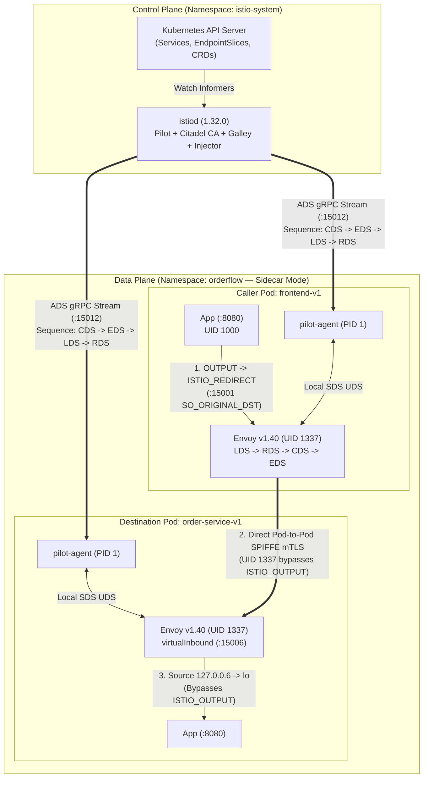
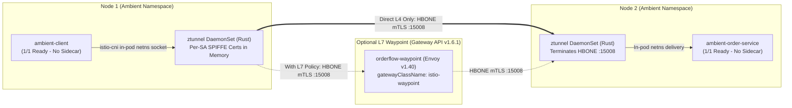

[Fellowship Portal](../README.md) | [Week 02 Guide](../fellowship/week-02-dataplane-internals-and-ambient/WEEK.md) | [<- Module 00](../00-environment-setup/README.md) | [Guided Lab (LAB.md)](./LAB.md) | [Next: Module 02 ->](../02-service-discovery-and-routing/README.md)

# Module 01: Istio Architecture, Envoy Internals & Dataplane Modes (`Sidecar` vs. `Ambient`)

> **Version & Fellowship Context**
> - **Authoritative Baseline**: Istio `1.32.0` | Envoy `v1.40` | Kubernetes `v1.36+` | Gateway API `v1.6.1` — see [`../VERSIONS.md`](../VERSIONS.md) and [`../COMPATIBILITY.md`](../COMPATIBILITY.md).
> - **Fellowship Cohort 01 Mapping**: Complete this module alongside **[Week 02: Data Plane Internals & Ambient Mode (`NP-102`)](../fellowship/week-02-dataplane-internals-and-ambient/WEEK.md)**.
> - **Estimated Completion Time**: `1 hour 50 mins` across 4 progressive lessons (`25–30 mins` each) + `45 mins` Guided Lab (`LAB.md`).
> - **Prerequisites**: Completed [Module 00 (`README.md` & `LAB.md`)](../00-environment-setup/README.md) with the 4-node cluster and `orderflow` baseline pods running (`2/2 READY`).

---

## 1. NovaPay Engineering Context & Alex Morgan's Module 01 Briefing

### 1.1 What Is Happening at NovaPay?
Last week in Module 00 (`NP-101`), you provisioned NovaPay's multi-zone Kubernetes `v1.36+` cluster, installed Istio `1.32.0`, and onboarded the `orderflow` checkout pipeline. Now, in **Week 02 (`NP-102` & `INC-02`)**, we face two critical engineering missions:
1. **Operational Mastery of the Envoy Data Plane**: When a payment authorization call fails in production, you must be able to prove within seconds whether the failure occurred in Linux `iptables` redirection (`UID 1337` / `127.0.0.6`), at an Envoy virtual listener (`:15001` / `:15006`), or inside Envoy's 7-stage xDS pipeline (`LDS -> RDS -> CDS -> EDS -> SDS`).
2. **Sidecar Mode vs. Ambient Mode Architecture Decision**: Daniel Brooks's backend team runs high-density nightly merchant settlement `Job` pods (`orderflow-batch`), where per-pod Envoy sidecars consume 18 GB of RAM. Leadership tasked us with evaluating **Istio `1.32.0` Ambient Mode** (`ztunnel` + Gateway API `istio-waypoint`) against Sidecar Mode (including Kubernetes `1.36` Native Sidecar Containers `KEP-753`).

### 1.2 Alex Morgan's Briefing

> **Alex Morgan (Senior Platform Engineer — Mentor Briefing)**
> *"In Module 01, we take the hood off the engine. Most engineers treat Envoy and `iptables` like a haunted forest—they apply a YAML file, pray it works, and panic when they see `503 UF` or `503 NR`.*
>
> *To make sure you never feel overwhelmed by a massive wall of reference documentation, I've structured this module into **four focused, 25–30 minute progressive lessons**. Take them in order: first we dissect `istiod`, `pilot-agent`, and Kubernetes Native Sidecars (`KEP-753`); next we trace every packet through Linux `netns` and `iptables` (`UID 1337`); then we walk through Envoy `v1.40`'s 7-stage xDS airport terminal and ADS sequencing; and finally we evaluate Sidecar Mode vs. Ambient Mode (`ztunnel` + `HBONE :15008` + Waypoints). After Lesson 01.4, jump into `LAB.md` to verify every single mechanism on your live cluster."*

---

## 2. Progressive Lesson Milestones Table

Work through the four lessons below in sequence before executing the hands-on lab:

| Lesson | Title & Link | Core NovaPay Focus & Technical Mechanisms | Est. Time |
| :--- | :--- | :--- | :--- |
| **Lesson 01.1** | **[Control Plane vs. Data Plane, Sidecar Injection & Native Sidecars (`KEP-753`)](./lessons/01-control-plane-and-sidecar-injection.md)** | Why a service mesh exists at NovaPay; `istiod` (**Pilot**, **Citadel**, **Galley**, **Injector**) vs. `istio-proxy` (**`pilot-agent`** PID 1 + **`envoy`** `v1.40`); `MutatingAdmissionWebhook` (`:15017`); Kubernetes **Native Sidecars (`KEP-753`)** solving `Job` hangs. | `25 mins` |
| **Lesson 01.2** | **[Linux Network Namespaces, `iptables` Interception & The Istio Port Map](./lessons/02-linux-netns-and-iptables-interception.md)** | `istio-init` vs. `istio-cni` (plus **Cilium CNI** `cni.exclusive=false` & `socketLB.hostNamespaceOnly=true`); shared pod `netns`; exact `iptables -t nat` chains (`ISTIO_INBOUND` `:15006`, `ISTIO_OUTPUT` `:15001`); **`UID 1337`** & **`127.0.0.6`** loop avoidance; complete Istio port reference. | `30 mins` |
| **Lesson 01.3** | **[Inside Envoy `v1.40` — The 7-Stage xDS Pipeline & ADS Sequencing](./lessons/03-envoy-xds-pipeline-and-ads.md)** | Envoy's 7-stage packet pipeline (`LDS` $\rightarrow$ Filter Chains $\rightarrow$ `HCM`/`tcp_proxy` $\rightarrow$ HTTP Filters $\rightarrow$ `RDS` $\rightarrow$ `CDS` $\rightarrow$ `EDS`/`SDS`); `SO_ORIGINAL_DST` virtual listeners; why **ADS (`:15012`)** sequences `CDS -> EDS -> LDS -> RDS`. | `30 mins` |
| **Lesson 01.4** | **[Ambient Mode in Istio `1.32.0` — `ztunnel`, HBONE (`:15008`) & Waypoint Proxies](./lessons/04-ambient-mode-ztunnel-and-waypoints.md)** | Sidecar Mode vs. Ambient Mode; per-node Rust **`ztunnel` DaemonSet**; in-pod `istio-cni` netns redirection; **HBONE (`:15008`)** multiplexing; Gateway API `v1.6.1` **`istio-waypoint`** proxies; Alex/Sarah/Daniel/Maya's production trade-off evaluation. | `30 mins` |
| **Guided Lab** | **[Module 01 Hands-On Lab (`LAB.md`)](./LAB.md)** | Live verification of webhook injection, `iptables -t nat` counters, `istioctl proxy-config` 4-layer xDS tracing, `:15000` Admin API queries, and deploying Ambient Mode (`ztunnel` + Waypoint). | `45 mins` |

---

## 3. Architectural Synthesis & End-to-End Mechanism Diagrams

Use these two master architectural diagrams and their 6-part walkthroughs to connect all four lessons together.

### 3.1 Control Plane (`istiod`) to Data Plane (`LDS -> RDS -> CDS -> EDS`) Synthesis

#### 6-Part Synthesis Walkthrough: End-to-End Request & Control Plane Loop
1. **What initiates the operation?**
   `istiod` watches Kubernetes `Services`, `EndpointSlices`, and Istio CRDs via `kube-apiserver` informers while `frontend-v1` (running as `UID 1000`) initiates an HTTP request to `http://order-service:8080`.
2. **Which component receives it?**
   Inside `frontend-v1`'s network namespace, Linux `iptables` (`ISTIO_OUTPUT` $\rightarrow$ `ISTIO_REDIRECT`) redirects the packet to `127.0.0.1:15001` (`virtualOutbound`), where `envoy` (`v1.40`, running as `UID 1337`) accepts the connection.
3. **What information is exchanged?**
   Envoy inspects `SO_ORIGINAL_DST` (`10.96.45.12:8080`), matches virtual listener `0.0.0.0_8080` (`LDS`), evaluates `Route: 8080` (`RDS`), selects cluster `outbound|8080||order-service.orderflow.svc.cluster.local` (`CDS`), retrieves its SPIFFE X.509 certificate from `pilot-agent` (`SDS`), and picks a concrete Pod IP (`10.244.1.15:8080`) from `EDS`.
4. **What changes in the system?**
   `frontend-v1`'s Envoy opens an mTLS connection directly to `10.244.1.15:8080`. Because Envoy runs as `UID 1337`, its outbound socket matches `--uid-owner 1337 -j RETURN` in `ISTIO_OUTPUT`. On arrival at `order-service-v1`, `ISTIO_INBOUND` redirects the packet to `127.0.0.1:15006` (`virtualInbound`), where the server Envoy terminates mTLS and forwards cleartext HTTP to the local app container from loopback source IP `127.0.0.6`.
5. **How can you observe/verify it on your cluster?**
   - Verify ADS synchronization: `istioctl proxy-status`
   - Trace the 4 xDS stages on the caller: `istioctl proxy-config listener|route|cluster|endpoint <pod>.orderflow`
   - Inspect live packet counters in the `nat` table: `iptables -t nat -L -n -v`
6. **What happens if a component fails?**
   - If the target cluster is missing from `CDS`, Envoy returns `503 NR` (`No Route`).
   - If `EDS` has zero healthy Pod IPs, Envoy returns `503 UH` (`No Healthy Upstream`).
   - If the server application bound strictly to `127.0.0.1:8080` instead of `0.0.0.0:8080` (`INC-02`), the server Envoy fails to connect to the local app container and returns `503 UF` (`Upstream Connection Failure`).

---

### 3.2 Sidecar Mode vs. Ambient Mode (`ztunnel` + Waypoint) Synthesis

#### 6-Part Synthesis Walkthrough: Ambient Mode Data Plane Flow
1. **What initiates the operation?**
   A namespace is labeled `istio.io/dataplane-mode=ambient`, and `ambient-client` (`1/1 Ready`, zero sidecar containers) initiates a TCP connection to `ambient-order-service:8080`.
2. **Which component receives it?**
   `istio-cni` programs in-pod network namespace redirection rules that pass the connection directly to the listening socket managed by the local node's **`ztunnel` DaemonSet**.
3. **What information is exchanged?**
   Node 1's `ztunnel` wraps the TCP stream in an **HBONE (`HTTP/2 CONNECT` over mTLS `:15008`)** tunnel authenticated with `ambient-client`'s SPIFFE X.509 certificate (`spiffe://cluster.local/ns/orderflow-ambient/sa/ambient-client-sa`). If the destination has an attached **Waypoint Proxy**, `ztunnel` routes the HBONE tunnel through the Waypoint first; otherwise it sends it directly to Node 2's `ztunnel`.
4. **What changes in the system?**
   If a Waypoint is present, it parses HTTP/L7 headers and enforces `HTTPRoute`/`VirtualService` and L7 `AuthorizationPolicy` rules before forwarding over HBONE `:15008` to Node 2's `ztunnel`, which decrypts the stream and delivers it to `ambient-order-service:8080`.
5. **How can you observe/verify it on your cluster?**
   - Check `ztunnel` workload enrollment and Waypoint bindings: `istioctl ztunnel-config workloads`
   - Check `ztunnel` certificates: `istioctl ztunnel-config certificates`
   - Inspect `ztunnel` access logs: `kubectl logs -n istio-system -l app=ztunnel`
6. **What happens if a component fails?**
   - If `ztunnel` on Node 1 crashes, all ambient pods on Node 1 lose mesh connectivity until the DaemonSet restarts (node-wide blast radius).
   - If you apply an L7 `AuthorizationPolicy` (matching HTTP paths/methods) without deploying a Waypoint proxy, `ztunnel` cannot parse L7 HTTP semantics to allow the request cleanly.

---

## 4. Module 01 Definition of Done

Before moving on to Module 02, verify that you have completed all four lessons and [`LAB.md`](./LAB.md):
- [ ] Completed **[Lesson 01.1](./lessons/01-control-plane-and-sidecar-injection.md)**: You can explain the 4 roles of `istiod`, the 2 processes in `istio-proxy`, and Kubernetes Native Sidecar Containers (`KEP-753`).
- [ ] Completed **[Lesson 01.2](./lessons/02-linux-netns-and-iptables-interception.md)**: You can trace packets through `ISTIO_INBOUND` (`:15006`) and `ISTIO_OUTPUT` (`:15001`), explain `UID 1337` and `127.0.0.6` loop avoidance, and configure Cilium CNI compatibility.
- [ ] Completed **[Lesson 01.3](./lessons/03-envoy-xds-pipeline-and-ads.md)**: You can trace Envoy's 7-stage packet pipeline (`LDS -> RDS -> CDS -> EDS -> SDS`) and explain why ADS sequences `CDS -> EDS -> LDS -> RDS`.
- [ ] Completed **[Lesson 01.4](./lessons/04-ambient-mode-ztunnel-and-waypoints.md)**: You can compare Sidecar Mode vs. Ambient Mode (`ztunnel` + HBONE `:15008` + Gateway API `istio-waypoint`) and articulate NovaPay's hybrid strategy.
- [ ] Completed **[Module 01 Lab (`LAB.md`)](./LAB.md)**: You have inspected live `iptables` rules, traced xDS configuration with `istioctl proxy-config`, and tested Ambient Mode (`ztunnel` + Waypoint) on your cluster.

---

## Next Step
Start with **[Lesson 01.1: Control Plane vs. Data Plane, Sidecar Injection & Native Sidecars (`KEP-753`) ->](./lessons/01-control-plane-and-sidecar-injection.md)**, or jump straight to **[Module 01 Guided Lab (`LAB.md`)](./LAB.md)** if you have finished all four lessons!
