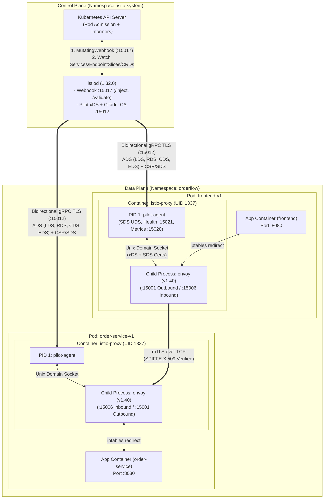

[Fellowship Portal](../../README.md) > [Week 02](../../fellowship/week-02-dataplane-internals-and-ambient/WEEK.md) > [Module 01](../README.md) > Lesson 01.1 | [Next: Lesson 01.2 ->](./02-linux-netns-and-iptables-interception.md)

# Lesson 01.1: Control Plane vs. Data Plane, Sidecar Injection & Native Sidecars (`KEP-753`)

> **Lesson Metadata**
> - **Estimated Completion Time**: `25 mins`
> - **Prerequisites**: Completed [Module 00 (`README.md` & `LAB.md`)](../../00-environment-setup/README.md) with `orderflow` pods running (`2/2 READY`).
> - **Authoritative Baseline**: Istio `1.32.0` | Envoy `v1.40` | Kubernetes `v1.36+` | Gateway API `v1.6.1`
> - **Learning Objectives**:
>   1. Articulate why out-of-process data plane proxies solve language fragmentation, operational coupling, and Kubernetes L4 blindness at NovaPay.
>   2. Differentiate the 4 consolidated control plane responsibilities inside `istiod` (**Pilot**, **Citadel**, **Galley**, **Sidecar Injector**) from the 2 processes inside the `istio-proxy` container (**`pilot-agent`** and **`envoy`**).
>   3. Explain how Kubernetes **Native Sidecar Containers (`KEP-753`)** (GA in Kubernetes `1.33+` and default in Istio `1.32.0`) eliminate historical `Job` completion hangs and startup race conditions.

---

## 1. NovaPay Engineering Context & Alex Morgan's Briefing

### 1.1 What Is Happening at NovaPay?
At **NovaPay**, our `orderflow` checkout architecture combines polyglot microservices: `frontend` (TypeScript/Node.js), `order-service` (Go), `payment-service` (Java/Spring Boot), and `inventory-service` (Python/FastAPI), alongside nightly batch settlement Kubernetes `Job` workloads (`settlement-worker`).

Before adopting Istio, Daniel Brooks's backend engineering teams maintained four separate in-application resilience and TLS libraries:
- When a TLS root CA needed rotation or a retry backoff policy caused a retry storm during a downstream payment gateway brownout, all four teams had to rebuild, test, and redeploy their application containers.
- Worse, when teams began migrating `settlement-worker` Kubernetes `Job` workloads into an early sidecar mesh on an older Kubernetes release, `Job` pods hung in `Running (1/2)` forever because `istio-proxy` refused to exit after the batch binary finished (`exit 0`).

### 1.2 Alex's Briefing & Intuition Analogy

> **Alex Morgan (Senior Platform Engineer — Mentor Briefing)**
> *"When an application developer asks me why we run `istiod` and `istio-proxy` instead of just letting microservices talk directly over Kubernetes `Services`, I give them the **Diplomatic Courier & Security Detail** analogy.*
>
> *Without a service mesh, every microservice developer has to train their own application code to be a translator, a cryptographer, a passport inspector, and a traffic router. If you write services in Go, Java, and Python, you end up with three incompatible security details.*
>
> *Istio separates policy from packets:*
> - ***`istiod` (The Control Plane)*** *is **Headquarters**. It never touches a single customer checkout packet! If `istiod` restarts right now during peak Black Friday traffic, existing active checkout traffic continues flowing through Envoy unimpeded. Headquarters watches the cluster state, signs cryptographic passports (SPIFFE X.509 certificates), and radios updated flight plans (`xDS`) to the field.*
> - ***`istio-proxy` (The Data Plane)*** *is the **Onboard Diplomatic Escort** riding inside every pod. Inside that container, `pilot-agent` (PID 1) handles radio comms and passport renewal with Headquarters, while `envoy` (`v1.40`) is the high-speed C++ packet engine sitting directly in the network path.*
>
> *Let's look under the hood at how `istiod` injects that escort into your pod—and how Kubernetes `1.36+` and Istio `1.32.0` permanently solved the infamous `Job` lifecycle bug using Native Sidecar Containers (`KEP-753`)."*

---

## 2. Progressive Disclosure Technical Explanation

### 2.1 Core Concept: Why a Service Mesh Exists

In a distributed microservices architecture like **OrderFlow**, every network call between `frontend`, `order-service`, `payment-service`, and `inventory-service` crosses an unreliable L3/L4 container network. Moving network policy out-of-process into a service mesh solves three fundamental challenges:

1. **Eliminating Polyglot Library Drift**: Retry budgets, circuit breaking, outlier ejection, and W3C distributed trace propagation execute identically in Envoy `v1.40` regardless of whether the application container is written in Go, Java, Python, or Rust.
2. **Decoupling Infrastructure Operations from App Releases**: Rotating mTLS certificates, shifting `10%` of canary traffic, or blocking an unauthorized caller via `AuthorizationPolicy` happens dynamically via xDS API pushes in milliseconds—zero application rebuilds required.
3. **Bridging Kubernetes L4 Blindness**: Standard Kubernetes `Service` and `kube-proxy` operate strictly at Layer 4 (TCP/UDP). They have no awareness of HTTP `503` status codes, HTTP headers (`x-user-tier: vip`), gRPC stream multiplexing, or cryptographic workload identity.

---

### 2.2 Technical Deep Dive: `istiod` vs. `istio-proxy` (`pilot-agent` + `envoy`)

#### The Consolidated Control Plane (`istiod`)
Prior to Istio 1.5, the control plane was split across four separate deployments (`istio-pilot`, `istio-citadel`, `istio-galley`, `istio-sidecar-injector`). In **Istio `1.32.0`**, all four subsystems run inside a single binary: **`istiod`**.

| Sub-Component | Role Inside `istiod` | How It Works Under the Hood in Istio `1.32.0` |
| :--- | :--- | :--- |
| **Pilot** | Service discovery & xDS configuration translator | Watches Kubernetes `Service`, `EndpointSlice`, `Pod`, Gateway API `v1.6.1` CRDs (`Gateway`, `HTTPRoute`, `GRPCRoute`), and Istio CRDs (`VirtualService`, `DestinationRule`, `ServiceEntry`). Compiles this high-level state into low-level Envoy xDS protobufs and pushes them over a bidirectional gRPC stream (`:15012`). |
| **Citadel (CA)** | Public Key Infrastructure (PKI) & Identity | Acts as an X.509 Certificate Authority. Validates Certificate Signing Requests (CSRs) from `pilot-agent` (authenticated via Kubernetes projected `ServiceAccount` JWT tokens) and issues short-lived SPIFFE X.509 workload certificates via SDS. |
| **Galley** | Configuration validation | Runs as a Kubernetes `ValidatingAdmissionWebhook` (`:15017/validate`) to reject malformed Istio CRDs at `kubectl apply` time before they can corrupt the mesh state. |
| **Sidecar Injector** | Mutating Admission Webhook | Intercepts `Pod` creation (`CREATE`) requests matching labeled namespaces (`istio-injection=enabled` or `istio.io/rev=<tag>`) on `:15017/inject` and patches the pod spec with `istio-init` (or `istio-validation`) and the `istio-proxy` container. |

#### The Two Processes Inside `istio-proxy`
When you inspect a sidecar-injected pod in `orderflow`, the `istio-proxy` container runs **two distinct processes**:

1. **`pilot-agent` (`istio-agent`) — PID 1**:
   - Generates the initial Envoy bootstrap configuration (`/etc/istio/proxy/envoy-rev.json`) and spawns `envoy` as a child process.
   - Generates private keys in memory (never touching disk) and sends CSRs to `istiod` `:15012`, delivering signed X.509 certificates to Envoy over a local Unix Domain Socket (`/var/run/secrets/workload-spiffe-uds/socket`) via **SDS (Secret Discovery Service)**.
   - Runs a local DNS proxy (`127.0.0.1:15053`) when `ISTIO_META_DNS_CAPTURE=true` is enabled.
   - Exposes health checks (`:15021/healthz/ready`) and merged Prometheus metrics (`:15020/stats/prometheus`).
2. **`envoy` (`v1.40`) — Child Process**:
   - High-performance C++ L4/L7 proxy that handles all actual data plane packets (`:15001` outbound, `:15006` inbound) and maintains the ADS xDS connection (proxied through `pilot-agent`) to `istiod`.

---

### 2.3 Mechanism Diagram & 6-Part Step-by-Step Walkthrough



#### 6-Part Mechanism Walkthrough: Pod Admission, Bootstrap & Runtime
1. **What initiates the operation?**
   A user or controller creates a Pod in the `orderflow` namespace (e.g., `kubectl apply -f base-platform.yaml`), or creates/updates an Istio routing CRD (`VirtualService`, `DestinationRule`).
2. **Which component receives it?**
   - On Pod creation: `kube-apiserver` matches the namespace label `istio-injection=enabled` against the `istio-sidecar-injector` `MutatingWebhookConfiguration` and sends an HTTPS `AdmissionReview` request to `istiod` on port `:15017/inject`.
   - On CRD/Service changes: `istiod`'s Kubernetes informers receive the watch event directly from `kube-apiserver`.
3. **What information is exchanged?**
   - During admission: `istiod` renders the sidecar injection template and returns a JSON Patch adding `istio-init` (or `istio-validation` with `istio-cni`), the `istio-proxy` container (`UID 1337`), and projected `ServiceAccount` token volumes.
   - At pod startup: `pilot-agent` authenticates to `istiod:15012` using its projected Kubernetes `ServiceAccount` JWT (`istio-token`), exchanges a CSR for a SPIFFE X.509 certificate, and proxies Envoy's Aggregated Discovery Service (ADS) stream.
4. **What changes in the system?**
   The Pod spec persisted in `etcd` now includes the sidecar container and volumes. Once `envoy` receives its initial `LDS`, `RDS`, `CDS`, `EDS`, and `SDS` payloads from `istiod`, `pilot-agent` marks `:15021/healthz/ready` as `HTTP 200`, allowing Kubelet to mark the pod `2/2 Ready`.
5. **How can you observe/verify it on your cluster?**
   - Inspect webhook configuration: `kubectl get mutatingwebhookconfigurations istio-sidecar-injector`
   - Inspect processes inside `istio-proxy`: `kubectl exec -n orderflow deploy/order-service-v1 -c istio-proxy -- ps aux`
   - Verify xDS sync state: `istioctl proxy-status`
6. **What happens if a component fails?**
   - **If `istiod` is down when existing pods are running**: Data plane traffic between `frontend` and `order-service` **continues flowing normally** using Envoy's last-known-good in-memory xDS config (until workload certificates expire or endpoints change).
   - **If `istiod` `:15017` is unreachable during Pod creation**: New pod creation fails if the webhook `failurePolicy` is `Fail` (or pods start *uninjected* `1/1` if `failurePolicy: Ignore`, causing mTLS failures under `STRICT` mode!).

---

### 2.4 Engineering Insight: Kubernetes Native Sidecar Containers (`KEP-753`) in Istio `1.32.0`

Historically (prior to Kubernetes `1.29` / `1.33`), Kubernetes had no native concept of a "sidecar container." `istio-proxy` was injected as a regular container in `spec.containers[]` alongside your application container. That caused three notorious production bugs at NovaPay:

1. **Startup Race Condition**: The application container (`order-service`) and `istio-proxy` started simultaneously. If `order-service` made an outbound database or HTTP connection in its first 300ms before `envoy` finished warming xDS listeners, the connection failed (`Connection Refused` on `:15001`) unless developers enabled `values.global.proxy.holdApplicationUntilProxyStarts: true`.
2. **Kubernetes `Job` Hang Forever**: In a Kubernetes `Job` (`settlement-worker`), when the main batch container exited (`exit 0`), the Pod stayed `Running (1/2)` indefinitely because `istio-proxy` never terminated! Teams had to write brittle `curl -X POST http://localhost:15020/quitquitquit` wrapper scripts.
3. **Shutdown Race Condition**: On `SIGTERM`, Kubernetes sent `SIGTERM` to both the app and `istio-proxy` at the exact same millisecond, severing in-flight outbound requests from the app before it finished draining.

#### How Kubernetes `1.36+` & Istio `1.32.0` Solve This (`KEP-753` Native Sidecars)
With **KEP-753 (Native Sidecar Containers)**—which graduated to **GA in Kubernetes `1.33+`** and is supported natively in **Istio `1.32.0`**—`istio-proxy` is injected into `spec.initContainers[]` with **`restartPolicy: Always`**:

```yaml
spec:
  initContainers:
    - name: istio-init # (or istio-validation when istio-cni is used)
      image: docker.io/istio/proxyv2:1.32.0
    - name: istio-proxy
      image: docker.io/istio/proxyv2:1.32.0
      restartPolicy: Always   # <--- KEP-753 Native Sidecar!
      startupProbe:
        httpGet:
          path: /healthz/ready
          port: 15021
  containers:
    - name: order-service
      image: nicholasjackson/fake-service:v0.26.2
```

Because `istio-proxy` is an `initContainer` with `restartPolicy: Always`:
- **Guaranteed Startup Order**: Kubelet waits for `istio-proxy`'s `startupProbe` (`:15021/healthz/ready`) to succeed *before* starting the main application container in `spec.containers[]`!
- **Guaranteed Shutdown Order**: During pod termination, Kubelet terminates `spec.containers[]` first and keeps `istio-proxy` alive until the application container exits.
- **Clean `Job` Completion**: When all regular `spec.containers[]` in a `Job` exit `0`, Kubelet automatically terminates the `restartPolicy: Always` native sidecar, and the `Job` completes cleanly without `/quitquitquit` hacks!

---

## 3. Practical Observation & Investigation

Run these commands against your live `orderflow` namespace to observe the injected container specification and the dual-process (`pilot-agent` + `envoy`) architecture:

```bash
# 1. Pick an order-service-v1 pod
ORDER_POD=$(kubectl get pod -n orderflow -l app=order-service,version=v1 -o jsonpath='{.items[0].metadata.name}')

# 2. Inspect PID 1 (pilot-agent) and its child process (envoy) inside istio-proxy
kubectl exec -n orderflow "$ORDER_POD" -c istio-proxy -- ps aux

# 3. Verify the local Unix Domain Socket used for SDS certificate delivery
kubectl exec -n orderflow "$ORDER_POD" -c istio-proxy -- ls -la /var/run/secrets/workload-spiffe-uds/
```

---

## 4. Knowledge Check (Engineering Judgment)

### Question 1: What Happens to Active Checkout Traffic When `istiod` Restarts?
During a peak checkout window at NovaPay, all replicas of `istiod` in `istio-system` restart simultaneously due to an OOM spike. What happens to active customer requests flowing from `frontend` to `order-service` and `payment-service` during the 20 seconds `istiod` is unavailable?

<details>
<summary>Check Answer & Engineering Explanation</summary>

**Answer:**
**Active data plane traffic continues flowing without interruption.**
`istiod` is strictly in the **Control Plane**, not the **Data Plane** packet path. Every `envoy` proxy in `orderflow` already holds its compiled listeners, routes, clusters, endpoints, and mTLS certificates in memory.
However, while `istiod` is down:
1. New pods created in `orderflow` cannot be injected by the mutating webhook (`:15017`).
2. Changes to `EndpointSlices` (pod scale-ups/scale-downs) or new `VirtualService` policies will not be pushed to Envoy until `istiod` recovers and re-establishes the `:15012` ADS stream.
</details>

### Question 2: Native Sidecar (`KEP-753`) vs. Legacy Sidecar Lifecycle
Daniel Brooks's team runs a short-lived `settlement-worker` Kubernetes `Job` that connects to `payment-service:8080` immediately on startup, processes records for 8 seconds, and exits `0`. Explain how injecting `istio-proxy` as a Kubernetes `1.36` Native Sidecar (`initContainers` with `restartPolicy: Always`) solves both the startup `Connection Refused` error and the shutdown hang compared to legacy `spec.containers[]` injection.

<details>
<summary>Check Answer & Engineering Explanation</summary>

**Answer:**
1. **Startup Protection**: Because `istio-proxy` is in `spec.initContainers[]` with `restartPolicy: Always`, Kubelet starts `istio-proxy` *before* any container in `spec.containers[]` and waits for `istio-proxy`'s `startupProbe` (`:15021/healthz/ready`) to pass. By the time `settlement-worker` starts, Envoy's `:15001` listener and xDS clusters are already warm.
2. **Job Completion & Shutdown Ordering**: When `settlement-worker` (the only container in `spec.containers[]`) exits with code `0`, Kubelet recognizes that all primary containers have completed and automatically sends `SIGTERM` to the `restartPolicy: Always` native sidecar (`istio-proxy`), allowing the `Job` pod to transition cleanly to `Completed`.
</details>

### Question 3: Role of `pilot-agent` vs. `envoy`
Why doesn't the `istio-proxy` container simply run `/usr/local/bin/envoy` directly as PID 1? Name at least three critical runtime duties performed by `pilot-agent`.

<details>
<summary>Check Answer & Engineering Explanation</summary>

**Answer:**
`pilot-agent` runs as PID 1 because Envoy is a pure network proxy and does not speak Kubernetes-specific authentication or lifecycle protocols natively:
1. **SDS Certificate Lifecycle**: `pilot-agent` generates the private key in memory, reads the projected Kubernetes `ServiceAccount` JWT token, submits the CSR to `istiod` (`Citadel`), and serves the signed SPIFFE X.509 certificate to Envoy over a local Unix Domain Socket via SDS.
2. **Bootstrap & Hot-Restart Lifecycle**: `pilot-agent` generates Envoy's bootstrap JSON from pod environment variables (`ISTIO_META_*`), supervises the `envoy` child process, and handles graceful draining on `SIGTERM`.
3. **Health Probes & Telemetry Merging**: `pilot-agent` serves Kubelet readiness checks on `:15021/healthz/ready`, rewrites application liveness/readiness probes via `:15020/app-health/`, and merges Prometheus metrics from Envoy (`:15090`) and the application container on `:15020/stats/prometheus`.
</details>

---

## 5. Key Takeaways, Definition of Done & Authoritative References

### Key Takeaways
- **`istiod` is the Control Plane; `envoy` is the Data Plane**: `istiod` translates Kubernetes & Istio state into xDS protobufs (`Pilot`), signs SPIFFE certs (`Citadel`), validates CRDs (`Galley`), and injects sidecars (`Injector`).
- **`istio-proxy` runs two processes**: `pilot-agent` (PID 1 lifecycle, SDS, DNS, metrics) and `envoy` (`v1.40` packet processor).
- **Native Sidecars (`KEP-753`) guarantee lifecycle ordering**: Running `istio-proxy` as an `initContainer` with `restartPolicy: Always` ensures Envoy is ready *before* the app starts and terminates *after* the app exits.

### Lesson 01.1 Definition of Done
- [ ] You can explain the 4 roles of `istiod` and the 2 processes inside `istio-proxy`.
- [ ] You have executed `ps aux` inside an `orderflow` pod's `istio-proxy` container and verified `pilot-agent` (PID 1) and `envoy`.
- [ ] You can explain how Kubernetes Native Sidecars (`KEP-753`) eliminate `Job` completion hangs.

### Authoritative References
- [Istio 1.32 Architecture Overview](https://istio.io/latest/docs/ops/deployment/architecture/)
- [Kubernetes KEP-753: Sidecar Containers (`restartPolicy: Always`)](https://kubernetes.io/docs/concepts/workloads/pods/sidecar-containers/)

---

## Next Lesson
Continue to **[Lesson 01.2: Linux Network Namespaces, `iptables` Interception & The Port Map ->](./02-linux-netns-and-iptables-interception.md)**.
