[Fellowship Portal](../../README.md) > [Week 02](../../fellowship/week-02-dataplane-internals-and-ambient/WEEK.md) > [Module 01](../README.md) > Lesson 01.2 | [<- Lesson 01.1](./01-control-plane-and-sidecar-injection.md) | [Next: Lesson 01.3 ->](./03-envoy-xds-pipeline-and-ads.md)

# Lesson 01.2: Linux Network Namespaces, `iptables` Interception & The Istio Port Map

> **Lesson Metadata**
> - **Estimated Completion Time**: `30 mins`
> - **Prerequisites**: Completed [Lesson 01.1 (`01-control-plane-and-sidecar-injection.md`)](./01-control-plane-and-sidecar-injection.md).
> - **Authoritative Baseline**: Istio `1.32.0` | Envoy `v1.40` | Kubernetes `v1.36+` | Gateway API `v1.6.1`
> - **Learning Objectives**:
>   1. Compare `istio-init` (per-pod `NET_ADMIN` initContainer) against `istio-cni` (node-level CNI DaemonSet), including **Cilium CNI** compatibility (`cni.exclusive=false` and `socketLB.hostNamespaceOnly=true`).
>   2. Trace inbound (`PREROUTING` $\rightarrow$ `ISTIO_INBOUND` $\rightarrow$ `:15006`) and outbound (`OUTPUT` $\rightarrow$ `ISTIO_OUTPUT` $\rightarrow$ `:15001`) packets through Linux `iptables -t nat` chains inside a pod's shared network namespace.
>   3. Explain how **UID `1337`** and source IP **`127.0.0.6`** prevent infinite packet redirection loops, and diagnose the classic `127.0.0.1` vs. `0.0.0.0` binding failure mode (`INC-02`).

---

## 1. NovaPay Engineering Context & Alex Morgan's Briefing

### 1.1 What Is Happening at NovaPay?
When NovaPay's `frontend` pod makes an HTTP call to `http://order-service:8080`, the Node.js application code simply opens a standard TCP socket to `10.96.45.12:8080` (the Kubernetes `Service` ClusterIP). Neither `frontend` nor `order-service` has any proxy settings (`HTTP_PROXY`) configured. Yet every packet leaving `frontend` is transparently captured by its local Envoy sidecar on `:15001`, encrypted in SPIFFE mTLS, and captured on arrival at `order-service` by the server's Envoy sidecar on `:15006`.

Two production incidents at NovaPay make mastering this layer mandatory (`NP-102` & `INC-02`):
1. **Maya Patel's PCI-DSS Security Audit**: Maya's team enforced Kubernetes `PodSecurityStandards: restricted` across PCI namespaces, which immediately blocked pods using `istio-init` because `istio-init` requests `NET_ADMIN` and `NET_RAW` Linux capabilities inside workload pods.
2. **Daniel Brooks's `503 UF` Mystery (`INC-02`)**: A developer built a new microservice container with `USER 1337` in its `Dockerfile` (and another bound strictly to `127.0.0.1:8080`), causing outbound calls to silently bypass Envoy and inbound calls to fail!

### 1.2 Alex's Briefing & Intuition Analogy

> **Alex Morgan (Senior Platform Engineer — Mentor Briefing)**
> *"How does `envoy` intercept packets from `order-service` without `order-service` knowing Envoy exists? The secret is a fundamental Linux kernel primitive: **every container inside a Kubernetes Pod shares the exact same Linux Network Namespace (`netns`)**.*
>
> *Think of a Kubernetes Pod as a **secure building with a single shared mailroom (`eth0` + `lo` + the kernel's `iptables` routing table)**. The application container (`order-service`) lives on Floor 2, and `istio-proxy` (`envoy`) lives on Floor 1. Before the building opens for business, a setup crew (`istio-init` or `istio-cni`) installs automated mail chutes (`iptables -t nat` rules) in the shared mailroom:*
> - *Every letter arriving from outside the building (`PREROUTING`) is diverted down Chute **`15006`** (`virtualInbound`) to Envoy on Floor 1.*
> - *Every letter sent by the application on Floor 2 (`OUTPUT`) is diverted down Chute **`15001`** (`virtualOutbound`) to Envoy on Floor 1.*
>
> *Now ask yourself the million-dollar question: **Once Envoy on Floor 1 inspects an outbound letter and drops it back into the mailroom (`OUTPUT`) to leave the building, why doesn't the mail chute divert Envoy's own letter right back to Floor 1 in an infinite loop?***
> *Because Envoy wears badge **UID `1337`**, and the mailroom has an explicit rule: `if sender == UID 1337, let it pass straight through!` Let's trace every rule in that table."*

---

## 2. Progressive Disclosure Technical Explanation

### 2.1 Core Concept: `istio-init` vs. `istio-cni` (and Cilium CNI)

Who programs those `iptables` rules inside the pod's Linux network namespace (`netns`)? Istio provides two mechanisms:

| Dimension | `istio-init` (Default InitContainer) | `istio-cni` (Node-Level CNI Plugin DaemonSet) |
| :--- | :--- | :--- |
| **How It Works** | Runs as an injected `initContainer` inside every pod before app containers start, executing `pilot-agent istio-iptables` to program the pod's `netns`. | Runs as a privileged node-level `DaemonSet` plugged into the Kubernetes CNI chain. Programs the pod's `netns` from the node during CNI pod sandbox creation. |
| **Linux Capabilities on Workload Pods** | Requires **`NET_ADMIN` and `NET_RAW`** on the `istio-init` container inside *every* application pod. | Workload pods require **zero** elevated capabilities (`NET_ADMIN`/`NET_RAW` only exist on the `istio-cni` node DaemonSet). *(Note: An unprivileged `istio-validation` initContainer still runs to prevent race conditions).* |
| **Enterprise Security & Ambient Mode** | Blocked by strict `PodSecurityStandards: restricted` or OPA Gatekeeper policies. | **Mandatory for PCI-DSS / `restricted` PSS clusters** and **required for Istio Ambient Mode** (`ztunnel` netns redirection). |

> [!IMPORTANT]
> **Cilium CNI Compatibility (`cni.exclusive=false` & `socketLB.hostNamespaceOnly=true`)**
> When running `istio-cni` (in either Sidecar or Ambient Mode) on a Kubernetes `v1.36+` cluster with **Cilium CNI** (`kubeProxyReplacement=true`), two Cilium Helm settings are mandatory:
> 1. **`cni.exclusive=false`**: Prevents Cilium from overwriting `/etc/cni/net.d/` exclusively, allowing `istio-cni` to chain as a secondary CNI plugin.
> 2. **`socketLB.hostNamespaceOnly=true`**: Prevents Cilium's eBPF `connect()` syscall hook (`bpf_sockaddr`) from translating `Service` ClusterIPs inside the pod's `netns` before `iptables` (`:15001`) or `ztunnel` (`:15008`) can intercept the original destination (`SO_ORIGINAL_DST`).

---

### 2.2 Technical Deep Dive: Exact `iptables -t nat` Chains & Loop Avoidance

When `istio-iptables` runs inside a pod's network namespace, it creates four custom chains in the `nat` table (`ISTIO_INBOUND`, `ISTIO_IN_REDIRECT`, `ISTIO_OUTPUT`, `ISTIO_REDIRECT`). Crucially, the `istio-proxy` container always runs as Linux User ID (UID) **`1337`**.

### 2.3 Mechanism Diagram & 6-Part Step-by-Step Walkthrough

```mermaid
flowchart TD
    subgraph InboundFlow["Inbound Packet Flow (External Wire -> Pod eth0 -> App :8080)"]
        NetIn["1. Packet arrives at Pod eth0<br/>(Dst: 10.244.1.15:8080)"] --> PREROUTING["2. PREROUTING Chain<br/>Jump to ISTIO_INBOUND"]
        PREROUTING --> ISTIO_INBOUND["3. ISTIO_INBOUND Chain<br/>Exclude ports: 15008, 15020, 15021, 15090 -> RETURN<br/>All other TCP -> Jump ISTIO_IN_REDIRECT"]
        ISTIO_INBOUND --> ISTIO_IN_REDIRECT["4. ISTIO_IN_REDIRECT Chain<br/>REDIRECT TCP to 127.0.0.1:15006<br/>(Kernel saves SO_ORIGINAL_DST)"]
        ISTIO_IN_REDIRECT --> EnvoyIn["5. Envoy virtualInbound (:15006)<br/>(Runs as UID 1337)<br/>Terminates mTLS, checks RBAC"]
        EnvoyIn -->|"6. Envoy opens local socket to App :8080<br/>Source IP bound to 127.0.0.6 (UID 1337)"| OUTPUT_IN["7. OUTPUT -> ISTIO_OUTPUT Chain"]
        OUTPUT_IN -->|"Rule 1: -s 127.0.0.6/32 -o lo -> RETURN<br/>(Breaks Inbound Loop!)"| App["8. Application Container (:8080)"]
    end

    subgraph OutboundFlow["Outbound Packet Flow (App UID 1000 -> Upstream Service VIP :8080)"]
        AppOut["1. App (UID 1000) calls<br/>10.96.45.12:8080"] --> OUTPUT_OUT["2. OUTPUT -> ISTIO_OUTPUT Chain"]
        OUTPUT_OUT --> ISTIO_OUTPUT["3. ISTIO_OUTPUT Evaluation:<br/>- Src 127.0.0.6? No.<br/>- UID/GID == 1337? No.<br/>- Dst == 127.0.0.1? No.<br/>-> Jump ISTIO_REDIRECT"]
        ISTIO_OUTPUT --> ISTIO_REDIRECT["4. ISTIO_REDIRECT Chain<br/>REDIRECT TCP to 127.0.0.1:15001<br/>(Kernel saves SO_ORIGINAL_DST)"]
        ISTIO_REDIRECT --> EnvoyOut["5. Envoy virtualOutbound (:15001)<br/>(Runs as UID 1337)<br/>Applies RDS/CDS/EDS, selects Pod IP"]
        EnvoyOut -->|"6. Envoy opens upstream mTLS socket<br/>as UID 1337"| OUTPUT_UP["7. OUTPUT -> ISTIO_OUTPUT Chain"]
        OUTPUT_UP -->|"Rule 4: --uid-owner 1337 -> RETURN<br/>(Breaks Outbound Loop!)"| NetOut["8. Exits Pod eth0 to Upstream Pod IP"]
    end
```



#### 6-Part Mechanism Walkthrough: Inbound & Outbound `iptables` Interception
1. **What initiates the operation?**
   - **Inbound**: An upstream caller's Envoy proxy transmits an mTLS TCP packet over the container network to `order-service-v1`'s Pod IP (`10.244.1.15:8080`).
   - **Outbound**: The application process inside `frontend-v1` (running as non-1337 UID, e.g., `UID 1000`) executes a `connect()` syscall to `10.96.45.12:8080` (`order-service` ClusterIP).
2. **Which component receives it?**
   The Linux kernel netfilter subsystem inside the pod's network namespace intercepts the inbound packet at the `PREROUTING` hook (jumping to `ISTIO_INBOUND`) and the outbound packet at the `OUTPUT` hook (jumping to `ISTIO_OUTPUT`).
3. **What information is exchanged?**
   - When `ISTIO_IN_REDIRECT` rewrites the destination to `127.0.0.1:15006` (or `ISTIO_REDIRECT` rewrites to `127.0.0.1:15001`), the Linux kernel's `conntrack` table preserves the original pre-NAT destination IP and port (`10.244.1.15:8080` or `10.96.45.12:8080`).
   - Envoy reads this original target immediately upon accepting the TCP connection by calling `getsockopt(fd, SOL_IP, SO_ORIGINAL_DST, ...)`.
4. **What changes in the system?**
   - **Inbound Loop Avoidance (`127.0.0.6` & `UID 1337`)**: After Envoy terminates mTLS on `:15006`, it forwards the cleartext request to the local application container on port `:8080` using the magic loopback source IP **`127.0.0.6`**. When that local packet traverses `OUTPUT -> ISTIO_OUTPUT`, the very first rule (`-s 127.0.0.6/32 -o lo -j RETURN`) immediately exits the chain so the packet reaches the application instead of looping back to Envoy.
   - **Outbound Loop Avoidance (`--uid-owner 1337`)**: When Envoy (running as `UID 1337`) opens the real upstream TCP connection out to the network, its packet traverses `OUTPUT -> ISTIO_OUTPUT`, matches `-m owner --uid-owner 1337 -j RETURN`, and exits `eth0` untouched.
5. **How can you observe/verify it on your cluster?**
   - View the programmed rules from `istio-init` logs:
     `kubectl logs -n orderflow deploy/order-service-v1 -c istio-init`
   - Or inspect live packet counters in the pod's `nat` table:
     `kubectl debug -it -n orderflow <pod> --image=nicolaka/netshoot --target=istio-proxy -- iptables -t nat -L -n -v`
6. **What happens if a component fails?**
   - **Misconfiguration 1 (App runs as `UID 1337`)**: If an application container runs with `runAsUser: 1337`, its outbound packets match `--uid-owner 1337 -j RETURN` in `ISTIO_OUTPUT` and **completely bypass Envoy** (no mTLS, no L7 routing, no telemetry!).
   - **Misconfiguration 2 (`127.0.0.1` vs. Pod IP Binding — `INC-02`)**: If an application binds strictly to `127.0.0.1:8080` instead of `0.0.0.0:8080`, inbound connections forwarded by Envoy to the Pod IP (`10.244.1.15:8080` from source `127.0.0.6`) are rejected with `RST` (`503 UF — Upstream connection failure`) unless the endpoint or `Sidecar` ingress listener is explicitly configured for loopback. Always bind application listeners to `0.0.0.0`.

---

### 2.4 Authoritative Reference: Complete Istio & Envoy Port Map

Bookmark this table—Sarah Chen and Alex Morgan use it during every incident response at NovaPay:

| Port | Process | Direction | Protocol | Purpose |
| :--- | :--- | :--- | :--- | :--- |
| **`15000`** | `envoy` | Localhost (`127.0.0.1`) | HTTP | Envoy Admin Interface (`/config_dump`, `/clusters`, `/stats`, `/logging`). Never exposed outside the pod. |
| **`15001`** | `envoy` | Pod-internal (`iptables`) | TCP/HTTP | `virtualOutbound` listener. Captures all outbound application traffic redirected by `ISTIO_REDIRECT`. |
| **`15004`** | `pilot-agent` | Localhost (`127.0.0.1`) | gRPC | Local xDS proxy port used internally by `pilot-agent` when proxying debug/xDS requests. |
| **`15006`** | `envoy` | Inbound (`iptables`) | TCP/HTTP/mTLS | `virtualInbound` listener. Captures all inbound traffic entering the pod redirected by `ISTIO_IN_REDIRECT`. |
| **`15008`** | `envoy` / `ztunnel` | Inbound / Outbound | HBONE (mTLS/HTTP2) | **HBONE (HTTP-Based Overlay Network Environment)** tunnel port used by Istio Ambient Mode (`ztunnel` & Waypoints) and East-West multi-network gateways. |
| **`15010`** | `istiod` | Control Plane | gRPC (Plaintext) | Unencrypted xDS discovery service port (debugging only; never used by data plane proxies in production). |
| **`15012`** | `istiod` | Control Plane | gRPC (TLS/mTLS) | Production xDS (ADS) and CA (Citadel CSR) service port used by `pilot-agent` and `ztunnel` to connect to `istiod`. |
| **`15014`** | `istiod` | Control Plane | HTTP | Control plane self-monitoring and Prometheus metrics port (`/metrics`) for `istiod`. |
| **`15017`** | `istiod` | Control Plane | HTTPS | Kubernetes Mutating (`/inject`) & Validating (`/validate`) Admission Webhook server port. |
| **`15020`** | `pilot-agent` | Inbound | HTTP | Merged Prometheus telemetry (`/stats/prometheus` combining Envoy, agent, and app stats) + Kubelet health probe rewriting target (`/app-health/`). |
| **`15021`** | `envoy` / `agent` | Inbound | HTTP | Health check endpoint (`/healthz/ready`). Kubelet checks this to verify Envoy has received xDS config and is ready to accept traffic. |
| **`15053`** | `pilot-agent` | Pod-internal (`iptables`) | DNS (UDP/TCP) | Local DNS proxy inside `pilot-agent` when `ISTIO_META_DNS_CAPTURE=true` is enabled (resolves `ServiceEntry` hosts and caches CoreDNS responses). |
| **`15090`** | `envoy` | Inbound | HTTP | Raw Envoy Prometheus telemetry (`/stats/prometheus`). |

---

## 3. Practical Observation & Investigation

Run these commands on your cluster to inspect the exact `iptables-restore` script generated for `order-service-v1`:

```bash
# 1. Inspect the exact iptables rules programmed at pod initialization
ORDER_POD=$(kubectl get pod -n orderflow -l app=order-service,version=v1 -o jsonpath='{.items[0].metadata.name}')
kubectl logs -n orderflow "$ORDER_POD" -c istio-init

# 2. Verify that istio-proxy runs as UID 1337
kubectl get pod -n orderflow "$ORDER_POD" -o jsonpath='{.spec.containers[?(@.name=="istio-proxy")].securityContext.runAsUser}{"\n"}'
```

Look for these exact lines in the `istio-init` output:
- `-A ISTIO_INBOUND -p tcp --dport 15008 -j RETURN` (and `15020`, `15021`, `15090`)
- `-A ISTIO_IN_REDIRECT -p tcp -j REDIRECT --to-ports 15006`
- `-A ISTIO_OUTPUT -s 127.0.0.6/32 -o lo -j RETURN`
- `-A ISTIO_OUTPUT -m owner --uid-owner 1337 -j RETURN`
- `-A ISTIO_REDIRECT -p tcp -j REDIRECT --to-ports 15001`

---

## 4. Knowledge Check (Engineering Judgment)

### Question 1: Why Does `ISTIO_INBOUND` Exclude Ports `15020`, `15021`, and `15090`?
Look at the `ISTIO_INBOUND` chain in the diagram above. Every inbound TCP packet is redirected to `127.0.0.1:15006` *except* packets targeting ports `15008`, `15020`, `15021`, and `15090`, which immediately hit `RETURN`. What would happen if port `15021` were redirected into `:15006` during pod startup?

<details>
<summary>Check Answer & Engineering Explanation</summary>

**Answer:**
Port `15021` (`/healthz/ready`) is polled by the node's **Kubelet** to determine if `istio-proxy` is ready, and ports `15020`/`15090` are scraped by **Prometheus** in plaintext HTTP.
1. During early pod startup or when `PeerAuthentication` is set to `STRICT` mTLS, `:15006` (`virtualInbound`) requires callers to present a valid mesh SPIFFE client certificate.
2. Kubelet runs on the host node outside the mesh and does **not** possess an Istio SPIFFE client certificate! If `:15021` or `:15020` were redirected through `:15006` under `STRICT` mTLS, Envoy would reject Kubelet's readiness probes and Prometheus scrapes, causing Kubelet to mark every pod in the mesh `Unready` or restart it in a crash loop.
</details>

### Question 2: The `127.0.0.6` Magic Loopback Address
Suppose `order-service` makes a call to *itself* using its own Pod IP (`10.244.1.15:8080`) or receives an inbound request on `:15006` that Envoy forwards to the local app container on `:8080`. Why does Envoy bind its local upstream socket source IP to **`127.0.0.6`** instead of `127.0.0.1`?

<details>
<summary>Check Answer & Engineering Explanation</summary>

**Answer:**
In `ISTIO_OUTPUT`, there is a subtle edge case: what if a pod calls its *own* Pod IP (`10.244.1.15:8080`)? The kernel routes a self-call over the loopback interface (`-o lo`), but its destination IP is `10.244.1.15` (`! 127.0.0.1`).
To ensure a self-call still goes through inbound policy enforcement on `:15006`, `ISTIO_OUTPUT` contains:
`-A ISTIO_OUTPUT -o lo ! -d 127.0.0.1/32 -m owner --uid-owner 1337 -j ISTIO_IN_REDIRECT`
If Envoy (`UID 1337`) forwarded inbound traffic from `:15006` to the application at `10.244.1.15:8080` using a normal source IP, that rule would redirect Envoy's packet *right back into `:15006`*! By binding the source IP of `:15006` $\rightarrow$ App connections to **`127.0.0.6`**, the very first rule in `ISTIO_OUTPUT` (`-s 127.0.0.6/32 -o lo -j RETURN`) matches first and delivers the packet cleanly to the application container.
</details>

### Question 3: Diagnosing the `USER 1337` Dockerfile Bug
A developer deploys a new `fraud-detector` service in `orderflow`. The pod is `2/2 Running`, and `fraud-detector` can make outbound calls to external plaintext HTTP APIs, but when it calls `payment-service:8080` (which requires Istio mTLS), the connection fails—and zero outbound access logs appear in `fraud-detector`'s `istio-proxy` logs! You inspect the `Dockerfile` of `fraud-detector` and see `USER 1337`. Explain the exact kernel mechanism causing this failure.

<details>
<summary>Check Answer & Engineering Explanation</summary>

**Answer:**
Because the `fraud-detector` container runs as Linux **UID `1337`** (the exact same UID reserved for `istio-proxy`), every outbound TCP packet emitted by `fraud-detector` enters `OUTPUT -> ISTIO_OUTPUT` and hits:
`-A ISTIO_OUTPUT -m owner --uid-owner 1337 -j RETURN`
The Linux kernel thinks `fraud-detector` *is* Envoy! As a result, `iptables` skips `ISTIO_REDIRECT` (`:15001`) completely, and raw plaintext packets leave `eth0` directly toward `payment-service`, bypassing the local Envoy sidecar. Always run application containers under a non-`1337` UID (e.g., `1000` or `65532`).
</details>

---

## 5. Key Takeaways, Definition of Done & Authoritative References

### Key Takeaways
- **Shared Network Namespace (`netns`)**: All containers in a Pod share one network stack (`eth0`, `lo`, `iptables`), allowing `iptables -t nat` to redirect packets transparently between the application container and `istio-proxy`.
- **`15006` is Inbound; `15001` is Outbound**: `ISTIO_IN_REDIRECT` sends inbound traffic to `:15006`; `ISTIO_REDIRECT` sends outbound traffic to `:15001`.
- **`UID 1337` and `127.0.0.6` prevent infinite loops**: Outbound connections from `UID 1337` (`envoy`) and inbound local handoffs from `127.0.0.6` hit `RETURN` in `ISTIO_OUTPUT`.
- **Use `istio-cni` in production**: Eliminates `NET_ADMIN`/`NET_RAW` capabilities from workload pods and is required for Ambient Mode.

### Lesson 01.2 Definition of Done
- [ ] You can trace an inbound and outbound packet through all 4 `ISTIO_*` `iptables` chains from memory.
- [ ] You can explain why `UID 1337` and `127.0.0.6` exist in `ISTIO_OUTPUT`.
- [ ] You know the exact role of ports `15000`, `15001`, `15006`, `15008`, `15012`, `15017`, `15020`, `15021`, and `15090`.

### Authoritative References
- [Istio Traffic Redirection & `iptables` Internals](https://istio.io/latest/docs/ops/deployment/requirements/#ports-used-by-istio)
- [Installing Istio with the Istio CNI Plugin (`istio-cni`)](https://istio.io/latest/docs/setup/additional-setup/cni/)

---

## Next Lesson
Continue to **[Lesson 01.3: Inside Envoy `v1.40` — The 7-Stage xDS Pipeline & ADS Sequencing ->](./03-envoy-xds-pipeline-and-ads.md)**.
