[Fellowship Portal](../../README.md) > [Week 02](../../fellowship/week-02-dataplane-internals-and-ambient/WEEK.md) > [Module 01](../README.md) > Lesson 01.3 | [<- Lesson 01.2](./02-linux-netns-and-iptables-interception.md) | [Next: Lesson 01.4 ->](./04-ambient-mode-ztunnel-and-waypoints.md)

# Lesson 01.3: Inside Envoy `v1.40` — The 7-Stage xDS Pipeline & ADS Sequencing

> **Lesson Metadata**
> - **Estimated Completion Time**: `30 mins`
> - **Prerequisites**: Completed [Lesson 01.2 (`02-linux-netns-and-iptables-interception.md`)](./02-linux-netns-and-iptables-interception.md).
> - **Authoritative Baseline**: Istio `1.32.0` | Envoy `v1.40` | Kubernetes `v1.36+` | Gateway API `v1.6.1`
> - **Learning Objectives**:
>   1. Trace a packet through Envoy `v1.40`'s 7-stage internal processing pipeline: **Listener (`LDS`)** $\rightarrow$ **Filter Chain Match** $\rightarrow$ **Network Filter (`HCM` / `tcp_proxy`)** $\rightarrow$ **HTTP Filter Chain** $\rightarrow$ **Route (`RDS`)** $\rightarrow$ **Cluster (`CDS`)** $\rightarrow$ **Endpoint (`EDS`) & Secret (`SDS`)**.
>   2. Explain how `virtualOutbound` (`:15001`) uses `use_original_dst: true` (`SO_ORIGINAL_DST`) to dispatch connections to in-memory virtual listeners without opening thousands of OS sockets.
>   3. Articulate why **Aggregated Discovery Service (ADS)** multiplexes xDS updates over a single gRPC stream (`:15012`) and strictly sequences pushes as **`CDS` $\rightarrow$ `EDS` $\rightarrow$ `LDS` $\rightarrow$ `RDS`**.

---

## 1. NovaPay Engineering Context & Alex Morgan's Briefing

### 1.1 What Is Happening at NovaPay?
In Lesson 01.2, we traced how `iptables` redirects an outbound call from `frontend` (`http://order-service:8080`, ClusterIP `10.96.45.12:8080`) into Envoy's `virtualOutbound` socket at `127.0.0.1:15001`.

Now the TCP connection is inside Envoy `v1.40`. What happens next?
At NovaPay, whenever a checkout call fails with an Envoy response flag (`503 NR`, `503 UF`, `503 UH`, `503 UC`, or `403 RBAC: access denied`), an engineer who only knows Istio YAML (`VirtualService`, `DestinationRule`) has to guess what went wrong. An engineer who understands Envoy's 7-stage xDS pipeline runs `istioctl proxy-config` (or queries `:15000/config_dump`), pinpoints the exact broken stage in 30 seconds, and resolves the outage.

### 1.2 Alex's Briefing & Intuition Analogy

> **Alex Morgan (Senior Platform Engineer — Mentor Briefing)**
> *"Never memorize Istio CRDs as magic spells. Every Istio CRD you ever write is just a user-friendly compiler input that `istiod` translates into **Envoy xDS protobufs**.*
>
> *Think of Envoy `v1.40` as an **International Airport Terminal**:*
> 1. ***Listeners (`LDS`)*** *are the **Terminal Entrance Doors** (`:15001` Outbound, `:15006` Inbound, `:8080` Virtual Listener). They check your ticket's original destination (`SO_ORIGINAL_DST`) and direct you to the right concourse.*
> 2. ***Filter Chains & Network/HTTP Filters*** *are the **TSA Security & Customs Checkpoints** (`http_connection_manager`, `jwt_authn`, `rbac`, `fault`, `router`). They inspect your passport, scan your luggage (HTTP headers/paths), and can reject you (`403`) before you ever reach a gate.*
> 3. ***Routes (`RDS`)*** *are the **Departure Board** (`Route: 8080`). They read your HTTP `Host` header (`order-service`) and URI path (`/api/orders`) and tell you which airline carrier (**Cluster**) operates your flight.*
> 4. ***Clusters (`CDS`)*** *are the **Airline Carriers** (`outbound|8080|v1|order-service.orderflow.svc.cluster.local`). They define the carrier's rules: mTLS encryption, connection pool limits, circuit breakers, and load-balancing algorithm (`LEAST_REQUEST`).*
> 5. ***Endpoints (`EDS`)*** *are the **Specific Aircraft Tail Numbers (Pod IPs)** (`10.244.1.15:8080`, `10.244.2.6:8080`) parked at the gate ready to fly right now.*
> 6. ***Secrets (`SDS`)*** *are the **Cryptographic Flight Credentials** (SPIFFE X.509 certs and keys) delivered straight from `pilot-agent` in memory.*
>
> *Once you see the airport terminal in your head, `istioctl proxy-config listener | route | cluster | endpoint | secret` becomes second nature."*

---

## 2. Progressive Disclosure Technical Explanation

### 2.1 Core Concept: The 7 Stages of the Envoy Packet Pipeline

When a packet enters Envoy on `127.0.0.1:15001` (outbound) or `127.0.0.1:15006` (inbound), it traverses seven deterministic stages:

| Stage | Envoy Component | xDS API | Istio / K8s Source that Programs It | `istioctl proxy-config` Subcommand |
| :--- | :--- | :--- | :--- | :--- |
| **1** | **Listener** | **LDS** (Listener Discovery Service) | Kubernetes `Service` ports, `Sidecar`, `Gateway` | `istioctl pc listener <pod>` |
| **2** | **Filter Chain Match** | Inside **LDS** | `Service` port protocol (`http-*`, `tcp-*`), `PeerAuthentication` (mTLS vs. plaintext) | `istioctl pc listener <pod> -o json` |
| **3** | **Network Filters** | Inside **LDS** | `envoy.filters.network.http_connection_manager` (HCM) or `tcp_proxy` | `istioctl pc listener <pod> -o json` |
| **4** | **HTTP Filters** | Inside **LDS** (HCM) / **ECDS** | `RequestAuthentication` (`jwt_authn`), `AuthorizationPolicy` (`rbac`), `VirtualService` (`fault`), `WasmPlugin` | `istioctl pc listener <pod> -o json` |
| **5** | **Route Table** | **RDS** (Route Discovery Service) | Kubernetes `Service` defaults + **`VirtualService`** / Gateway API **`HTTPRoute`** | `istioctl pc route <pod>` |
| **6** | **Cluster** | **CDS** (Cluster Discovery Service) | Kubernetes `Service` defaults + **`DestinationRule`** / **`ServiceEntry`** | `istioctl pc cluster <pod>` |
| **7** | **Endpoint & Secret** | **EDS** & **SDS** | Kubernetes **`EndpointSlice`** / `WorkloadEntry` (EDS) + **`istiod` Citadel CA** (SDS) | `istioctl pc endpoint <pod>` / `istioctl pc secret <pod>` |

---

### 2.2 Technical Deep Dive & Mechanism Diagram

```mermaid
flowchart LR
    Downstream["Downstream Caller<br/>(App Container -> :15001)"] --> Listener["1. Listener (LDS)<br/>virtualOutbound :15001<br/>-> SO_ORIGINAL_DST<br/>-> 0.0.0.0_8080"]
    Listener --> FilterChain["2. Filter Chain Match<br/>Port / Protocol / ALPN<br/>(App: http/1.1, h2c)"]
    FilterChain --> NetFilter["3. Network Filter<br/>http_connection_manager<br/>(or tcp_proxy for L4)"]
    NetFilter --> HTTPFilters["4. HTTP Filter Chain<br/>jwt_authn -> rbac -><br/>fault -> cors -> router"]
    HTTPFilters --> Route["5. Route Table (RDS)<br/>Route: 8080<br/>VHost: order-service:8080<br/>Match: prefix '/'"]
    Route --> Cluster["6. Cluster (CDS)<br/>outbound|8080||order-service...<br/>(LB: LEAST_REQUEST, mTLS, CB)"]
    Cluster --> Endpoint["7. Endpoint (EDS) + Secret (SDS)<br/>Pod IP: 10.244.1.15:8080<br/>+ SPIFFE X.509 Cert"]
    Endpoint --> Upstream["Upstream Pod<br/>(10.244.1.15:15006)"]
```



#### 6-Part Mechanism Walkthrough: From `:15001` (`LDS`) to Upstream Pod IP (`EDS`)
1. **What initiates the operation?**
   The application container in `client-toolbox` (or `frontend-v1`) opens an HTTP connection to `http://order-service:8080` (`10.96.45.12:8080`), which `iptables` (`ISTIO_REDIRECT`) redirects to Envoy's local socket `127.0.0.1:15001`.
2. **Which component receives it?**
   Envoy's **`virtualOutbound` Listener (`0.0.0.0:15001`)** accepts the socket. Because `virtualOutbound` has `use_original_dst: true`, Envoy queries the Linux kernel (`SO_ORIGINAL_DST`) to discover the packet was originally targeting port `8080` (`10.96.45.12:8080`) and hands the connection off internally (zero extra OS sockets!) to the in-memory virtual listener **`0.0.0.0_8080`**.
3. **What information is exchanged?**
   - Inside listener `0.0.0.0_8080`, Envoy evaluates its **Filter Chains**. Because port `8080` on `order-service` is named `http-api`, the HTTP filter chain matches (`Trans: raw_buffer; App: http/1.1,h2c`) and invokes the **`http_connection_manager` (HCM)** network filter.
   - The HCM parses the raw TCP byte stream into structured HTTP/1.1 or HTTP/2 frames, passes the headers through the **HTTP Filter Chain** (`jwt_authn`, `rbac`, `fault`, `router`), and queries **RDS (`Route: 8080`)**.
   - **RDS** matches the HTTP `Host: order-service:8080` header against the `VirtualHost` named `order-service.orderflow.svc.cluster.local:8080` and selects the target **Cluster** name: `outbound|8080||order-service.orderflow.svc.cluster.local`.
4. **What changes in the system?**
   - Envoy looks up `outbound|8080||order-service.orderflow.svc.cluster.local` in its **CDS** table. Notice Istio's canonical cluster naming convention:
     `direction | port | subset | service-fqdn`
     (e.g., `outbound|8080|v1|order-service.orderflow.svc.cluster.local`).
   - Envoy checks the Cluster's circuit-breaker thresholds, pulls the active workload X.509 certificate from **SDS**, picks a healthy pod IP (`10.244.1.15:8080`) from the Cluster's **EDS** endpoint pool using the `LEAST_REQUEST` load balancer, and opens a direct Pod-IP-to-Pod-IP mTLS connection.
5. **How can you observe/verify it on your cluster?**
   Trace all 5 layers live for `client-toolbox`:
   - Stage 1–4 (LDS): `istioctl proxy-config listener deploy/client-toolbox.orderflow --port 8080`
   - Stage 5 (RDS): `istioctl proxy-config route deploy/client-toolbox.orderflow --name 8080`
   - Stage 6 (CDS): `istioctl proxy-config cluster deploy/client-toolbox.orderflow --fqdn order-service.orderflow.svc.cluster.local`
   - Stage 7 (EDS & SDS): `istioctl proxy-config endpoint deploy/client-toolbox.orderflow --cluster "outbound|8080||order-service.orderflow.svc.cluster.local"` and `istioctl proxy-config secret deploy/client-toolbox.orderflow`
6. **What happens if a component fails?**
   Every stage produces a specific Envoy **Response Flag** in access logs when it fails:
   - **Stage 5 (`RDS`) or Stage 6 (`CDS`) missing**: Returns `HTTP 503` with response flag **`NR` (No Route)** (e.g., `VirtualService` routes to a subset cluster `outbound|8080|v3|...` that doesn't exist in CDS).
   - **Stage 7 (`EDS`) has zero healthy endpoints**: Returns `HTTP 503` with response flag **`UH` (No Healthy Upstream)**.
   - **Stage 6 (`CDS`) circuit breaker tripped**: Returns `HTTP 503` with response flag **`UO` (Upstream Overflow)**.
   - **Stage 7 (`EDS` / `SDS`) mTLS handshake or TCP connect failure**: Returns `HTTP 503` with response flag **`UF` (Upstream Connection Failure)**.

---

### 2.3 Engineering Insight: Why ADS (Aggregated Discovery Service) Sequences `CDS -> EDS -> LDS -> RDS`

Early versions of Envoy allowed fetching `LDS`, `RDS`, `CDS`, and `EDS` over four separate, independent gRPC connections. In production, independent streams caused catastrophic race conditions during deployments!

#### The Race Condition Without ADS
Imagine you deploy a new canary release `order-service-v2` with a `DestinationRule` (creates Cluster `outbound|8080|v2|order-service...` in **CDS**) and a `VirtualService` (creates a Route pointing to `outbound|8080|v2|order-service...` in **RDS**) at the exact same moment:
- If the **RDS** route update arrived at Envoy 50 milliseconds *before* the **CDS** cluster definition arrived, Envoy would immediately start routing live customer checkout requests to `outbound|8080|v2|order-service...`—a cluster that Envoy didn't know existed yet! Every checkout request during that window would fail with `503 NR`.

#### How ADS (`:15012`) Solves This
**ADS (Aggregated Discovery Service)** multiplexes all xDS resource types (`CDS`, `EDS`, `LDS`, `RDS`, `SDS`) over a **single, ordered bidirectional gRPC stream** between `istiod` (`:15012`) and `istio-proxy`. When a configuration change occurs, `istiod` strictly sequences pushes in warming order:

$$\text{1. CDS (Clusters)} \longrightarrow \text{2. EDS (Endpoints)} \longrightarrow \text{3. LDS (Listeners)} \longrightarrow \text{4. RDS (Routes)}$$

1. **First (`CDS`)**: Create the new Cluster (`outbound|8080|v2|order-service...`).
2. **Second (`EDS`)**: Populate the healthy Pod IPs (`10.244.2.19:8080`) into that Cluster so it isn't empty (`503 UH`).
3. **Third (`LDS`)**: Create or update any Listener referencing the route table.
4. **Fourth (`RDS`)**: Finally update the Route table to shift live traffic into the already-warmed Cluster and Endpoints!

> [!WARNING]
> **What ADS Protects Against (and What It Cannot Fix!)**
> ADS guarantees safe ordering when `istiod` compiles a **single control plane push** containing both the `DestinationRule` and `VirtualService`. However, if *your CI/CD script* applies the `VirtualService` YAML to Kubernetes 5 seconds *before* applying the `DestinationRule` YAML, `istiod` will faithfully push the broken `RDS` route first! We will dissect and reproduce that exact **Evaluation Order Trap** in [Module 02 Lesson 02](../../02-service-discovery-and-routing/lessons/02-virtualservice-destinationrule-and-order-trap.md).

---

## 3. Practical Observation & Investigation

Trace the complete 4-layer xDS chain (`LDS -> RDS -> CDS -> EDS`) for `order-service` inside `client-toolbox` right now:

```bash
TOOLBOX_POD=$(kubectl get pod -n orderflow -l app=client-toolbox -o jsonpath='{.items[0].metadata.name}')

# 1. LDS: Verify virtual listener 0.0.0.0:8080 hands HTTP traffic to Route: 8080
istioctl proxy-config listener "$TOOLBOX_POD.orderflow" --port 8080

# 2. RDS: Verify Route 8080 matches Host order-service and targets Cluster outbound|8080||order-service...
istioctl proxy-config route "$TOOLBOX_POD.orderflow" --name 8080

# 3. CDS: Verify Cluster outbound|8080||order-service... exists with EDS discovery
istioctl proxy-config cluster "$TOOLBOX_POD.orderflow" --fqdn order-service.orderflow.svc.cluster.local

# 4. EDS: Verify the 3 healthy Pod IPs (2x v1, 1x v2) inside that Cluster
istioctl proxy-config endpoint "$TOOLBOX_POD.orderflow" --cluster "outbound|8080||order-service.orderflow.svc.cluster.local"

# 5. SDS: Verify the in-memory SPIFFE X.509 certificate and ROOTCA
istioctl proxy-config secret "$TOOLBOX_POD.orderflow"
```

---

## 4. Knowledge Check (Engineering Judgment)

### Question 1: Decoding Istio's Canonical Cluster Naming Format
While debugging an Envoy access log in `orderflow`, you see the upstream cluster recorded as:
`outbound|8080|v2|payment-service.orderflow.svc.cluster.local`
Break down each of the 4 pipe-delimited (`|`) fields, and explain what happens to the 3rd field when no `DestinationRule` subset is used.

<details>
<summary>Check Answer & Engineering Explanation</summary>

**Answer:**
Istio names Envoy clusters using the 4-part schema `direction|port|subset|hostname`:
1. **`direction` (`outbound` or `inbound`)**: Whether the cluster represents an upstream destination called by this pod (`outbound`) or a local application port inside this pod (`inbound|8080||`).
2. **`port` (`8080`)**: The Kubernetes `Service` port number.
3. **`subset` (`v2`)**: The named subset defined in a `DestinationRule`. When routing to the default service without a subset, this field is empty (`outbound|8080||payment-service.orderflow.svc.cluster.local`).
4. **`hostname` (`payment-service.orderflow.svc.cluster.local`)**: The Fully Qualified Domain Name (FQDN) of the target Kubernetes `Service` (or `ServiceEntry`).
</details>

### Question 2: How `virtualOutbound` (`:15001`) Avoids Opening 2,000 OS Sockets
Suppose a Kubernetes cluster has 2,000 Services listening on various ports (`80`, `8080`, `8443`, `9090`, etc.). When you run `istioctl proxy-config listener <pod>`, you see dozens of listeners like `0.0.0.0:8080` and `10.96.45.12:80`. Does Envoy actually call the Linux `bind()` and `listen()` syscalls on all 2,000 IP:Port combinations inside the pod? How does it work?

<details>
<summary>Check Answer & Engineering Explanation</summary>

**Answer:**
**No!** Envoy only binds **two physical OS sockets** for workload traffic inside the pod: `0.0.0.0:15001` (`virtualOutbound`) and `0.0.0.0:15006` (`virtualInbound`).
All other listeners shown in `istioctl proxy-config listener` have `"bindToPort": false` in Envoy's LDS configuration—they are **in-memory virtual listeners**.
When `iptables` redirects a packet to physical socket `127.0.0.1:15001`, Envoy reads `SO_ORIGINAL_DST` from the kernel socket (e.g., `10.96.45.12:8080`) and dispatches the connection in memory to the matching virtual listener (`0.0.0.0_8080`) without binding port `8080` in the OS kernel.
</details>

### Question 3: Diagnosing `503 UH` vs. `503 UF` in Production
Sarah Chen pages you at 2:15 AM: `frontend` is returning `HTTP 503` when calling `payment-service`.
- In Case A, `frontend`'s Envoy access log shows response flag **`UH`**.
- In Case B, `frontend`'s Envoy access log shows response flag **`UF`**.
Explain the exact difference in the 7-stage xDS pipeline between **`UH`** and **`UF`**, and which `istioctl proxy-config` command you would run first for Case A.

<details>
<summary>Check Answer & Engineering Explanation</summary>

**Answer:**
- **Case A (`503 UH` — No Healthy Upstream)**: Envoy matched the Listener (`LDS`), Route (`RDS`), and Cluster (`CDS`), and reached Stage 7 (`EDS`), but the Cluster's **EDS endpoint pool contains zero healthy endpoints** (either all `payment-service` pods failed readiness probes, scaled to 0, or were ejected by Outlier Detection). Run:
  `istioctl proxy-config endpoint <frontend-pod>.orderflow --cluster "outbound|8080||payment-service.orderflow.svc.cluster.local"`
- **Case B (`503 UF` — Upstream Connection Failure)**: Envoy found a healthy Pod IP in `EDS` and attempted to open an outbound TCP/mTLS connection to that Pod IP, but the connection failed at the network/transport layer (e.g., TCP `RST`, connection timeout, or an mTLS handshake mismatch between a plaintext caller and a `STRICT` mTLS server).
</details>

---

## 5. Key Takeaways, Definition of Done & Authoritative References

### Key Takeaways
- **Every packet traverses 7 Envoy stages**: `Listener (LDS)` $\rightarrow$ `Filter Chain` $\rightarrow$ `Network Filter (HCM/tcp_proxy)` $\rightarrow$ `HTTP Filters` $\rightarrow$ `Route (RDS)` $\rightarrow$ `Cluster (CDS)` $\rightarrow$ `Endpoint (EDS) + Secret (SDS)`.
- **`virtualOutbound` (`:15001`) and `virtualInbound` (`:15006`) use `SO_ORIGINAL_DST`**: They dispatch redirected packets to in-memory virtual listeners (`bindToPort: false`).
- **ADS sequences `CDS -> EDS -> LDS -> RDS`**: Multiplexing all xDS APIs over a single gRPC stream (`:15012`) ensures clusters and endpoints are warm before routes shift traffic to them.

### Lesson 01.3 Definition of Done
- [ ] You can trace a request from `LDS` (`0.0.0.0_8080`) $\rightarrow$ `RDS` (`Route: 8080`) $\rightarrow$ `CDS` (`outbound|8080||...`) $\rightarrow$ `EDS` (Pod IPs) using `istioctl proxy-config`.
- [ ] You can explain why ADS orders pushes as `CDS -> EDS -> LDS -> RDS`.
- [ ] You can distinguish Envoy response flags `NR`, `UH`, `UF`, and `UO`.

### Authoritative References
- [Envoy v1.40 Life of a Request](https://www.envoyproxy.io/docs/envoy/latest/intro/life_of_a_request)
- [Envoy xDS Protocol & Aggregated Discovery Service (ADS) Specification](https://www.envoyproxy.io/docs/envoy/latest/api-docs/xds_protocol#aggregated-discovery-service)
- [Debugging Envoy & Istiod with `istioctl proxy-config`](https://istio.io/latest/docs/ops/diagnostic-tools/proxy-cmd/)

---

## Next Lesson
Continue to **[Lesson 01.4: Ambient Mode in Istio `1.32.0` — `ztunnel`, HBONE (`:15008`) & Waypoint Proxies ->](./04-ambient-mode-ztunnel-and-waypoints.md)**.
