[Fellowship Portal](../../README.md) > [Week 02](../../fellowship/week-02-dataplane-internals-and-ambient/WEEK.md) > [Module 01](../README.md) > Lesson 01.4 | [<- Lesson 01.3](./03-envoy-xds-pipeline-and-ads.md) | [Next: Module 01 Lab ->](../LAB.md)

# Lesson 01.4: Ambient Mode in Istio `1.32.0` — `ztunnel`, HBONE (`:15008`) & Waypoint Proxies

> **Lesson Metadata**
> - **Estimated Completion Time**: `30 mins`
> - **Prerequisites**: Completed [Lesson 01.3 (`03-envoy-xds-pipeline-and-ads.md`)](./03-envoy-xds-pipeline-and-ads.md).
> - **Authoritative Baseline**: Istio `1.32.0` | Envoy `v1.40` | Kubernetes `v1.36+` | Gateway API `v1.6.1`
> - **Learning Objectives**:
>   1. Compare **Sidecar Mode** (per-pod L4+L7 Envoy proxy) against **Ambient Mode** (decoupled per-node Rust L4 `ztunnel` DaemonSet + optional L7 Gateway API `istio-waypoint` proxies).
>   2. Explain how `istio-cni` and `ztunnel` perform in-pod Linux network namespace redirection and multiplex workload SPIFFE certificates over **HBONE (`:15008`)** with zero sidecar containers.
>   3. Evaluate production trade-offs across memory footprint, blast radius, CVE patching, and Istio `1.32.0` multi-network Ambient enhancements for NovaPay's architecture (`NP-102`).

---

## 1. NovaPay Engineering Context & Alex Morgan's Briefing

### 1.1 What Is Happening at NovaPay?
At **NovaPay**, we operate two very different workload profiles on the same Kubernetes `v1.36+` clusters:
1. **`orderflow` Real-Time Checkout APIs**: Long-lived microservices (`frontend`, `order-service`, `payment-service`, `inventory-service`) that use rich L7 routing, fault injection, retries, and strict single-pod fault isolation.
2. **`orderflow-batch` Nightly Merchant Settlement Workers**: High-density batch workloads (`settlement-worker`, `reporting-worker`) that spin up 150–300 lightweight Go pods per node (`32Mi` RAM per pod) and only require zero-trust SPIFFE mTLS encryption and L4 access control.

When Daniel Brooks's team ran 150 `settlement-worker` pods in Sidecar Mode, the 150 injected `istio-proxy` containers consumed **~18 GB of RAM** across the cluster—more than 3x the memory used by the Go applications themselves! Even worse, whenever Sarah Chen's SRE team rolled out an Envoy CVE security patch, they had to restart every single running application pod in the cluster.

### 1.2 Alex, Sarah, Daniel & Maya's Architecture Evaluation (`#platform-mesh-arch`)

> **Alex Morgan (Senior Platform Engineer — Mentor Briefing)**
> *"Historically, Sidecar Mode followed an **All-or-Nothing** deal: to get basic L4 mTLS encryption between Pod A and Pod B, you had to inject a full C++ Layer-7 Envoy proxy into every single pod in the cluster. Every pod paid the memory tax of holding thousands of L7 route and cluster definitions, and every network call traversed two full L7 HTTP parsers (Client Sidecar + Server Sidecar).*
>
> ***Istio Ambient Mode** (GA since Istio 1.22+ and enhanced with multi-network support in **Istio `1.32.0`**) decouples the data plane into two layers:*
> 1. ***Layer 4 Secure Overlay (`ztunnel`)***: *A purpose-built **Rust** `DaemonSet` running once per node (~30MB RAM per node!) that handles L4 mTLS, SPIFFE identity, L4 `AuthorizationPolicy`, and L4 TCP telemetry over **HBONE (`:15008`)**—with **zero containers injected into application pods (`1/1 READY`)**.*
> 2. ***Layer 7 Processing (`Waypoint Proxy`)***: *An optional, dedicated Envoy deployment provisioned via the Kubernetes **Gateway API `v1.6.1`** (`gatewayClassName: istio-waypoint`) only for specific namespaces or services that actually need L7 routing, retries, or L7 HTTP `AuthorizationPolicy`.*
>
> *Remember how our four leads evaluated this for NovaPay in Ticket `NP-102`:*
> - ***Daniel Brooks (Backend)*** *loves that enrolling a running namespace (`istio.io/dataplane-mode=ambient`) requires **zero pod restarts** and cuts `orderflow-batch` proxy RAM by 90%.*
> - ***Maya Patel (Security)*** *verified that `ztunnel` still provisions **distinct per-`ServiceAccount` SPIFFE X.509 certificates** in memory—pods on the same node never share a generic node certificate.*
> - ***Sarah Chen (SRE)*** *reminded us of the trade-off: `ztunnel` has a **node-wide blast radius** (a `ztunnel` crash affects all ambient pods on that node), whereas a sidecar crash only affects a single pod. That's why we test both modes side-by-side in `1.32.0`!"*

---

## 2. Progressive Disclosure Technical Explanation

### 2.1 Core Concept: Sidecar Mode vs. Ambient Mode Architecture

```mermaid
flowchart TB
    subgraph SidecarMode["Sidecar Mode (Per-Pod L4 + L7 Envoy Proxy)"]
        direction LR
        subgraph SPod1["Pod A (2/2 Ready)"]
            SApp1["App A"] -->|"iptables :15001"| SEnvoy1["Envoy Sidecar<br/>(L4 mTLS + L7 HTTP)"]
        end
        subgraph SPod2["Pod B (2/2 Ready)"]
            SEnvoy2["Envoy Sidecar<br/>(L4 mTLS + L7 HTTP)"] -->|"iptables :15006"| SApp2["App B"]
        end
        SEnvoy1 ===>|"mTLS over TCP"| SEnvoy2
    end

    subgraph AmbientMode["Ambient Mode (Decoupled L4 ztunnel + Optional L7 Waypoint)"]
        direction LR
        subgraph Node1["Worker Node 1"]
            APod1["Pod A (1/1 Ready)<br/>(No Sidecar Container!)"]
            Z1["ztunnel DaemonSet (Rust)<br/>(L4 mTLS, SPIFFE SDS, L4 Authz)"]
            APod1 -->|"In-pod netns socket<br/>(via istio-cni)"| Z1
        end

        subgraph WaypointScope["Namespace / Service Scope (Optional L7)"]
            WP["Waypoint Proxy (Envoy v1.40)<br/>(GatewayClass: istio-waypoint)<br/>VirtualService / HTTPRoute / L7 Authz"]
        end

        subgraph Node2["Worker Node 2"]
            Z2["ztunnel DaemonSet (Rust)<br/>(L4 mTLS, SPIFFE SDS, L4 Authz)"]
            APod2["Pod B (1/1 Ready)<br/>(No Sidecar Container!)"]
            Z2 -->|"In-pod netns socket<br/>(via istio-cni)"| APod2
        end

        Z1 ===>|"Path 1 (L4 Only): Direct HBONE mTLS :15008"| Z2
        Z1 -.->|"Path 2 (If Waypoint Attached): HBONE :15008"| WP
        WP -.->|"HBONE mTLS :15008"| Z2
    end
```



---

### 2.2 Technical Deep Dive & 6-Part Mechanism Walkthrough

#### How `ztunnel`, In-Pod Redirection, and HBONE (`:15008`) Work Under the Hood
How does a `ztunnel` pod running in `istio-system` intercept traffic from `ambient-client` running in `orderflow-ambient` without breaking container network isolation or spoofing source IPs?

1. **In-Pod Network Namespace Redirection (`istio-cni` + `ztunnel`)**:
   When a pod starts in (or is dynamically added to) a namespace labeled `istio.io/dataplane-mode=ambient`, the node's **`istio-cni`** agent enters the pod's Linux network namespace (`netns`), programs redirection rules inside that pod's `netns`, and passes a file descriptor for listening sockets (`:15001` outbound, `:15006` inbound, `:15008` HBONE inbound) over a Unix Domain Socket to the local **`ztunnel`** DaemonSet pod. Because the listening socket literally lives inside the application pod's own `netns`, `ztunnel` knows with 100% kernel certainty which exact pod sent the packet!
2. **Per-ServiceAccount SPIFFE Identity Multiplexing**:
   `ztunnel` watches local pods scheduled on its node and requests dedicated SPIFFE X.509 certificates (`spiffe://cluster.local/ns/orderflow-ambient/sa/ambient-client-sa`) from `istiod` (`:15012`) on behalf of each local pod's `ServiceAccount`. When `ambient-client` sends a packet, `ztunnel` presents `ambient-client`'s exact SPIFFE certificate—never a shared node identity.
3. **The HBONE Protocol (`:15008`)**:
   Between `ztunnel` instances (and between `ztunnel` and Waypoint proxies or Sidecars), traffic is encapsulated in **HBONE (HTTP-Based Overlay Network Environment)** on TCP port **`15008`**. HBONE establishes an mTLS connection and uses standard **`HTTP/2 CONNECT`** tunneling to multiplex encrypted TCP streams while passing metadata headers (`:authority` carrying the original target IP:Port, baggage, and peer identity).

#### 6-Part Mechanism Walkthrough: Ambient Mode L4 (`ztunnel`) & L7 (`Waypoint`) Flow
1. **What initiates the operation?**
   An application container (`ambient-client`, `1/1 Ready`) in a namespace labeled `istio.io/dataplane-mode=ambient` opens a standard TCP connection to `http://ambient-order-service:8080`.
2. **Which component receives it?**
   The in-pod `iptables` rules (programmed inside `ambient-client`'s Linux `netns` by `istio-cni`) redirect the outbound TCP socket to the local listening file descriptor owned by **Node 1's `ztunnel` DaemonSet process**.
3. **What information is exchanged?**
   - Node 1's `ztunnel` looks up `ambient-order-service` in its compact workload xDS table (`Address` / `Workload` protobufs pushed by `istiod` over `:15012`).
   - **Case A (No Waypoint — L4 Only)**: `ztunnel` sees that `ambient-order-service` has no Waypoint proxy. It opens an **HBONE (`HTTP/2 CONNECT` over mTLS `:15008`)** connection using `ambient-client`'s SPIFFE certificate directly to **Node 2's `ztunnel`** (inside `ambient-order-service`'s pod IP `:15008`).
   - **Case B (Waypoint Attached — L4 + L7)**: `ztunnel` sees that `ambient-order-service` has an associated Waypoint proxy (`orderflow-waypoint`). Node 1's `ztunnel` sends the HBONE `:15008` tunnel to the **Waypoint Proxy (Envoy `v1.40`)** first. The Waypoint enforces L7 policies (`HTTPRoute`/`VirtualService`, retries, L7 `AuthorizationPolicy`), and forwards a new HBONE `:15008` tunnel to Node 2's `ztunnel`.
4. **What changes in the system?**
   Node 2's `ztunnel` terminates the inbound HBONE mTLS tunnel on `:15008`, verifies the caller's SPIFFE SAN (and that traffic passed through the required Waypoint if configured), enforces any L4 `AuthorizationPolicy`, and delivers the plaintext TCP stream inside `ambient-order-service`'s `netns` to port `:8080`.
5. **How can you observe/verify it on your cluster?**
   - Verify pods have no sidecars (`1/1 Ready`): `kubectl get pods -n orderflow-ambient`
   - Inspect `ztunnel`'s workload & protocol table (`HBONE` + attached `WAYPOINT`): `istioctl ztunnel-config workloads`
   - Inspect live SPIFFE certificates held in memory by `ztunnel`: `istioctl ztunnel-config certificates`
   - Tail `ztunnel` L4 access logs: `kubectl logs -n istio-system -l app=ztunnel --tail=20`
6. **What happens if a component fails?**
   - **If `ztunnel` on a node crashes or restarts**: Active TCP connections for *all* ambient pods on that worker node are severed until the `ztunnel` DaemonSet container restarts (node-wide blast radius).
   - **If an L7 `AuthorizationPolicy` (matching HTTP path `/api/orders` or method `POST`) is applied to an ambient workload *without* a Waypoint proxy**: Because `ztunnel` strictly refuses to parse L7 HTTP payloads, `ztunnel` cannot evaluate L7 HTTP rules smoothly; L7 policies require a **Waypoint Proxy** (`gatewayClassName: istio-waypoint`) to be deployed for the target namespace or service!

---

### 2.3 Engineering Insight: Production Trade-Off Matrix & Istio `1.32.0` Enhancements

| Dimension | Sidecar Mode (`envoy` per pod) | Ambient Mode (`ztunnel` + Waypoint) |
| :--- | :--- | :--- |
| **Pod Restart Required to Join/Leave Mesh?** | **Yes.** `MutatingAdmissionWebhook` only runs at Pod creation time. Enrolling existing workloads requires rolling restarts. | **No.** Labeling a namespace `istio.io/dataplane-mode=ambient` dynamically instructs `istio-cni` + `ztunnel` to capture running pods live with zero restarts. |
| **Memory & CPU Footprint** | Scales linearly with **Pod count** ($O(N_{\text{pods}})$). Even idle pods reserve 50–128MB RAM for an Envoy instance holding cluster state. | `ztunnel` scales with **Node count** (~30MB RAM per node). Waypoints scale with **L7 traffic volume** per namespace/service. Saves **70–90% proxy memory** for high-density workloads. |
| **CVE Patching & Envoy Upgrades** | Upgrading Envoy requires restarting *every application pod* across the entire cluster. | `ztunnel` and Waypoint proxies are upgraded independently via DaemonSet/Deployment rollouts with **zero application pod restarts**. |
| **Kubernetes `Job` Compatibility** | Historically required workarounds; cleanly solved in K8s `1.33+` / Istio `1.32.0` via **Native Sidecars (`KEP-753`)**, though still pays per-pod startup & memory cost. | **Zero lifecycle or memory friction.** No container is injected into the pod spec (`1/1`), so short-lived `Job` pods start and exit instantaneously. |
| **L7 Hop Count & Latency** | **2 Envoys on every call** (Client Sidecar parses L7 + Server Sidecar parses L7), even if only L4 mTLS is needed. | **0 Envoys** if only L4 mTLS/Authz is used (`ztunnel` $\rightarrow$ `ztunnel`). **1 Envoy** (Destination Waypoint) when L7 policies are active. |
| **Fault Isolation / Blast Radius** | **Single Pod.** If an Envoy sidecar crashes or OOMs, only that single pod replica is impacted. | **Node-wide (`ztunnel`) or Namespace/Service-wide (`Waypoint`).** A failure in `ztunnel` impacts all ambient pods on that Kubernetes node. |
| **Customization & Client-Side Filters** | Supports 100% of Istio features, client-side `EnvoyFilter` Lua/Wasm customizations, and consumer-specific outbound overrides. | Waypoints are **destination-oriented (server-side)** proxies. Arbitrary client-side `EnvoyFilter` patches do not run in `ztunnel`. |

#### What's New in Istio `1.32.0` for Ambient Mode?
1. **Multi-Network Ambient Support & Hybrid Topologies**:
   Istio `1.32.0` supports multi-cluster, multi-network Ambient deployments via East-West HBONE Gateways (`:15008`), including **hybrid clusters and namespaces that mix Sidecar Mode (`orderflow`) and Ambient Mode (`orderflow-ambient`)**. A sidecar-injected pod in `orderflow` and an ambient pod in `orderflow-ambient` transparently negotiate end-to-end SPIFFE mTLS over HBONE (`:15008`) without knowing which data plane mode the peer uses!
2. **Gateway API `v1.6.1` Waypoint Standard**:
   Waypoints are provisioned declaratively using standard `gateway.networking.k8s.io/v1` `Gateway` resources (`gatewayClassName: istio-waypoint`) and bound via the label `istio.io/use-waypoint: <waypoint-name>` on a Namespace, `Service`, or `Pod`.

---

## 3. Practical Observation & Investigation

When you run Step 4 of [**Module 01 Lab (`LAB.md`)**](../LAB.md) (with `ztunnel` enabled), these commands allow you to inspect `ztunnel`'s live state:

```bash
# 1. Inspect how ztunnel tracks both Sidecar ('Istio') and Ambient ('HBONE') pods across the cluster
istioctl ztunnel-config workloads

# 2. Inspect the distinct per-ServiceAccount SPIFFE X.509 certificates managed by ztunnel on the node
istioctl ztunnel-config certificates

# 3. Inspect services and their bound Waypoint proxies in ztunnel's xDS table
istioctl ztunnel-config services
```

---

## 4. Knowledge Check (Engineering Judgment)

### Question 1: Maya Patel's Zero-Trust Identity Question on `ztunnel`
In our `#platform-mesh-arch` debate, Maya Patel asked: *"Since `ztunnel` runs as a single shared DaemonSet pod on each worker node, do all 50 ambient pods running on `worker-1` share a single node-level TLS certificate?"* Explain how `ztunnel` proves cryptographic identity per pod without injecting a sidecar container.

<details>
<summary>Check Answer & Engineering Explanation</summary>

**Answer:**
**No—pods never share a node-level certificate in Ambient Mode.**
1. `ztunnel` watches the Kubernetes API (via `istiod` xDS `Workload` resources) to learn the exact `Namespace` and `ServiceAccount` of every ambient pod scheduled onto its local node.
2. `ztunnel` requests and caches **separate SPIFFE X.509 certificates** (`spiffe://cluster.local/ns/<namespace>/sa/<service-account>`) from `istiod` (`:15012`) for each distinct `ServiceAccount` running on that node.
3. Because `istio-cni` places the interception listening socket directly inside each pod's isolated Linux network namespace (`netns`), `ztunnel` knows which pod originated every TCP connection and wraps the outbound HBONE (`:15008`) mTLS tunnel using that specific pod's SPIFFE X.509 certificate.
</details>

### Question 2: Where Do L7 Policies Execute in Ambient Mode?
You enroll `orderflow-ambient` in Ambient Mode (`istio.io/dataplane-mode=ambient`). Both `ambient-client` and `ambient-order-service` are running (`1/1 Ready`), and `ztunnel` is encrypting traffic with mTLS over HBONE (`:15008`). Now you apply an `HTTPRoute` (or `VirtualService`) that routes requests with header `x-user-tier: vip` and an `AuthorizationPolicy` that only allows HTTP `GET /api/orders`. Why won't `ztunnel` enforce these rules by itself, and what resource must you deploy?

<details>
<summary>Check Answer & Engineering Explanation</summary>

**Answer:**
`ztunnel` is intentionally designed as a strictly **Layer 4 (TCP / mTLS / HBONE)** proxy in Rust to keep its memory footprint tiny (~30MB/node) and eliminate L7 parsing vulnerabilities in the shared node DaemonSet. It never terminates or parses the inner application HTTP stream.
To enforce Layer 7 policies (HTTP headers, URI paths, HTTP methods, retries, or `HTTPRoute`/`VirtualService` splits), you must deploy a **Waypoint Proxy** (an Envoy `v1.40` deployment) using a Kubernetes Gateway API `Gateway` resource with `gatewayClassName: istio-waypoint` and label the namespace or service with `istio.io/use-waypoint: <waypoint-name>`.
</details>

### Question 3: Sidecar vs. Ambient Architectural Recommendation for NovaPay
Based on the trade-off matrix, explain why Alex Morgan and Sarah Chen chose a **hybrid rollout strategy** at NovaPay: enrolling the high-density `orderflow-batch` settlement `Job` namespace in **Ambient Mode** immediately while keeping certain legacy `orderflow` services that rely on custom client-side Lua `EnvoyFilter` patches in **Sidecar Mode**—and explain how pods in those two namespaces communicate in Istio `1.32.0`.

<details>
<summary>Check Answer & Engineering Explanation</summary>

**Answer:**
1. **`orderflow-batch` in Ambient Mode**: Batch settlement runs hundreds of short-lived pods per node that only need L4 mTLS and L4 SPIFFE authorization. Ambient Mode eliminates ~18 GB of per-pod Envoy sidecar RAM and removes any sidecar startup delay.
2. **Legacy client-side `EnvoyFilter` services in Sidecar Mode**: Because Ambient Mode's `ztunnel` does not run Envoy or execute L7 filters on the client side (and Waypoints are destination-scoped), workloads requiring custom client-side outbound `EnvoyFilter` mutations remain in Sidecar Mode until migrated.
3. **Seamless Interoperability over HBONE (`:15008`)**: Istio `1.32.0` natively supports hybrid Sidecar-to-Ambient and Ambient-to-Sidecar communication. Every Envoy sidecar includes an inbound/outbound HBONE `:15008` listener, allowing `ztunnel` and `istio-proxy` sidecars to negotiate end-to-end SPIFFE mTLS seamlessly.
</details>

---

## 5. Key Takeaways, Definition of Done & Authoritative References

### Key Takeaways
- **Ambient Mode splits L4 and L7**: Per-node Rust **`ztunnel` DaemonSet** handles L4 mTLS, SPIFFE identity, L4 Authz, and L4 metrics; optional per-namespace/service **Waypoint Proxies (Envoy)** handle L7 routing and L7 Authz.
- **HBONE (`:15008`) is the transport protocol**: Multiplexes encrypted TCP connections over `HTTP/2 CONNECT` tunnels with full SPIFFE peer verification.
- **Zero pod restarts to enroll**: Labeling a namespace `istio.io/dataplane-mode=ambient` enrolls running pods live via `istio-cni` netns socket redirection.
- **Sidecar and Ambient interoperate natively in Istio `1.32.0`**: Workloads in both modes communicate over mTLS seamlessly, including across multi-network East-West gateways.

### Lesson 01.4 Definition of Done
- [ ] You can explain how `istio-cni` and `ztunnel` redirect pod traffic without injecting a container (`1/1 Ready`).
- [ ] You can explain what HBONE (`:15008`) is and why `ztunnel` maintains per-`ServiceAccount` SPIFFE certificates.
- [ ] You can articulate when a Waypoint Proxy (`gatewayClassName: istio-waypoint`) is required and weigh Sidecar vs. Ambient blast radius and resource trade-offs.

### Authoritative References
- [Istio 1.32 Ambient Mode Overview & Architecture](https://istio.io/latest/docs/ambient/architecture/)
- [HBONE (HTTP-Based Overlay Network Environment) Protocol Specification](https://istio.io/latest/docs/ambient/architecture/hbone/)
- [Configuring Waypoint Proxies with Kubernetes Gateway API](https://istio.io/latest/docs/ambient/usage/waypoint/)

---

## Next Step: Hands-On Lab
You have completed all four lessons in Module 01! Proceed to **[Module 01 Guided Lab (`../LAB.md`)](../LAB.md)** to inspect live `iptables` NAT chains, trace packets through `istioctl proxy-config` (`LDS -> RDS -> CDS -> EDS`), and deploy an Ambient Mode namespace with `ztunnel` and a Waypoint Proxy!
