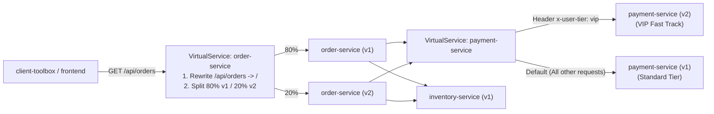

# Module 02 Lab: Traffic Routing, Subsets, Consistent Hashing, `Sidecar` Scoping & The `503 NR` Trap

## Learning Objectives
By the end of this lab, you will be able to:
1. Observe default load balancing across `v1` and `v2` pods when no `DestinationRule` or `VirtualService` is present.
2. Define `DestinationRule` subsets (`v1` and `v2`) and verify how Envoy creates dedicated subset clusters in CDS.
3. Implement L7 header-based routing (`x-user-tier: vip` -> `payment-service` `v2`), weighted canary traffic splitting (`80%` `v1` / `20%` `v2` for `order-service`), and URI prefix rewriting.
4. Configure session affinity using `consistentHash` on an HTTP header (`x-session-id`).
5. Scope Envoy's configuration footprint using the `Sidecar` CRD and measure the exact reduction in Envoy clusters.
6. Reproduce, diagnose, and fix the notorious **`503 NR` (No Route / No Cluster) Evaluation Order Trap**.

---

## Prerequisites & Version Baseline Pre-Flight Verification

> **Version Baseline (November 2026)**: Istio `1.32.0` | Envoy `v1.40` | Kubernetes `v1.36+` | Gateway API `v1.6.1`
> **Fellowship Reference**: **[Week 03: Service Discovery & L7 Traffic Routing](../fellowship/week-03-service-discovery-and-l7-routing/WEEK.md)** | [`../VERSIONS.md`](../VERSIONS.md)

- Kubernetes `v1.36+` cluster with Istio `1.32.0` installed and the `orderflow` namespace running from Module 00/01.
- Verify the Istio control plane version and clean up any leftover routing rules in `orderflow` before starting:
  ```bash
  istioctl version
  kubectl delete virtualservice,destinationrule,sidecar --all -n orderflow
  ```

---

## Architecture & Expected Traffic Flow



---

## Step-by-Step Implementation

### Step 1: Observe Baseline Routing Without `VirtualService` or `DestinationRule`

When no `VirtualService` or `DestinationRule` exists, Envoy routes all traffic for `order-service` to the single default cluster `outbound|8080||order-service.orderflow.svc.cluster.local`, which contains endpoints for **both** `v1` and `v2` pods.

Run 10 requests from `client-toolbox` to `order-service` and inspect which versions of `order-service` and `payment-service` respond:

```bash
TOOLBOX_POD=$(kubectl get pod -n orderflow -l app=client-toolbox -o jsonpath='{.items[0].metadata.name}')

for i in $(seq 1 6); do
  kubectl exec -n orderflow "$TOOLBOX_POD" -c client-toolbox -- curl -s http://order-service:8080 | grep -E '"name":|"body":'
  echo "---"
done
```

**Expected Output:**
You will see a mix of `order-service-v1` and `order-service-v2`, calling a mix of `payment-service-v1` and `payment-service-v2`:
```text
  "name": "order-service-v1",
  "body": "Order processed by v1",
      "name": "payment-service-v2",
      "body": "Payment processed by v2",
---
  "name": "order-service-v2",
  "body": "Order processed by v2",
      "name": "payment-service-v1",
      "body": "Payment processed by v1",
```

Check the clusters currently configured on `client-toolbox` for `order-service` and `payment-service`:

```bash
istioctl proxy-config cluster "$TOOLBOX_POD.orderflow" | grep -E "order-service|payment-service"
```

**Expected Output:**
```text
 order-service.orderflow.svc.cluster.local      8080  -      outbound  EDS
 payment-service.orderflow.svc.cluster.local    8080  -      outbound  EDS
```
Notice the `SUBSET` column is `-` (only the default cluster exists).

---

### Step 2: Apply `DestinationRule` Subsets First (Safe Rollout Pattern)

Now apply `destination-rules.yaml`, which defines `v1` and `v2` subsets for both `order-service` and `payment-service`:

```bash
kubectl apply -f /home/chan/Documents/Istio/02-service-discovery-and-routing/manifests/destination-rules.yaml
```

Inspect the Envoy clusters on `client-toolbox` again:

```bash
istioctl proxy-config cluster "$TOOLBOX_POD.orderflow" | grep -E "order-service|payment-service"
```

**Expected Output:**
```text
SERVICE FQDN                                   PORT  SUBSET  DIRECTION  TYPE  DESTINATION RULE
order-service.orderflow.svc.cluster.local      8080  -       outbound   EDS   order-service-dr.orderflow
order-service.orderflow.svc.cluster.local      8080  v1      outbound   EDS   order-service-dr.orderflow
order-service.orderflow.svc.cluster.local      8080  v2      outbound   EDS   order-service-dr.orderflow
payment-service.orderflow.svc.cluster.local    8080  -       outbound   EDS   payment-service-dr.orderflow
payment-service.orderflow.svc.cluster.local    8080  v1      outbound   EDS   payment-service-dr.orderflow
payment-service.orderflow.svc.cluster.local    8080  v2      outbound   EDS   payment-service-dr.orderflow
```

Verify that each subset cluster (`v1` vs `v2`) only contains the Pod IPs matching its label selector (`version: v1` vs `version: v2`):

```bash
istioctl proxy-config endpoint "$TOOLBOX_POD.orderflow" --cluster "outbound|8080|v1|order-service.orderflow.svc.cluster.local"
istioctl proxy-config endpoint "$TOOLBOX_POD.orderflow" --cluster "outbound|8080|v2|order-service.orderflow.svc.cluster.local"
```

---

### Step 3: Apply `VirtualService` for Canary Splits, Header Routing & URI Rewrites

Now that the subset clusters exist in CDS and their endpoints are populated in EDS, apply `virtual-services-routing.yaml`:

```bash
kubectl apply -f /home/chan/Documents/Istio/02-service-discovery-and-routing/manifests/virtual-services-routing.yaml
```

Let's review what `virtual-services-routing.yaml` configures:
1. **`order-service-vs`**:
   - Rewrites URI prefix `/api/orders` to `/` so external/frontend callers can request `/api/orders` while `order-service` receives `/`.
   - Splits traffic **80% to `v1`** and **20% to `v2`**.
2. **`payment-service-vs`**:
   - If HTTP header `x-user-tier: vip` is present, routes **100% to `v2`**.
   - Otherwise, routes **100% to `v1`**.

#### 3.1 Verify URI Rewrite and 80/20 Weighted Canary Split on `order-service`

Call `http://order-service:8080/api/orders` 10 times from `client-toolbox`:

```bash
for i in $(seq 1 10); do
  kubectl exec -n orderflow "$TOOLBOX_POD" -c client-toolbox -- curl -s http://order-service:8080/api/orders | grep -m 1 '"name":'
done
```

**Expected Output:**
Approximately 8 responses from `order-service-v1` and 2 responses from `order-service-v2`:
```text
  "name": "order-service-v1",
  "name": "order-service-v1",
  "name": "order-service-v2",
  "name": "order-service-v1",
  "name": "order-service-v1",
  "name": "order-service-v1",
  "name": "order-service-v1",
  "name": "order-service-v2",
  "name": "order-service-v1",
  "name": "order-service-v1",
```

#### 3.2 Verify Header-Based Routing (`x-user-tier: vip`) to `payment-service`

First, call `payment-service` without the header (should always hit `payment-service-v1`):

```bash
for i in $(seq 1 5); do
  kubectl exec -n orderflow "$TOOLBOX_POD" -c client-toolbox -- curl -s http://payment-service:8080 | grep '"name":'
done
```

**Expected Output:**
```text
  "name": "payment-service-v1",
  "name": "payment-service-v1",
  "name": "payment-service-v1",
  "name": "payment-service-v1",
  "name": "payment-service-v1",
```

Now pass `-H "x-user-tier: vip"` (should always hit `payment-service-v2`):

```bash
for i in $(seq 1 5); do
  kubectl exec -n orderflow "$TOOLBOX_POD" -c client-toolbox -- curl -s -H "x-user-tier: vip" http://payment-service:8080 | grep '"name":'
done
```

**Expected Output:**
```text
  "name": "payment-service-v2",
  "name": "payment-service-v2",
  "name": "payment-service-v2",
  "name": "payment-service-v2",
  "name": "payment-service-v2",
```

Inspect the Envoy RDS route configuration on `client-toolbox` to see how `x-user-tier: vip` was compiled into Envoy's route table:

```bash
istioctl proxy-config route "$TOOLBOX_POD.orderflow" --name 8080 -o json | grep -A 25 '"name": "vip-fast-track"'
```

---

### Step 4: Test Session Affinity with `consistentHash` Load Balancing

Suppose `order-service` has multiple pod endpoints (`v1` and `v2`) and we want every request with the same `x-session-id` header to consistently hit the **exact same pod endpoint**.

Apply `consistent-hash-lb.yaml`:

```bash
kubectl apply -f /home/chan/Documents/Istio/02-service-discovery-and-routing/manifests/consistent-hash-lb.yaml
```

Inspect the cluster load balancer type in Envoy (`RING_HASH`):

```bash
istioctl proxy-config cluster "$TOOLBOX_POD.orderflow" --fqdn order-service.orderflow.svc.cluster.local -o json | grep -E '"name":|"lbPolicy":'
```

**Expected Output:**
```json
        "name": "outbound|8080||order-service.orderflow.svc.cluster.local",
        "lbPolicy": "RING_HASH",
```

Test sending 5 requests with `x-session-id: user-alpha-101` — notice that every single request lands on the exact same backend pod (as opposed to alternating between `v1` and `v2`):

```bash
for i in $(seq 1 5); do
  kubectl exec -n orderflow "$TOOLBOX_POD" -c client-toolbox -- curl -s -H "x-session-id: user-alpha-101" http://order-service:8080 | grep -m 1 '"name":'
done
```

Restore the standard `destination-rules.yaml` and `virtual-services-routing.yaml` after testing:

```bash
kubectl apply -f /home/chan/Documents/Istio/02-service-discovery-and-routing/manifests/destination-rules.yaml
kubectl apply -f /home/chan/Documents/Istio/02-service-discovery-and-routing/manifests/virtual-services-routing.yaml
```

---

### Step 5: Scope Envoy Memory & xDS Push Size with the `Sidecar` Resource

First, count how many total clusters Envoy in `client-toolbox` is currently tracking across the entire Kubernetes cluster (including `kube-system`, `default`, etc.):

```bash
istioctl proxy-config cluster "$TOOLBOX_POD.orderflow" | wc -l
```

Look at the services outside `orderflow` that `client-toolbox` knows about (e.g., `kubernetes.default.svc.cluster.local`, `kube-dns.kube-system.svc.cluster.local`):

```bash
istioctl proxy-config cluster "$TOOLBOX_POD.orderflow" | grep -v "orderflow"
```

Now apply `sidecar-scope.yaml`, which scopes workloads in `orderflow` to only receive xDS configuration for `./*` (the `orderflow` namespace) and `istio-system/*`:

```bash
kubectl apply -f /home/chan/Documents/Istio/02-service-discovery-and-routing/manifests/sidecar-scope.yaml
```

Re-run the cluster count and filter check:

```bash
istioctl proxy-config cluster "$TOOLBOX_POD.orderflow" | wc -l
istioctl proxy-config cluster "$TOOLBOX_POD.orderflow" | grep -v "orderflow"
```

**Expected Output:**
All clusters from `default`, `kube-system`, and other unrelated namespaces have been completely pruned from Envoy's memory! Only `orderflow`, `istio-system`, and Envoy internal clusters (`BlackHoleCluster`, `PassthroughCluster`, `InboundPassthroughClusterIpv4`) remain.

---

### Step 6: Troubleshooting Exercise — Reproduce & Fix the `503 NR` Missing Subset Bug

Let's intentionally trigger the **Evaluation Order / Missing Subset Trap** by applying `broken-subset-trap.yaml`, which routes `inventory-service` traffic to `subset: v2-canary` — a subset that does not exist in any `DestinationRule`!

```bash
kubectl apply -f /home/chan/Documents/Istio/02-service-discovery-and-routing/manifests/broken-subset-trap.yaml
```

Now call `inventory-service` from `client-toolbox` with `-i` to see the HTTP response status:

```bash
kubectl exec -n orderflow "$TOOLBOX_POD" -c client-toolbox -- curl -i -s http://inventory-service:8080
```

**Expected Output:**
```http
HTTP/1.1 503 Service Unavailable
date: Tue, 17 Nov 2026 16:10:00 GMT
server: envoy
content-length: 0
```

#### How to Diagnose This in Production:
1. Run `istioctl analyze -n orderflow`:
   ```bash
   istioctl analyze -n orderflow
   ```
   **Expected Output:**
   ```text
   Error [IST0101] (VirtualService orderflow/inventory-broken-vs) Referenced host+subset in destinationrule not found: "inventory-service.orderflow.svc.cluster.local+v2-canary"
   ```
2. Check Envoy's route vs. cluster table:
   ```bash
   istioctl proxy-config route "$TOOLBOX_POD.orderflow" --name 8080 -o json | grep "v2-canary"
   istioctl proxy-config cluster "$TOOLBOX_POD.orderflow" | grep "inventory-service"
   ```
   You will see that the Route points to `outbound|8080|v2-canary|inventory-service.orderflow.svc.cluster.local`, which is **missing** from `proxy-config cluster`!

#### Fix the Issue:
Delete the broken `VirtualService` and verify `inventory-service` immediately returns `HTTP/1.1 200 OK`:

```bash
kubectl delete -f /home/chan/Documents/Istio/02-service-discovery-and-routing/manifests/broken-subset-trap.yaml
kubectl exec -n orderflow "$TOOLBOX_POD" -c client-toolbox -- curl -i -s http://inventory-service:8080 | head -n 10
```
