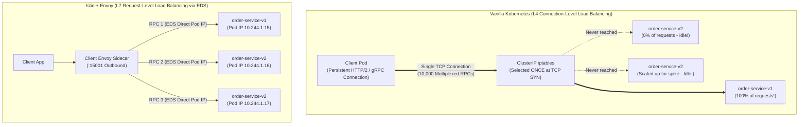
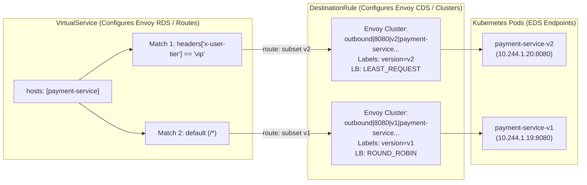
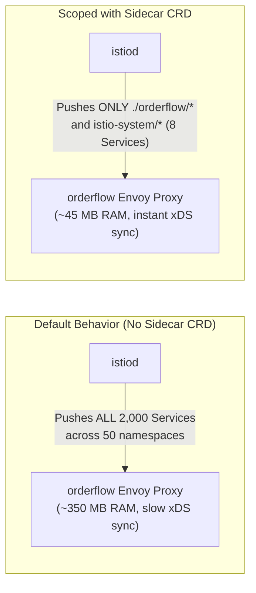

# Module 02: Service Discovery, Traffic Routing (`VirtualService` & `DestinationRule`) & Mesh Scaling (`Sidecar`)

> **Version & Fellowship Context**
> - **Version Baseline (November 2026)**: Istio `1.32.0` | Envoy `v1.40` | Kubernetes `v1.36+` | Gateway API `v1.6.1` — see [`../VERSIONS.md`](../VERSIONS.md) and [`../COMPATIBILITY.md`](../COMPATIBILITY.md).
> - **Fellowship Cohort 01 Mapping**: Complete this module alongside **[Week 03: Service Discovery & L7 Traffic Routing](../fellowship/week-03-service-discovery-and-l7-routing/WEEK.md)**.

## 1. Kubernetes Service Discovery vs. Istio Service Discovery

To understand why Istio's traffic routing primitives exist, we first need to examine how standard Kubernetes service routing works and where it breaks down in production.

### 1.1 How Standard Kubernetes (`kube-proxy`) Routes Traffic

In vanilla Kubernetes:
1. You create a `Service` (e.g., `order-service`) with a label selector `app: order-service`.
2. The Kubernetes EndpointSlice controller watches pods matching `app: order-service` (both `version: v1` and `version: v2` pods!) and populates an `EndpointSlice` object with their Pod IPs.
3. On every node, `kube-proxy` watches `Service` and `EndpointSlice` objects and writes `iptables` (or IPVS) rules that map the Service's virtual ClusterIP (`10.96.45.12:8080`) to a random pod IP at **TCP connection establishment (`SYN`) time**.

### 1.2 Why `kube-proxy` Fails for Modern Microservices



1. **The gRPC / HTTP/2 Multiplexing Problem**:
   gRPC and HTTP/2 multiplex thousands of concurrent requests over a *single* long-lived TCP connection. Because `kube-proxy` only load-balances when a new TCP connection is opened, all 10,000 gRPC requests from a client pod get pinned to a single backend pod replica, even if Kubernetes HPA scales the deployment up from 1 to 10 replicas!
2. **No Subset Awareness**:
   A Kubernetes `Service` selector (`app: order-service`) cannot split traffic `90%` to `version: v1` and `10%` to `version: v2` unless you manage replica counts manually (e.g., running 9 replicas of `v1` and 1 replica of `v2`, which is impossible for `99%` / `1%` canary splits).
3. **No L7 Routing**:
   `kube-proxy` cannot inspect HTTP headers (`x-user-tier: vip`), URI paths, or JWT claims to route traffic dynamically.

### 1.3 How Istio Service Discovery & Envoy EDS Work

In Istio:
1. `istiod` watches Kubernetes `Services`, `EndpointSlices`, and `Pods` (along with Istio `ServiceEntry` and `WorkloadEntry` resources).
2. Notice what Envoy does with the Kubernetes ClusterIP (`10.96.45.12`):
   When the application calls `http://order-service:8080`, DNS resolves `order-service` to `10.96.45.12`. The client's `iptables` redirects the packet to Envoy on `15001`.
3. **Envoy bypasses `kube-proxy` completely!** Envoy looks up the Cluster `outbound|8080||order-service.orderflow.svc.cluster.local`, picks a specific healthy **Pod IP** (`10.244.1.15:8080`) from its **EDS (Endpoint Discovery Service)** pool, and opens an mTLS connection *directly* to that Pod IP, load-balancing every individual HTTP/1.1, HTTP/2, or gRPC request at Layer 7.

---

## 2. `VirtualService` vs. `DestinationRule`

The single most important conceptual distinction in Istio traffic management is how `VirtualService` and `DestinationRule` map to Envoy's internal xDS configuration.



| CRD | Question It Answers | Envoy xDS Equivalent | What It Configures |
| :--- | :--- | :--- | :--- |
| **`VirtualService`** | **"Where should this request go?"** (Routing) | **RDS (Route Configuration)** | Match conditions (URI prefix/exact/regex, HTTP headers, query params, source labels, port), weighted destination splits, URI rewrites, redirects, timeouts, retries, fault injection, and mirroring. |
| **`DestinationRule`** | **"How should Envoy talk to that destination once chosen?"** (Cluster Policy & Subsets) | **CDS (Cluster Configuration)** | Named **Subsets** (grouping pod endpoints by labels like `version: v1`), Load Balancing algorithms (`ROUND_ROBIN`, `LEAST_REQUEST`, `consistentHash`), Connection Pool limits, Outlier Detection (circuit breaking), and TLS/mTLS settings. |

### 2.1 How Hostname Resolution Works in `hosts`

In both `VirtualService` and `DestinationRule`, you specify a `host` (or `hosts` list):
```yaml
hosts:
  - payment-service
```
**Production Best Practice**: While short names (`payment-service`) work when the CRD is in the same namespace (`orderflow`), Istio resolves unqualified hostnames relative to the **namespace of the CRD**, *not* the namespace of the calling workload. In production or cross-namespace setups, always prefer the **Fully Qualified Domain Name (FQDN)**:
```yaml
hosts:
  - payment-service.orderflow.svc.cluster.local
```

---

## 3. The Evaluation Order Trap (`503 NR` / Blackholing)

One of the most frequent production incidents with Istio occurs when deploying a new `VirtualService` and `DestinationRule` for canary routing.

### 3.1 Why Order of Application Matters

Suppose you want to route `100%` of `payment-service` traffic to `subset: v1`.
- By default (before any `DestinationRule` exists), Envoy only has the **default cluster**:
  `outbound|8080||payment-service.orderflow.svc.cluster.local`
- Envoy **does not create subset clusters** (`outbound|8080|v1|payment-service.orderflow.svc.cluster.local`) until a `DestinationRule` defining `subsets: [{name: v1, ...}]` is applied.

```mermaid
sequenceDiagram
    autonumber
    participant Operator as DevOps / CI Pipeline
    participant Istiod as istiod (Control Plane)
    participant Envoy as Client Envoy Proxy
    participant App as Caller (order-service)

    rect rgb(90, 30, 30)
    Note over Operator,App: BAD ROLLOUT ORDER: VirtualService Applied BEFORE DestinationRule
    Operator->>Istiod: 1. kubectl apply VirtualService (routes to subset: v1)
    Istiod->>Envoy: Push RDS Route -> target cluster "outbound|8080|v1|payment-service..."
    App->>Envoy: HTTP GET http://payment-service:8080
    Note over Envoy: Cluster "outbound|8080|v1|..." DOES NOT EXIST in CDS!
    Envoy-->>App: HTTP 503 Service Unavailable (Response Flag: NR / NC)
    end

    rect rgb(25, 75, 45)
    Note over Operator,App: SAFE PRODUCTION ROLLOUT ORDER
    Operator->>Istiod: 1. kubectl apply DestinationRule (defines subsets v1, v2)
    Istiod->>Envoy: Push CDS + EDS -> Creates "outbound|8080|v1|..." & populates endpoints
    Note over Operator,Envoy: Wait a few seconds for CDS/EDS convergence
    Operator->>Istiod: 2. kubectl apply VirtualService (routes to subset: v1)
    Istiod->>Envoy: Push RDS Route -> target cluster "outbound|8080|v1|..." (Already Warm!)
    App->>Envoy: HTTP GET http://payment-service:8080
    Envoy-->>App: HTTP 200 OK (Zero dropped packets!)
    end
```



### 3.2 Production Rule for Zero-Downtime Rollouts
1. **When Adding Routing to Subsets**:
   - **Step 1**: Apply the `DestinationRule` first so `istiod` pushes the new subset `Clusters` (CDS) and `Endpoints` (EDS) to all Envoys.
   - **Step 2**: Verify sync (`istioctl proxy-status`) or wait briefly, then apply the `VirtualService` referencing those subsets.
2. **When Deleting Subsets**:
   - Reverse the order! Remove the subset reference from the `VirtualService` first, wait for RDS to update, and *only then* delete the subset from the `DestinationRule`.

---

## 4. Load Balancing Algorithms & Consistent Hashing

Inside a `DestinationRule`, `spec.trafficPolicy.loadBalancer` controls how the client Envoy selects an endpoint from the cluster's EDS pool.

### 4.1 Standard Load Balancers (`simple`)

| Algorithm | Behavior in Envoy | Best Used When |
| :--- | :--- | :--- |
| **`LEAST_REQUEST`** *(Istio Default)* | Envoy picks 2 random healthy endpoints (`P2C` — Power of Two Random Choices) and sends the request to the one with fewer active in-flight requests (`rq_active`). | **General Production Default.** Automatically adapts if one pod replica is on a noisy neighbor node or processing a slow query. |
| **`ROUND_ROBIN`** | Cycles sequentially through every healthy endpoint in the EDS list (`E1 -> E2 -> E3 -> E1`). | Deterministic testing, labs, or homogeneous stateless endpoints with identical latency profiles. |
| **`RANDOM`** | Picks a uniform random healthy endpoint. | Simple stateless workloads when avoiding any state tracking overhead. |
| **`PASSTHROUGH`** | Disables Envoy load balancing; forwards the connection to the original destination IP requested by the caller. | Headless services, stateful peer-to-peer clusters (Cassandra, Kafka), or `ServiceEntry` with `resolution: NONE`. |

> **Wait — Is `ROUND_ROBIN` or `LEAST_REQUEST` the default?**
> Prior to Istio 1.18, `ROUND_ROBIN` was the default. Starting in Istio 1.18+, Istio changed the default load balancing policy to **`LEAST_REQUEST`** because P2C least-request significantly reduces tail latency (`p99`) under uneven pod load!

### 4.2 Session Affinity / Sticky Routing (`consistentHash`)

For stateful caching layers, WebSocket gateways, or in-memory user session stores where requests from the same user or tenant should consistently land on the same pod replica (unless that pod dies), use `consistentHash`:

```yaml
trafficPolicy:
  loadBalancer:
    consistentHash:
      httpHeaderName: x-session-id
      # Alternative hash keys:
      # httpCookie:
      #   name: user-session
      #   ttl: 3600s
      # useSourceIp: true
      # httpQueryParameterName: session_id
```
Under the hood, Envoy builds a **Ring Hash** (or Maglev table) over the healthy EDS endpoints. If a pod scales up or down, only $\approx 1/N$ of keys remap to a different pod.

---

## 5. Scaling the Mesh: The `Sidecar` CRD

### 5.1 The $O(N^2)$ Full-Mesh Memory & xDS Push Problem

By default, Istio assumes every workload in the cluster might call every other workload in the cluster:
- If your Kubernetes cluster has **2,000 Services** across 50 namespaces, `istiod` pushes the `Listeners`, `Routes`, `Clusters`, and `Endpoints` for all 2,000 services to **every single Envoy proxy**.
- Every time a pod scales up or down in *any* namespace, `istiod` must push an EDS update to thousands of Envoy sidecars that will never talk to that service.
- Each Envoy sidecar consumes **hundreds of megabytes of RAM** just storing unused xDS cluster definitions.

### 5.2 Scoping Egress Visibility with `Sidecar`

The `Sidecar` CRD restricts which namespaces and services `istiod` compiles into a workload's Envoy xDS configuration:

```yaml
apiVersion: networking.istio.io/v1
kind: Sidecar
metadata:
  name: default
  namespace: orderflow
spec:
  egress:
    - hosts:
        - "./*"                 # All services in the same namespace (orderflow)
        - "istio-system/*"      # Control plane & telemetry services in istio-system
```



### 5.3 Production Best Practices for `Sidecar`
1. **Deploy a Root Namespace Default**:
   Create a mesh-wide default `Sidecar` in `istio-system` (the root namespace) with `hosts: ["./*", "istio-system/*"]`. Every namespace automatically inherits this scope unless it defines its own namespace-level `Sidecar` with explicit cross-namespace dependencies (e.g., `"shared-payments/payment-gateway.shared-payments.svc.cluster.local"`).
2. **Beware `exportTo` on `VirtualService`, `DestinationRule`, and `ServiceEntry`**:
   In addition to `Sidecar` (which is consumer-side filtering), service owners can set `spec.exportTo: ["."]` on `VirtualService`, `DestinationRule`, and `ServiceEntry` to prevent their private routing rules from leaking to other namespaces.
