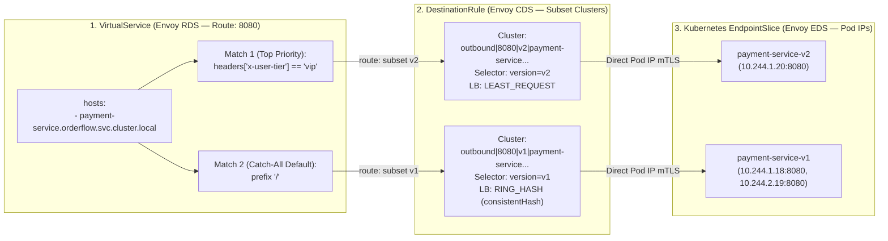
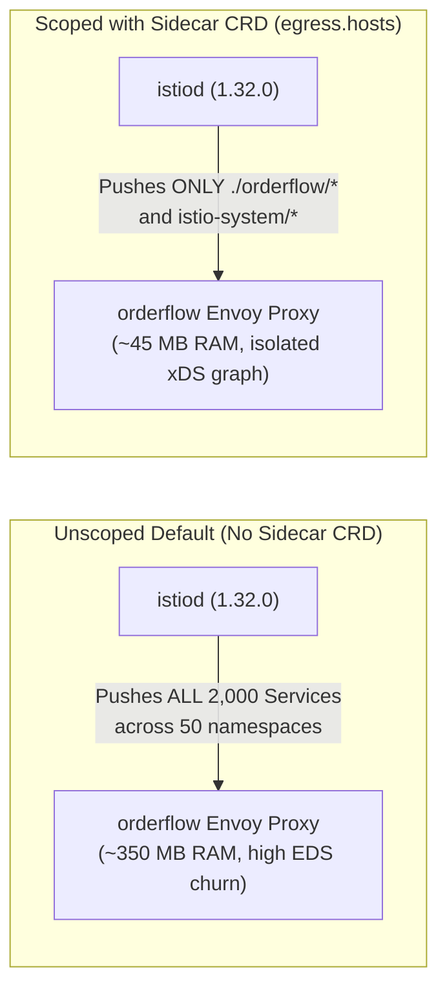

[Fellowship Portal](../README.md) | [Week 03 Guide](../fellowship/week-03-service-discovery-and-l7-routing/WEEK.md) | [<- Module 01](../01-architecture-and-internals/README.md) | [Guided Lab (LAB.md)](./LAB.md) | [Next: Module 03 ->](../03-gateways-ingress-and-egress/README.md)

# Module 02: Service Discovery, Traffic Routing (`VirtualService` & `DestinationRule`) & Mesh Scaling (`Sidecar`)

> **Version & Fellowship Context**
> - **Authoritative Baseline**: Istio `1.32.0` | Envoy `v1.40` | Kubernetes `v1.36+` | Gateway API `v1.6.1` — see [`../VERSIONS.md`](../VERSIONS.md) and [`../COMPATIBILITY.md`](../COMPATIBILITY.md).
> - **Fellowship Cohort 01 Mapping**: Complete this module alongside **[Week 03: Service Discovery & L7 Traffic Routing (`NP-103`)](../fellowship/week-03-service-discovery-and-l7-routing/WEEK.md)**.
> - **Estimated Completion Time**: `1 hour 25 mins` across 3 progressive lessons (`25–30 mins` each) + `45 mins` Guided Lab (`LAB.md`).
> - **Prerequisites**: Completed [Module 01 (`README.md` & `LAB.md`)](../01-architecture-and-internals/README.md) with `orderflow` baseline pods running (`2/2 READY`).

---

## 1. NovaPay Engineering Context & Alex Morgan's Module 02 Briefing

### 1.1 What Is Happening at NovaPay?
In Week 03 of the NovaPay Platform Engineering Apprenticeship (**Ticket `NP-103` & Incident `INC-03`**), we are preparing the `orderflow` checkout pipeline for our `v2` release (`order-service-v2` and `payment-service-v2`). Three real production problems drive everything you will learn in this module:
1. **The gRPC / HTTP/2 Multiplexing Pinning Outage**: When `payment-service` scaled up under load in vanilla Kubernetes, `kube-proxy` kept all multiplexed gRPC streams pinned to the original pods while newly scaled pods sat at `0%` CPU.
2. **The `503 NR` Canary Outage (`INC-03`)**: A team applied a `VirtualService` referencing `subset: v2` before the `DestinationRule` defining `v2` existed in Envoy's `CDS` table, dropping checkout requests with `503 Service Unavailable (NR)`.
3. **The $O(N^2)$ Envoy Memory & Push Bloat Problem**: On shared multi-tenant clusters with 2,000 Services across 50 namespaces, every Envoy sidecar in `orderflow` consumed `350 MB` of RAM tracking unrelated services until scoped with a `Sidecar` CRD.

### 1.2 Alex Morgan's Briefing

> **Alex Morgan (Senior Platform Engineer — Mentor Briefing)**
> *"Now that you know how Envoy `v1.40`'s 7-stage xDS pipeline works from Module 01, Layer-7 traffic engineering in Module 02 is going to click immediately.*
>
> *Just remember our two golden rules:*
> 1. ***`VirtualService` programs Envoy `RDS` (Where to route), while `DestinationRule` programs Envoy `CDS` (Who belongs to each subset & How to connect).*** *Because a route (`RDS`) cannot forward packets to a cluster (`CDS`) that doesn't exist yet, you must always apply `DestinationRule` before `VirtualService` when creating subsets!*
> 2. ***Never leave a production namespace unscoped.*** *A 15-line `Sidecar` CRD (`egress.hosts: ["./*", "istio-system/*"]`) is the difference between a lean `45 MB` Envoy proxy and a `350 MB` memory monster.*
>
> *Work through the three focused lessons below in order, and then put every concept to the test in `LAB.md`."*

---

## 2. Progressive Lesson Milestones Table

| Lesson | Title & Link | Core NovaPay Focus & Technical Mechanisms | Est. Time |
| :--- | :--- | :--- | :--- |
| **Lesson 02.1** | **[Vanilla Kubernetes L4 Discovery (`kube-proxy`) vs. Istio Service Discovery & Envoy `EDS`](./lessons/01-k8s-l4-discovery-vs-istio-eds.md)** | Why `kube-proxy` L4 connection-level load balancing fails for HTTP/2 & gRPC multiplexing; how `istiod` watches `EndpointSlices` and programs Envoy `EDS` for direct Pod-to-Pod L7 request load balancing. | `25 mins` |
| **Lesson 02.2** | **[`VirtualService` (`RDS`), `DestinationRule` (`CDS`) & The `503 NR` Evaluation Order Trap](./lessons/02-virtualservice-destinationrule-and-order-trap.md)** | Mapping `VirtualService` to `RDS` and `DestinationRule` to `CDS`; FQDN host resolution rules; top-down `http[]` match precedence; diagnosing and preventing the **`503 NR` (`IST0101`) Evaluation Order Trap** (`INC-03`). | `30 mins` |
| **Lesson 02.3** | **[Load Balancing Algorithms (`LEAST_REQUEST` vs. `consistentHash`) & Solving $O(N^2)$ Mesh Bloat with `Sidecar`](./lessons/03-load-balancing-and-sidecar-scoping.md)** | Envoy load balancers (`LEAST_REQUEST` P2C default, `ROUND_ROBIN`, `RANDOM`, `PASSTHROUGH`, and `consistentHash` `RING_HASH` session affinity); solving the $O(N^2)$ xDS memory problem with the **`Sidecar` CRD** and **`exportTo`**. | `30 mins` |
| **Guided Lab** | **[Module 02 Hands-On Lab (`LAB.md`)](./LAB.md)** | Live implementation of `DestinationRule` subsets, `VirtualService` 80/20 canary splits & VIP header routing, `consistentHash` session affinity, `Sidecar` xDS pruning, and reproducing/fixing `503 NR`. | `45 mins` |

---

## 3. Architectural Synthesis & End-to-End Mechanism Diagrams

### 3.1 `VirtualService` (`RDS`) + `DestinationRule` (`CDS`) + `EndpointSlice` (`EDS`) Synthesis

#### 6-Part Synthesis Walkthrough: L7 Subset Routing & Load Balancing
1. **What initiates the operation?**
   A Platform Engineer applies a `DestinationRule` (defining subsets `v1` and `v2` for `payment-service`) followed by a `VirtualService` (routing `x-user-tier: vip` to `v2` and default traffic to `v1`), and `order-service` sends an HTTP request to `http://payment-service:8080`.
2. **Which component receives it?**
   `istiod` receives both CRDs from `kube-apiserver` and pushes `CDS`, `EDS`, and `RDS` updates over ADS (`:15012`) to `order-service`'s Envoy proxy. At runtime, `order-service`'s local Envoy proxy (`:15001`) intercepts the outbound HTTP request.
3. **What information is exchanged?**
   Envoy's `http_connection_manager` evaluates `Route: 8080` (`RDS`) from top to bottom. If the request carries HTTP header `x-user-tier: vip`, Rule 1 matches and selects cluster `outbound|8080|v2|payment-service.orderflow.svc.cluster.local`. Otherwise, Rule 2 matches and selects `outbound|8080|v1|payment-service.orderflow.svc.cluster.local`.
4. **What changes in the system?**
   Inside the selected `CDS` cluster, Envoy applies that subset's configured load balancing policy (`LEAST_REQUEST` P2C or `RING_HASH` `consistentHash` on `x-session-id`) across only the healthy Pod IPs in `EDS` matching that subset's label selector (`version=v1` or `version=v2`), and opens a direct Pod-to-Pod mTLS connection.
5. **How can you observe/verify it on your cluster?**
   - Verify subset clusters in `CDS`: `istioctl proxy-config cluster <pod>.orderflow --fqdn payment-service.orderflow.svc.cluster.local`
   - Verify route rules in `RDS`: `istioctl proxy-config route <pod>.orderflow --name 8080 -o json`
   - Verify subset endpoints in `EDS`: `istioctl proxy-config endpoint <pod>.orderflow --cluster "outbound|8080|v2|payment-service.orderflow.svc.cluster.local"`
6. **What happens if a component fails?**
   - **If `VirtualService` is applied before `DestinationRule` (`INC-03`)**: The route points to `outbound|8080|v2|...` before that cluster exists in `CDS`. Envoy returns **`503 Service Unavailable (NR)`** and `istioctl analyze` reports **`Error [IST0101]`**.
   - **If all pods matching `version: v2` crash or scale to 0**: The cluster exists in `CDS`, but its `EDS` endpoint list is empty. Envoy returns **`503 Service Unavailable (UH — No Healthy Upstream)`**.

---

### 3.2 `Sidecar` CRD Egress Scoping Synthesis

#### 6-Part Synthesis Walkthrough: `Sidecar` CRD xDS Pruning
1. **What initiates the operation?**
   A Platform Engineer applies a `Sidecar` CRD in `orderflow` (or a mesh-wide default in `istio-system`) with `spec.egress[0].hosts: ["./*", "istio-system/*"]`.
2. **Which component receives it?**
   `istiod` receives the `Sidecar` resource and filters the outbound service discovery graph for all workloads in `orderflow`.
3. **What information is exchanged?**
   `istiod` pushes a trimmed `CDS`, `LDS`, and `RDS` configuration over ADS (`:15012`) containing only services in `orderflow` and `istio-system`.
4. **What changes in the system?**
   Envoy garbage-collects all clusters, listeners, routes, and endpoints belonging to unrelated namespaces (`default`, `kube-system`, `legacy-uninjected`), reducing proxy memory footprint and eliminating unnecessary EDS pushes when external namespaces scale.
5. **How can you observe/verify it on your cluster?**
   - Run `istioctl proxy-config cluster <pod>.orderflow | grep -v "orderflow"` before and after applying the `Sidecar` CRD.
6. **What happens if a component fails?**
   - If a workload in `orderflow` attempts to call a service in an unscoped namespace while `outboundTrafficPolicy.mode: REGISTRY_ONLY` is set on the `Sidecar`, Envoy blocks the call via `BlackHoleCluster` (`502` / `503`).

---

## 4. Module 02 Definition of Done

Before moving on to Module 03, verify that you have completed all three lessons and [`LAB.md`](./LAB.md):
- [ ] Completed **[Lesson 02.1](./lessons/01-k8s-l4-discovery-vs-istio-eds.md)**: You can explain why `kube-proxy` fails for HTTP/2 and gRPC multiplexing and how Envoy `EDS` load-balances individual requests at L7.
- [ ] Completed **[Lesson 02.2](./lessons/02-virtualservice-destinationrule-and-order-trap.md)**: You can map `VirtualService` (`RDS`) and `DestinationRule` (`CDS`), explain FQDN and top-down route precedence rules, and prevent the `503 NR` (`IST0101`) evaluation order trap.
- [ ] Completed **[Lesson 02.3](./lessons/03-load-balancing-and-sidecar-scoping.md)**: You can configure `LEAST_REQUEST` and `consistentHash` (`RING_HASH`) load balancing, and eliminate $O(N^2)$ xDS bloat using the `Sidecar` CRD and `exportTo`.
- [ ] Completed **[Module 02 Lab (`LAB.md`)](./LAB.md)**: You have verified 80/20 canary routing, VIP header routing, `RING_HASH` session affinity, `Sidecar` cluster pruning, and diagnosed/resolved the `503 NR` missing subset bug on your cluster.

---

## Next Step
Start with **[Lesson 02.1: Vanilla Kubernetes L4 Discovery (`kube-proxy`) vs. Istio Service Discovery & Envoy `EDS` ->](./lessons/01-k8s-l4-discovery-vs-istio-eds.md)**, or jump straight to **[Module 02 Guided Lab (`LAB.md`)](./LAB.md)** if you have finished all three lessons!
