[Fellowship Portal](../../README.md) > [Week 03](../../fellowship/week-03-service-discovery-and-l7-routing/WEEK.md) > [Module 02](../README.md) > Lesson 02.1 | [Next: Lesson 02.2 ->](./02-virtualservice-destinationrule-and-order-trap.md)

# Lesson 02.1: Vanilla Kubernetes L4 Discovery (`kube-proxy`) vs. Istio Service Discovery & Envoy `EDS`

> **Lesson Metadata**
> - **Estimated Completion Time**: `25 mins`
> - **Prerequisites**: Completed [Module 01 (`README.md` & `LAB.md`)](../../01-architecture-and-internals/README.md).
> - **Authoritative Baseline**: Istio `1.32.0` | Envoy `v1.40` | Kubernetes `v1.36+` | Gateway API `v1.6.1`
> - **Learning Objectives**:
>   1. Explain how standard Kubernetes (`EndpointSlice` + `kube-proxy` `iptables`/`IPVS`) performs **Layer 4 connection-level load balancing** at TCP `SYN` establishment time.
>   2. Diagnose the **gRPC / HTTP/2 Multiplexing Failure Mode** at NovaPay, where auto-scaled pods sit at `0%` CPU while original pods collapse under pinned connections.
>   3. Trace how Istio `istiod` and Envoy **Endpoint Discovery Service (`EDS`)** bypass `kube-proxy` entirely to perform **Layer 7 request-level load balancing** directly to Pod IPs.

---

## 1. NovaPay Engineering Context & Alex Morgan's Briefing

### 1.1 What Is Happening at NovaPay?
At **NovaPay**, `order-service` communicates with `payment-service` using high-throughput persistent HTTP/2 and gRPC streams. Before migrating `orderflow` into Istio `1.32.0`, Daniel Brooks's backend team suffered a severe production outage during a flash sale:

1. `payment-service` started with **2 pod replicas** (`Pod A` and `Pod B`).
2. `order-service` opened a persistent HTTP/2 (gRPC) TCP connection to the Kubernetes `Service` ClusterIP (`10.96.45.12:8080`). At TCP `SYN` time, `kube-proxy` mapped that connection to `Pod A`.
3. When flash-sale checkout volume spiked 5x, Kubernetes Horizontal Pod Autoscaler (HPA) scaled `payment-service` from **2 pods to 8 pods** (`Pod C` through `Pod H`).
4. **The Outage**: `Pod A` and `Pod B` hit `100%` CPU and began timing out payment authorizations, while the 6 newly scaled pods (`Pod C`–`Pod H`) sat at **`0%` CPU receiving zero requests**!

Additionally, even for HTTP/1.1 traffic in `orderflow`, remember our baseline deployment in [`00-environment-setup/manifests/base-platform.yaml`](../../00-environment-setup/manifests/base-platform.yaml): `order-service` runs **2 replicas of `v1`** and **1 replica of `v2`** behind a single `Service`. In vanilla Kubernetes, traffic splits `66.7%` to `v1` and `33.3%` to `v2` purely based on pod replica count, making a `99%` / `1%` canary impossible without running 100 pods!

### 1.2 Alex's Briefing & Intuition Analogy

> **Alex Morgan (Senior Platform Engineer — Mentor Briefing)**
> *"Why did Daniel's 6 new `payment-service` pods sit completely idle while the original 2 pods melted down? Because **`kube-proxy` doesn't balance requests—it only balances TCP `SYN` packets!***
>
> *Think of a persistent HTTP/2 or gRPC connection in vanilla Kubernetes like **building a private freight train tunnel between two warehouses**. When `order-service` opens a TCP connection (`SYN`), `kube-proxy` picks one destination warehouse (`Pod A`) and welds the tracks in place. As long as that TCP connection stays open, `order-service` sends 10,000 freight cars (multiplexed HTTP/2 streams / gRPC RPCs) down that single welded track. Kubernetes can build 6 brand-new warehouses next door, but `kube-proxy` never re-welds an existing TCP connection!*
>
> *Now look at what Envoy `v1.40` does in Istio:*
> *When `order-service` sends a packet to the `payment-service` ClusterIP (`10.96.45.12:8080`), the client pod's `iptables` grabs the packet at `:15001` **before `kube-proxy` ever sees it**. Envoy looks at the ClusterIP solely as an ID badge to look up the service name (`outbound|8080||payment-service...`), throws away the ClusterIP, and distributes **each individual HTTP/2 stream or gRPC request at Layer 7** across its own pool of direct Pod-IP connections (`10.244.1.15`, `10.244.1.16`, `10.244.2.18`) discovered via **EDS**!"*

---

## 2. Progressive Disclosure Technical Explanation

### 2.1 Core Concept: How Standard Kubernetes (`kube-proxy`) Routes Traffic (and Why It Fails at L7)

In vanilla Kubernetes without a service mesh:
1. You create a `Service` (e.g., `order-service`) with label selector `app: order-service` (note that it does *not* filter by `version: v1` or `version: v2`).
2. The Kubernetes `EndpointSlice` controller watches all ready pods matching `app: order-service` and writes their Pod IPs into an `EndpointSlice` resource.
3. On every node, `kube-proxy` watches `Service` and `EndpointSlice` resources and programs node-level `iptables` (`KUBE-SVC-*` chains with `--mode random --probability`) or `IPVS` rules that DNAT the virtual ClusterIP (`10.96.45.12:8080`) to one random backend Pod IP **only when a new TCP connection (`SYN`) is created in `conntrack`**.

This creates three fundamental production limitations:
1. **The gRPC / HTTP/2 Multiplexing Pinning Bug**: Because HTTP/2 and gRPC multiplex thousands of requests over a single long-lived TCP connection, `conntrack` maps every subsequent packet on that TCP connection to the exact same backend pod, starving newly auto-scaled pods.
2. **Replica-Coupled Traffic Splits**: You cannot route `5%` of traffic to `v2` without running 19 pods of `v1` and 1 pod of `v2`.
3. **Zero Layer-7 Intelligence**: `kube-proxy` cannot inspect HTTP headers (`x-user-tier: vip`), URI paths (`/api/orders`), or HTTP status codes (`503`).

---

### 2.2 Technical Deep Dive: How Istio Service Discovery & Envoy `EDS` Bypass `kube-proxy`

```mermaid
flowchart TB
    subgraph KubeProxyL4["1. Vanilla Kubernetes (L4 TCP Connection-Level Load Balancing)"]
        direction LR
        ClientK8s["Client App<br/>(Persistent HTTP/2 or gRPC)"] ===>|"1 TCP Connection<br/>(10,000 Multiplexed RPCs)"| VIP["Node kube-proxy iptables<br/>(Chosen ONCE at TCP SYN)"]
        VIP ===>|"100% of RPCs pinned"| Pod1["payment-service Pod 1<br/>(100% CPU - Overloaded!)"]
        VIP -.->|"0 RPCs"| Pod2["payment-service Pod 2<br/>(0% CPU - Idle!)"]
        VIP -.->|"0 RPCs (HPA Scaled)"| Pod3["payment-service Pod 3<br/>(0% CPU - Idle!)"]
    end

    subgraph IstioL7["2. Istio + Envoy v1.40 (L7 Request-Level Load Balancing via EDS)"]
        direction LR
        K8sAPI["K8s EndpointSlice<br/>(Pod IPs)"] -->|"Watch"| Istiod["istiod (Pilot)<br/>Compiles CDS + EDS"]
        ClientIstio["Client App<br/>Calls ClusterIP 10.96.45.12:8080"] -->|"Pod iptables -> :15001<br/>(Bypasses kube-proxy!)"| ClientEnvoy["Client Envoy Sidecar<br/>(:15001 virtualOutbound)"]
        Istiod ===>|"ADS Push (:15012)<br/>EDS Pod IPs"| ClientEnvoy
        ClientEnvoy -->|"RPC 1 -> Direct Pod IP"| IPod1["payment-service Pod 1<br/>(10.244.1.18:8080)"]
        ClientEnvoy -->|"RPC 2 -> Direct Pod IP"| IPod2["payment-service Pod 2<br/>(10.244.2.19:8080)"]
        ClientEnvoy -->|"RPC 3 -> Direct Pod IP"| IPod3["payment-service Pod 3<br/>(10.244.3.20:8080)"]
    end
```



#### 6-Part Mechanism Walkthrough: Istio Service Discovery & Envoy EDS Direct Routing
1. **What initiates the operation?**
   - **Control Plane Loop**: A `payment-service` pod scales up or passes its readiness probe, causing Kubernetes to update the `payment-service` `EndpointSlice` object in `kube-apiserver`.
   - **Data Plane Loop**: The `order-service` application container resolves `payment-service` via CoreDNS to its Kubernetes `Service` ClusterIP (`10.96.45.12`) and sends an HTTP/1.1, HTTP/2, or gRPC request to `10.96.45.12:8080`.
2. **Which component receives it?**
   - **Control Plane**: `istiod` (`Pilot`) receives the `EndpointSlice` watch event from `kube-apiserver`.
   - **Data Plane**: Inside the `order-service` pod's Linux network namespace, `ISTIO_OUTPUT` $\rightarrow$ `ISTIO_REDIRECT` intercepts the packet before it ever leaves the pod's `eth0` interface (where node-level `kube-proxy` rules live!) and delivers it to the client's local Envoy sidecar on `127.0.0.1:15001`.
3. **What information is exchanged?**
   - `istiod` extracts the concrete Pod IPs (`10.244.1.18:8080`, `10.244.2.19:8080`, `10.244.3.20:8080`), their node locality labels (`region`/`zone`), and their `Pod` labels (`version: v1` or `version: v2`), and pushes a `ClusterLoadAssignment` (**EDS**) protobuf over ADS (`:15012`) to every Envoy proxy in the mesh.
   - Inside the client Envoy, `virtualOutbound` (`:15001`) inspects `SO_ORIGINAL_DST` (`10.96.45.12:8080`), matches the HTTP listener (`0.0.0.0_8080`), and routes to cluster `outbound|8080||payment-service.orderflow.svc.cluster.local`.
4. **What changes in the system?**
   **Envoy completely discards the virtual ClusterIP (`10.96.45.12`) at the transport layer!** Instead, Envoy terminates the client application's local HTTP/2 or gRPC stream at Layer 7, selects a specific healthy backend **Pod IP** (`10.244.2.19:8080`) from its in-memory `EDS` endpoint pool for *each individual request/RPC*, and transmits the request over an mTLS connection directly from the caller Pod IP to the target Pod IP (`10.244.2.19:8080`). When HPA scales `payment-service` from 2 pods to 8 pods, `istiod` pushes the 6 new Pod IPs via EDS in milliseconds, and Envoy immediately distributes the very next RPCs across all 8 pods without needing the client application to reconnect!
5. **How can you observe/verify it on your cluster?**
   - Compare Kubernetes `EndpointSlices` with Envoy's `EDS` table:
     `kubectl get endpointslices -n orderflow -l kubernetes.io/service-name=order-service`
     `istioctl proxy-config endpoint deploy/client-toolbox.orderflow --cluster "outbound|8080||order-service.orderflow.svc.cluster.local"`
   - Notice that every endpoint in Envoy's `EDS` table is a real **Pod IP** (`10.244.x.x:8080`), never the Service ClusterIP (`10.96.x.x`).
6. **What happens if a component fails?**
   - If a pod fails its Kubernetes readiness probe, Kubernetes marks the endpoint `ready: false` in the `EndpointSlice`. `istiod` immediately pushes an EDS update removing (or marking `UNHEALTHY`) that Pod IP in Envoy.
   - Even faster: if a pod crashes *between* Kubernetes readiness probes (which typically run every 10 seconds) and returns `503`/`502` or TCP connect timeouts, Envoy's **Outlier Detection** (covered in Module 05) passively ejects that specific Pod IP from the local EDS pool in real time without waiting for Kubernetes!

---

### 2.3 Engineering Insight: Why Kubernetes `Service` Still Matters in Istio

A common question from backend engineers at NovaPay is: *"If Envoy bypasses `kube-proxy` and connects directly to Pod IPs via `EDS`, why do we still create a Kubernetes `Service` resource for `order-service` and `payment-service`?"*

We still need the Kubernetes `Service` for three critical reasons:
1. **CoreDNS Resolution**: Your application code (`curl http://order-service:8080`) still queries CoreDNS first. If no Kubernetes `Service` exists (and no Istio `ServiceEntry` with auto-allocated VIPs is configured), the application's `getaddrinfo()` DNS lookup fails with `NXDOMAIN` before ever opening a TCP socket for Envoy to intercept!
2. **`istiod` Service Registry & Port Protocol Discovery**: `istiod` reads the Kubernetes `Service` spec to learn the service's canonical FQDN (`order-service.orderflow.svc.cluster.local`), virtual port (`80` $\rightarrow$ `targetPort: 8080`), and Layer-7 protocol (`name: http-api` or `appProtocol: http`).
3. **Label Selector for EndpointSlices**: Kubernetes uses the `Service` label selector (`app: order-service`) to populate the `EndpointSlice` that `istiod` watches to build the base EDS pool.

---

## 3. Practical Observation & Investigation

Run these commands on your cluster right now to observe the baseline replica-skew behavior (`2` pods of `v1` vs. `1` pod of `v2`) when no `VirtualService` or `DestinationRule` is installed:

```bash
TOOLBOX_POD=$(kubectl get pod -n orderflow -l app=client-toolbox -o jsonpath='{.items[0].metadata.name}')

# 1. Inspect the 3 Pod IPs in Envoy's default EDS pool for order-service (2x v1 + 1x v2)
istioctl proxy-config endpoint "$TOOLBOX_POD.orderflow" --cluster "outbound|8080||order-service.orderflow.svc.cluster.local"

# 2. Send 6 requests and observe the ~66.7% v1 / ~33.3% v2 split driven purely by Pod count
for i in $(seq 1 6); do
  kubectl exec -n orderflow "$TOOLBOX_POD" -c toolbox -- curl -s http://order-service:8080 | grep -m 1 '"name":'
done
```

---

## 4. Knowledge Check (Engineering Judgment)

### Question 1: Why Did `kube-proxy` Pin 10,000 gRPC Requests to One Pod?
Explain the exact kernel mechanism that causes vanilla Kubernetes (`kube-proxy` in `iptables` or `IPVS` mode) to fail at distributing gRPC calls across newly scaled pods, and how Envoy `v1.40` solves it without changing a single line of gRPC client code.

<details>
<summary>Check Answer & Engineering Explanation</summary>

**Answer:**
1. **Why `kube-proxy` fails**: gRPC uses HTTP/2, which multiplexes thousands of concurrent RPC streams over a **single long-lived TCP connection**. `kube-proxy` operates at Layer 4 (`netfilter`/`conntrack`): it selects a backend Pod IP only once when the initial TCP `SYN` packet creates the `conntrack` entry. All subsequent packets on that TCP connection match the existing `conntrack` state and go to that single pod, ignoring any new pods added by HPA.
2. **How Envoy solves it**: The client pod's `istio-proxy` intercepts the connection on `:15001` via `http_connection_manager`, terminates the HTTP/2 connection locally at Layer 7, and demultiplexes each individual gRPC request (`HEADERS` + `DATA` frames). Envoy maintains its own upstream HTTP/2 connection pool to **every healthy Pod IP in `EDS`** and load-balances each individual RPC across all available pods.
</details>

### Question 2: Does Traffic in Istio Ever Touch `kube-proxy`'s `KUBE-SVC-*` Rules?
When `frontend-v1` (a sidecar-injected pod in `orderflow`) calls `http://order-service:8080` (`10.96.45.12:8080`), at what point is the destination IP rewritten from the virtual ClusterIP (`10.96.45.12`) to the real target Pod IP (`10.244.1.15`), and does the node's `kube-proxy` perform that translation?

<details>
<summary>Check Answer & Engineering Explanation</summary>

**Answer:**
**No—`kube-proxy` does not perform the translation for in-mesh traffic.**
1. Inside `frontend-v1`'s own pod network namespace, `ISTIO_OUTPUT` $\rightarrow$ `ISTIO_REDIRECT` intercepts the packet targeting `10.96.45.12:8080` and redirects it to `127.0.0.1:15001` (Envoy) *before* the packet ever exits the pod's `veth` interface onto the host node where `kube-proxy` rules reside.
2. Envoy looks up the EDS endpoint pool for `outbound|8080||order-service.orderflow.svc.cluster.local` and opens a brand-new TCP connection directly to the backend **Pod IP (`10.244.1.15:8080`)**. When that packet leaves `frontend-v1` onto the node, its destination IP is already `10.244.1.15`, so `kube-proxy`'s `KUBE-SERVICES` ClusterIP rules are completely bypassed.
</details>

---

## 5. Key Takeaways, Definition of Done & Authoritative References

### Key Takeaways
- **`kube-proxy` is an L4 TCP connection load balancer**: It selects a destination Pod IP once at TCP `SYN` time, causing severe load skew for long-lived HTTP/2 and gRPC connections.
- **Envoy + `EDS` is an L7 request load balancer**: Envoy intercepts traffic on `:15001`, bypasses `kube-proxy`, and load-balances every individual HTTP/1.1, HTTP/2, or gRPC request directly to healthy Pod IPs in its `EDS` pool.
- **Without Istio `VirtualService` + `DestinationRule`, traffic splits by pod replica count**: Because `order-service` has 2 `v1` pods and 1 `v2` pod in the same `EndpointSlice`, default EDS routing sends `66.7%` to `v1` and `33.3%` to `v2`.

### Lesson 02.1 Definition of Done
- [ ] You can explain why `kube-proxy` fails to load-balance multiplexed gRPC/HTTP2 streams across auto-scaled pods.
- [ ] You can trace how `istiod` translates Kubernetes `EndpointSlices` into Envoy `EDS` endpoints.
- [ ] You have observed the baseline `66.7%` (`v1`) / `33.3%` (`v2`) replica-driven traffic split in `orderflow`.

### Authoritative References
- [Istio Traffic Management & Service Discovery Concepts](https://istio.io/latest/docs/concepts/traffic-management/)
- [Kubernetes Blog: gRPC Load Balancing on Kubernetes Without Tears](https://kubernetes.io/blog/2018/11/07/grpc-load-balancing-on-kubernetes-without-tears/)

---

## Next Lesson
Continue to **[Lesson 02.2: `VirtualService` (`RDS`), `DestinationRule` (`CDS`) & The `503 NR` Evaluation Order Trap ->](./02-virtualservice-destinationrule-and-order-trap.md)**.
