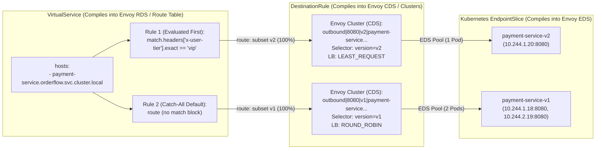

[Fellowship Portal](../../README.md) > [Week 03](../../fellowship/week-03-service-discovery-and-l7-routing/WEEK.md) > [Module 02](../README.md) > Lesson 02.2 | [<- Lesson 02.1](./01-k8s-l4-discovery-vs-istio-eds.md) | [Next: Lesson 02.3 ->](./03-load-balancing-and-sidecar-scoping.md)

# Lesson 02.2: `VirtualService` (`RDS`), `DestinationRule` (`CDS`) & The `503 NR` Evaluation Order Trap

> **Lesson Metadata**
> - **Estimated Completion Time**: `30 mins`
> - **Prerequisites**: Completed [Lesson 02.1 (`01-k8s-l4-discovery-vs-istio-eds.md`)](./01-k8s-l4-discovery-vs-istio-eds.md).
> - **Authoritative Baseline**: Istio `1.32.0` | Envoy `v1.40` | Kubernetes `v1.36+` | Gateway API `v1.6.1`
> - **Learning Objectives**:
>   1. Map Istio's **`VirtualService`** directly to Envoy's **Route Discovery Service (`RDS`)** and **`DestinationRule`** directly to Envoy's **Cluster Discovery Service (`CDS`)**.
>   2. Explain Istio's FQDN hostname resolution rules (`hosts: [payment-service.orderflow.svc.cluster.local]`) and top-down `http[]` route match precedence.
>   3. Diagnose and prevent the notorious **`503 NR` (No Route / Missing Cluster) Evaluation Order Trap** (`INC-03`) using deterministic GitOps rollout sequencing.

---

## 1. NovaPay Engineering Context & Alex Morgan's Briefing

### 1.1 What Is Happening at NovaPay?
At **NovaPay**, we are rolling out two critical `v2` upgrades in `orderflow` (Ticket `NP-103`):
- **`order-service-v2`**: Our redesigned checkout engine. Product leadership wants external and internal callers to be able to call `/api/orders` (rewritten to `/`) with an **80% `v1` / 20% `v2`** weighted canary split, regardless of the fact that `v1` has 2 pod replicas and `v2` has 1 pod replica.
- **`payment-service-v2`**: Our multi-currency instant RTP payment adapter. We want VIP customers (`x-user-tier: vip` HTTP header) routed **100% to `v2`**, while all standard customers stay **100% on `v1`**.

However, during last Tuesday's staging deployment (`INC-03`), a junior engineer pushed a Git commit that applied `virtual-services-routing.yaml` **12 seconds before** `destination-rules.yaml`. For those 12 seconds, `100%` of NovaPay checkout transactions failed with `HTTP/1.1 503 Service Unavailable (Response Flag: NR)`.

### 1.2 Alex's Briefing & Intuition Analogy

> **Alex Morgan (Senior Platform Engineer — Mentor Briefing)**
> *"Every engineer learning Istio asks the exact same question: **'Why did Istio create two separate CRDs—`VirtualService` and `DestinationRule`—instead of putting routing and subsets in one file?'***
>
> *Go back to our **Airport Terminal (Envoy xDS)** mental model from Module 01:*
> - ***`VirtualService` programs the Departure Board (`Envoy RDS — Routes`).*** *It answers the question: **'WHERE should this passenger go?'** ('If the passenger is holding a VIP ticket `x-user-tier: vip`, send them to Carrier `payment-service-v2`; otherwise send them to Carrier `payment-service-v1`.')*
> - ***`DestinationRule` registers the Airline Carriers & Their Policies (`Envoy CDS — Clusters`).*** *It answers the question: **'WHAT are the named subsets (`v1`, `v2`), and HOW should Envoy talk to that destination once chosen?'** (mTLS mode, load balancing algorithm, connection pools, and circuit breakers).*
>
> *Now think about what happens if you update the **Departure Board (`VirtualService` / `RDS`)** to tell every passenger to board **Carrier `outbound|8080|v2|payment-service...`** BEFORE you have registered **Carrier `v2` (`DestinationRule` / `CDS`)** with the airport! Passengers walk up to Gate `v2`, find an empty wall where no airline carrier exists, and get rejected at the door with **`503 NR` (`No Route / No Cluster`)**. Let's make sure you never trigger that outage in production."*

---

## 2. Progressive Disclosure Technical Explanation

### 2.1 Core Concept: `VirtualService` (`RDS`) vs. `DestinationRule` (`CDS`)



| CRD | Question It Answers | Envoy xDS Target | Key Fields & Capabilities |
| :--- | :--- | :--- | :--- |
| **`VirtualService`** | **"Where should this request go?"** (L7 Routing & Traffic Shaping) | **RDS** (`RouteConfiguration`) | `hosts`, `gateways`, `http[].match` (URI prefix/exact/regex, headers, query params, method, sourceLabels), `route` (weighted destinations/subsets), `rewrite`, `redirect`, `timeout`, `retries`, `fault`, `mirror`. |
| **`DestinationRule`** | **"Who belongs to each subset, and how should Envoy connect to them?"** (Cluster Policy) | **CDS** (`Cluster` + `EDS` subset filtering) | `host`, `subsets[]` (`name`, `labels`), `trafficPolicy` (`loadBalancer`, `connectionPool`, `outlierDetection`, `tls`). |

---

### 2.2 Technical Deep Dive: Host Resolution & Route Precedence Rules

#### 1. FQDN Host Resolution Rules (`hosts`)
In both `VirtualService` and `DestinationRule`, you specify a target host:
```yaml
# Short name (Dangerous in multi-namespace setups!)
hosts:
  - payment-service

# Fully Qualified Domain Name (NovaPay Production Standard)
hosts:
  - payment-service.orderflow.svc.cluster.local
```
**Why short names are dangerous**: Istio resolves an unqualified short name (`payment-service`) relative to the **namespace where the `VirtualService` YAML is applied**, *never* relative to the calling pod's namespace! In production, always write the full Kubernetes FQDN (`<service>.<namespace>.svc.cluster.local`).

#### 2. Top-Down Route Evaluation Precedence (`http[]`)
Inside a `VirtualService`, `spec.http` is an **ordered YAML list**. Envoy evaluates `http[]` rules strictly **from top to bottom, and the first rule that matches wins**:
- **Always put specific match rules (`headers`, `uri.exact`, `uri.prefix: /api/orders`) AT THE TOP**.
- **Always put your catch-all default route (a rule with no `match` block) AT THE BOTTOM**.
- If you accidentally place the catch-all default route first in the list, Envoy matches `100%` of requests on Rule 1 and **never evaluates** your VIP header rule below it!

---

### 2.3 Mechanism Diagram & 6-Part Walkthrough: The `503 NR` Evaluation Order Trap (`INC-03`)

By default (before any `DestinationRule` is applied), Envoy only has a **single default cluster** for `payment-service`:
`outbound|8080||payment-service.orderflow.svc.cluster.local` (note the empty subset `||`).
Envoy **does not create** subset clusters (`outbound|8080|v1|...` or `outbound|8080|v2|...`) until a `DestinationRule` defining `subsets: [v1, v2]` is applied!

```mermaid
sequenceDiagram
    autonumber
    participant Operator as Engineer / GitOps Pipeline
    participant Istiod as istiod (Control Plane)
    participant Envoy as Caller Envoy Proxy (:15001)
    participant App as Caller App (order-service)

    rect rgb(90, 30, 30)
    Note over Operator,App: BROKEN ROLLOUT ORDER (INC-03): VirtualService Applied BEFORE DestinationRule
    Operator->>Istiod: 1. kubectl apply VirtualService (routes to subset: v1 & v2)
    Istiod->>Envoy: 2. Push RDS Route -> target cluster "outbound|8080|v1|payment-service..."
    App->>Envoy: 3. HTTP GET http://payment-service:8080
    Note over Envoy: 4. Lookup "outbound|8080|v1|..." in CDS -> CLUSTER DOES NOT EXIST!
    Envoy-->>App: 5. HTTP 503 Service Unavailable (Response Flag: NR)
    end

    rect rgb(25, 75, 45)
    Note over Operator,App: SAFE PRODUCTION ROLLOUT ORDER (Zero Dropped Packets)
    Operator->>Istiod: 6. kubectl apply DestinationRule (defines subsets v1 & v2)
    Istiod->>Envoy: 7. Push CDS + EDS -> Creates "outbound|8080|v1|..." & "v2" with Pod IPs
    Note over Operator,Envoy: 8. Verify CDS/EDS convergence (istioctl proxy-status)
    Operator->>Istiod: 9. kubectl apply VirtualService (routes to subset: v1 & v2)
    Istiod->>Envoy: 10. Push RDS Route -> target cluster "outbound|8080|v1|..." (Already Warm!)
    App->>Envoy: 11. HTTP GET http://payment-service:8080
    Envoy-->>App: 12. HTTP 200 OK (Routed cleanly to Pod IP in v1 subset!)
    end
```



#### 6-Part Mechanism Walkthrough: The `503 NR` Subset Ordering Trap
1. **What initiates the operation?**
   An engineer (or an unordered CI/CD manifest apply) creates a `VirtualService` that routes traffic to `subset: v1` (or `subset: v2-canary`) *before* a `DestinationRule` defining that subset exists in Kubernetes.
2. **Which component receives it?**
   `istiod` receives the `VirtualService` creation event from `kube-apiserver`, compiles an updated `RouteConfiguration` (`RDS` for `Route: 8080`), and pushes it over ADS (`:15012`) to the caller's Envoy proxy.
3. **What information is exchanged?**
   The `RDS` payload updates the route action for `payment-service.orderflow.svc.cluster.local:8080` to forward requests to cluster `"outbound|8080|v1|payment-service.orderflow.svc.cluster.local"`. However, because no `DestinationRule` defines subset `v1`, `istiod` has **never pushed a `CDS` cluster definition** with that name.
4. **What changes in the system?**
   The caller's Envoy proxy now holds a **dangling route pointer** in `RDS` pointing to a non-existent `CDS` cluster. The moment the application calls `http://payment-service:8080`, Envoy matches `Route: 8080`, attempts to look up cluster `outbound|8080|v1|payment-service...` in its `CDS` hash map, finds `NULL`, and immediately short-circuits the request.
5. **How can you observe/verify it on your cluster?**
   - **Control Plane Static Analysis**: Run `istioctl analyze -n orderflow`. Istio immediately flags:
     `Error [IST0101] (VirtualService orderflow/...) Referenced host+subset in destinationrule not found`
   - **Data Plane xDS Inspection**: Compare `istioctl proxy-config route <pod> --name 8080 -o json` (which references `outbound|8080|<subset>|...`) against `istioctl proxy-config cluster <pod>` (where that subset cluster is missing).
   - **Envoy Access Log**: Shows `HTTP 503` with response flag **`NR`** (`No Route configured`, which Envoy also emits when a route's target cluster does not exist).
6. **What happens if a component fails (Safe Rollout & Teardown Protocol)?**
   - **When Creating Subsets**: Always apply the **`DestinationRule` first** (wait for `CDS`/`EDS` to warm), then apply the **`VirtualService` second**. (If bundled in a single multi-document YAML or ArgoCD wave, use `argocd.argoproj.io/sync-wave: "1"` on `DestinationRule` and `"2"` on `VirtualService`).
   - **When Deleting Subsets**: Reverse the order! Remove the subset reference from the **`VirtualService` first** (shifting traffic back to `v1` or default), wait for `RDS` to sync, and **delete the subset from `DestinationRule` second**.

---

## 3. Practical Observation & Investigation

When you run Steps 2, 3, and 6 of [**Module 02 Lab (`LAB.md`)**](../LAB.md), you will verify how `DestinationRule` creates subset clusters in `CDS` before `VirtualService` programs `RDS`:

```bash
TOOLBOX_POD=$(kubectl get pod -n orderflow -l app=client-toolbox -o jsonpath='{.items[0].metadata.name}')

# 1. Inspect CDS clusters for order-service & payment-service
istioctl proxy-config cluster "$TOOLBOX_POD.orderflow" | grep -E "order-service|payment-service"

# 2. Run static validation to catch missing subset references (IST0101) before they cause 503 NR
istioctl analyze -n orderflow
```

---

## 4. Knowledge Check (Engineering Judgment)

### Question 1: Catch-All Route Ordering Bug in `VirtualService`
A developer on Daniel Brooks's team writes the following `VirtualService` for `payment-service` and complains that requests with `-H "x-user-tier: vip"` are still going to `v1` instead of `v2`:
```yaml
spec:
  hosts:
    - payment-service.orderflow.svc.cluster.local
  http:
    - name: default-standard-tier
      route:
        - destination:
            host: payment-service.orderflow.svc.cluster.local
            subset: v1
    - name: vip-fast-track
      match:
        - headers:
            x-user-tier:
              exact: vip
      route:
        - destination:
            host: payment-service.orderflow.svc.cluster.local
            subset: v2
```
Why does every VIP request land on `v1`, and how do you fix it?

<details>
<summary>Check Answer & Engineering Explanation</summary>

**Answer:**
In a `VirtualService`, Envoy evaluates `spec.http[]` entries strictly **in top-to-bottom order**, and the **first entry that matches wins**.
Because `default-standard-tier` is placed at index `0` (the top of the list) and has **no `match` block**, it acts as an unconditional catch-all (`prefix: "/"`) that matches `100%` of requests—including requests carrying `x-user-tier: vip`! Envoy never reaches the second rule (`vip-fast-track`).
**Fix:** Move `vip-fast-track` (the specific header match rule) above `default-standard-tier` (the catch-all default route).
</details>

### Question 2: Why did ADS Not Prevent `INC-03` (`503 NR`)?
In Module 01 Lesson 03, we learned that Envoy's **Aggregated Discovery Service (ADS)** sequences updates in the safe order `CDS -> EDS -> LDS -> RDS`. If ADS sequences `CDS` before `RDS`, why did applying the `VirtualService` 12 seconds before the `DestinationRule` still cause a `503 NR` outage?

<details>
<summary>Check Answer & Engineering Explanation</summary>

**Answer:**
ADS sequences `CDS -> EDS -> LDS -> RDS` **within a single configuration snapshot known to `istiod` at push time**.
When the engineer applied *only* the `VirtualService` at $t = 0\text{s}$ and waited until $t = 12\text{s}$ to apply the `DestinationRule`, at $t = 0\text{s}$ `istiod` had **no `DestinationRule` in `etcd`** to compile into `CDS`! `istiod` therefore pushed the new `RDS` route pointing to subset `v1` at $t = 0\text{s}$, while the `CDS` cluster was not created until $t = 12\text{s}$. Always apply `DestinationRule` before (or atomically with) `VirtualService`, and validate with `istioctl analyze` in CI.
</details>

### Question 3: Decoupling Traffic Percentage from Pod Replica Count
In `orderflow`, `order-service-v1` has **2 replicas** and `order-service-v2` has **1 replica**. Once we apply a `DestinationRule` (defining subsets `v1` and `v2`) and a `VirtualService` (splitting traffic `80%` to `v1` and `20%` to `v2`), what percentage of total traffic does each individual `v1` pod receive, and what percentage does the single `v2` pod receive?

<details>
<summary>Check Answer & Engineering Explanation</summary>

**Answer:**
1. First, Envoy's **RDS (`VirtualService`)** layer selects the target **Cluster** based on the `80/20` weights: `80%` of requests are routed to Cluster `outbound|8080|v1|order-service...` and `20%` of requests are routed to Cluster `outbound|8080|v2|order-service...`.
2. Next, inside Cluster `v1`, Envoy's **CDS/EDS** load balancer distributes that `80%` evenly across the 2 healthy `v1` Pod IPs (**`40%` of total traffic per `v1` pod**).
3. Inside Cluster `v2`, the single `v2` Pod IP receives all **`20%`** of the `v2` traffic.
Thus, replica count within a subset no longer distorts the top-level canary percentage!
</details>

---

## 5. Key Takeaways, Definition of Done & Authoritative References

### Key Takeaways
- **`VirtualService` = Envoy `RDS` (Where to route)**: Configures L7 match rules, weighted canary splits, URI rewrites, timeouts, retries, and fault injection.
- **`DestinationRule` = Envoy `CDS` (Who is in each subset & How to connect)**: Creates subset clusters (`outbound|8080|<subset>|<fqdn>`) and configures load balancing, connection pools, outlier detection, and TLS.
- **Rollout Order Rule**: Always apply **`DestinationRule` before `VirtualService`** when adding subsets (and remove from `VirtualService` before `DestinationRule` when deleting subsets) to prevent `503 NR`.
- **Route Precedence Rule**: Place specific `match` blocks above catch-all default routes in `VirtualService.spec.http[]`, and always use FQDNs in `hosts`.

### Lesson 02.2 Definition of Done
- [ ] You can explain how `VirtualService` and `DestinationRule` map to Envoy `RDS` and `CDS`.
- [ ] You can explain the root cause of `503 NR` (`Error [IST0101]`) and how to diagnose it with `istioctl analyze` and `istioctl proxy-config`.
- [ ] You know the safe deployment and teardown sequence for subset routing.

### Authoritative References
- [Istio `VirtualService` Reference](https://istio.io/latest/docs/reference/config/networking/virtual-service/)
- [Istio `DestinationRule` Reference](https://istio.io/latest/docs/reference/config/networking/destination-rule/)
- [Istio Analyzer Message `IST0101` (Referenced host+subset not found)](https://istio.io/latest/docs/reference/config/analysis/ist0101/)

---

## Next Lesson
Continue to **[Lesson 02.3: Load Balancing Algorithms (`LEAST_REQUEST` vs. `consistentHash`) & Solving $O(N^2)$ Bloat with `Sidecar` ->](./03-load-balancing-and-sidecar-scoping.md)**.
