[Fellowship Portal](../../README.md) > [Week 03](../../fellowship/week-03-service-discovery-and-l7-routing/WEEK.md) > [Module 02](../README.md) > Lesson 02.3 | [<- Lesson 02.2](./02-virtualservice-destinationrule-and-order-trap.md) | [Next: Module 02 Lab ->](../LAB.md)

# Lesson 02.3: Load Balancing Algorithms (`LEAST_REQUEST` vs. `consistentHash`) & Solving $O(N^2)$ Mesh Bloat with `Sidecar`

> **Lesson Metadata**
> - **Estimated Completion Time**: `30 mins`
> - **Prerequisites**: Completed [Lesson 02.2 (`02-virtualservice-destinationrule-and-order-trap.md`)](./02-virtualservice-destinationrule-and-order-trap.md).
> - **Authoritative Baseline**: Istio `1.32.0` | Envoy `v1.40` | Kubernetes `v1.36+` | Gateway API `v1.6.1`
> - **Learning Objectives**:
>   1. Compare Envoy's load balancing algorithms inside a `DestinationRule` (**`LEAST_REQUEST` P2C default**, **`ROUND_ROBIN`**, **`RANDOM`**, **`PASSTHROUGH`**, and **`consistentHash` Ring Hash / Maglev session affinity**).
>   2. Explain why a multi-tenant Kubernetes cluster without egress scoping suffers from the **$O(N^2)$ Full-Mesh Memory & xDS Push Problem**.
>   3. Architect **`Sidecar` CRDs (`spec.egress.hosts`)** and **`exportTo: ["."]`** rules to trim Envoy memory consumption by up to 85% and accelerate `istiod` xDS convergence.

---

## 1. NovaPay Engineering Context & Alex Morgan's Briefing

### 1.1 What Is Happening at NovaPay?
As we finish engineering ticket `NP-103` at **NovaPay**, two challenges from our `#platform-mesh-arch` engineering thread remain:
1. **Stateful Cache Locality (`consistentHash`)**: Daniel Brooks's `order-service` and `payment-service` maintain an in-memory per-session / per-merchant rate-limit and fraud-scoring cache. If 5 sequential checkout API calls with header `x-session-id: user-alpha-101` hit 3 different pod replicas, each pod suffers a cold-cache miss and has to query Redis/PostgreSQL, adding `14ms` to checkout latency. Daniel needs requests with the same `x-session-id` header pinned deterministically to the same pod replica—while automatically failing over if that pod terminates.
2. **Sarah Chen's Envoy Memory & xDS Push Alarm ($O(N^2)$ Scale Problem)**: On NovaPay's shared staging and production clusters, 45 different engineering teams run over **2,000 Kubernetes Services** across 50 namespaces. Sarah noticed that every single `istio-proxy` in `orderflow` was consuming **`~350 MB` of RAM** because `istiod` was pushing `Listeners`, `Routes`, `Clusters`, and `Endpoints` for all 2,000 services—even though `orderflow` only ever talks to the 5 services inside `orderflow` and `istio-system`!

### 1.2 Alex's Briefing & Intuition Analogy

> **Alex Morgan (Senior Platform Engineer — Mentor Briefing)**
> *"Let's tackle both of these right now.*
>
> *First, on **Load Balancing**: a lot of outdated blog posts will tell you Istio's default load balancer is `ROUND_ROBIN`. That hasn't been true since Istio 1.18! In **Istio `1.32.0`**, the default is **`LEAST_REQUEST`** using the **Power of Two Random Choices (`P2C`)** algorithm. Think of `ROUND_ROBIN` like a **blind ticket dispenser at a bank** that sends Customer #4 to Teller #1 even if Teller #1 is stuck handling a 20-minute wire transfer. `LEAST_REQUEST` (`P2C`) picks two random tellers, checks whose line (`rq_active`) is shorter right now, and sends the customer there—dramatically cutting `P99` tail latency. And when you need sticky session affinity for in-memory caches, **`consistentHash` (`RING_HASH`)** maps every `x-session-id` onto a circular 360-degree hash ring of healthy Pod IPs.*
>
> *Second, on **Mesh Scaling (`Sidecar` CRD)**: by default, Istio gives every Envoy proxy in your cluster **the entire global phonebook for every service in every namespace**. If you have 2,000 pods across 50 namespaces, every time *one* pod in an unrelated `analytics-dev` namespace restarts, `istiod` has to send an EDS update to all 2,000 Envoy sidecars ($2,000 \times 2,000 = 4,000,000$ xDS relationships—an **$O(N^2)$ explosion**!).*
>
> *Deploying a **`Sidecar` CRD** in `orderflow` replaces that 50-namespace global phonebook with a **1-page speed-dial sheet** (`./*` and `istio-system/*`), slashing Envoy RAM from `350 MB` down to `45 MB` instantly."*

---

## 2. Progressive Disclosure Technical Explanation

### 2.1 Core Concept: Load Balancing Algorithms & Consistent Hashing (`DestinationRule`)

Inside a `DestinationRule`, `spec.trafficPolicy.loadBalancer` controls how the client Envoy selects a Pod IP from the target Cluster's `EDS` endpoint pool:

| Algorithm | Behavior in Envoy `v1.40` | Best Used When |
| :--- | :--- | :--- |
| **`LEAST_REQUEST`** *(Istio `1.32.0` Default)* | Envoy picks 2 random healthy endpoints (**`P2C` — Power of Two Random Choices**) and routes the request to the endpoint with fewer active in-flight requests (`rq_active`). | **General Production Default.** Automatically routes around a pod suffering from a noisy-neighbor node, garbage collection pause, or slow database query. |
| **`ROUND_ROBIN`** | Cycles sequentially through every healthy endpoint in the `EDS` list (`E1 -> E2 -> E3 -> E1`). | Deterministic lab verification or strictly homogeneous stateless endpoints with identical response times. |
| **`RANDOM`** | Picks a uniform random healthy endpoint. | Simple stateless workloads when avoiding any local state counter overhead. |
| **`PASSTHROUGH`** | Disables Envoy load balancing; forwards the connection to the original destination IP requested by the caller (`ORIGINAL_DST`). | Headless Kubernetes Services (`clusterIP: None`), stateful peer-to-peer clusters (Kafka, Cassandra), or `ServiceEntry` with `resolution: NONE`. |
| **`consistentHash`** (`RING_HASH` / `MAGLEV`) | Hashes a request attribute (HTTP header, cookie, source IP, or query parameter) onto a consistent hash ring of healthy `EDS` endpoints. | In-memory caching layers, stateful session stores, WebSocket/gRPC stream affinity, or per-merchant rate-limit caches. |

#### How `consistentHash` (`RING_HASH`) Works Under the Hood
When you configure `consistentHash` in a `DestinationRule`:
```yaml
apiVersion: networking.istio.io/v1
kind: DestinationRule
metadata:
  name: order-service-consistent-hash
  namespace: orderflow
spec:
  host: order-service.orderflow.svc.cluster.local
  trafficPolicy:
    loadBalancer:
      consistentHash:
        httpHeaderName: x-session-id
        # Other supported hash keys:
        # httpCookie: { name: "novapay-sid", ttl: 3600s }
        # useSourceIp: true
        # httpQueryParameterName: "session_id"
```
Envoy switches the Cluster's `lbPolicy` from `LEAST_REQUEST` to **`RING_HASH`**.
- Envoy hashes each healthy Pod IP in `EDS` across multiple virtual nodes on a $2^{64}$ ring.
- When a request arrives with `x-session-id: user-alpha-101`, Envoy hashes `"user-alpha-101"`, walks clockwise on the ring to the nearest healthy virtual node, and forwards the request to that exact Pod IP every single time.
- **Why Consistent Hashing beats Modulo Hashing (`hash(key) % N`)**: With naive modulo hashing, if $N$ scales from 3 pods to 4 pods, almost `75%` of keys remap simultaneously (causing a cache-stampede outage!). With Envoy's **Ring Hash**, adding or removing a pod only remaps $\approx 1/N$ of keys while all other sessions remain pinned to their existing warm pods.

---

### 2.2 Technical Deep Dive: The $O(N^2)$ xDS Scaling Problem & The `Sidecar` CRD

#### Why Default Full-Mesh Discovery Becomes $O(N^2)$ at Scale
Without a `Sidecar` resource:
- Let $N$ be the number of Envoy sidecar proxies in the cluster and $S$ be the number of Services/Endpoints.
- `istiod` compiles the entire cluster's service registry ($S$) and pushes it to all $N$ proxies.
- Whenever *any* pod in the cluster starts, stops, or changes readiness status, `istiod` must compute and transmit an `EDS` push to all $N$ proxies ($O(N \times S) \approx O(N^2)$ network & CPU work).

#### Scoping Egress Visibility with the `Sidecar` CRD
By applying a `Sidecar` CRD in the `orderflow` namespace without a `workloadSelector` (making it the namespace default), we instruct `istiod` to **only** compile and push xDS configuration (`LDS`, `RDS`, `CDS`, `EDS`) for services in `orderflow` (`./*`) and `istio-system` (`istio-system/*`):

```yaml
apiVersion: networking.istio.io/v1
kind: Sidecar
metadata:
  name: default-orderflow-sidecar-scope
  namespace: orderflow
spec:
  # No workloadSelector = applies to ALL pods in the 'orderflow' namespace!
  egress:
    - hosts:
        - "./*"                 # All services in the local 'orderflow' namespace
        - "istio-system/*"      # Control plane & telemetry services in 'istio-system'
  outboundTrafficPolicy:
    mode: REGISTRY_ONLY
```

---

### 2.3 Mechanism Diagram & 6-Part Step-by-Step Walkthrough

```mermaid
flowchart TB
    subgraph Unscoped["1. Default Unscoped Mesh (No Sidecar CRD — O(N²) Bloat)"]
        direction LR
        K8sAll["50 Namespaces<br/>(2,000 Services & EndpointSlices:<br/>default, kube-system, analytics, hr...)"] --> Istiod1["istiod (1.32.0)"]
        Istiod1 ===>|"Pushes ALL 2,000 Services<br/>(LDS + RDS + CDS + EDS)"| EnvoyHeavy["orderflow Envoy Proxy<br/>- ~2,000 Clusters in CDS<br/>- ~350 MB RAM per pod<br/>- Constant EDS churn from other teams"]
    end

    subgraph Scoped["2. Scoped with Sidecar CRD + exportTo (O(1) Namespace Isolation)"]
        direction LR
        SidecarCRD["Sidecar CRD (orderflow)<br/>egress.hosts:<br/>- './*'<br/>- 'istio-system/*'"] --> Istiod2["istiod (1.32.0)<br/>Filters xDS Graph per Namespace"]
        Istiod2 ===>|"Pushes ONLY orderflow/*<br/>and istio-system/* (8 Services)"| EnvoyLean["orderflow Envoy Proxy<br/>- ~18 Clusters in CDS<br/>- ~45 MB RAM per pod<br/>- Zero EDS churn from other namespaces"]
    end
```



#### 6-Part Mechanism Walkthrough: `Sidecar` CRD xDS Pruning & `exportTo`
1. **What initiates the operation?**
   A Platform Engineer applies a `kind: Sidecar` custom resource (e.g., `sidecar-scope.yaml`) in the `orderflow` namespace with `spec.egress[0].hosts: ["./*", "istio-system/*"]`.
2. **Which component receives it?**
   `istiod` (`Pilot`) receives the `Sidecar` CRD creation event from `kube-apiserver` and recomputes the scoped xDS visibility graph for all Envoy proxies running in `orderflow`.
3. **What information is exchanged?**
   `istiod` pushes a new full `CDS`, `LDS`, and `RDS` snapshot over ADS (`:15012`) to every Envoy proxy in `orderflow`. Every `Cluster`, `VirtualHost`, and `Listener` belonging to external namespaces (`default`, `kube-system`, `legacy-uninjected`, etc.) is omitted from the push.
4. **What changes in the system?**
   - Each Envoy proxy in `orderflow` immediately garbage-collects all pruned `Cluster` and `Endpoint` objects from memory (dropping active cluster count from dozens/thousands down to just the services in `orderflow`, `istio-system`, and Envoy's 4 internal clusters: `BlackHoleCluster`, `PassthroughCluster`, `InboundPassthroughClusterIpv4`, `xds-grpc`).
   - Moving forward, when a deployment scales in another namespace (`default` or `legacy-uninjected`), `istiod` completely skips pushing that `EDS` event to `orderflow` proxies!
5. **How can you observe/verify it on your cluster?**
   - Count active Envoy clusters before and after applying `Sidecar`:
     `istioctl proxy-config cluster deploy/client-toolbox.orderflow | wc -l`
   - Verify that non-`orderflow` services (`kubernetes.default`, `kube-dns.kube-system`) have vanished from `CDS`:
     `istioctl proxy-config cluster deploy/client-toolbox.orderflow | grep -v "orderflow"`
6. **What happens if a component fails (or an `orderflow` pod calls an unscoped namespace)?**
   - If a developer in `orderflow` suddenly adds code to call `http://reporting.analytics.svc.cluster.local:8080` *without* adding `"analytics/reporting.analytics.svc.cluster.local"` to the `orderflow` `Sidecar` CRD's `egress.hosts`:
     - Envoy does **not** have a Cluster or Route for `reporting.analytics` in its xDS table!
     - If `outboundTrafficPolicy.mode: REGISTRY_ONLY` is set (as in `sidecar-scope.yaml`), Envoy forwards the unrecognized request to **`BlackHoleCluster`** and rejects it with **`502 Bad Gateway` / `503 UH` (`UF,URX`)**.
     - If `outboundTrafficPolicy.mode: ALLOW_ANY` is set, Envoy forwards the unrecognized request through **`PassthroughCluster`** (raw TCP/plaintext without mesh L7 policies or mTLS).

---

### 2.4 Engineering Insight: Consumer-Side (`Sidecar`) vs. Producer-Side (`exportTo`) Visibility

At NovaPay, Sarah Chen and Maya Patel enforce **two complementary visibility controls**:

| Mechanism | Who Owns It? | What It Controls | Example |
| :--- | :--- | :--- | :--- |
| **`Sidecar` CRD (`spec.egress.hosts`)** | **Consumer Namespace Owner** (`orderflow`) | Controls which upstream services the **caller pods in this namespace** want imported into their Envoy xDS memory. | `hosts: ["./*", "istio-system/*"]` |
| **`exportTo` field on `VirtualService`, `DestinationRule`, `ServiceEntry`** | **Producer / Service Owner** (`orderflow`) | Controls which other namespaces are allowed to **see this routing rule or subset definition**. Defaults to `["*"]` (all namespaces) if omitted! | `exportTo: ["."]` (private to current namespace) or `exportTo: [".", "istio-system"]` |

> [!CAUTION]
> **Maya Patel's Security Reminder: `Sidecar` Scoping Is NOT an Authorization Policy!**
> As Maya noted in our Week 03 briefing: removing a destination from a caller's `Sidecar` CRD trims Envoy's xDS memory table, which prevents accidental calls (especially with `REGISTRY_ONLY`), **but a caller could still craft a direct call if `ALLOW_ANY` is active or if their namespace owner edits their own `Sidecar` CRD**. Cryptographic zero-trust access control is always enforced on the **destination server side** using `PeerAuthentication` (`STRICT` mTLS) and `AuthorizationPolicy` (Module 04).

---

## 3. Practical Observation & Investigation

Run these quick commands on your cluster to inspect the current default load balancer policy (`LEAST_REQUEST`) and the current unscoped cluster count in `client-toolbox`:

```bash
TOOLBOX_POD=$(kubectl get pod -n orderflow -l app=client-toolbox -o jsonpath='{.items[0].metadata.name}')

# 1. Verify Envoy's default load-balancing policy is LEAST_REQUEST
istioctl proxy-config cluster "$TOOLBOX_POD.orderflow" --fqdn order-service.orderflow.svc.cluster.local -o json | grep -E '"name":|"lbPolicy":'

# 2. Check how many clusters outside 'orderflow' are currently loaded into client-toolbox's Envoy memory
istioctl proxy-config cluster "$TOOLBOX_POD.orderflow" | grep -v "orderflow"
```

---

## 4. Knowledge Check (Engineering Judgment)

### Question 1: Why Did Istio Switch the Default Load Balancer from `ROUND_ROBIN` to `LEAST_REQUEST` (`P2C`)?
Suppose `payment-service-v1` has 2 pod replicas: `Pod A` (scheduled on a healthy worker node) and `Pod B` (scheduled on a worker node experiencing a noisy neighbor disk I/O stall, causing requests on `Pod B` to take `200ms` instead of `10ms`). Compare how `ROUND_ROBIN` vs. `LEAST_REQUEST` behaves under 100 RPS of checkout traffic.

<details>
<summary>Check Answer & Engineering Explanation</summary>

**Answer:**
- **`ROUND_ROBIN`**: Blindly sends exactly 50% of requests (`50 RPS`) to `Pod A` and 50% (`50 RPS`) to the slow `Pod B`, regardless of how many requests are piling up in `Pod B`'s queue. `Pod B`'s active request queue grows rapidly, driving NovaPay's `P95` and `P99` tail latency through the roof.
- **`LEAST_REQUEST` (`P2C`)**: Envoy tracks `rq_active` (the number of currently in-flight, unfinished requests) on each endpoint. Because `Pod B` takes 20x longer to finish each request, its `rq_active` counter is immediately higher than `Pod A`'s. Whenever Envoy compares the two endpoints, it automatically shifts the vast majority of traffic to `Pod A` (`rq_active == 0` or `1`), keeping overall `P99` checkout latency low!
</details>

### Question 2: `consistentHash` Behavior When a Pod Scales Up
You configure `loadBalancer.consistentHash.httpHeaderName: x-session-id` on `order-service` (currently 3 pod replicas). A customer with `x-session-id: sess-8821` sends 10 requests and hits `Pod 2` every time. Now Kubernetes HPA scales `order-service` from 3 pods to 4 pods. What happens to existing sessions across the service?

<details>
<summary>Check Answer & Engineering Explanation</summary>

**Answer:**
Because Envoy uses a **Consistent Hash Ring (`RING_HASH`)**, inserting a 4th pod into the `EDS` pool only shifts approximately $\frac{1}{N} = \frac{1}{4} = 25\%$ of hash ring segments to the new `Pod 4`. The remaining `~75%` of active `x-session-id` values remain mapped to their exact same original pods (`Pod 1`, `Pod 2`, or `Pod 3`), preserving their warm in-memory caches and preventing a backend cache stampede.
</details>

### Question 3: Root Namespace (`istio-system`) Default `Sidecar` Strategy
Sarah Chen wants every one of the 50 namespaces in NovaPay's production cluster to be isolated to its own namespace (`./*`) and `istio-system/*` by default, without relying on 50 different application teams to remember to create a `Sidecar` CRD in their namespace. How can you achieve this with a single `Sidecar` YAML manifest?

<details>
<summary>Check Answer & Engineering Explanation</summary>

**Answer:**
Create a single `Sidecar` resource with **no `workloadSelector`** inside Istio's **Root Namespace (`istio-system`)**:
```yaml
apiVersion: networking.istio.io/v1
kind: Sidecar
metadata:
  name: mesh-wide-default-scope
  namespace: istio-system
spec:
  egress:
    - hosts:
        - "./*"
        - "istio-system/*"
```
In Istio, a selector-less `Sidecar` in the root namespace (`istio-system`) acts as the **mesh-wide default** for every namespace that does not define its own namespace-level `Sidecar` CRD. Notice that `"./*"` is evaluated relative to each workload's *own* namespace, so every namespace is automatically scoped to itself plus `istio-system`!
</details>

---

## 5. Key Takeaways, Definition of Done & Authoritative References

### Key Takeaways
- **`LEAST_REQUEST` (`P2C`) is Istio's default load balancer**: It compares active in-flight requests (`rq_active`) across two random endpoints, significantly reducing tail latency compared to `ROUND_ROBIN`.
- **`consistentHash` (`RING_HASH` / `MAGLEV`) provides session affinity**: Hashes HTTP headers, cookies, source IPs, or query params onto a consistent ring with minimal ($\approx 1/N$) remapping during scale events.
- **Unscoped meshes suffer from $O(N^2)$ xDS memory and push bloat**: Always deploy a `Sidecar` CRD (`egress.hosts: ["./*", "istio-system/*"]`) and set `exportTo: ["."]` on private `VirtualService`/`DestinationRule` resources.

### Lesson 02.3 Definition of Done
- [ ] You can explain when to use `LEAST_REQUEST`, `ROUND_ROBIN`, `PASSTHROUGH`, and `consistentHash`.
- [ ] You can explain how the `Sidecar` CRD solves the $O(N^2)$ Envoy memory and `istiod` EDS push problem.
- [ ] You understand the difference between consumer-side scoping (`Sidecar`) and producer-side scoping (`exportTo`).

### Authoritative References
- [Istio `DestinationRule` LoadBalancerSettings (`simple` & `consistentHash`)](https://istio.io/latest/docs/reference/config/networking/destination-rule/#LoadBalancerSettings)
- [Istio `Sidecar` Resource Reference & Mesh Scaling](https://istio.io/latest/docs/reference/config/networking/sidecar/)
- [Envoy v1.40 Supported Load Balancers (`LEAST_REQUEST`, `RING_HASH`, `MAGLEV`)](https://www.envoyproxy.io/docs/envoy/latest/intro/arch_overview/upstream/load_balancing/load_balancers)

---

## Next Step: Hands-On Lab
You have completed all three lessons in Module 02! Proceed to **[Module 02 Guided Lab (`../LAB.md`)](../LAB.md)** to configure `DestinationRule` subsets, `VirtualService` canary & VIP header routing, `consistentHash` session affinity, `Sidecar` memory scoping, and reproduce/fix the `503 NR` missing subset trap!
