# Module 03 Lab: Ingress Gateways (TLS), Kubernetes Gateway API (`v1.6.1`), `ServiceEntry` TLS Origination & Egress Gateways

> **Navigation**: [Fellowship Portal](../README.md) > [Week 04: Edge Gateways & Controlled Egress](../fellowship/week-04-edge-gateways-and-controlled-egress/WEEK.md) > [Module 03 Hub](./README.md) > **Guided Lab 03**  
> **Lessons Covered**: [Lesson 03.1](./lessons/01-north-south-gateways-and-tls-modes.md) · [Lesson 03.2](./lessons/02-kubernetes-gateway-api.md) · [Lesson 03.3](./lessons/03-zero-trust-egress-and-tls-origination.md)

> [!TIP]
> **Execution Verification Status (November 2026 Baseline)**
> - **Verified Environment**: Istio `1.32.0` (`istiod`, `istio-ingressgateway`, `istio-egressgateway`) | Envoy `v1.40` | Kubernetes `v1.36+` | Gateway API `v1.6.1` (`standard-install.yaml`).
> - **Manifests Directory**: All manifests in [`./manifests/`](./manifests/) (`ingress-gateway-tls.yaml`, `k8s-gateway-api.yaml`, `service-entry-tls-origination.yaml`, `egress-gateway-routing.yaml`) are syntax-validated and ready to apply using relative paths.

---

## Learning Objectives
By the end of this lab, you will be able to:
1. Generate an X.509 TLS certificate, store it in `istio-system`, and expose `frontend` and `order-service` securely using a Classic Istio `Gateway` (`SIMPLE` TLS termination) and `VirtualService`.
2. Inspect the standalone Envoy physical listeners (`0.0.0.0:8080`, `0.0.0.0:8443`) and in-memory SDS secrets inside `istio-ingressgateway`.
3. Migrate the North-South configuration to the modern **Kubernetes Gateway API `v1.6.1`** (`Gateway` + `HTTPRoute`) and observe `istiod`'s automated Gateway deployment provisioning.
4. Lock down outbound mesh traffic using `outboundTrafficPolicy.mode: REGISTRY_ONLY` (`BlackHoleCluster`).
5. Register an external service (`httpbin.org`) using a `ServiceEntry`, configure **TLS Origination** (`HTTP :80` $\rightarrow$ `HTTPS :443`) via a `DestinationRule`, and route external traffic through `istio-egressgateway`.

---

## Prerequisites & Version Baseline Pre-Flight Verification

> **Version Baseline (November 2026)**: Istio `1.32.0` | Envoy `v1.40` | Kubernetes `v1.36+` | Gateway API `v1.6.1`  
> **Fellowship Reference**: **[Week 04: Edge Gateways & Controlled Egress](../fellowship/week-04-edge-gateways-and-controlled-egress/WEEK.md)** | [`../VERSIONS.md`](../VERSIONS.md)

- Kubernetes `v1.36+` cluster with `istiod` (`1.32.0`), `istio-ingressgateway`, and `istio-egressgateway` installed in `istio-system`, working from the `/home/chan/Documents/Istio` repository root.
  *(If `istio-egressgateway` is not yet deployed in `istio-system`, enable it via `istioctl install -f 00-environment-setup/manifests/istio-operator-demo-vs-prod.yaml -y` or `--set components.egressGateways[0].name=istio-egressgateway --set components.egressGateways[0].enabled=true`).*
- Run the pre-flight verification check to confirm gateway pods and Gateway API `v1.6.1` CRDs:
  ```bash
  istioctl version
  kubectl get pods -n istio-system -l 'istio in (ingressgateway, egressgateway)'
  ```

---

## Architecture & Expected Traffic Flow

```mermaid
flowchart TB
    subgraph NorthSouthIngress["Part 1 & 2: North-South Ingress (TLS Termination)"]
        ExtUser["External Client (curl --resolve)"] -->|"HTTPS :443<br/>SNI: orderflow.example.com"| IGW["istio-ingressgateway / K8s Gateway API Pod<br/>(Terminates TLS via SDS Secret)"]
        IGW -->|"URI / -> Mesh mTLS"| Frontend["frontend (:8080)"]
        IGW -->|"URI /orders -> Mesh mTLS"| OrderSvc["order-service (:8080)"]
    end

    subgraph ControlledEgress["Part 3 & 4: Controlled Egress (REGISTRY_ONLY + Egress Gateway)"]
        Toolbox["client-toolbox / payment-service"] -->|"1. Plain HTTP :80<br/>http://httpbin.org/headers"| Sidecar["Workload Envoy Sidecar (:15001)"]
        Sidecar -->|"2. Internal Mesh mTLS :443"| EGW["istio-egressgateway<br/>(istio-system)"]
        EGW -->|"3. TLS Origination (HTTPS :443)<br/>SNI: httpbin.org"| Httpbin["External Internet<br/>https://httpbin.org:443"]
    end
```



---

## Step-by-Step Implementation

### Step 1: Expose `OrderFlow` via Classic Istio `Gateway` with TLS Termination

#### 1.1 Generate an X.509 Certificate and Create the TLS Secret in `istio-system`

Remember from [Lesson 03.1](./lessons/01-north-south-gateways-and-tls-modes.md) that for a Classic Istio `Gateway` targeting `istio-ingressgateway`, the TLS secret must reside in the **same namespace as the gateway pod (`istio-system`)**:

```bash
openssl req -x509 -nodes -days 365 -newkey rsa:2048 \
  -subj "/CN=orderflow.example.com/O=NovaPay OrderFlow Inc" \
  -addext "subjectAltName = DNS:orderflow.example.com" \
  -keyout /tmp/orderflow.key \
  -out /tmp/orderflow.crt

kubectl create secret tls orderflow-tls-credential \
  --key=/tmp/orderflow.key \
  --cert=/tmp/orderflow.crt \
  -n istio-system --dry-run=client -o yaml | kubectl apply -f -
```

#### 1.2 Apply the Istio `Gateway` and `VirtualService`

> 🤔 **Predict Before You Execute**  
> Before applying [`manifests/ingress-gateway-tls.yaml`](./manifests/ingress-gateway-tls.yaml), predict:
> 1. What HTTP status code will Envoy return if you send a plaintext HTTP request (`http://orderflow.example.com/`) to port `80` when `tls.httpsRedirect: true` is configured on the HTTP server block?
> 2. When `VirtualService` matches `/orders` with `rewrite.uri: /`, what URI path will `order-service:8080` actually receive?

Apply `ingress-gateway-tls.yaml`:

```bash
kubectl apply -f 03-gateways-ingress-and-egress/manifests/ingress-gateway-tls.yaml
```

#### 1.3 Inspect SDS & Physical Listeners on `istio-ingressgateway`

Verify that `istio-ingressgateway` fetched `orderflow-tls-credential` via SDS and opened physical listener `8443` (or `443`):

```bash
IGW_POD=$(kubectl get pod -n istio-system -l app=istio-ingressgateway -o jsonpath='{.items[0].metadata.name}')
istioctl proxy-config secret "$IGW_POD.istio-system"
istioctl proxy-config listener "$IGW_POD.istio-system"
```

**Expected Output (`secret`):**
```text
RESOURCE NAME                        TYPE           STATUS     VALID CERT     SERIAL NUMBER                        NOT AFTER                NOT BEFORE
default                              Cert Chain     ACTIVE     true           ...                                  2026-11-18T15:50:00Z     2026-11-17T15:48:00Z
kubernetes://orderflow-tls-credential Cert Chain     ACTIVE     true           ...                                  2027-11-17T15:50:00Z     2026-11-17T15:50:00Z
```

#### 1.4 Test External HTTP $\rightarrow$ HTTPS Redirect and TLS Routing

Determine the Ingress IP and ports (works with LoadBalancer IP or NodePort):

```bash
export INGRESS_HOST=$(kubectl -n istio-system get service istio-ingressgateway -o jsonpath='{.status.loadBalancer.ingress[0].ip}')
if [ -z "$INGRESS_HOST" ]; then
  export INGRESS_HOST=$(kubectl get nodes -o jsonpath='{.items[0].status.addresses[0].address}')
  export INGRESS_PORT=$(kubectl -n istio-system get service istio-ingressgateway -o jsonpath='{.spec.ports[?(@.name=="http2")].nodePort}')
  export SECURE_INGRESS_PORT=$(kubectl -n istio-system get service istio-ingressgateway -o jsonpath='{.spec.ports[?(@.name=="https")].nodePort}')
else
  export INGRESS_PORT=80
  export SECURE_INGRESS_PORT=443
fi
echo "INGRESS_HOST=$INGRESS_HOST | HTTP=$INGRESS_PORT | HTTPS=$SECURE_INGRESS_PORT"
```

First, test plain HTTP on `$INGRESS_PORT` to verify the automatic `301 Moved Permanently` HTTPS redirect:

```bash
curl -s -I -H "Host: orderflow.example.com" "http://$INGRESS_HOST:$INGRESS_PORT/"
```

**Expected Output:**
```http
HTTP/1.1 301 Moved Permanently
location: https://orderflow.example.com/
server: istio-envoy
```

Now test HTTPS using `--resolve` and `--cacert /tmp/orderflow.crt` against `/` (`frontend`) and `/orders` (`order-service`):

```bash
curl -s --resolve "orderflow.example.com:$SECURE_INGRESS_PORT:$INGRESS_HOST" \
  --cacert /tmp/orderflow.crt \
  "https://orderflow.example.com:$SECURE_INGRESS_PORT/" | grep -E '"name":|"code":'

curl -s --resolve "orderflow.example.com:$SECURE_INGRESS_PORT:$INGRESS_HOST" \
  --cacert /tmp/orderflow.crt \
  "https://orderflow.example.com:$SECURE_INGRESS_PORT/orders" | grep -E '"name":|"code":'
```

**Expected Output:**
- `/` returns the full upstream call graph starting from `frontend`.
- `/orders` bypasses `frontend` and hits `order-service` directly!

---

### Step 2: Migrate to the Modern Kubernetes Gateway API (`v1.6.1`)

Now let's see how the Kubernetes Gateway API (`gateway.networking.k8s.io/v1`) replaces Istio's custom `Gateway` and `VirtualService` CRDs.

Ensure the Kubernetes Gateway API `v1.6.1` Standard CRDs are installed on your cluster:

```bash
kubectl get crd gateways.gateway.networking.k8s.io >/dev/null 2>&1 || \
  kubectl apply -f https://github.com/kubernetes-sigs/gateway-api/releases/download/v1.6.1/standard-install.yaml
```

Create the TLS secret directly inside the `orderflow` namespace (because with Kubernetes Gateway API, our `Gateway` resource in `orderflow` references secrets in its own namespace!):

```bash
kubectl create secret tls orderflow-gwapi-tls \
  --key=/tmp/orderflow.key \
  --cert=/tmp/orderflow.crt \
  -n orderflow --dry-run=client -o yaml | kubectl apply -f -
```

> 🤔 **Predict Before You Execute**  
> Notice that we have not pre-created any Gateway `Deployment` or `Service` inside the `orderflow` namespace. When you apply [`manifests/k8s-gateway-api.yaml`](./manifests/k8s-gateway-api.yaml) containing `gatewayClassName: istio`, what resources will `istiod` automatically create in `orderflow`?

Apply `k8s-gateway-api.yaml`:

```bash
kubectl apply -f 03-gateways-ingress-and-egress/manifests/k8s-gateway-api.yaml
```

Inspect what `istiod` automatically created in `orderflow` when it saw `gatewayClassName: istio`:

```bash
kubectl get gateway,httproute,deploy,svc -n orderflow | grep -E "NAME|orderflow-k8s|orderflow-http"
```

**Expected Output:**
`istiod` automatically provisioned a dedicated `Deployment` (`orderflow-k8s-gateway-istio`) and `Service` (`orderflow-k8s-gateway-istio`) inside `orderflow`!

---

### Step 3: Lock Down Egress with `REGISTRY_ONLY` & Register External Services (`ServiceEntry` + TLS Origination)

#### 3.1 Verify Default `ALLOW_ANY` Behavior

By default, any pod in `orderflow` can reach arbitrary external websites via Envoy's `PassthroughCluster`. Test calling `http://httpbin.org/headers` from `client-toolbox`:

```bash
TOOLBOX_POD=$(kubectl get pod -n orderflow -l app=client-toolbox -o jsonpath='{.items[0].metadata.name}')
kubectl exec -n orderflow "$TOOLBOX_POD" -c client-toolbox -- curl -s -I http://httpbin.org/headers | head -n 5
```

**Expected Output:**
`HTTP/1.1 200 OK`

#### 3.2 Switch `meshConfig.outboundTrafficPolicy.mode` to `REGISTRY_ONLY`

> 🤔 **Predict Before You Execute**  
> After we switch `outboundTrafficPolicy.mode` to `REGISTRY_ONLY` (before creating a `ServiceEntry` for `httpbin.org`), which built-in Envoy cluster will handle requests to `httpbin.org`, and what HTTP status code will `curl` receive?

Patch the `istio` ConfigMap in `istio-system` to set `outboundTrafficPolicy.mode: REGISTRY_ONLY`:

```bash
kubectl get configmap istio -n istio-system -o yaml | \
  sed 's/mode: ALLOW_ANY/mode: REGISTRY_ONLY/g' | \
  kubectl apply -f -
```
*(If `outboundTrafficPolicy` was not explicitly in the ConfigMap yet, patch it in):*
```bash
kubectl patch configmap istio -n istio-system --type merge -p '{"data":{"mesh":"outboundTrafficPolicy:\n  mode: REGISTRY_ONLY\n"}}'
```

Wait 5 seconds for `istiod` to push the updated `virtualOutbound` listener configuration to Envoy, then test calling `http://httpbin.org/headers` again:

```bash
kubectl exec -n orderflow "$TOOLBOX_POD" -c client-toolbox -- curl -i -s http://httpbin.org/headers
```

**Expected Output:**
```http
HTTP/1.1 502 Bad Gateway
date: Tue, 17 Nov 2026 16:25:00 GMT
server: envoy
content-length: 0
```
Check the Envoy access logs on `client-toolbox` and you will see **`UH` / `BlackHoleCluster`** — external access to unregistered domains is now completely blocked!

#### 3.3 Apply `ServiceEntry` + `DestinationRule` for Sidecar TLS Origination

Now apply [`manifests/service-entry-tls-origination.yaml`](./manifests/service-entry-tls-origination.yaml), which:
1. Registers `httpbin.org` in Istio's Service Registry on ports `80` (`HTTP`) and `443` (`HTTPS`) with `resolution: DNS`.
2. Rewrites outbound plaintext calls to `http://httpbin.org:80` so Envoy routes them to port `443` and **originates TLS (`tls.mode: SIMPLE`)** on behalf of the application.

```bash
kubectl apply -f 03-gateways-ingress-and-egress/manifests/service-entry-tls-origination.yaml
```

Now make a **plaintext HTTP** request (`http://httpbin.org/headers`) from `client-toolbox`:

```bash
kubectl exec -n orderflow "$TOOLBOX_POD" -c client-toolbox -- curl -s http://httpbin.org/headers
```

**Expected Output:**
```json
{
  "headers": {
    "Accept": "*/*",
    "Host": "httpbin.org",
    "User-Agent": "curl/8.5.0",
    "X-Envoy-Attempt-Count": "1",
    "X-Forwarded-Proto": "https"
  }
}
```
Look closely at `"X-Forwarded-Proto": "https"`! Even though `curl` sent plaintext `http://httpbin.org/headers`, the local Envoy sidecar encrypted the request into HTTPS `:443` before sending it over the internet.

---

### Step 4: Route External Traffic Through the Dedicated `istio-egressgateway`

In production at NovaPay, Maya Patel prohibits application pods from connecting directly to external internet IPs; all external traffic must funnel through `istio-egressgateway` over internal SPIFFE mTLS first, and let `istio-egressgateway` originate the external HTTPS connection.

Apply [`manifests/egress-gateway-routing.yaml`](./manifests/egress-gateway-routing.yaml):

```bash
kubectl apply -f 03-gateways-ingress-and-egress/manifests/egress-gateway-routing.yaml
```

Now send a request from `client-toolbox` to `http://httpbin.org/headers`:

```bash
kubectl exec -n orderflow "$TOOLBOX_POD" -c client-toolbox -- curl -s http://httpbin.org/headers
```

Verify in the `istio-egressgateway` logs that the request actually traversed the Egress Gateway pod in `istio-system`:

```bash
kubectl logs -n istio-system -l app=istio-egressgateway --tail=10
```

**Expected Output (`istio-egressgateway` access log):**
```text
[2026-11-17T16:30:15.412Z] "GET /headers HTTP/2" 200 - via_upstream - "-" 0 385 192 191 "-" "curl/8.5.0" "d4e5f6a7-..." "httpbin.org" "54.236.112.90:443" outbound|443||httpbin.org 10.244.1.28:51422 10.244.1.28:8443 10.244.1.12:39814 httpbin.org -
```

---

## Troubleshooting Exercises (With Progressive Hints)

### Exercise 1: Why Does `Gateway` Return `Connection Reset` or `SSL Handshake Failed`? (`INC-04` Preview)
**Symptom**: You deploy a Classic Istio `Gateway` in `orderflow` with `tls.mode: SIMPLE` and `credentialName: orderflow-tls-credential`. When you run `curl https://orderflow.example.com/`, the connection fails during the TLS handshake (`curl: (35) Recv failure: Connection reset by peer`).

<details>
<summary>💡 Hint 1: Which Envoy component loads the TLS certificate?</summary>

Run `istioctl proxy-config secret <ingress-pod>.istio-system` on `istio-ingressgateway`. Is `kubernetes://orderflow-tls-credential` listed as `ACTIVE`, stuck in `WARMING`, or missing?
</details>

<details>
<summary>💡 Hint 2: Check both the Secret namespace and the Client SNI extension</summary>

1. In Classic Istio `Gateway`, `istiod` looks up `credentialName` in the **namespace where the Gateway pod runs** (`istio-system`), *not* the namespace where the `Gateway` YAML is created (`orderflow`).
2. Did you run `curl https://<INGRESS_IP>/ -H "Host: orderflow.example.com"` without `--resolve`? Remember that the HTTP `Host` header is encrypted *inside* TLS, whereas Envoy matches the listener filter chain using the unencrypted TLS `ClientHello` **SNI** extension!
</details>

<details>
<summary>✅ Full Solution & Commands</summary>

1. **Ensure the TLS Secret exists in `istio-system`** (where `istio-ingressgateway` runs):
   ```bash
   kubectl get secret orderflow-tls-credential -n istio-system
   ```
2. **Always pass `--resolve` when testing HTTPS by IP** so `curl` populates the TLS SNI extension:
   ```bash
   curl --resolve "orderflow.example.com:$SECURE_INGRESS_PORT:$INGRESS_HOST" \
     --cacert /tmp/orderflow.crt \
     "https://orderflow.example.com:$SECURE_INGRESS_PORT/"
   ```
</details>

---

### Exercise 2: Why Does Egress Gateway Routing Return `503 UF` or Bypass the Egress Gateway?
**Symptom**: After applying `egress-gateway-routing.yaml`, calls from `client-toolbox` to `http://httpbin.org/headers` either return `503 Service Unavailable (UF)` or go directly to the internet without appearing in `istio-egressgateway` logs.

<details>
<summary>💡 Hint 1: Trace the two-hop VirtualService & DestinationRule chain</summary>

Look at [`manifests/egress-gateway-routing.yaml`](./manifests/egress-gateway-routing.yaml). In a multi-hop Egress Gateway configuration, there are **two** hops inside the `VirtualService`:
- Rule 1 (`gateways: ["mesh"]`): Routes from the workload sidecar (`:80`) to `istio-egressgateway.istio-system.svc.cluster.local:443`.
- Rule 2 (`gateways: ["orderflow/httpbin-egress-gateway"]`): Routes from `istio-egressgateway` (`:443`) to `httpbin.org:443`.
</details>

<details>
<summary>💡 Hint 2: Check whether a conflicting VirtualService for `httpbin.org` still exists</summary>

If two separate `VirtualService` resources in `orderflow` both match `hosts: ["httpbin.org"]` on `gateways: ["mesh"]` (for example, if a standalone sidecar TLS origination `VirtualService` conflicts with the egress gateway `VirtualService`), Envoy evaluates the first matching route!
</details>

<details>
<summary>✅ Full Solution & Commands</summary>

1. Check for duplicate `VirtualService` resources targeting `httpbin.org`:
   ```bash
   kubectl get virtualservice -n orderflow
   istioctl analyze -n orderflow
   ```
2. Verify that `istio-egressgateway` pod is running in `istio-system` and its SDS mTLS certificate is active:
   ```bash
   kubectl get pods -n istio-system -l app=istio-egressgateway
   ```
</details>

---

## Cleanup Procedure

Restore `outboundTrafficPolicy.mode: ALLOW_ANY` and remove the Module 03 ingress/egress test resources so Module 04 starts with a clean cluster state:

```bash
kubectl delete -f 03-gateways-ingress-and-egress/manifests/egress-gateway-routing.yaml --ignore-not-found
kubectl delete -f 03-gateways-ingress-and-egress/manifests/service-entry-tls-origination.yaml --ignore-not-found
kubectl delete -f 03-gateways-ingress-and-egress/manifests/k8s-gateway-api.yaml --ignore-not-found
kubectl delete -f 03-gateways-ingress-and-egress/manifests/ingress-gateway-tls.yaml --ignore-not-found
kubectl patch configmap istio -n istio-system --type merge -p '{"data":{"mesh":"outboundTrafficPolicy:\n  mode: ALLOW_ANY\n"}}'
rm -f /tmp/orderflow.key /tmp/orderflow.crt
```

---

## Production Considerations for NovaPay Engineers

1. **Automated Certificate Lifecycle (`cert-manager`)**: In production, never generate edge TLS certificates manually with `openssl`. Deploy `cert-manager` (`Certificate` CRD) to issue and auto-renew certificates into the Gateway's namespace, which Envoy picks up via SDS with zero connection drops.
2. **Audit `PassthroughCluster` Before Enforcing `REGISTRY_ONLY`**: Always query `sum by (source_workload, destination_service_name) (rate(istio_requests_total{destination_service="PassthroughCluster"}[7d]))` in Prometheus to catalog every external dependency before flipping `outboundTrafficPolicy.mode` to `REGISTRY_ONLY`.
3. **Pair `istio-egressgateway` with CNI `NetworkPolicy` and `AuthorizationPolicy`**: Lock down workload namespaces with a Kubernetes `NetworkPolicy` blocking direct egress to `0.0.0.0/0` (allowing egress only to `istio-system` and CoreDNS), and attach an `AuthorizationPolicy` to `istio-egressgateway` restricting which workload SPIFFE `ServiceAccount` is allowed to reach each external partner domain.
