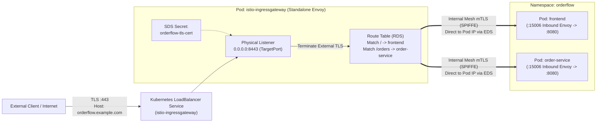
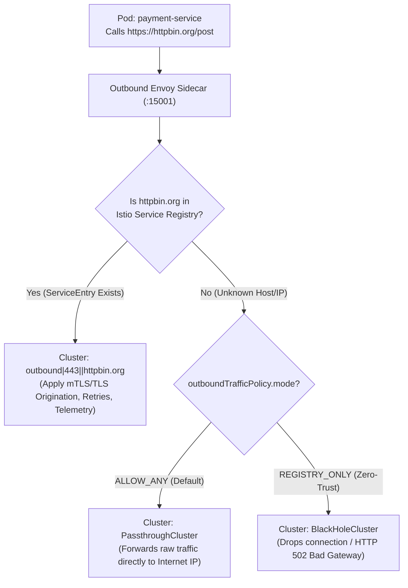
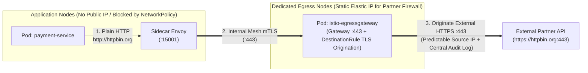

# Module 03: Gateways, North-South Ingress, Kubernetes Gateway API & Controlled Egress

## 1. North-South Traffic Architecture in Istio

In Modules 01 and 02, we focused on **East-West** traffic (service-to-service communication inside the mesh). **North-South** traffic refers to traffic entering the cluster from outside (**Ingress**) or leaving the cluster to external APIs, SaaS providers, or legacy databases (**Egress**).

### 1.1 What Is an Istio Gateway Pod Under the Hood?

A common misconception is that `istio-ingressgateway` or `istio-egressgateway` is a special piece of software distinct from the sidecar proxy.
**Under the hood, an Istio Gateway pod is simply a standalone Envoy proxy (`pilot-agent` + `envoy`) running in a pod without an application container and without `iptables` traffic redirection.**

Notice two critical architectural details:
1. **Physical Listeners Instead of Virtual Listeners**:
   Because a Gateway pod has no application container, it does not use `iptables` or `15001`/`15006`. Instead, when you configure a `Gateway` on port `443` (mapped to container port `8443` or `443`), `istiod` programs Envoy via **LDS** to bind directly to `0.0.0.0:8443` (or `0.0.0.0:443`).
2. **Direct EDS Routing Over Mesh mTLS**:
   Unlike standard NGINX Ingress Controllers (which forward traffic to a Kubernetes `Service` ClusterIP unless special annotations are used), the Istio Ingress Gateway is a **full member of the Istio service mesh**. After terminating external edge TLS, it uses **EDS** to pick the target Pod IP directly and establishes **internal SPIFFE mTLS** all the way to the destination pod's sidecar (`15006`).

---

## 2. Comparing Kubernetes `Ingress`, Istio `Gateway`, and the Kubernetes Gateway API

Istio supports three ways to configure North-South ingress traffic. Understanding their evolution is essential for modern production architecture:

| Feature | Kubernetes `Ingress` (`networking.k8s.io/v1`) | Istio Classic `Gateway` + `VirtualService` | **Kubernetes Gateway API** (`gateway.networking.k8s.io/v1`) |
| :--- | :--- | :--- | :--- |
| **Design Era** | 2015 (Legacy) | 2018 (Istio-native) | **2023+ (Modern Standard & Istio Future Default)** |
| **Role Separation** | Single monolithic resource mixes TLS, hostnames, and app paths. | Decouples L4/TLS (`Gateway`) from L7 Routing (`VirtualService`). | Decouples Infrastructure (`GatewayClass`), Cluster Ops (`Gateway`), and App Devs (`HTTPRoute`, `GRPCRoute`, `TLSRoute`). |
| **Vendor Portability** | Relies on vendor-specific `metadata.annotations` for anything beyond basic path routing. | Istio-specific CRDs (`networking.istio.io`). | Portable CNCF standard across Istio, Envoy Gateway, Cilium, GKE, Kong, NGINX. |
| **Binding Direction** | Monolithic. | `VirtualService` references `gateways: [my-gw]` (Consumer points to Gateway). | Two-way handshake: `Gateway` defines `allowedRoutes` (which namespaces may attach), and `HTTPRoute` defines `parentRefs` (Producer + Consumer consent). |
| **Gateway Pod Provisioning** | Requires pre-installed controller Deployment. | Requires pre-installed `istio-ingressgateway` Deployment matching `selector: {istio: ingressgateway}`. | **Automated Deployment Provisioning**: Creating a `Gateway` with `gatewayClassName: istio` automatically causes `istiod` to provision the Deployment & LoadBalancer Service! |

### 2.1 How Classic Istio `Gateway` + `VirtualService` Bind Together

In the classic Istio API:
1. The **`Gateway`** resource selects the gateway pod (`selector: {istio: ingressgateway}`) and configures **LDS** (ports, protocols, SNI hosts, and edge TLS certificates via `credentialName`).
   - *Gotcha*: A `Gateway` resource with no `VirtualService` bound to it causes Envoy to listen on the port (or hold the config) with no routes! In fact, for HTTP listeners, Envoy may not even open the socket until a route is attached, or will immediately return `404 Not Found`.
2. The **`VirtualService`** binds to the `Gateway` via `spec.gateways: ["orderflow/orderflow-gateway"]` and matching `spec.hosts: ["orderflow.example.com"]`, programming **RDS** on that gateway listener.
   - *Crucial Rule*: If a `VirtualService` specifies `gateways: ["orderflow-gateway"]`, those routing rules apply **only** to traffic entering through that Gateway — they do **not** apply to internal East-West pod-to-pod calls unless you also include the reserved keyword **`mesh`** in `gateways: ["orderflow-gateway", "mesh"]`!

---

## 3. Edge TLS Modes (`SIMPLE`, `MUTUAL`, `PASSTHROUGH`, `AUTO_PASSTHROUGH`)

When configuring a TLS listener on an Istio `Gateway`, `tls.mode` determines how Envoy handles the TLS handshake:

| TLS Mode | How Envoy Processes the Connection | Production Use Case |
| :--- | :--- | :--- |
| **`SIMPLE`** | Envoy terminates TLS at the gateway using the X.509 certificate and private key loaded via SDS from the Kubernetes `Secret` named in `credentialName`. | Standard HTTPS web apps and REST/gRPC APIs (`https://orderflow.example.com`). |
| **`MUTUAL`** | Envoy terminates TLS **and** requires the external client to present a valid client X.509 certificate signed by the CA bundle in `credentialName` (`ca.crt`). | B2B Partner APIs, OpenBanking (mTLS at the edge), IoT device ingestion. |
| **`PASSTHROUGH`** | Envoy **does not terminate TLS**. It inspects the unencrypted **SNI (Server Name Indication)** extension in the TLS `ClientHello` packet and forwards the raw encrypted TCP stream to the backend service specified in a `VirtualService` `tls:` route block. | End-to-end TLS where the backend application pod holds its own TLS private key and must terminate TLS itself for compliance. |
| **`AUTO_PASSTHROUGH`** | Envoy inspects the SNI header (which Istio formats as `outbound_.8080_._.order-service.orderflow.svc.cluster.local`) and automatically routes the mTLS connection to the matching mesh cluster without needing a `VirtualService`. | Multi-cluster Istio East-West Gateways connecting private pod networks across regions/clouds. |

> **Important Secret Location Rule for `credentialName`**:
> In Classic Istio `Gateway`, the Kubernetes `tls` Secret referenced by `credentialName` **must** live in the **same namespace as the Gateway pod** (typically `istio-system`), *even if* the `Gateway` CRD itself is created in the `orderflow` namespace! (In Kubernetes Gateway API, cross-namespace Secret references are explicitly governed by `ReferenceGrant`).

---

## 4. Egress Traffic Management: Controlling What Leaves the Mesh

In a Zero-Trust production environment (such as PCI-DSS payment processing in `payment-service`), allowing compromised pods to open outbound connections to arbitrary internet IPs (data exfiltration or C2 callbacks) is unacceptable.

### 4.1 `outboundTrafficPolicy.mode`: `ALLOW_ANY` vs. `REGISTRY_ONLY`

Istio controls unknown outbound destinations via `meshConfig.outboundTrafficPolicy.mode`:

- **`ALLOW_ANY` (Istio Default)**: Any outbound destination not in Istio's internal service registry is routed to Envoy's special **`PassthroughCluster`**, which lets the connection exit to the original destination IP untouched. Convenient for getting started, dangerous for strict security compliance.
- **`REGISTRY_ONLY`**: Unknown destinations are routed to **`BlackHoleCluster`**, which immediately drops TCP connections (or returns `502 Bad Gateway` for HTTP). External hosts can only be reached if explicitly registered via a **`ServiceEntry`**.

> **Security Nuance**: Is `REGISTRY_ONLY` + `ServiceEntry` alone a complete firewall?
> **No!** Remember from Module 01 that `VirtualService` HTTP routing relies on the HTTP `Host` header (or TLS SNI). A malicious binary running inside a pod could spoof `Host: allowed-domain.com` while opening a TCP socket to an arbitrary IP if `resolution: NONE` is used, or bypass Envoy if it compromises the pod's network namespace. In production, combine **Egress Gateways** + Kubernetes **`NetworkPolicy`** so application pods cannot route to `0.0.0.0/0` directly; only the `istio-egressgateway` pods are permitted by CNI `NetworkPolicy` to exit the cluster!

### 4.2 Registering External Services with `ServiceEntry`

A `ServiceEntry` inserts an external (or unmanaged internal) endpoint into Istio's abstract Service Registry so `istiod` creates a real Envoy Cluster (`outbound|80||httpbin.org`) for it:

| Field | Options | How Envoy Handles It |
| :--- | :--- | :--- |
| **`location`** | `MESH_EXTERNAL` / `MESH_INTERNAL` | `MESH_EXTERNAL` tells Istio the service is outside the mesh (disables automatic Istio mTLS by default). |
| **`resolution`** | `DNS`, `STATIC`, `NONE` | **`DNS`**: Envoy periodically queries DNS to resolve the hostname in `hosts` (`STRICT_DNS` / `LOGICAL_DNS` cluster). **`STATIC`**: Envoy load-balances across explicit static IP addresses listed in `endpoints`. **`NONE`**: Envoy assumes connections are already addressed to the target IP (`ORIGINAL_DST`). |

### 4.3 TLS Origination by the Sidecar (`DestinationRule` `SIMPLE` TLS)

Suppose `payment-service` needs to call an external HTTPS payment processor (`https://httpbin.org:443`), or you want the Envoy proxy to manage TLS connection pooling, cipher suites, and HTTP header telemetry without the application managing TLS certificates.

With **TLS Origination**:
1. The application container makes a fast, local **plaintext HTTP** request (`http://httpbin.org:80/get`).
2. A `ServiceEntry` registers port `80` (HTTP) and port `443` (HTTPS) for `httpbin.org`.
3. A `VirtualService` redirects/routes port `80` traffic to destination port `443`, and a `DestinationRule` on port `443` specifies `tls.mode: SIMPLE` with `sni: httpbin.org`.
4. Envoy transparently encrypts the outbound request into HTTPS (`:443`) before it ever leaves the pod!

### 4.4 Routing Egress Through a Dedicated `istio-egressgateway`

Why route external traffic through a centralized `istio-egressgateway` Deployment instead of letting each pod's sidecar talk directly to the internet?

1. **Predictable Source IP Whitelisting**: External B2B payment gateways and legacy enterprise firewalls often require whitelisting a small set of static source IPs. By scheduling `istio-egressgateway` pods onto dedicated egress nodes with Static NAT IPs, all external traffic originates from those fixed IPs.
2. **Defense-in-Depth Network Isolation**: You can apply a Kubernetes `NetworkPolicy` blocking all workload namespaces (`orderflow`) from reaching outside the cluster CIDR, allowing them only to reach `istio-egressgateway` in `istio-system`.
3. **Centralized Egress Auditing & Policy**: A single chokepoint to log, rate-limit, and enforce `AuthorizationPolicy` on which specific workload `ServiceAccount` (`payment-sa` only!) is allowed to exit through the Egress Gateway.
