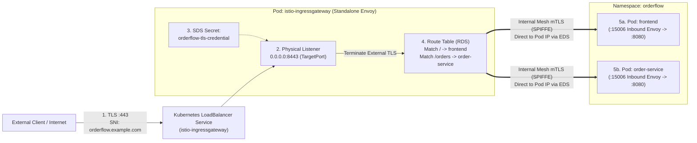
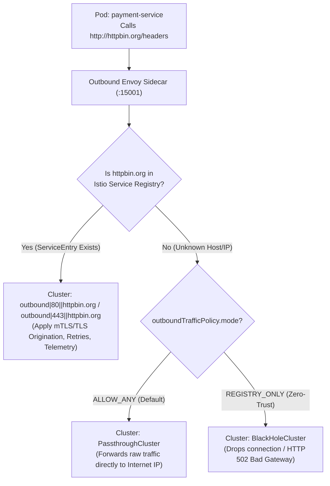
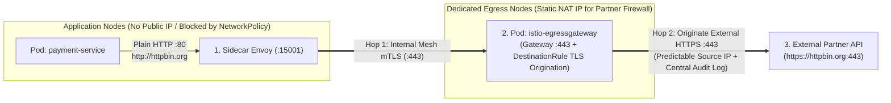

# Module 03: Gateways, North-South Ingress, Kubernetes Gateway API (`v1.6.1`) & Controlled Egress

> **Navigation**: [Fellowship Portal](../README.md) > [Week 04: Edge Gateways & Controlled Egress](../fellowship/week-04-edge-gateways-and-controlled-egress/WEEK.md) > **Module 03 Architecture Hub** | [Guided Lab (`LAB.md`)](./LAB.md)  
> **Version Baseline (November 2026)**: Istio `1.32.0` | Envoy `v1.40` | Kubernetes `1.36+` | Gateway API `v1.6.1` — see [`../VERSIONS.md`](../VERSIONS.md) and [`../COMPATIBILITY.md`](../COMPATIBILITY.md).  
> **Fellowship Cohort 01 Mapping**: Complete this module alongside **[Week 04: Edge Gateways & Controlled Egress](../fellowship/week-04-edge-gateways-and-controlled-egress/WEEK.md)** (Engineering Ticket `NP-104` & Incident `INC-04`).

---

## 🎙️ Alex Morgan's Module 03 Architecture Briefing

> **Alex Morgan (Senior Platform Engineer, NovaPay)**: *"In Modules 01 and 02, all of our traffic stayed safely inside the cluster (**East-West**). In Module 03, we engineer the perimeter of the NovaPay payment platform (**North-South** Ingress and Egress).*
>
> *To keep this module crisp and digestible, we have broken it into **three focused 25–30 minute lessons**. Start with Lesson 03.1 to understand how a standalone Envoy Gateway pod terminates edge TLS via SDS and routes directly to workload Pod IPs over SPIFFE mTLS. Then move to Lesson 03.2 to master the **Kubernetes Gateway API `v1.6.1`**—including automated gateway deployment provisioning by `istiod`. Finally, in Lesson 03.3, join Maya Patel and Sarah Chen to lock down outbound internet traffic with `REGISTRY_ONLY`, `ServiceEntry` TLS Origination, and a dedicated PCI-DSS `istio-egressgateway`."*

---

## 🗺️ Progressive Lesson Milestones Table

Complete these three modular lessons in order before executing the hands-on **[Module 03 Guided Lab (`./LAB.md`)](./LAB.md)**:

| Lesson | Title & Core Architecture Focus | Est. Time | NovaPay Fellowship Milestone |
| :--- | :--- | :--- | :--- |
| **[Lesson 03.1](./lessons/01-north-south-gateways-and-tls-modes.md)** | **North-South Gateways, Classic `Gateway` Binding & Edge TLS Modes** Standalone Envoy Gateway pods (`0.0.0.0:8443` vs. `15001`/`15006`), direct EDS routing over internal mTLS, `gateways: ["mesh", "..."]` binding rule, and `SIMPLE`/`MUTUAL`/`PASSTHROUGH`/`AUTO_PASSTHROUGH` TLS modes. | **25 min** | Expose `frontend` & `order-service` over HTTPS and diagnose `INC-04` (cross-namespace SDS `credentialName` rules). |
| **[Lesson 03.2](./lessons/02-kubernetes-gateway-api.md)** | **Kubernetes Gateway API (`v1.6.1`) & Automated Gateway Provisioning** `GatewayClass`, `Gateway`, `HTTPRoute`, `GRPCRoute`, graduated `v1` `TCPRoute`/`UDPRoute`, `istiod` automated `Deployment`/`Service` provisioning, two-way `allowedRoutes`/`parentRefs` handshake, and `ReferenceGrant`. | **25 min** | Migrate NovaPay's North-South edge from Classic Istio CRDs to portable Kubernetes Gateway API `v1.6.1`. |
| **[Lesson 03.3](./lessons/03-zero-trust-egress-and-tls-origination.md)** | **Zero-Trust Egress (`REGISTRY_ONLY`), `ServiceEntry` & Egress Gateways** `ALLOW_ANY` (`PassthroughCluster`) vs. `REGISTRY_ONLY` (`BlackHoleCluster`), `ServiceEntry` (`DNS`/`STATIC`/`NONE`), sidecar TLS origination (`:80` $\rightarrow$ `:443`), and multi-hop `istio-egressgateway` routing with CNI `NetworkPolicy`. | **30 min** | Lock down `orderflow` outbound internet traffic for PCI-DSS Requirement 1.3 (`NP-104`). |
| **[Guided Lab](./LAB.md)** | **Hands-On Lab 03: Edge TLS, Gateway API `v1.6.1` & Controlled Egress** Step-by-step cluster verification with "Predict Before You Execute" checks and progressive troubleshooting hints. | **45 min** | Verify all 4 North-South ingress and egress architectures on your live cluster. |

---

## 1. North-South Ingress Architecture Synthesis

> 📖 **Deep Dive**: Read **[Lesson 03.1: North-South Gateways & Edge TLS Modes](./lessons/01-north-south-gateways-and-tls-modes.md)** for full implementation details.

An Istio Gateway pod (`istio-ingressgateway` or an auto-provisioned Gateway API pod) is a **standalone Envoy `v1.40` proxy (`pilot-agent` + `envoy`) running without an application container and without `iptables` redirection**.

### 6-Part Mechanism Walkthrough: Standalone Envoy Ingress Gateway
1. **What initiates the operation?**
   An external client connects to the `istio-ingressgateway` LoadBalancer IP on TCP port `443` and sends a TLS `ClientHello` with SNI `orderflow.example.com`.
2. **Which component receives it?**
   The Kubernetes `LoadBalancer` Service maps external port `443` to container `targetPort: 8443` on the `istio-ingressgateway` pod, where Envoy's physical listener `0.0.0.0:8443` accepts the socket.
3. **What information is exchanged?**
   Envoy matches the SNI hostname against its TLS filter chain, presents the X.509 certificate fetched in memory via **SDS** (`kubernetes://orderflow-tls-credential`), terminates external TLS, and evaluates the HTTP request against its **RDS** virtual host route table.
4. **What changes in the system?**
   Envoy selects a destination pod IP directly from the **EDS** endpoint pool (`frontend` or `order-service`)—bypassing `kube-proxy` ClusterIP routing—and originates an internal **SPIFFE mTLS** connection to the target workload pod's `:15006` inbound listener.
5. **How can you observe/verify it on your cluster?**
   Run `istioctl proxy-config secret <igw-pod>.istio-system` to verify the active SDS certificate and `istioctl proxy-config listener <igw-pod>.istio-system --port 8443` to inspect the physical listener filter chains.
6. **What happens if a component fails?**
   If the TLS Secret is placed in `orderflow` instead of `istio-system` (for Classic Istio `Gateway`), SDS fails to load the certificate and the gateway resets incoming TLS connections (`INC-04`). If the client omits the TLS SNI header (connecting by raw IP without `--resolve`), the filter chain match fails and the TLS handshake is aborted.

---

## 2. Comparing Kubernetes `Ingress`, Classic Istio `Gateway` & Gateway API `v1.6.1`

> 📖 **Deep Dive**: Read **[Lesson 03.2: Kubernetes Gateway API (`v1.6.1`) & Automated Gateway Provisioning](./lessons/02-kubernetes-gateway-api.md)** for role-oriented architecture and `ReferenceGrant` patterns.

| Feature | Kubernetes `Ingress` (`networking.k8s.io/v1`) | Istio Classic `Gateway` + `VirtualService` | **Kubernetes Gateway API `v1.6.1`** (`gateway.networking.k8s.io/v1`) |
| :--- | :--- | :--- | :--- |
| **Design Era** | 2015 (Legacy) | 2018 (Istio-native) | **2023–2026+ (Modern CNCF Standard & Istio Default)** |
| **Role Separation** | Single monolithic resource mixes TLS, hostnames, and app paths. | Decouples L4/TLS (`Gateway`) from L7 Routing (`VirtualService`). | Decouples Infrastructure (`GatewayClass`), Cluster Ops (`Gateway`), and App Devs (`HTTPRoute`, `GRPCRoute`, `TLSRoute`, `TCPRoute`, `UDPRoute`). |
| **Vendor Portability** | Relies on vendor-specific `metadata.annotations`. | Istio-specific CRDs (`networking.istio.io/v1`). | Portable CNCF standard across Istio, Envoy Gateway, Cilium, GKE, Kong, NGINX. |
| **Binding Direction** | Monolithic. | `VirtualService` references `gateways: [my-gw]` (Consumer points to Gateway). | Two-way handshake: `Gateway` defines `allowedRoutes` and `HTTPRoute` defines `parentRefs` (Producer + Consumer consent). |
| **Gateway Pod Provisioning** | Requires pre-installed controller Deployment. | Requires pre-installed `istio-ingressgateway` Deployment matching `selector`. | **Automated Deployment Provisioning**: Creating a `Gateway` with `gatewayClassName: istio` automatically causes `istiod` to provision the Deployment & LoadBalancer Service! |

---

## 3. Zero-Trust Egress Architecture Synthesis

> 📖 **Deep Dive**: Read **[Lesson 03.3: Zero-Trust Egress (`REGISTRY_ONLY`), `ServiceEntry`, TLS Origination & Egress Gateways](./lessons/03-zero-trust-egress-and-tls-origination.md)** for full PCI-DSS egress design.

### 3.1 `outboundTrafficPolicy.mode`: `ALLOW_ANY` vs. `REGISTRY_ONLY`

#### 6-Part Mechanism Walkthrough: Outbound Registry Lookup (`ALLOW_ANY` vs. `REGISTRY_ONLY`)
1. **What initiates the operation?**
   A pod in `orderflow` (`payment-service` or `client-toolbox`) initiates an outbound connection to an external hostname (`httpbin.org`).
2. **Which component receives it?**
   Pod `iptables` redirects the outbound TCP socket to the local Envoy sidecar's `virtualOutbound` listener (`127.0.0.1:15001`).
3. **What information is exchanged?**
   Envoy matches the target port and HTTP `Host` header (or TLS SNI) against the active Service Registry listeners/routes compiled by `istiod`.
4. **What changes in the system?**
   - If the external host is registered via a `ServiceEntry`, Envoy routes the stream to the dedicated cluster (`outbound|80||httpbin.org` or `outbound|443||httpbin.org`) and applies configured `VirtualService` and `DestinationRule` policies.
   - If the host is unregistered, Envoy falls back to either `PassthroughCluster` (when `mode: ALLOW_ANY`) or `BlackHoleCluster` (when `mode: REGISTRY_ONLY`, immediately failing with `502 Bad Gateway` / TCP drop).
5. **How can you observe/verify it on your cluster?**
   Inspect `kubectl get cm istio -n istio-system -o yaml` and query `istio_requests_total{destination_service=~"PassthroughCluster|BlackHoleCluster"}` or Envoy sidecar access logs.
6. **What happens if a component fails?**
   If `REGISTRY_ONLY` is enabled without a matching `ServiceEntry` for a required external endpoint, outbound calls fail immediately with `502 Bad Gateway` (`BlackHoleCluster`).

---

### 3.2 Multi-Hop Egress Routing Through `istio-egressgateway`

#### 6-Part Mechanism Walkthrough: Egress Gateway Funnel & TLS Origination
1. **What initiates the operation?**
   `payment-service` sends a plaintext HTTP request (`http://httpbin.org/headers` on port `80`).
2. **Which component receives it?**
   The local workload Envoy sidecar (`:15001`) intercepts the request, matches the `mesh` gateway rule in the `VirtualService`, and forwards it over internal SPIFFE mTLS (`:443`) to `istio-egressgateway` in `istio-system`.
3. **What information is exchanged?**
   `istio-egressgateway` terminates internal mesh mTLS on physical port `8443` (`tls.mode: ISTIO_MUTUAL`), inspects the HTTP `Host: httpbin.org` header, and routes the request to `outbound|443||httpbin.org`.
4. **What changes in the system?**
   `istio-egressgateway` applies the `DestinationRule` (`tls.mode: SIMPLE`, `sni: httpbin.org`) to originate an outbound external HTTPS (`:443`) connection from the dedicated egress node's static NAT IP to `httpbin.org`.
5. **How can you observe/verify it on your cluster?**
   Check `kubectl logs -n istio-system -l app=istio-egressgateway --tail=10` to confirm the request traversed `istio-egressgateway` and verify `"X-Forwarded-Proto": "https"` in the response from `httpbin.org/headers`.
6. **What happens if a component fails?**
   If a compromised pod attempts to bypass `istio-egressgateway` and connect directly to an external IP, the namespace's Kubernetes CNI `NetworkPolicy` drops the packet at L3/L4 because only `istio-egressgateway` is permitted to egress outside the cluster CIDR.

---

## 🚀 Next Steps

1. Complete the three lessons above (`03.1` $\rightarrow$ `03.2` $\rightarrow$ `03.3`).
2. Execute the hands-on **[Module 03 Lab (`./LAB.md`)](./LAB.md)**.
3. Complete your Thursday engineering ticket (`NP-104`) and Friday incident simulation (`INC-04`) in **[Week 04: Edge Gateways & Controlled Egress (`../fellowship/week-04-edge-gateways-and-controlled-egress/WEEK.md`)](../fellowship/week-04-edge-gateways-and-controlled-egress/WEEK.md)**.
