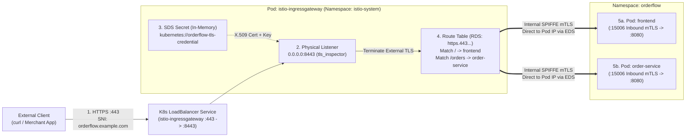

# Lesson 03.1: North-South Gateways, Classic `Gateway` Binding & Edge TLS Modes

> **Navigation**: [Fellowship Portal](../../README.md) > [Week 04: Edge Gateways & Controlled Egress](../../fellowship/week-04-edge-gateways-and-controlled-egress/WEEK.md) > [Module 03 Hub](../README.md) > **Lesson 03.1**  
> **Estimated Completion Time**: 25 minutes  
> **Prerequisites**: [Module 02 (`VirtualService` & `DestinationRule`)](../../02-service-discovery-and-routing/README.md)  
> **Authoritative Baseline**: Istio `1.32.0` | Envoy `v1.40` | Kubernetes `1.36+` | Gateway API `v1.6.1`

### Learning Objectives
By the end of this lesson, you will be able to:
1. Explain how an Istio Gateway pod (`istio-ingressgateway`) differs architecturally from a workload sidecar proxy (physical socket listeners vs. virtual `15001`/`15006` listeners, and direct EDS pod routing over internal SPIFFE mTLS).
2. Configure and bind a Classic Istio `Gateway` and `VirtualService`, avoiding the common `gateways: ["mesh", "..."]` omission trap.
3. Differentiate Istio's four Edge TLS modes (`SIMPLE`, `MUTUAL`, `PASSTHROUGH`, and `AUTO_PASSTHROUGH`) and enforce the cross-namespace `credentialName` Secret placement rule.

---

## 1. NovaPay Engineering Context & Alex Morgan's Briefing

### What Is Happening at NovaPay?
In Weeks 01–03, all traffic inside the `orderflow` payment and checkout platform (`frontend` $\rightarrow$ `order-service` $\rightarrow$ `payment-service` & `inventory-service`) was **East-West** traffic between pods inside the cluster. Now, in Week 04 (Ticket `NP-104`), external merchants and mobile checkout clients need secure HTTPS access from the public internet (**North-South Ingress**) to `https://orderflow.example.com`.

### Alex Morgan's Briefing & Intuition Analogy
> **Alex Morgan (Senior Platform Engineer)**: *"When engineers first look at `istio-ingressgateway`, they often assume it's a totally different piece of software from the sidecar proxy—like an NGINX controller bolted onto the edge of the cluster. It's not. Under the hood, an Istio Gateway pod is the **exact same `pilot-agent` + Envoy `v1.40` binary**, just running standalone in a pod without an application container and without `iptables` redirection.*
>
> *Think of a workload sidecar like a **personal bodyguard** standing inside an executive's office (`15006`), intercepting everyone who walks through the door. An Ingress Gateway pod is the **building's main lobby security desk**: external visitors arrive from the street (`0.0.0.0:8443`), show their external ID (TLS certificate/SNI), and the lobby desk immediately escorts them directly to the exact room (`Pod IP` via EDS) over an encrypted internal corridor (SPIFFE mTLS)—skipping the Kubernetes `Service` ClusterIP proxy hop entirely.*
>
> *Watch out for two production traps that have paged us at 2 AM: forgetting that `credentialName` secrets must live in the **gateway pod's namespace** (`istio-system`), and forgetting that adding `gateways: ["orderflow-gateway"]` to a `VirtualService` silently removes East-West `mesh` routing unless you include `"mesh"` in the list!"*

> **Maya Patel (Principal Security Engineer)**: *"From a PCI-DSS standpoint, pay close attention to how edge TLS certificates are loaded. We never mount TLS private keys as static files on gateway disks where a container breakout could scrape them. Envoy fetches the X.509 certificate and private key in memory over the **Secret Discovery Service (SDS)** API directly from `istiod`."*

---

## 2. Progressive Disclosure Technical Explanation

### 2.1 Core Concept: Standalone Envoy Gateway Architecture

Unlike a workload pod (which uses `iptables` or eBPF to redirect traffic to virtual listeners `15001` and `15006`), an Istio Gateway pod (`istio-ingressgateway` or `istio-egressgateway`) runs **only** the `istio-proxy` container.

1. **Physical Listeners Instead of Virtual Listeners**:
   Because there is no application container inside the gateway pod, Envoy binds directly to physical container ports (such as `0.0.0.0:8080` for HTTP port `80` and `0.0.0.0:8443` for HTTPS port `443`). The Kubernetes `LoadBalancer` Service maps external port `443` (`port: 443`) to container port `8443` (`targetPort: 8443`), allowing Envoy to run as a non-root user without needing `CAP_NET_BIND_SERVICE` for privileged ports below `1024`.
2. **Direct EDS Routing Over Internal Mesh mTLS**:
   Traditional Kubernetes Ingress controllers forward traffic to a `Service` ClusterIP (`kube-proxy`). By contrast, `istio-ingressgateway` is a full member of the Istio mesh. After terminating external TLS, it looks up the destination service's healthy Pod IPs via **EDS (Endpoint Discovery Service)** and opens an internal **SPIFFE mTLS** connection directly to `frontend` or `order-service` on `:15006`.

### 2.2 Technical Deep Dive: Classic `Gateway` + `VirtualService` Binding & Edge TLS Modes

In the Classic Istio Networking API (`networking.istio.io/v1`), North-South configuration is split across two CRDs:
1. **`Gateway` (L4–L6 Port, SNI & TLS Configuration)**: Selects the gateway pod via label selector (`selector: { istio: ingressgateway }`) and instructs `istiod` to program an Envoy **Listener (LDS)** on the specified port, protocol, SNI hostname, and TLS mode.
2. **`VirtualService` (L7 HTTP/TLS Route Table)**: Attaches to the `Gateway` via `spec.gateways` and matching `spec.hosts`, instructing `istiod` to program the **RouteConfiguration (RDS)** attached to that listener.

#### The Four Edge TLS Modes (`spec.servers[].tls.mode`)

| TLS Mode | Envoy Listener & Filter Chain Behavior | Primary NovaPay Use Case |
| :--- | :--- | :--- |
| **`SIMPLE`** | Envoy terminates external TLS using the server certificate & private key loaded via SDS from the `Secret` named in `credentialName`. | Standard customer-facing HTTPS APIs (`https://orderflow.example.com`). |
| **`MUTUAL`** | Envoy terminates external TLS **and** validates the client's X.509 certificate against the CA bundle (`ca.crt`) in `credentialName` (or ` -cacert` secret). | B2B Partner Bank settlement webhooks and OpenBanking mTLS endpoints. |
| **`PASSTHROUGH`** | Envoy **does not terminate TLS**. Its `tls_inspector` listener filter peeks at the unencrypted **SNI** in the TLS `ClientHello` and forwards the raw encrypted TCP bytes to the upstream pod via a `VirtualService` `tls:` route block. | Legacy HSM/vault workloads that must terminate their own end-to-end TLS session inside the application container. |
| **`AUTO_PASSTHROUGH`** | Envoy reads an Istio-encoded SNI string (`outbound_.8080_._.order-service.orderflow.svc.cluster.local`) and routes raw mTLS directly to the destination cluster without a `VirtualService`. | Multi-cluster Istio East-West Gateways bridging isolated Kubernetes pod networks across cloud regions. |

### 2.3 Mechanism Diagram & 6-Part Step-by-Step Walkthrough



#### 6-Part Mechanism Walkthrough: North-South Edge TLS Termination to Mesh Pod
1. **What initiates the operation?**
   An external client resolves `orderflow.example.com` to the public IP of the `istio-ingressgateway` Kubernetes `LoadBalancer` Service and initiates a TCP handshake + TLS `ClientHello` on port `443` containing `SNI: orderflow.example.com`.
2. **Which component receives it?**
   The cloud/cluster load balancer forwards the TCP packet to container port `8443` on one of the `istio-ingressgateway` pods in `istio-system`, where Envoy `v1.40`'s physical listener `0.0.0.0:8443` and its `envoy.filters.listener.tls_inspector` filter receive the connection.
3. **What information is exchanged?**
   - Envoy inspects the `ClientHello` SNI (`orderflow.example.com`), matches the filter chain configured by the `Gateway` CRD, and completes the TLS handshake using the X.509 certificate and private key streamed into memory via **SDS** (`kubernetes://orderflow-tls-credential`).
   - Once decrypted, the HTTP Connection Manager (HCM) evaluates the **RDS** route table (`https.443.https-orderflow.orderflow-gateway.orderflow`) programmed by the bound `VirtualService`.
4. **What changes in the system?**
   Envoy matches the URI prefix (`/` or `/orders`), selects a healthy destination Pod IP from the **EDS** pool (`outbound|80||frontend.orderflow.svc.cluster.local` or `outbound|8080||order-service.orderflow.svc.cluster.local`), and initiates a *new* internal mutual TLS connection using its own SPIFFE identity (`spiffe://cluster.local/ns/istio-system/sa/istio-ingressgateway-service-account`) to the workload pod's `:15006` inbound listener.
5. **How can you observe/verify it on your cluster?**
   - Check the SDS certificate status: `istioctl proxy-config secret <ingress-pod>.istio-system` (confirm `kubernetes://orderflow-tls-credential` is `ACTIVE`).
   - Check physical listeners and route binding: `istioctl proxy-config listener <ingress-pod>.istio-system --port 8443` and `istioctl proxy-config routes <ingress-pod>.istio-system`.
6. **What happens if a component fails?**
   - **Missing or wrong-namespace Secret**: If `orderflow-tls-credential` was created in `orderflow` instead of `istio-system`, SDS cannot find it; the listener stays in a warming/unready state or resets the TLS handshake (`SSL_ERROR_SYSCALL` / `Connection reset by peer`).
   - **No `VirtualService` bound to `Gateway`**: Envoy either does not open the HTTP listener or immediately returns `404 Not Found` (`NR` — *NoRoute*).
   - **Missing SNI in client request**: If a client connects via raw IP (`https://1.2.3.4/`) without setting the TLS SNI extension to `orderflow.example.com`, Envoy's filter chain match fails before HTTP headers are ever decrypted, resulting in an immediate TLS connection reset.

### 2.4 Engineering Insight & Production Trade-Offs

- **The `credentialName` Namespace Rule**:
  In Classic Istio `Gateway`, `istiod` resolves `tls.credentialName: orderflow-tls-credential` relative to the **namespace where the Gateway pod runs** (`istio-system`), *not* the namespace where the `Gateway` YAML resource is applied (`orderflow`). In multi-tenant clusters, giving application teams write access to `istio-system` to upload TLS Secrets is a security risk—which is one major reason teams either deploy namespace-local gateway pods or migrate to the **Kubernetes Gateway API** (Lesson 03.2).
- **The `gateways: ["mesh"]` Omission Trap**:
  Every `VirtualService` has an implicit default: `gateways: ["mesh"]`, meaning its rules apply to all internal East-West sidecars. The moment you explicitly specify `gateways: ["orderflow/orderflow-gateway"]`, you **overwrite** that default! If you want the same routing rules (such as canary weights or timeouts) to apply to *both* North-South ingress traffic and East-West pod-to-pod traffic, you must explicitly list both:
  ```yaml
  spec:
    hosts:
      - order-service.orderflow.svc.cluster.local
      - orderflow.example.com
    gateways:
      - orderflow/orderflow-gateway
      - mesh
  ```

---

## 3. Practical Observation & Investigation

Run these commands against your cluster (or during [Lab 03](../LAB.md)) to inspect how `istio-ingressgateway` binds physical ports and SDS secrets:

```bash
# 1. Identify the istio-ingressgateway pod in istio-system
IGW_POD=$(kubectl get pod -n istio-system -l app=istio-ingressgateway -o jsonpath='{.items[0].metadata.name}')

# 2. Observe physical listeners (Notice 0.0.0.0:8080 and 0.0.0.0:8443 instead of 15001/15006!)
istioctl proxy-config listener "$IGW_POD.istio-system"

# 3. Inspect active in-memory SDS certificates loaded on the gateway
istioctl proxy-config secret "$IGW_POD.istio-system"

# 4. Inspect the RDS route table programmed for port 8443/443
istioctl proxy-config routes "$IGW_POD.istio-system"
```

---

## 4. Knowledge Check (Engineering Judgment)

### Question 1: The `curl -H "Host: ..."` TLS Handshake Failure
An engineer tests a newly deployed HTTPS Istio `Gateway` (`hosts: ["orderflow.example.com"]`, `tls.mode: SIMPLE`) by running:
```bash
curl -k -H "Host: orderflow.example.com" https://203.0.113.10/orders
```
The request fails immediately with `curl: (35) Recv failure: Connection reset by peer` before returning any HTTP status code. Why did `-H "Host: orderflow.example.com"` fail to match the Gateway host, and how must the engineer fix the test command?

<details>
<summary>Check Answer & Engineering Explanation</summary>

**Answer**:
The HTTP `Host` header is sent *after* the TLS handshake completes, encrypted inside the HTTP application payload. However, Envoy selects the TLS filter chain and X.509 certificate *during* the initial TLS handshake by inspecting the unencrypted **SNI (Server Name Indication)** extension in the TLS `ClientHello` packet.

When `curl` connects to a raw IP URL (`https://203.0.113.10/`), it does not populate the TLS SNI hostname (or sets an empty/IP SNI), even if `-H "Host: ..."` is passed. Because the `Gateway` filter chain requires SNI `orderflow.example.com`, Envoy finds no matching filter chain and immediately resets the TCP connection.

**Fix**: Use `curl --resolve orderflow.example.com:443:203.0.113.10 https://orderflow.example.com/orders` so `curl` connects to `203.0.113.10` while placing `orderflow.example.com` in **both** the TLS `ClientHello` SNI extension and the HTTP `Host` header.
</details>

### Question 2: Disappearing East-West Canary Split
Daniel Brooks has an existing `VirtualService` splitting internal traffic to `order-service` (`90% v1`, `10% v2`). To expose `order-service` at the edge, he adds `gateways: ["orderflow-gateway"]` to that `VirtualService`. Suddenly, internal calls from `frontend` to `order-service` ignore the `90/10` split and revert to `50/50` round-robin across `v1` and `v2`, while external calls through the gateway still follow `90/10`. Why?

<details>
<summary>Check Answer & Engineering Explanation</summary>

**Answer**:
When `spec.gateways` is omitted on a `VirtualService`, Istio defaults to `gateways: ["mesh"]` (programming all internal sidecar proxies). By adding `gateways: ["orderflow-gateway"]` without including `"mesh"`, Daniel restricted the `VirtualService` so `istiod` **only** pushed its RDS routes to `istio-ingressgateway`. The internal `frontend` sidecar lost the custom `VirtualService` route and fell back to default round-robin load balancing across all endpoints of the Kubernetes `Service`.

**Fix**: Set `gateways: ["orderflow-gateway", "mesh"]` and ensure `hosts` includes both the internal service name (`order-service.orderflow.svc.cluster.local`) and external domain (`orderflow.example.com`).
</details>

---

## 5. Key Takeaways, Definition of Done & Next Lesson

### Key Takeaways
- **`istio-ingressgateway` is a standalone Envoy proxy**: It uses physical container listeners (`0.0.0.0:8080`, `0.0.0.0:8443`) rather than `iptables` virtual listeners, and routes directly to workload Pod IPs via EDS over internal SPIFFE mTLS.
- **Classic `Gateway` + `VirtualService` separation**: `Gateway` programs L4–L6 listeners and SDS TLS secrets (which must live in `istio-system`), while `VirtualService` binds to the `Gateway` to program L7 RDS routes.
- **Always include `mesh` when sharing routes**: If a `VirtualService` applies to both edge ingress and internal pod-to-pod calls, specify `gateways: ["<gateway-name>", "mesh"]`.

### Definition of Done
- [ ] You can trace a North-South HTTPS packet from the external client through `0.0.0.0:8443`, SDS TLS termination, RDS route evaluation, and internal EDS SPIFFE mTLS to the workload pod `:15006`.
- [ ] You understand when to choose `SIMPLE`, `MUTUAL`, `PASSTHROUGH`, or `AUTO_PASSTHROUGH` TLS modes.

### Authoritative References
- [Istio 1.32 Documentation — Ingress Gateways](https://istio.io/latest/docs/tasks/traffic-management/ingress/ingress-control/)
- [Istio 1.32 Documentation — Secure Gateways (SDS)](https://istio.io/latest/docs/tasks/traffic-management/ingress/secure-ingress/)
- **Next Lesson**: **[Lesson 03.2: Kubernetes Gateway API (`v1.6.1`) & Role-Oriented Ingress](./02-kubernetes-gateway-api.md)**
