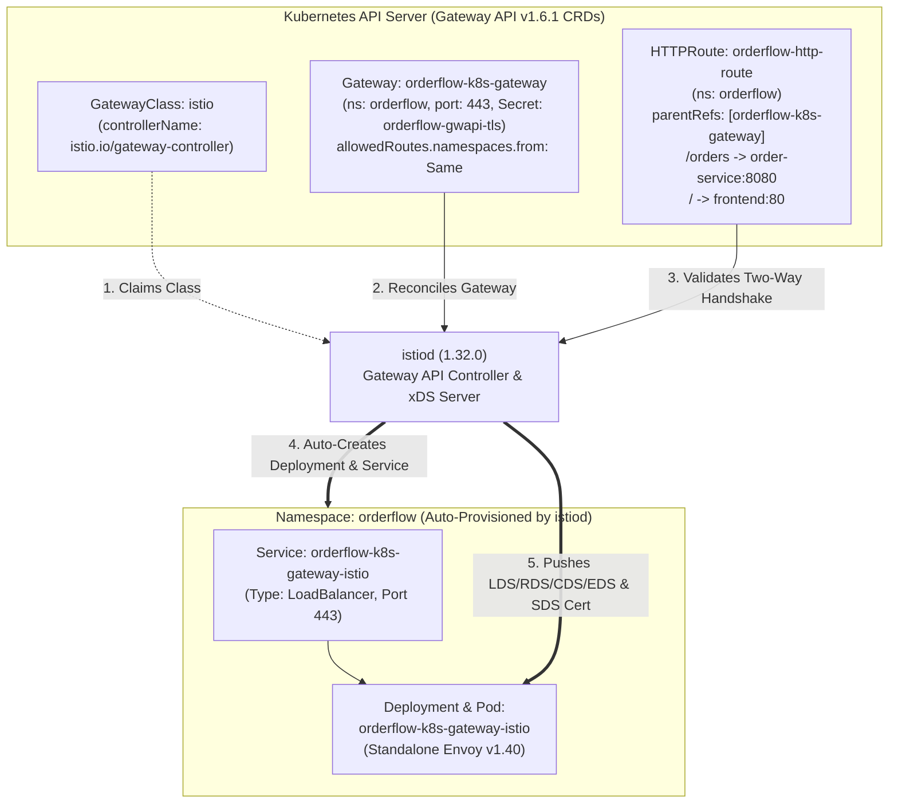

# Lesson 03.2: Kubernetes Gateway API (`v1.6.1`) & Automated Gateway Provisioning

> **Navigation**: [Fellowship Portal](../../README.md) > [Week 04: Edge Gateways & Controlled Egress](../../fellowship/week-04-edge-gateways-and-controlled-egress/WEEK.md) > [Module 03 Hub](../README.md) > **Lesson 03.2**  
> **Estimated Completion Time**: 25 minutes  
> **Prerequisites**: [Lesson 03.1: North-South Gateways & Edge TLS Modes](./01-north-south-gateways-and-tls-modes.md)  
> **Authoritative Baseline**: Istio `1.32.0` | Envoy `v1.40` | Kubernetes `1.36+` | Gateway API `v1.6.1`

### Learning Objectives
By the end of this lesson, you will be able to:
1. Compare legacy Kubernetes `Ingress`, Classic Istio `Gateway`/`VirtualService`, and the **Kubernetes Gateway API `v1.6.1`** (`gateway.networking.k8s.io/v1`).
2. Explain how `istiod` automatically provisions and manages Gateway `Deployment` and `Service` resources when a `Gateway` with `gatewayClassName: istio` is created.
3. Architect role-oriented two-way route binding (`allowedRoutes` on `Gateway` + `parentRefs` on `HTTPRoute`) and cross-namespace secret sharing with `ReferenceGrant`.

---

## 1. NovaPay Engineering Context & Alex Morgan's Briefing

### What Is Happening at NovaPay?
At NovaPay, Daniel Brooks's backend engineers deploy microservices across both Istio clusters and non-Istio GKE/Cilium clusters. Having to write Istio-proprietary `networking.istio.io/v1` `Gateway` and `VirtualService` manifests in one environment and vendor-specific annotations in another slows down developer velocity. Furthermore, Maya Patel wants to eliminate the security smell where application TLS secrets had to be dumped into `istio-system`.

### Alex Morgan's Briefing & Peer Engineering Debate
> **Daniel Brooks (Staff Backend Engineer)**: *"Alex, my backend engineers already use standard Kubernetes Gateway API (`HTTPRoute` and `GRPCRoute`) in our other environments. In Istio `1.32.0`, can we standardize our North-South ingress in `orderflow` on **Kubernetes Gateway API `v1.6.1`** instead of Classic Istio `Gateway`?"*
>
> **Alex Morgan (Senior Platform Engineer)**: *"Not only can we use it—Kubernetes Gateway API is the **official strategic standard** for traffic management in Istio `1.32.0`! Think of legacy Kubernetes `Ingress` like a single crumpled sticky note where everyone scribbled TLS certs, hostnames, and vendor annotations in one place. Classic Istio `Gateway` + `VirtualService` split that into two cards, but it was still Istio-only and required pre-installing `istio-ingressgateway` in `istio-system`.*
>
> *With **Gateway API `v1.6.1`**, we get three huge superpowers:*
> 1. ***Role-Based Resource Separation**: Infrastructure defines `GatewayClass` (`istio`), Platform/SRE defines the `Gateway` (ports, TLS certs), and Application Developers define `HTTPRoute` or `GRPCRoute` in their own namespaces.*
> 2. ***Two-Way Mutual Consent Handshake**: A route only attaches if the `Gateway` explicitly trusts the route's namespace (`allowedRoutes`) **AND** the `HTTPRoute` explicitly targets the `Gateway` (`parentRefs`).*
> 3. ***Automated Deployment Provisioning**: When you apply a `Gateway` with `gatewayClassName: istio` in `orderflow`, `istiod` automatically creates and manages the Envoy `Deployment` and `LoadBalancer` `Service` right inside `orderflow`—so the TLS Secret lives cleanly in `orderflow` too!"*

---

## 2. Progressive Disclosure Technical Explanation

### 2.1 Core Concept: Evolution from `Ingress` to Gateway API `v1.6.1`

| Dimension | Kubernetes `Ingress` (`networking.k8s.io/v1`) | Classic Istio `Gateway` + `VirtualService` | **Kubernetes Gateway API `v1.6.1`** (`gateway.networking.k8s.io/v1`) |
| :--- | :--- | :--- | :--- |
| **Design Era** | 2015 (Legacy HTTP-only) | 2018 (Istio-native CRDs) | **2023–2026+ (CNCF Standard & Istio Strategic Default)** |
| **Role Separation** | Monolithic object mixes infra TLS & app paths. | 2-tier: `Gateway` (L4/TLS) + `VirtualService` (L7). | **3-tier**: `GatewayClass` (Infra), `Gateway` (Platform Ops), `HTTPRoute` / `GRPCRoute` / `TCPRoute` / `UDPRoute` / `TLSRoute` (App Devs). |
| **Portability** | Relies on non-portable `metadata.annotations`. | Istio-only (`networking.istio.io/v1`). | Portable across Istio, Envoy Gateway, Cilium, GKE, Kong, NGINX. |
| **Attachment Consent** | None (monolithic). | One-way: `VirtualService` points to `gateways: [...]`. | **Two-way handshake**: `Gateway` specifies `allowedRoutes` **AND** `HTTPRoute` specifies `parentRefs`. |
| **Pod Provisioning** | Requires pre-installed controller pods. | Requires pre-installed `istio-ingressgateway` pods matching label selector. | **Automated Provisioning**: `istiod` automatically creates `<gw-name>-istio` `Deployment` and `Service` (or binds to an existing Service). |
| **Secret Namespace** | Same namespace as `Ingress`. | Must live in the **Gateway pod's namespace** (`istio-system`). | Same namespace as `Gateway` (or cross-namespace via explicit **`ReferenceGrant`**). |

> [!IMPORTANT]
> **What's New in Kubernetes Gateway API `v1.6.1` (`standard-install.yaml`)**  
> In our November 2026 baseline (**Gateway API `v1.6.1`** with **Istio `1.32.0`**), **`TCPRoute` and `UDPRoute` have graduated to the Standard (`gateway.networking.k8s.io/v1`) channel**, joining `GatewayClass`, `Gateway`, `HTTPRoute`, `GRPCRoute`, and `ReferenceGrant`. You no longer need `experimental-install.yaml` for standard L4 TCP/UDP gateway routing!

### 2.2 Technical Deep Dive: Automated Provisioning & Two-Way Binding

When you apply a Kubernetes Gateway API `Gateway` resource with `gatewayClassName: istio`:

```yaml
apiVersion: gateway.networking.k8s.io/v1
kind: Gateway
metadata:
  name: orderflow-k8s-gateway
  namespace: orderflow
spec:
  gatewayClassName: istio
  listeners:
    - name: https
      hostname: "orderflow.example.com"
      port: 443
      protocol: HTTPS
      tls:
        mode: Terminate
        certificateRefs:
          - kind: Secret
            name: orderflow-gwapi-tls
      allowedRoutes:
        namespaces:
          from: Same   # Options: Same, All, or Selector
```

#### How `istiod` Automated Deployment Provisioning Works
1. `istiod`'s Gateway API controller watches `gateway.networking.k8s.io/v1` `Gateway` resources referencing `gatewayClassName: istio`.
2. Instead of requiring a pre-existing pod in `istio-system`, `istiod` dynamically generates a Kubernetes `Deployment` (`orderflow-k8s-gateway-istio`) and a `Service` (`orderflow-k8s-gateway-istio`, type `LoadBalancer` by default) directly inside the `orderflow` namespace!
3. The generated pod uses a minimalist proxy template that starts `pilot-agent` + `envoy`, connects to `istiod` over xDS/SDS, and reads `orderflow-gwapi-tls` directly from the `orderflow` namespace.
4. `istiod` updates the `Gateway.status.addresses` and `Gateway.status.conditions` (`Programmed: True`, `Accepted: True`) once the `Service` IP is assigned and Envoy acknowledges the xDS push.

### 2.3 Mechanism Diagram & 6-Part Step-by-Step Walkthrough



#### 6-Part Mechanism Walkthrough: Gateway API Reconciliation & Automated Provisioning
1. **What initiates the operation?**
   A Platform Engineer applies `Gateway` (`orderflow-k8s-gateway`) and an Application Engineer applies `HTTPRoute` (`orderflow-http-route`) in the `orderflow` namespace to the Kubernetes API server.
2. **Which component receives it?**
   `istiod` (`1.32.0`), which registers as the controller for `GatewayClass: istio` (`istio.io/gateway-controller`), receives the watch events for `Gateway`, `HTTPRoute`, and `Secret` (`orderflow-gwapi-tls`).
3. **What information is exchanged?**
   - `istiod` verifies the **two-way attachment handshake**: Does `orderflow-k8s-gateway`'s `allowedRoutes` permit routes from `orderflow` (`from: Same`), and does `orderflow-http-route`'s `parentRefs` reference `orderflow-k8s-gateway`?
   - `istiod` checks that `orderflow-gwapi-tls` exists in `orderflow` (or that a `ReferenceGrant` exists if the Secret is in another namespace).
4. **What changes in the system?**
   - `istiod` automatically creates the `orderflow-k8s-gateway-istio` `Deployment` and `Service` in `orderflow`.
   - Once the gateway pod starts, `istiod` pushes the compiled Envoy `v1.40` listener (`:443`), SDS secret (`orderflow-gwapi-tls`), and RDS routes (`/orders` with `URLRewrite` filter $\rightarrow$ `order-service:8080`, `/` $\rightarrow$ `frontend:80`), and patches `status.conditions` (`Accepted: True`, `Programmed: True`) on both the `Gateway` and `HTTPRoute`.
5. **How can you observe/verify it on your cluster?**
   - Run `kubectl get gateway,httproute,deploy,svc -n orderflow` and verify `PROGRAMMED=True` on `orderflow-k8s-gateway`.
   - Run `kubectl describe httproute orderflow-http-route -n orderflow` and inspect `Status.Parents[].Conditions` for `Accepted: True` and `ResolvedRefs: True`.
6. **What happens if a component fails?**
   - **`allowedRoutes` mismatch**: If an `HTTPRoute` in namespace `team-b` tries to attach to `orderflow-k8s-gateway` (`from: Same`), `istiod` refuses to program the route and sets `Accepted: False (Reason: NotAllowedByListeners)` on the `HTTPRoute` status.
   - **Missing Secret or missing `ReferenceGrant`**: The `Gateway` listener condition reports `ResolvedRefs: False (Reason: InvalidCertificateRef)`, preventing silent TLS misconfigurations.

### 2.4 Engineering Insight & Production Trade-Offs

- **When to Use Classic Istio `Gateway`/`VirtualService` vs. Kubernetes Gateway API at NovaPay**:
  - **Use Kubernetes Gateway API (`v1.6.1`)** for all new North-South Ingress (`Gateway` + `HTTPRoute` / `GRPCRoute`) and standard East-West GAMMA mesh routing, especially when application teams manage their own routes or when you want namespace-isolated gateway deployments and rich `status.conditions`.
  - **Know Classic `Gateway` + `VirtualService`** because many enterprise brownfield clusters still run classic manifests, and certain Istio-specific capabilities—such as **multi-hop Egress Gateway routing with TLS origination** (Lesson 03.3) and declarative L7 Chaos Fault Injection (Module 05)—remain cleaner or natively expressed in `VirtualService`.
- **Manual Gateway Binding (Linking Gateway API to an Existing Service)**:
  If your infrastructure team pre-allocates static cloud load balancers rather than letting `istiod` create a new `LoadBalancer` Service per `Gateway`, you can point a Kubernetes Gateway API `Gateway` at an existing Service IP/hostname via `spec.addresses`.

---

## 3. Practical Observation & Investigation

When you apply `manifests/k8s-gateway-api.yaml` in [Lab 03](../LAB.md), inspect the control plane reconciliation and status conditions with these commands:

```bash
# 1. Verify Gateway API v1.6.1 Standard CRDs are installed
kubectl get crd | grep gateway.networking.k8s.io

# 2. Check the GatewayClass controller mapping
kubectl get gatewayclass istio -o yaml

# 3. Inspect the auto-provisioned Deployment & Service in orderflow
kubectl get gateway,httproute,deploy,svc -n orderflow | grep -E "NAME|orderflow-k8s|orderflow-http"

# 4. Inspect rich status conditions on the HTTPRoute
kubectl get httproute orderflow-http-route -n orderflow -o jsonpath='{.status.parents[0].conditions}' | jq .
```

---

## 4. Knowledge Check (Engineering Judgment)

### Question 1: Cross-Namespace `HTTPRoute` Attachment Rejected
NovaPay's `platform-ops` team deploys a shared `Gateway` named `novapay-shared-gw` in the `istio-ingress` namespace with the default `allowedRoutes` configuration (`namespaces.from: Same`). Daniel's team deploys an `HTTPRoute` in the `orderflow` namespace with `parentRefs: [{ name: novapay-shared-gw, namespace: istio-ingress }]`. Traffic returns `404 Not Found`. Why did attachment fail, and what must `platform-ops` change on the `Gateway`?

<details>
<summary>Check Answer & Engineering Explanation</summary>

**Answer**:
In the Kubernetes Gateway API, route attachment requires a **two-way handshake**. Because `allowedRoutes.namespaces.from` defaults to `Same`, `novapay-shared-gw` in `istio-ingress` only accepts `HTTPRoute` resources located in `istio-ingress`. Even though Daniel's `HTTPRoute` in `orderflow` pointed to `novapay-shared-gw` via `parentRefs`, `istiod` rejected the attachment (`Reason: NotAllowedByListeners`).

**Fix**: The `platform-ops` team must update `novapay-shared-gw`'s listener `allowedRoutes.namespaces` to either `from: All` or (preferably for Zero-Trust production) `from: Selector` matching a namespace label on `orderflow` (e.g., `kubernetes.io/metadata.name: orderflow` or `gateway-access: allowed`).
</details>

### Question 2: Cross-Namespace TLS Secret Access Without Secret Sprawl
Maya Patel stores NovaPay's wildcard production TLS certificate (`novapay-prod-wildcard-tls`) inside a locked-down `security-certs` namespace. How can a Kubernetes Gateway API `Gateway` in the `orderflow` namespace reference that `Secret` in `security-certs` without copying the Secret into `orderflow`?

<details>
<summary>Check Answer & Engineering Explanation</summary>

**Answer**:
Maya can create a **`ReferenceGrant`** (`gateway.networking.k8s.io/v1beta1` / `v1`) resource inside the **`security-certs`** namespace. The `ReferenceGrant` explicitly grants permission for `Gateway` resources in the `orderflow` namespace (`from: [{ group: gateway.networking.k8s.io, kind: Gateway, namespace: orderflow }]`) to reference `Secret` resources (`to: [{ group: "", kind: Secret, name: novapay-prod-wildcard-tls }]`) in `security-certs`. Without the `ReferenceGrant` in the target namespace, `istiod` blocks the cross-namespace secret reference to prevent unauthorized secret exfiltration.
</details>

---

## 5. Key Takeaways, Definition of Done & Next Lesson

### Key Takeaways
- **Gateway API `v1.6.1` is role-oriented and portable**: It separates `GatewayClass` (Infrastructure), `Gateway` (Platform Ops), and `HTTPRoute`/`GRPCRoute`/`TCPRoute`/`UDPRoute` (Application Developers).
- **Automated Deployment Provisioning**: A `Gateway` with `gatewayClassName: istio` causes `istiod` to automatically provision and manage a dedicated Envoy `Deployment` and `Service` in the `Gateway`'s namespace.
- **Two-Way Mutual Consent**: Routes only bind when the `Gateway` allows the route's namespace (`allowedRoutes`) and the route references the `Gateway` (`parentRefs`).

### Definition of Done
- [ ] You can explain why `istiod` creates `orderflow-k8s-gateway-istio` when a Gateway API `Gateway` is applied.
- [ ] You can diagnose `Accepted: False` and `ResolvedRefs: False` status conditions on `Gateway` and `HTTPRoute` resources.

### Authoritative References
- [Istio 1.32 Documentation — Kubernetes Gateway API](https://istio.io/latest/docs/tasks/traffic-management/ingress/gateway-api/)
- [Kubernetes Gateway API v1.6.1 Specification](https://gateway-api.sigs.k8s.io/)
- **Next Lesson**: **[Lesson 03.3: Zero-Trust Egress (`REGISTRY_ONLY`), `ServiceEntry`, TLS Origination & Egress Gateways](./03-zero-trust-egress-and-tls-origination.md)**
