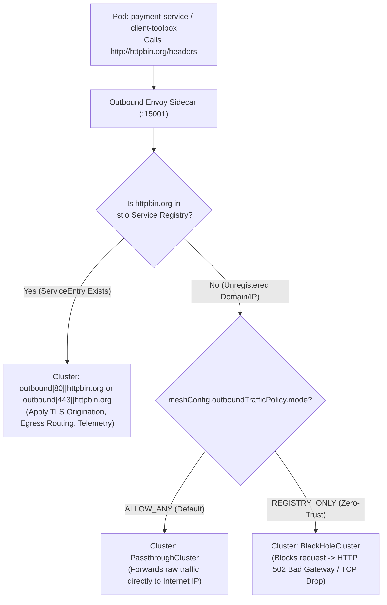
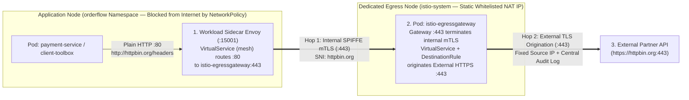

# Lesson 03.3: Zero-Trust Egress (`REGISTRY_ONLY`), `ServiceEntry`, TLS Origination & Egress Gateways

> **Navigation**: [Fellowship Portal](../../README.md) > [Week 04: Edge Gateways & Controlled Egress](../../fellowship/week-04-edge-gateways-and-controlled-egress/WEEK.md) > [Module 03 Hub](../README.md) > **Lesson 03.3**  
> **Estimated Completion Time**: 30 minutes  
> **Prerequisites**: [Lesson 03.1](./01-north-south-gateways-and-tls-modes.md) & [Lesson 03.2](./02-kubernetes-gateway-api.md)  
> **Authoritative Baseline**: Istio `1.32.0` | Envoy `v1.40` | Kubernetes `1.36+` | Gateway API `v1.6.1`

### Learning Objectives
By the end of this lesson, you will be able to:
1. Contrast `meshConfig.outboundTrafficPolicy.mode: ALLOW_ANY` (`PassthroughCluster`) with `REGISTRY_ONLY` (`BlackHoleCluster`), and explain why `REGISTRY_ONLY` alone is not a complete firewall without Kubernetes `NetworkPolicy` and an Egress Gateway.
2. Onboard external APIs into Istio's Service Registry using `ServiceEntry` (`MESH_EXTERNAL`, `DNS` vs. `STATIC` vs. `NONE`) and configure Envoy **TLS Origination** (`HTTP :80` $\rightarrow$ `HTTPS :443`) via `DestinationRule`.
3. Architect a multi-hop **Egress Gateway** pipeline (`Workload Sidecar` $\rightarrow$ `istio-egressgateway` $\rightarrow$ `External Partner API`) for PCI-DSS compliance, static source IP whitelisting, and centralized audit logging.

---

## 1. NovaPay Engineering Context & Alex Morgan's Briefing

### What Is Happening at NovaPay?
At NovaPay, `payment-service` in the `orderflow` namespace must call external card network settlement APIs (`https://httpbin.org:443` in our staging simulation) to authorize credit card transactions. However, for NovaPay's upcoming **PCI-DSS Level 1 audit (Requirement 1.3)**, Maya Patel has flagged a critical vulnerability: by default, Istio runs in `ALLOW_ANY` mode, meaning any compromised container in `orderflow` can open outbound connections to arbitrary command-and-control (C2) servers on the internet. Furthermore, our external banking partner requires all requests from NovaPay to originate from a **fixed, whitelisted NAT IP address** with centralized TLS 1.3/1.2 enforcement and audit logs.

### Alex, Maya & Sarah's Briefing
> **Maya Patel (Principal Security Engineer)**: *"Think of an office building with high-security keycard doors on the front entrance (`istio-ingressgateway`), while every window on the ground floor is left wide open (`ALLOW_ANY`). If an attacker exploits a vulnerability inside `order-service` or a third-party dependency, they can exfiltrate cardholder data straight out the window to any IP on the internet. Today we lock the windows (`REGISTRY_ONLY`), register our approved external partner (`ServiceEntry`), and force all external traffic through a single guarded exit door (`istio-egressgateway`)."*
>
> **Alex Morgan (Senior Platform Engineer)**: *"And pay attention to a subtle security question Maya loves to ask in architecture reviews: **Is `REGISTRY_ONLY` + `ServiceEntry` by itself a foolproof egress firewall?** No! Because HTTP sidecar routing trusts the HTTP `Host` header, a compromised pod could spoof `Host: allowed-partner.com` while connecting to an arbitrary IP unless Envoy resolves the DNS (`resolution: DNS`) and Kubernetes `NetworkPolicy` blocks application pods from reaching the internet directly—allowing them only to talk to `istio-egressgateway`."*
>
> **Sarah Chen (SRE Lead)**: *"One huge operational win we get from **TLS Origination** (`HTTP :80` from the app $\rightarrow$ `HTTPS :443` originated by Envoy): Daniel's apps don't have to manage external CA rotation or cipher suites, and Envoy can still inspect the L7 HTTP request, apply retries/circuit breaking, and record the HTTP status code and path in access logs before encrypting it to the external partner!"*

---

## 2. Progressive Disclosure Technical Explanation

### 2.1 Core Concept: `ALLOW_ANY` (`PassthroughCluster`) vs. `REGISTRY_ONLY` (`BlackHoleCluster`)

When an application container in `orderflow` opens an outbound connection, `iptables` redirects the socket to the local sidecar's `virtualOutbound` listener (`15001`). Envoy checks whether the destination host/IP exists in Istio's Service Registry (populated from Kubernetes `Services` and custom `ServiceEntry` resources).

What happens when the destination is **unknown** (not in the Service Registry) depends on `meshConfig.outboundTrafficPolicy.mode`:

- **`ALLOW_ANY` (Istio Default)**: Envoy routes unknown traffic to its built-in **`PassthroughCluster`** (`ORIGINAL_DST`), which forwards packets directly to the original destination IP untouched.
- **`REGISTRY_ONLY` (Zero-Trust Recommended)**: Envoy routes unknown traffic to its built-in **`BlackHoleCluster`**, which immediately drops raw TCP connections or returns `502 Bad Gateway` (with response flag `UH` / `UF`) for HTTP requests.



#### 6-Part Mechanism Walkthrough: `outboundTrafficPolicy.mode` Evaluation
1. **What initiates the operation?**
   A container inside `orderflow` (`client-toolbox` or `payment-service`) resolves `httpbin.org` via CoreDNS and sends an outbound TCP/HTTP request to the external IP on port `80`.
2. **Which component receives it?**
   Pod `iptables` (`ISTIO_OUTPUT` chain) intercepts the outbound packet and redirects it to `127.0.0.1:15001` (`virtualOutbound` listener) inside the local Envoy `v1.40` sidecar.
3. **What information is exchanged?**
   Envoy inspects the target port (`:80`) and the HTTP `Host: httpbin.org` header (or TLS SNI for `:443`) against its RDS/LDS filter chains pushed by `istiod` `1.32.0`.
4. **What changes in the system?**
   - If no `ServiceEntry` exists for `httpbin.org` and `mode: REGISTRY_ONLY` is active, the catch-all fallback route directs the stream to `BlackHoleCluster`, which has zero endpoints and immediately rejects the request (`502 Bad Gateway`).
   - Once a `ServiceEntry` for `httpbin.org` is applied, `istiod` pushes a new CDS cluster (`outbound|80||httpbin.org` / `outbound|443||httpbin.org`) and RDS route entry to the sidecar.
5. **How can you observe/verify it on your cluster?**
   - Check the mesh policy: `kubectl get configmap istio -n istio-system -o yaml | grep -A 2 outboundTrafficPolicy`.
   - Inspect the sidecar's clusters: `istioctl proxy-config cluster <pod>.orderflow | grep -E "PassthroughCluster|BlackHoleCluster|httpbin.org"`.
6. **What happens if a component fails?**
   - If an engineer flips `outboundTrafficPolicy.mode` to `REGISTRY_ONLY` in production **before** creating `ServiceEntry` resources for external dependencies (such as AWS S3, OAuth JWKS endpoints, or Stripe/card networks), all calls to those external endpoints immediately fail with `502 Bad Gateway` (`BlackHoleCluster`). Always audit `PassthroughCluster` metrics (`istio_requests_total{destination_service="PassthroughCluster"}`) before switching to `REGISTRY_ONLY`!

---

### 2.2 Technical Deep Dive: `ServiceEntry`, TLS Origination & Multi-Hop Egress Gateways

#### 1. Onboarding External Dependencies with `ServiceEntry`
A `ServiceEntry` adds external domains or IPs to Istio's internal Service Registry:
- **`location: MESH_EXTERNAL`**: Marks the service as external to the mesh (so Envoy does not attempt internal Istio SPIFFE mTLS automatically unless configured).
- **`resolution`**:
  - **`DNS`**: Envoy asynchronously resolves the domain name in `hosts` via DNS (`STRICT_DNS` or `LOGICAL_DNS` cluster) and ignores the client's original destination IP—preventing IP spoofing!
  - **`STATIC`**: Envoy routes only to the explicit static IPs listed under `endpoints`.
  - **`NONE`**: Envoy forwards to whatever destination IP the socket originally targeted (`ORIGINAL_DST`). *Avoid `NONE` for untrusted workloads because a client can spoof the `Host` header while targeting an arbitrary IP.*

#### 2. Sidecar TLS Origination (`HTTP :80` $\rightarrow$ `HTTPS :443`)
By combining a `ServiceEntry` (exposing ports `80` and `443`), a `VirtualService` (rewriting port `80` routes to destination port `443`), and a `DestinationRule` on port `443` with `tls.mode: SIMPLE` (`sni: httpbin.org`), the application sends fast local **plaintext HTTP (`:80`)**, and Envoy transparently upgrades the connection to **encrypted HTTPS (`:443`)**.

#### 3. Multi-Hop Egress Gateway Architecture (`istio-egressgateway`)
To satisfy Maya Patel's PCI-DSS requirements, we don't want individual workload pods connecting directly to the internet. Instead, we configure a **two-hop egress pipeline**:



#### 6-Part Mechanism Walkthrough: Multi-Hop Egress Gateway with TLS Origination
1. **What initiates the operation?**
   `payment-service` (or `client-toolbox`) makes a plaintext HTTP request to `http://httpbin.org/headers` on port `80`.
2. **Which component receives it?**
   - **Hop 1**: The workload pod's local Envoy sidecar (`:15001`) intercepts the request and matches the `VirtualService` rule for `gateways: ["mesh"]` and host `httpbin.org` port `80`.
   - **Hop 2**: The workload sidecar forwards the request over **internal SPIFFE mTLS** (`DestinationRule` `tls.mode: ISTIO_MUTUAL`, `sni: httpbin.org`) to `istio-egressgateway.istio-system.svc.cluster.local:443` (container port `8443`).
3. **What information is exchanged?**
   - `istio-egressgateway` terminates the internal mesh mTLS connection on its physical listener `0.0.0.0:8443` (configured by an Istio `Gateway` with `tls.mode: ISTIO_MUTUAL`).
   - `istio-egressgateway` evaluates the `VirtualService` rule for `gateways: ["httpbin-egress-gateway"]`, which routes the HTTP request to `httpbin.org:443`.
4. **What changes in the system?**
   `istio-egressgateway` applies the `DestinationRule` for `httpbin.org:443` (`tls.mode: SIMPLE`, `sni: httpbin.org`), originating an external **HTTPS (`:443`)** handshake to `httpbin.org`'s public IP from the Egress Gateway's node IP, and records a centralized egress audit log entry.
5. **How can you observe/verify it on your cluster?**
   - Check the response returned by `httpbin.org/headers`: it contains `"X-Forwarded-Proto": "https"`, proving `httpbin.org` received an HTTPS request on port `443` even though `curl` sent HTTP on port `80`.
   - Inspect the Egress Gateway access logs: `kubectl logs -n istio-system -l app=istio-egressgateway --tail=10` shows `outbound|443||httpbin.org` with the external IP of `httpbin.org`.
6. **What happens if a component fails?**
   - **Workload tries to bypass `istio-egressgateway`**: In a hardened production cluster, a Kubernetes CNI `NetworkPolicy` blocks all pods in `orderflow` from egressing to `0.0.0.0/0`, permitting egress only to `istio-system` (`istio-egressgateway`) and CoreDNS. Any direct connection attempt outside the Egress Gateway is dropped at L3/L4 by the CNI.
   - **Egress Gateway pod down or certificate validation fails**: The workload sidecar returns `503 UF` (*UpstreamConnectionFailure*), preventing unlogged or unencrypted data from leaking out of the cluster.

---

## 3. Practical Observation & Investigation

In [Lab 03](../LAB.md), you will execute these diagnostic commands to observe `BlackHoleCluster`, sidecar TLS origination, and `istio-egressgateway` traversal:

```bash
TOOLBOX_POD=$(kubectl get pod -n orderflow -l app=client-toolbox -o jsonpath='{.items[0].metadata.name}')

# 1. Inspect how Envoy configures outbound|80||httpbin.org and outbound|443||httpbin.org
istioctl proxy-config cluster "$TOOLBOX_POD.orderflow" --fqdn httpbin.org -o json

# 2. Inspect the Egress Gateway's listener (0.0.0.0:8443) and routes
EGW_POD=$(kubectl get pod -n istio-system -l app=istio-egressgateway -o jsonpath='{.items[0].metadata.name}')
istioctl proxy-config listener "$EGW_POD.istio-system"
istioctl proxy-config routes "$EGW_POD.istio-system"

# 3. Verify Egress Gateway access logs for external outbound calls
kubectl logs -n istio-system -l app=istio-egressgateway --tail=10
```

---

## 4. Knowledge Check (Engineering Judgment)

### Question 1: Why `REGISTRY_ONLY` Alone Is Not a Complete Firewall
A junior engineer tells Maya Patel: *"We set `meshConfig.outboundTrafficPolicy.mode: REGISTRY_ONLY` and created one `ServiceEntry` for `httpbin.org`. Therefore, even if an attacker gets root shell execution inside `order-service`, it is impossible for them to exfiltrate data to their attacker IP `198.51.100.99`."* Give two technical reasons why the junior engineer is wrong, and explain how NovaPay closes both gaps.

<details>
<summary>Check Answer & Engineering Explanation</summary>

**Answer**:
1. **Sidecar Bypass or Header Spoofing**:
   - If the attacker compromises the pod with elevated privileges (or if `ServiceEntry` uses `resolution: NONE` / HTTP `Host` header routing without strict DNS resolution), the attacker could send `Host: httpbin.org` while addressing the TCP packet to `198.51.100.99:80`, or bypass `iptables` if they have `CAP_NET_ADMIN`.
   - Even with `resolution: DNS`, if application nodes have direct network routing to the internet, any process or misconfigured uninjected pod in the namespace can reach `0.0.0.0/0`.
2. **How NovaPay Closes Both Gaps (Defense-in-Depth)**:
   - Use **`resolution: DNS`** (or `STATIC`) on the `ServiceEntry` so Envoy resolves `httpbin.org` via trusted DNS rather than trusting the packet's destination IP.
   - Funnel all external traffic through **`istio-egressgateway`** over internal SPIFFE mTLS (where an `AuthorizationPolicy` on `istio-egressgateway` verifies that only `spiffe://cluster.local/ns/orderflow/sa/payment-sa` may egress) **AND** enforce a Kubernetes CNI **`NetworkPolicy`** on `orderflow` that blocks all direct internet egress (`0.0.0.0/0`), allowing `orderflow` pods to connect only to cluster-internal CIDRs (`istio-egressgateway` and CoreDNS).
</details>

### Question 2: Safely Rolling Out `REGISTRY_ONLY` in Brownfield Production
Sarah Chen wants to flip NovaPay's production mesh from `ALLOW_ANY` to `REGISTRY_ONLY`, but she is worried that an undocumented microservice might be calling an external SaaS endpoint that hasn't been registered in a `ServiceEntry` yet. How can Sarah discover every unregistered external call across the entire cluster *before* turning on `REGISTRY_ONLY`?

<details>
<summary>Check Answer & Engineering Explanation</summary>

**Answer**:
While `outboundTrafficPolicy.mode` is still `ALLOW_ANY`, Envoy routes all unregistered external calls through the **`PassthroughCluster`**. Envoy automatically emits Prometheus telemetry and access logs for `PassthroughCluster`!

Sarah can run a PromQL query across the cluster:
```promql
sum by (source_workload, source_workload_namespace, destination_service_name) (
  rate(istio_requests_total{destination_service="PassthroughCluster"}[24h])
)
```
and inspect Envoy access logs matching `PassthroughCluster` to identify every external hostname/IP being called, author the corresponding `ServiceEntry` manifests, verify `PassthroughCluster` traffic drops to `0`, and *then* flip `outboundTrafficPolicy.mode` to `REGISTRY_ONLY` with zero outage.
</details>

---

## 5. Key Takeaways, Definition of Done & Next Steps

### Key Takeaways
- **`ALLOW_ANY` vs. `REGISTRY_ONLY`**: `ALLOW_ANY` forwards unknown outbound calls to `PassthroughCluster`; `REGISTRY_ONLY` blocks unknown outbound calls via `BlackHoleCluster` (`502 Bad Gateway`).
- **`ServiceEntry` + TLS Origination**: `ServiceEntry` registers external domains (`MESH_EXTERNAL`, `resolution: DNS`), while `DestinationRule` (`tls.mode: SIMPLE`) lets Envoy upgrade plaintext internal HTTP (`:80`) to external HTTPS (`:443`).
- **Defense-in-Depth Egress Gateways**: Routing external traffic through `istio-egressgateway` provides fixed NAT source IPs for partner firewalls, centralized audit logging, SPIFFE identity access control, and CNI `NetworkPolicy` isolation.

### Definition of Done
- [ ] You have completed all three lessons in Module 03 (`03.1`, `03.2`, and `03.3`).
- [ ] You are ready to execute the hands-on verification in **[Module 03 Lab: Edge TLS, Gateway API & Controlled Egress (`../LAB.md`)](../LAB.md)** and tackle **[Week 04 Ticket `NP-104`](../../fellowship/week-04-edge-gateways-and-controlled-egress/WEEK.md)**.

### Authoritative References
- [Istio 1.32 Documentation — Accessing External Services (`ServiceEntry`)](https://istio.io/latest/docs/tasks/traffic-management/egress/egress-control/)
- [Istio 1.32 Documentation — Egress TLS Origination](https://istio.io/latest/docs/tasks/traffic-management/egress/egress-tls-origination/)
- [Istio 1.32 Documentation — Egress Gateways](https://istio.io/latest/docs/tasks/traffic-management/egress/egress-gateway/)
- **Next Step**: Proceed to **[Module 03 Guided Lab (`../LAB.md`)](../LAB.md)** or **[Module 04: Zero-Trust Security (`../../04-security-mtls-and-authz/README.md`)](../../04-security-mtls-and-authz/README.md)**
