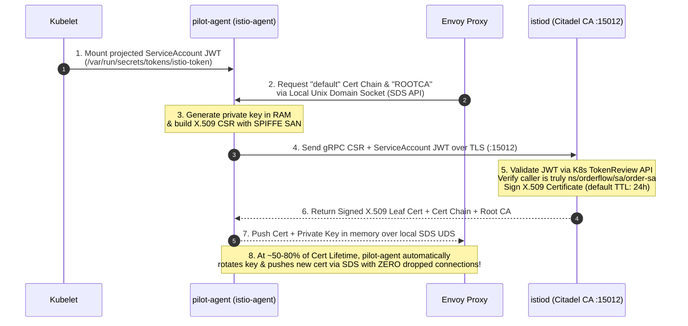
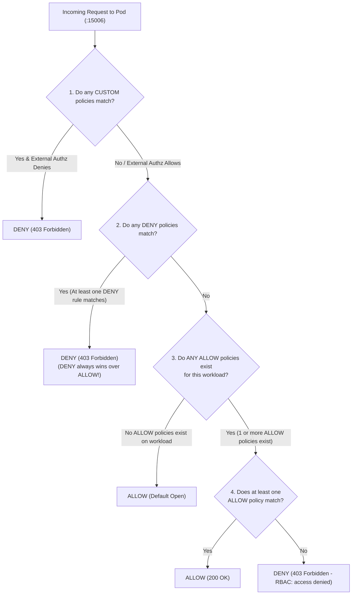

# Module 04: Zero-Trust Security — SPIFFE Identity, mTLS (`PeerAuthentication`), JWT (`RequestAuthentication`) & `AuthorizationPolicy`

## 1. Why Zero-Trust Networking Is Essential in Kubernetes

In traditional perimeter security ("castle-and-moat"), any workload inside the Kubernetes cluster network is implicitly trusted. Even when teams deploy Kubernetes `NetworkPolicy` (L3/L4 firewall rules implemented by the CNI), critical security gaps remain:

1. **IP Addresses Are Ephemeral, Not Cryptographic Identities**:
   In Kubernetes, Pod IPs are recycled within seconds as pods churn. Relying on IP-based rules in multi-tenant clusters is fragile and provides zero protection against ARP spoofing or CNI misconfiguration.
2. **Traffic on the Wire Is Unencrypted Plaintext**:
   Kubernetes `NetworkPolicy` does not encrypt packets. Anyone with node-level packet capture access or cross-node network visibility can sniff sensitive payloads, headers, or bearer tokens in transit.
3. **Zero L7 Awareness**:
   An L3/L4 `NetworkPolicy` can allow `order-service` to open a TCP connection to `payment-service:8080`, but it **cannot** restrict `order-service` to `POST /charge` while blocking `DELETE /refunds`, nor can it verify an end-user's JWT claims (`role: admin`).

Istio implements a **Defense-in-Depth Zero-Trust Architecture**:
- **Cryptographic Workload Identity (SPIFFE)** instead of IP addresses.
- **Mutual TLS (`PeerAuthentication`)** for encryption in transit and peer authentication.
- **Origin/End-User Authentication (`RequestAuthentication`)** for OpenID Connect / JWT verification.
- **Fine-Grained L4/L7 Access Control (`AuthorizationPolicy`)** enforced inside every server's inbound Envoy proxy.

---

## 2. Istio Identity, SPIFFE & SDS Certificate Lifecycle

How does `order-service` cryptographically prove to `payment-service` that it is genuinely running as the `order-sa` ServiceAccount in the `orderflow` namespace?

### 2.1 SPIFFE ID Format

Istio encodes workload identity using the CNCF **SPIFFE (Secure Production Identity Framework for Everyone)** standard inside the **Subject Alternative Name (SAN)** URI extension of an X.509 certificate:

```text
spiffe://<trust-domain>/ns/<namespace>/sa/<service-account>
```
For our **OrderFlow** workloads:
- `frontend`: `spiffe://cluster.local/ns/orderflow/sa/frontend-sa`
- `order-service`: `spiffe://cluster.local/ns/orderflow/sa/order-sa`
- `payment-service`: `spiffe://cluster.local/ns/orderflow/sa/payment-sa`
- `inventory-service`: `spiffe://cluster.local/ns/orderflow/sa/inventory-sa`
- `client-toolbox`: `spiffe://cluster.local/ns/orderflow/sa/toolbox-sa`

### 2.2 Under the Hood: CSR and Zero-Downtime Rotation via SDS

**Private keys never leave the pod and are never written to Kubernetes `Secrets` or disk.**



---

## 3. Mutual TLS (`PeerAuthentication`)

`PeerAuthentication` controls how the **inbound (server-side)** Envoy listener (`15006`) handles incoming connections from peer workloads.

### 3.1 The Three mTLS Modes

| Mode | Server Inbound (`15006`) Behavior | When to Use |
| :--- | :--- | :--- |
| **`PERMISSIVE`** *(Istio Default)* | Accepts **both** mutual TLS traffic and plaintext HTTP/TCP traffic on the same port. | Migration brownfield environments where non-mesh pods (without Envoy sidecars) must talk to mesh-enrolled pods. |
| **`STRICT`** | Accepts **only** mutual TLS connections with valid SPIFFE client certificates. Plaintext connections are immediately rejected at the TLS handshake layer (`Connection reset by peer`). | **Production Standard** for all mesh namespaces once workloads are enrolled. Required when enforcing identity-based `AuthorizationPolicy`. |
| **`DISABLE`** | Disables mTLS on the inbound listener (expects plaintext unless the application handles its own TLS). | Rare legacy edge cases; avoid in production. |

### 3.2 How Does `PERMISSIVE` Mode Auto-Detect mTLS vs. Plaintext on the Same Port?

Look back at the `15006` inbound listener output from Module 01:
- When a client Envoy in the mesh connects to a peer in `PERMISSIVE` mode, `istiod` knows the target pod has an Istio sidecar (`security.istio.io/tlsMode: istio` label), so the client Envoy automatically initiates TLS with the **ALPN (Application-Layer Protocol Negotiation)** header set to `istio`, `istio-peer-exchange`, `istio-http/1.1`, or `istio-h2`.
- On the server's `15006` listener, Envoy uses the **`tls_inspector` listener filter** to peek at the first bytes of the TCP stream:
  - If the bytes start with a TLS `ClientHello` matching Istio ALPN protocols, Envoy routes the connection into the **TLS Filter Chain**.
  - Otherwise, Envoy routes the connection into the **Plaintext (`raw_buffer`) Filter Chain**!

### 3.3 `PeerAuthentication` Precedence Hierarchy

Istio evaluates `PeerAuthentication` from **most specific to least specific**:

1. **Workload-specific policy** (in the workload's namespace with a matching `spec.selector.matchLabels` — also supports `portLevelMtls` overrides per port!).
2. **Namespace-wide policy** (in the workload's namespace, e.g., `orderflow`, with **no** `selector`).
3. **Mesh-wide policy** (in the **root namespace** `istio-system` with **no** `selector`).

---

## 4. End-User JWT Authentication (`RequestAuthentication`)

While `PeerAuthentication` authenticates the **immediate calling microservice** (Peer / Workload Identity via mTLS), `RequestAuthentication` authenticates the **end user or external client** (Origin Identity via a JSON Web Token / JWT).

```yaml
apiVersion: security.istio.io/v1
kind: RequestAuthentication
metadata:
  name: orderflow-jwt-authn
  namespace: orderflow
spec:
  selector:
    matchLabels:
      app: order-service
  jwtRules:
    - issuer: "testing@secure.istio.io"
      jwksUri: "https://raw.githubusercontent.com/istio/istio/release-1.24/security/tools/jwt/samples/jwks.json"
      # Or inline jwks: | ... for air-gapped / sandboxed environments!
      forwardOriginalToken: true
```

### 4.1 Crucial Nuance: What `RequestAuthentication` Allows vs. Rejects!

This trips up almost every engineer new to Istio:

| Incoming Request State | `RequestAuthentication` Alone Result | Why? |
| :--- | :--- | :--- |
| Request has **Valid JWT** | **Allowed (`200 OK`)** — Envoy populates `request.auth.principal` and `request.auth.claims`. | Signature and `exp`/`iss` validated against JWKS. |
| Request has **Invalid / Expired / Tampered JWT** | **Rejected (`401 Unauthorized`)** | `jwt_authn` HTTP filter rejects malformed or bad tokens immediately. |
| Request has **NO JWT at all** (No `Authorization` header) | **Allowed (`200 OK`)!** | `RequestAuthentication` only *validates* tokens if present! To **require** a JWT, you **must** pair it with an `AuthorizationPolicy` checking `requestPrincipals`. |

---

## 5. Access Control (`AuthorizationPolicy`)

`AuthorizationPolicy` configures Envoy's `envoy.filters.http.rbac` (L7) and `envoy.filters.network.rbac` (L4) filters.

### 5.1 The Evaluation Precedence Diagram (CRITICAL)

When multiple `AuthorizationPolicy` resources target the same workload, Envoy evaluates them in a strict deterministic order:



### 5.2 The Zero-Trust Baseline Pattern (`allow-nothing`)

Notice Step 3 above: if a workload has **zero** `ALLOW` policies, it defaults to allowing all traffic. As soon as you create **even one** `ALLOW` policy targeting a workload, anything not explicitly matched by an `ALLOW` policy is denied.

To establish a strict Zero-Trust posture across an entire namespace (`orderflow`) before adding additive `ALLOW` rules per service, deploy the **`allow-nothing`** policy with an empty `spec: {}`:

```yaml
apiVersion: security.istio.io/v1
kind: AuthorizationPolicy
metadata:
  name: allow-nothing-baseline
  namespace: orderflow
spec:
  {} # Matches all pods in orderflow, has action: ALLOW (default) with zero rules -> DENIES ALL TRAFFIC!
```
Then, add granular `ALLOW` policies for each valid edge in your service call graph (`frontend-sa -> order-service`, `order-sa -> payment-service`, `order-sa -> inventory-service`). Because `ALLOW` policies are **additive (logical OR across policies)**, each explicit `ALLOW` policy unlocks only its exact communication path!

### 5.3 The Most Common Production Bug: `AND` vs. `OR` Semantics in YAML

In `AuthorizationPolicy`, a single YAML indentation dash (`-`) changes the logic from **logical AND** (intersection) to **logical OR** (union)!

Compare these two configurations carefully:

```yaml
# =====================================================================
# CORRECT (Logical AND): Caller MUST be frontend-sa AND method MUST be GET
# =====================================================================
rules:
  - from:
      - source:
          principals: ["cluster.local/ns/orderflow/sa/frontend-sa"]
    to:
      - operation:
          methods: ["GET"]

# =====================================================================
# DANGEROUS BUG (Logical OR): Caller is frontend-sa (ANY method!)
#                             OR method is GET (from ANY caller!)
# =====================================================================
rules:
  - from:
      - source:
          principals: ["cluster.local/ns/orderflow/sa/frontend-sa"]
  - to:               # <--- Notice the extra dash (-) starting a SECOND rule in rules[]!
      - operation:
          methods: ["GET"]
```

**Summary of Boolean Logic inside `AuthorizationPolicy`**:
1. **Between elements in the same list** (e.g., `methods: ["GET", "POST"]`, or multiple items in `rules: []`, `from: []`, `to: []`, `when: []`): **Logical OR**.
2. **Between fields inside the same single object** (e.g., `from` + `to` + `when` inside a single `rules` item, or `principals` + `namespaces` inside a single `source` item): **Logical AND**.
   *(Exception: multiple items inside `when: []` under a single rule are combined with **Logical AND**).*
