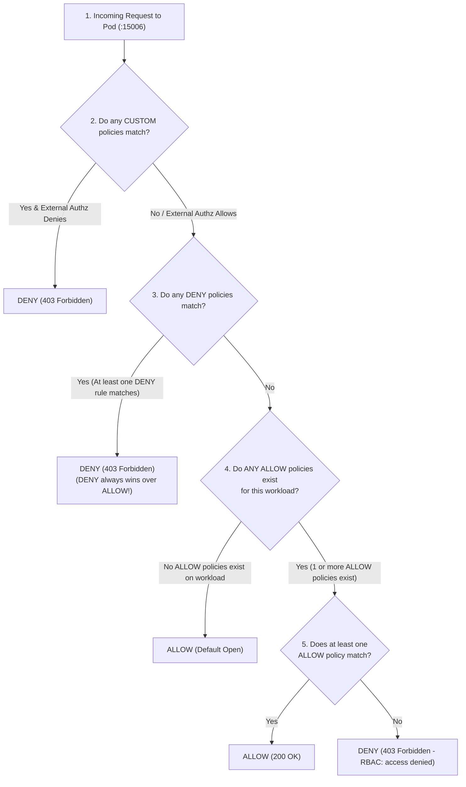

# Module 04: Zero-Trust Security — SPIFFE Identity, mTLS (`PeerAuthentication`), JWT (`RequestAuthentication`) & `AuthorizationPolicy`

> **Navigation**: [Fellowship Portal](../README.md) > [Week 05: Zero-Trust Security Architecture](../fellowship/week-05-zero-trust-security-architecture/WEEK.md) > **Module 04 Architecture Hub** | [Guided Lab (`LAB.md`)](./LAB.md)  
> **Version Baseline (November 2026)**: Istio `1.32.0` | Envoy `v1.40` | Kubernetes `v1.36+` | Gateway API `v1.6.1` — see [`../VERSIONS.md`](../VERSIONS.md) and [`../COMPATIBILITY.md`](../COMPATIBILITY.md).  
> **Fellowship Cohort 01 Mapping**: Complete this module alongside **[Week 05: Zero-Trust Security Architecture](../fellowship/week-05-zero-trust-security-architecture/WEEK.md)** (Engineering Ticket `NP-105` & Incident `INC-05`).

---

## 🎙️ Alex Morgan & Maya Patel's Module 04 Architecture Briefing

> **Maya Patel (Principal Security Engineer, NovaPay)**: *"Welcome to Module 04. In a PCI-DSS Level 1 financial environment like NovaPay's `orderflow` payment platform, trusting pod IP addresses or assuming that 'inside the cluster = safe' is an audit failure waiting to happen. Pod IPs churn every time a deployment scales, L3/L4 `NetworkPolicy` does not encrypt packets on the wire, and L4 firewalls cannot distinguish `GET /health` from `POST /charge`.*
>
> *In this module, we replace implicit network trust with **Cryptographic Zero-Trust**: every pod receives an in-memory **SPIFFE** X.509 passport via SDS, every connection is encrypted and authenticated with **`STRICT` mTLS (`PeerAuthentication`)**, end-user JWT tokens are validated via **`RequestAuthentication`**, and every microservice hop is locked down with a Default-Deny **`AuthorizationPolicy`**."*

> **Alex Morgan (Senior Platform Engineer, NovaPay)**: *"We've structured Module 04 into **three progressive 25–30 minute lessons**. Pay special attention in Lesson 04.3 to two things that trip up even seasoned engineers: why `RequestAuthentication` lets requests **without** a JWT pass right through unless paired with an `AuthorizationPolicy`, and how a single extra YAML hyphen (`-`) turns a strict `AND` authorization rule into a wide-open `OR` vulnerability (`INC-05`)."*

---

## 🗺️ Progressive Lesson Milestones Table

Complete these three modular lessons in order before executing the hands-on **[Module 04 Guided Lab (`./LAB.md`)](./LAB.md)**:

| Lesson | Title & Core Architecture Focus | Est. Time | NovaPay Fellowship Milestone |
| :--- | :--- | :--- | :--- |
| **[Lesson 04.1](./lessons/01-spiffe-identity-and-sds-lifecycle.md)** | **Zero-Trust Foundations, SPIFFE Identity & SDS Certificate Lifecycle** Why L3/L4 `NetworkPolicy` is insufficient for PCI-DSS, SPIFFE SAN URI format (`spiffe://cluster.local/ns/orderflow/sa/<sa>`), and the 8-step in-memory CSR & zero-downtime certificate rotation flow over SDS (`pilot-agent` $\leftrightarrow$ `istiod:15012`). | **25 min** | Inspect live in-memory X.509 workload certificates via SDS and verify dedicated `ServiceAccount` identities across `orderflow`. |
| **[Lesson 04.2](./lessons/02-peer-authentication-and-mtls-migration.md)** | **Mutual TLS (`PeerAuthentication`) & Zero-Downtime `STRICT` Migration** `PERMISSIVE` (ALPN + `tls_inspector` auto-detection) vs. `STRICT` vs. `DISABLE`, 3-tier precedence hierarchy (Workload + `portLevelMtls` > Namespace > Mesh-wide `istio-system`), and brownfield migration strategy. | **25 min** | Migrate `orderflow` from `PERMISSIVE` to `STRICT` mTLS and prove uninjected plaintext callers are rejected at the TLS layer. |
| **[Lesson 04.3](./lessons/03-jwt-authn-and-authorization-policy.md)** | **End-User JWT Authn (`RequestAuthentication`) & `AuthorizationPolicy`** `RequestAuthentication` validation semantics (`401` vs. no-token pass-through), `CUSTOM` $\rightarrow$ `DENY` $\rightarrow$ `ALLOW` precedence, `allow-nothing` (`spec: {}`) baseline, the YAML `AND` vs. `OR` indentation trap, and Istio `1.32.0` `HTTPRoute` `targetRefs`. | **30 min** | Lock down `orderflow` with least-privilege SPIFFE + JWT RBAC (`NP-105`) and fix the `AND` vs. `OR` bypass bug (`INC-05`). |
| **[Guided Lab](./LAB.md)** | **Hands-On Lab 04: SPIFFE Certificates, `STRICT` mTLS, JWT Auth & RBAC Debugging** Step-by-step cluster verification with "Predict Before You Execute" checks and progressive troubleshooting hints. | **45 min** | Execute all 5 Zero-Trust verification steps and debug the broken `AND`/`OR` policy live on your cluster. |

---

## 1. SPIFFE Workload Identity & SDS Certificate Lifecycle Synthesis

> 📖 **Deep Dive**: Read **[Lesson 04.1: SPIFFE Identity & the SDS Certificate Lifecycle](./lessons/01-spiffe-identity-and-sds-lifecycle.md)** for full PKI and `TokenReview` internals.

Istio encodes workload identity using the CNCF **SPIFFE** standard inside the `critical` **X.509 Subject Alternative Name (SAN)** URI extension (`spiffe://<trust-domain>/ns/<namespace>/sa/<service-account>`). **Private keys never leave the pod and are never written to Kubernetes `Secrets` or disk.**

### 6-Part Mechanism Walkthrough: SDS In-Memory Certificate Provisioning & Rotation
1. **What initiates the operation?**
   At pod startup (and automatically at ~50%–80% of the certificate's 24-hour TTL), `Kubelet` mounts the projected `ServiceAccount` token (`istio-token`) and Envoy connects to `pilot-agent` over the local SDS Unix Domain Socket requesting the `default` certificate chain and `ROOTCA`.
2. **Which component receives it?**
   `pilot-agent` (`istio-agent`) receives the local SDS stream request, generates a private key in RAM, and sends a gRPC Certificate Signing Request (CSR) to `istiod`'s Citadel CA endpoint (`:15012`).
3. **What information is exchanged?**
   `pilot-agent` transmits the PKCS#10 CSR (embedding `URI:spiffe://cluster.local/ns/orderflow/sa/<sa>`) and the projected `ServiceAccount` JWT over TLS. `istiod` validates the JWT against the Kubernetes API Server `TokenReview` endpoint and signs the X.509 certificate.
4. **What changes in the system?**
   `istiod` returns the signed certificate chain and Root CA to `pilot-agent`, which pushes the certificate and in-memory private key over the SDS Unix Domain Socket into Envoy's active TLS context with zero dropped connections.
5. **How can you observe/verify it on your cluster?**
   Run `istioctl proxy-config secret <pod>.orderflow` to confirm `default` and `ROOTCA` are `ACTIVE`, and decode the inline certificate chain using `openssl x509 -noout -text`.
6. **What happens if a component fails?**
   If `istiod` experiences a temporary outage, existing pods continue serving mTLS traffic using their in-memory certificates (valid for 24h) while `pilot-agent` retries CSR rotation with exponential backoff in the background. If a pod attempts to spoof another `ServiceAccount`'s SPIFFE ID in its CSR, `istiod`'s `TokenReview` check detects the identity mismatch and rejects the CSR.

---

## 2. Mutual TLS (`PeerAuthentication`) & End-User JWT (`RequestAuthentication`) Synthesis

> 📖 **Deep Dive**: Read **[Lesson 04.2: `PeerAuthentication` & mTLS Migration](./lessons/02-peer-authentication-and-mtls-migration.md)** and **[Lesson 04.3: JWT Authn & `AuthorizationPolicy`](./lessons/03-jwt-authn-and-authorization-policy.md)**.

### 2.1 `PeerAuthentication` Modes & Precedence (`1. Workload` > `2. Namespace` > `3. istio-system`)

| Mode | Server Inbound (`15006`) Behavior | When to Use |
| :--- | :--- | :--- |
| **`PERMISSIVE`** *(Default)* | Accepts **both** mutual TLS (`Trans: tls` matched via `tls_inspector` + Istio ALPN) and plaintext (`Trans: raw_buffer`) on the same port. | Brownfield migration while non-mesh pods still call mesh-enrolled pods. |
| **`STRICT`** | Removes the `raw_buffer` filter chain; accepts **only** mutual TLS connections with valid SPIFFE client certificates. Plaintext connections are reset immediately. | **Production Standard** for all mesh namespaces (`orderflow`). Required when enforcing SPIFFE-based `AuthorizationPolicy`. |
| **`DISABLE`** | Disables mTLS termination on the inbound listener (or specific container port via `portLevelMtls`). | Legacy exceptions where the application binary terminates its own TLS. |

### 2.2 `RequestAuthentication` JWT Validation Matrix

| Incoming Request State | `RequestAuthentication` Alone Result | Why? |
| :--- | :--- | :--- |
| **Valid Signed JWT** | **Allowed (`200 OK`)** — Populates `request.auth.principal` and `request.auth.claims`. | Signature, `iss`, and `exp` verified against JWKS. |
| **Invalid / Expired / Tampered JWT** | **Rejected (`401 Unauthorized`)** | `envoy.filters.http.jwt_authn` rejects bad tokens immediately. |
| **NO JWT Header Present** | **Allowed (`200 OK`)!** | `RequestAuthentication` only validates tokens *if present*! Pair with `AuthorizationPolicy` (`403 Forbidden`) to **require** a JWT. |

---

## 3. Access Control (`AuthorizationPolicy`) Evaluation Synthesis

> 📖 **Deep Dive**: Read **[Lesson 04.3: JWT Authn, `AuthorizationPolicy` Precedence & the `AND` vs. `OR` YAML Trap](./lessons/03-jwt-authn-and-authorization-policy.md)** for full boolean YAML syntax rules and Istio `1.32.0` `HTTPRoute` `targetRefs`.

### 6-Part Mechanism Walkthrough: `AuthorizationPolicy` RBAC Evaluation (`CUSTOM -> DENY -> ALLOW`)
1. **What initiates the operation?**
   An incoming request reaches the server pod's inbound Envoy listener (`:15006`) after completing mTLS (`PeerAuthentication`) and optional JWT verification (`RequestAuthentication`).
2. **Which component receives it?**
   Envoy `v1.40`'s `envoy.filters.http.rbac` (or `envoy.filters.network.rbac` for raw TCP) filter receives the authenticated request context (verified SPIFFE `source.principal`, `request.auth.claims`, and L7 HTTP method/path/headers).
3. **What information is exchanged?**
   The RBAC filter evaluates the request attributes in strict order: first against `action: CUSTOM` policies, second against `action: DENY` policies, and third against `action: ALLOW` policies.
4. **What changes in the system?**
   - If any `CUSTOM` or `DENY` rule matches, the request is immediately rejected with `403 Forbidden`.
   - If no `DENY` rule matches and at least one `ALLOW` policy targets the workload (such as our namespace-wide `allow-nothing` baseline `spec: {}`), the request is forwarded to the application container (`:8080`) **only if** at least one explicit `ALLOW` rule matches; otherwise Envoy returns `403 Forbidden` (`RBAC: access denied`).
5. **How can you observe/verify it on your cluster?**
   Inspect compiled RBAC policies via `istioctl proxy-config listener <pod>.orderflow --port 15006 -o json` and check Envoy access logs or `istio_requests_total{response_code="403"}`.
6. **What happens if a component fails?**
   If an engineer accidentally adds an extra YAML hyphen (`-`) before `to:` or `when:` inside `rules: []`, Envoy compiles two separate `OR` rules instead of a single `AND` rule, causing an authorization bypass (`INC-05`). Always verify every `ALLOW` policy with both positive (authorized) and negative (unauthorized caller/method) test requests!

---

## 🚀 Next Steps

1. Complete the three lessons above (`04.1` $\rightarrow$ `04.2` $\rightarrow$ `04.3`).
2. Execute the hands-on **[Module 04 Lab (`./LAB.md`)](./LAB.md)**.
3. Complete your Thursday engineering ticket (`NP-105`) and Friday incident simulation (`INC-05`) in **[Week 05: Zero-Trust Security Architecture (`../fellowship/week-05-zero-trust-security-architecture/WEEK.md`)](../fellowship/week-05-zero-trust-security-architecture/WEEK.md)**.
