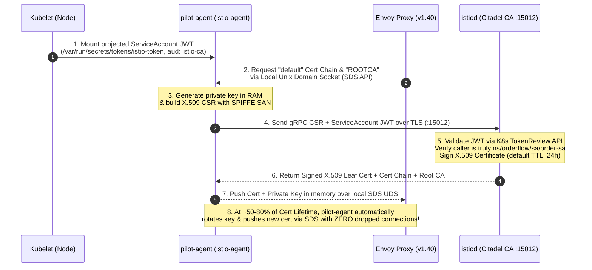

# Lesson 04.1: Zero-Trust Foundations, SPIFFE Cryptographic Identity & the SDS Certificate Lifecycle

> **Navigation**: [Fellowship Portal](../../README.md) > [Week 05: Zero-Trust Security Architecture](../../fellowship/week-05-zero-trust-security-architecture/WEEK.md) > [Module 04 Hub](../README.md) > **Lesson 04.1**  
> **Estimated Completion Time**: 25 minutes  
> **Prerequisites**: [Module 01 (`istiod` & Envoy xDS)](../../01-architecture-and-internals/README.md) & [Module 03 (Gateways & SDS)](../../03-gateways-ingress-and-egress/README.md)  
> **Authoritative Baseline**: Istio `1.32.0` | Envoy `v1.40` | Kubernetes `1.36+` | Gateway API `v1.6.1`

### Learning Objectives
By the end of this lesson, you will be able to:
1. Explain why Layer 3/4 Kubernetes `NetworkPolicy` is insufficient for Zero-Trust security and PCI-DSS Level 1 compliance at NovaPay.
2. Decode Istio's CNCF **SPIFFE** X.509 Subject Alternative Name (SAN) URI format (`spiffe://<trust-domain>/ns/<namespace>/sa/<service-account>`).
3. Trace the 8-step in-memory Certificate Signing Request (CSR) and zero-downtime certificate rotation flow between `pilot-agent`, `istiod` (`:15012`), and Envoy over the local **Secret Discovery Service (SDS)** Unix Domain Socket.

---

## 1. NovaPay Engineering Context & Alex Morgan's Briefing

### What Is Happening at NovaPay?
NovaPay's external **PCI-DSS Level 1 Qualified Security Assessor (QSA)** arrives next month to audit the `orderflow` payment processing platform (`frontend` $\rightarrow$ `order-service` $\rightarrow$ `payment-service` & `inventory-service`). Prior to Week 05 (Ticket `NP-105`), the cluster relied on CNI `NetworkPolicy` rules and perimeter firewalls. Maya Patel (Principal Security Engineer) has mandated a complete transition to **Cryptographic Zero-Trust** inside the mesh.

### Alex & Maya's Briefing & Intuition Analogy
> **Maya Patel (Principal Security Engineer)**: *"In traditional 'castle-and-moat' security, people assume that once a packet is inside the Kubernetes cluster network, it's trustworthy. Even when teams add Kubernetes `NetworkPolicy`, three massive security gaps remain:*
> 1. ***IP Addresses Are Ephemeral, Not Identities**: In Kubernetes, Pod IPs are recycled within seconds as pods scale or crash. Trusting an IP address is like a bank teller trusting whoever happens to be standing in parking spot #14.*
> 2. ***Traffic on the Wire Is Unencrypted Plaintext**: `NetworkPolicy` only filters L3/L4 packets; it does not encrypt them. Anyone with node capture access can sniff credit card tokens or JWTs off the wire.*
> 3. ***Zero L7 Awareness**: An L4 firewall can allow `order-service` to open a TCP socket to `payment-service:8080`, but it cannot allow `POST /charge` while blocking `DELETE /refunds`."*
>
> **Alex Morgan (Senior Platform Engineer)**: *"Here is the analogy I want you to remember for how Istio solves this: Instead of checking what 'parking spot' (Pod IP) a request came from, Istio issues every pod a **short-lived, government-grade cryptographic passport**—an X.509 certificate carrying a **SPIFFE ID** tied to its Kubernetes `ServiceAccount`.*
>
> *Even better: the private key for that passport is generated by `pilot-agent` **purely in RAM**, never touches disk, never gets stored in a Kubernetes `Secret` in `etcd`, and is automatically rotated in memory every 12–18 hours over a local Unix Domain Socket (SDS) without dropping a single active TCP connection!"*

---

## 2. Progressive Disclosure Technical Explanation

### 2.1 Core Concept: Defense-in-Depth Zero-Trust & SPIFFE IDs

Istio replaces IP-based trust with four layered pillars:
1. **Cryptographic Workload Identity (SPIFFE)**: X.509 certificates encoding the workload's namespace and `ServiceAccount`.
2. **Peer Authentication (`PeerAuthentication`)**: Mutual TLS (mTLS) encrypting traffic in transit and verifying both client and server SPIFFE certificates (Lesson 04.2).
3. **Request Authentication (`RequestAuthentication`)**: Verifying end-user OpenID Connect / JSON Web Tokens (JWTs) (Lesson 04.3).
4. **Fine-Grained Access Control (`AuthorizationPolicy`)**: L4/L7 RBAC evaluated against verified SPIFFE principals and JWT claims (Lesson 04.3).

#### The SPIFFE ID Format
Istio implements the CNCF **SPIFFE (Secure Production Identity Framework for Everyone)** specification. Every workload certificate issued by `istiod` leaves the X.509 `Subject` field empty and encodes the workload identity inside a `critical` **X509v3 Subject Alternative Name (SAN)** URI extension:

```text
spiffe://<trust-domain>/ns/<namespace>/sa/<service-account>
```

In NovaPay's `orderflow` namespace (where `meshConfig.trustDomain` defaults to `cluster.local`), each microservice runs under a dedicated Kubernetes `ServiceAccount`:

| Workload Deployment | Kubernetes `ServiceAccount` | Cryptographic SPIFFE ID in X.509 SAN URI |
| :--- | :--- | :--- |
| `frontend` | `frontend-sa` | `spiffe://cluster.local/ns/orderflow/sa/frontend-sa` |
| `order-service` (`v1`/`v2`) | `order-sa` | `spiffe://cluster.local/ns/orderflow/sa/order-sa` |
| `payment-service` (`v1`/`v2`) | `payment-sa` | `spiffe://cluster.local/ns/orderflow/sa/payment-sa` |
| `inventory-service` (`v1`) | `inventory-sa` | `spiffe://cluster.local/ns/orderflow/sa/inventory-sa` |
| `client-toolbox` | `toolbox-sa` | `spiffe://cluster.local/ns/orderflow/sa/toolbox-sa` |

---

### 2.2 Technical Deep Dive: The 8-Step In-Memory CSR & SDS Rotation Pipeline

How does a pod get its SPIFFE X.509 certificate without ever writing a private key to disk or `etcd`?



#### 6-Part Mechanism Walkthrough: In-Memory SPIFFE CSR & SDS Certificate Rotation
1. **What initiates the operation?**
   When a mesh-enrolled pod starts (and again automatically when the active certificate reaches roughly 50%–80% of its 24-hour TTL), the `Kubelet` mounts a time-bound, audience-scoped Kubernetes **Projected ServiceAccount Token** (`/var/run/secrets/tokens/istio-token`, audience `istio-ca`) into the `istio-proxy` container, and `envoy` connects to `pilot-agent` over the local SDS Unix Domain Socket (`/etc/istio/proxy/SDS` / `var/run/secrets/workload-spiffe-uds/socket`) requesting the `default` certificate chain and `ROOTCA`.
2. **Which component receives it?**
   First, `pilot-agent` (`istio-agent`) running inside the same container receives Envoy's local SDS request. Then, `istiod` (`1.32.0`'s integrated Citadel CA module listening on gRPC TLS port `:15012`) receives the outbound Certificate Signing Request (`IstioCertificateService.CreateCertificate`).
3. **What information is exchanged?**
   - `pilot-agent` generates an asymmetric private key (`RSA-2048` or `ECDSA P-256`) **strictly in process RAM** (never written to disk) and constructs a PKCS#10 CSR containing `URI:spiffe://cluster.local/ns/orderflow/sa/<sa-name>`.
   - `pilot-agent` sends the public CSR along with the projected Kubernetes `ServiceAccount` JWT (`Bearer <istio-token>`) over a TLS-encrypted gRPC call to `istiod:15012`.
   - `istiod` calls the Kubernetes API Server's `TokenReview` API to cryptographically verify that the JWT is valid and belongs to `ns/orderflow/sa/<sa-name>`, confirms the JWT identity matches the requested SPIFFE SAN in the CSR, and signs the X.509 leaf certificate (default validity `24h`).
4. **What changes in the system?**
   `istiod` returns the signed X.509 certificate chain and Root CA to `pilot-agent`, which immediately pushes the certificate chain plus the in-memory private key to Envoy over the local SDS Unix Domain Socket. Envoy atomically hot-swaps the active TLS context in memory for all new mTLS handshakes without restarting listeners or dropping existing connections.
5. **How can you observe/verify it on your cluster?**
   - Run `istioctl proxy-config secret <pod>.orderflow` to verify `default` (Cert Chain) and `ROOTCA` show `STATUS: ACTIVE` and `VALID CERT: true`.
   - Decode the live X.509 certificate from Envoy's SDS output using `istioctl proxy-config secret <pod>.orderflow -o json | jq -r '.dynamicActiveSecrets[0].secret.tlsCertificate.certificateChain.inlineBytes' | base64 -d | openssl x509 -noout -text`.
6. **What happens if a component fails?**
   - **What if `istiod` goes down for 2 hours?** Because workload certificates have a default 24-hour TTL (`SECRET_TTL=24h0m0s`) and `pilot-agent` begins rotation early (around 50%–80% of lifetime with exponential backoff), **existing running pods continue communicating over mTLS without interruption** as long as `istiod` recovers before the full 24h expiry window elapses! (However, *newly scheduled* pods cannot obtain their initial certificate until `istiod` recovers).
   - **What if a compromised pod tries to request a certificate for `payment-sa` while running as `toolbox-sa`?** `istiod` compares the `TokenReview` identity (`toolbox-sa`) against the CSR's SPIFFE SAN (`payment-sa`), detects the mismatch, rejects the CSR with `PermissionDenied`, and logs a security alert.

### 2.3 Engineering Insight & Production Trade-Offs

- **Why Every Microservice Needs Its Own `ServiceAccount`**:
  If a team is lazy and deploys `frontend`, `order-service`, and `payment-service` all using the namespace's `default` Kubernetes `ServiceAccount`, then every pod in the namespace receives the **exact same SPIFFE certificate** (`spiffe://cluster.local/ns/orderflow/sa/default`). An `AuthorizationPolicy` cannot distinguish `frontend` from `order-service` if they share a `ServiceAccount`! At NovaPay, **1 Deployment = 1 dedicated `ServiceAccount`** is a non-negotiable deployment gate.
- **Pluggable CA Integration (`cert-manager` / HashiCorp Vault / Cloud CAS)**:
  By default, `istiod` generates a self-signed root CA stored in `istio-system/istio-ca-secret`. In production at NovaPay, Platform Engineering mounts an intermediate CA certificate (`cacerts` Secret in `istio-system`) signed by our offline hardware security module (HSM) root CA, or integrates `istio-csr` with `cert-manager` / SPIRE so all clusters share a unified enterprise PKI root.

---

## 3. Practical Observation & Investigation

Run these commands on your cluster (or in Step 1 of [Lab 04](../LAB.md)) to inspect the live in-memory SPIFFE certificate of `order-service`:

```bash
# 1. Locate an order-service pod
ORDER_POD=$(kubectl get pod -n orderflow -l app=order-service,version=v1 -o jsonpath='{.items[0].metadata.name}')

# 2. Check the SDS secret status and 24-hour validity window
istioctl proxy-config secret "$ORDER_POD.orderflow"

# 3. Extract and decode the in-memory X.509 certificate with openssl
istioctl proxy-config secret "$ORDER_POD.orderflow" -o json | \
  jq -r '.dynamicActiveSecrets[0].secret.tlsCertificate.certificateChain.inlineBytes' | \
  base64 -d | \
  openssl x509 -noout -text | grep -A 4 -E "Issuer:|Validity|Subject:|Subject Alternative Name"
```

Notice in the output:
- `Subject:` is empty!
- `X509v3 Subject Alternative Name: critical` contains `URI:spiffe://cluster.local/ns/orderflow/sa/order-sa`.

---

## 4. Knowledge Check (Engineering Judgment)

### Question 1: Control Plane Outage Blast Radius on Active mTLS Traffic
At 02:00 AM, a bad configuration change causes all `istiod` replicas in `istio-system` to crash-loop for 45 minutes. Assuming no new pods are scheduled during those 45 minutes and workload certificates use the default 24-hour TTL, what happens to active mTLS traffic between `order-service` and `payment-service` during the 45-minute `istiod` outage?

<details>
<summary>Check Answer & Engineering Explanation</summary>

**Answer**:
**Existing mTLS traffic continues flowing normally with zero outage.**
Why?
1. Envoy holds its signed `default` X.509 certificate chain, private key, and `ROOTCA` **in memory**. Peer-to-peer mTLS handshakes happen directly between the client Envoy (`order-service`) and server Envoy (`payment-service`) without calling `istiod` on the data path.
2. Because `pilot-agent` initiates background certificate rotation at ~50%–80% of the 24-hour TTL (leaving 4–12 hours of remaining validity buffer), a 45-minute `istiod` outage simply causes background CSR retries in `pilot-agent` until `istiod` comes back online and signs the renewed certificates.
</details>

### Question 2: Shared `default` ServiceAccount Anti-Pattern
A developer deploys a new `reporting-service` pod in `orderflow` without specifying `serviceAccountName` in the Pod spec (so Kubernetes assigns `serviceAccountName: default`). Another legacy internal tool in `orderflow` also uses `serviceAccountName: default`. Why does Maya Patel block this PR in code review?

<details>
<summary>Check Answer & Engineering Explanation</summary>

**Answer**:
Because Istio derives a pod's cryptographic SPIFFE identity directly from its Kubernetes `ServiceAccount` (`spiffe://cluster.local/ns/orderflow/sa/<serviceAccountName>`), any two workloads in `orderflow` sharing the `default` `ServiceAccount` receive cryptographically identical SPIFFE identities (`spiffe://cluster.local/ns/orderflow/sa/default`). Any `AuthorizationPolicy` granting permissions to one workload would automatically grant the exact same permissions to the other, violating PCI-DSS least-privilege micro-segmentation.
</details>

---

## 5. Key Takeaways, Definition of Done & Next Lesson

### Key Takeaways
- **SPIFFE Identity replaces IP trust**: Every mesh pod is identified by an X.509 SAN URI `spiffe://<trust-domain>/ns/<namespace>/sa/<service-account>`.
- **Zero-disk private keys via SDS**: `pilot-agent` generates private keys purely in RAM, authenticates its CSR to `istiod:15012` using a projected `ServiceAccount` JWT, and streams the signed X.509 certificate to Envoy over a local SDS Unix Domain Socket.
- **1 Workload = 1 Dedicated `ServiceAccount`**: Fine-grained L7 authorization depends on every service having a distinct `ServiceAccount`.

### Definition of Done
- [ ] You can explain all 8 steps of the SDS certificate issuance and zero-downtime rotation flow.
- [ ] You can extract and inspect an Envoy pod's live in-memory X.509 SPIFFE certificate using `istioctl proxy-config secret` and `openssl x509`.

### Authoritative References
- [Istio 1.32 Documentation — Security Architecture & Identity](https://istio.io/latest/docs/concepts/security/#istio-identity)
- [Istio 1.32 Documentation — PKI and Certificate Management](https://istio.io/latest/docs/concepts/security/#pki)
- **Next Lesson**: **[Lesson 04.2: Mutual TLS (`PeerAuthentication`), `PERMISSIVE` ALPN Auto-Detection & Zero-Downtime `STRICT` Migration](./02-peer-authentication-and-mtls-migration.md)**
