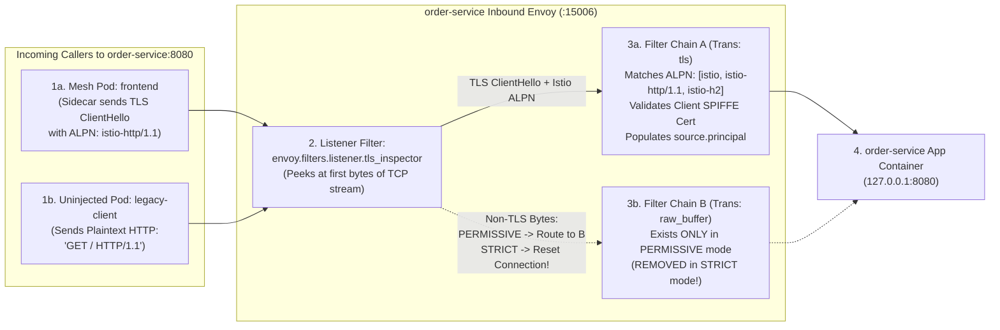

# Lesson 04.2: Mutual TLS (`PeerAuthentication`), `PERMISSIVE` ALPN Auto-Detection & Zero-Downtime `STRICT` Migration

> **Navigation**: [Fellowship Portal](../../README.md) > [Week 05: Zero-Trust Security Architecture](../../fellowship/week-05-zero-trust-security-architecture/WEEK.md) > [Module 04 Hub](../README.md) > **Lesson 04.2**  
> **Estimated Completion Time**: 25 minutes  
> **Prerequisites**: [Lesson 04.1: SPIFFE Identity & SDS Lifecycle](./01-spiffe-identity-and-sds-lifecycle.md)  
> **Authoritative Baseline**: Istio `1.32.0` | Envoy `v1.40` | Kubernetes `1.36+` | Gateway API `v1.6.1`

### Learning Objectives
By the end of this lesson, you will be able to:
1. Differentiate Istio's three `PeerAuthentication` mTLS modes (`PERMISSIVE`, `STRICT`, and `DISABLE`) and explain how Envoy's `tls_inspector` and ALPN negotiation allow `PERMISSIVE` mode to accept both mTLS and plaintext on the same port.
2. Apply Istio's 3-level `PeerAuthentication` precedence hierarchy (Workload + `portLevelMtls` > Namespace > Mesh-wide root namespace `istio-system`).
3. Execute a zero-downtime brownfield migration from `PERMISSIVE` to `STRICT` mTLS across `orderflow`.

---

## 1. NovaPay Engineering Context & Alex Morgan's Briefing

### What Is Happening at NovaPay?
In Lesson 04.1, we saw that `istiod` automatically issues a SPIFFE X.509 certificate to every sidecar in `orderflow`, and mesh-enrolled pods automatically use mTLS when talking to other mesh-enrolled pods (**Automatic mTLS**). However, by default, Istio configures server inbound listeners (`15006`) in **`PERMISSIVE`** mode. That means if an attacker compromises an uninjected legacy pod (or a developer sandbox pod without an Envoy sidecar), they can send unauthenticated **plaintext HTTP** directly to `payment-service:8080`, and `payment-service`'s inbound Envoy proxy will happily accept it!

For Ticket `NP-105`, Maya Patel requires enforcing **`STRICT`** mTLS across `orderflow` so plaintext connections are rejected immediately at the TLS handshake layer.

### Alex & Sarah's Briefing & Intuition Analogy
> **Alex Morgan (Senior Platform Engineer)**: *"Think of `PERMISSIVE` mode like a **bilingual hotel receptionist** during a company merger. If a guest walks up speaking the secret encrypted corporate language (Istio mTLS with ALPN `istio`), the receptionist speaks mTLS back and verifies their SPIFFE passport. But if a legacy guest without a sidecar walks up speaking plain English (plaintext HTTP), the receptionist shrugs and lets them in anyway so legacy systems don't break on Day 1.*
>
> *Once all legitimate services have their sidecars, keeping that bilingual fallback enabled is a huge security risk. Switching `PeerAuthentication` to **`STRICT`** removes the plaintext filter chain from `15006` completely—anyone without a valid SPIFFE client certificate gets the door slammed in their face (`Connection reset by peer`) before they can send a single HTTP byte!"*
>
> **Sarah Chen (SRE Lead)**: *"Before you flip a brownfield production namespace from `PERMISSIVE` to `STRICT`, always check one metric in Prometheus: `istio_requests_total{connection_security_policy="none"}`. That tells you immediately if any uninjected cron job, monitoring scraper, or legacy pod is still talking plaintext to your workloads!"*

---

## 2. Progressive Disclosure Technical Explanation

### 2.1 Core Concept: The Three `PeerAuthentication` Modes

`PeerAuthentication` (`security.istio.io/v1`) configures how the **server-side inbound Envoy listener (`virtualInbound` `:15006`)** authenticates incoming peer connections:

| Mode | Server Inbound (`15006`) Filter Chain Configuration | Production Use Case |
| :--- | :--- | :--- |
| **`PERMISSIVE`** *(Istio Default)* | Installs **both** a TLS filter chain (`Trans: tls`) and a plaintext filter chain (`Trans: raw_buffer`) on the same port. | Brownfield migration phase while onboarding non-mesh pods into Istio without breaking existing traffic. |
| **`STRICT`** | Installs **only** the mutual TLS filter chain (`Trans: tls`) requiring a valid client X.509 certificate signed by the mesh Root CA. Plaintext TCP/HTTP connections are immediately reset. | **Mandatory Production Standard** for all mesh namespaces (`orderflow`). Required foundation for SPIFFE-based `AuthorizationPolicy`. |
| **`DISABLE`** | Installs only the plaintext filter chain (`Trans: raw_buffer`); Envoy does not terminate mTLS. | Rare exception for specific ports (`portLevelMtls`) where the application binary terminates its own proprietary TLS. |
| **`UNSET`** | Inherits the mode from the parent scope (Namespace $\rightarrow$ Mesh-wide root namespace `istio-system`, which defaults to `PERMISSIVE`). | Default inheritance behavior when a field is omitted. |

---

### 2.2 Technical Deep Dive: How `PERMISSIVE` Auto-Detects mTLS vs. Plaintext on One Port

How can `order-service:8080` simultaneously accept encrypted mTLS from `frontend` and unencrypted plaintext HTTP from a legacy uninjected pod on the **exact same port `8080`**?

1. **Client-Side Automatic mTLS (`autoMtls`)**:
   When a mesh client (`frontend`) calls `order-service:8080`, `istiod` checks whether the destination pod has an Istio sidecar (`security.istio.io/tlsMode: istio` label on the endpoint). Because it does, `istiod` programs `frontend`'s outbound CDS cluster to initiate mutual TLS and sets the TLS **ALPN (Application-Layer Protocol Negotiation)** extension in the `ClientHello` to `istio`, `istio-peer-exchange`, `istio-http/1.1`, or `istio-h2`.
2. **Server-Side `tls_inspector` Filter Chain Matching**:
   On `order-service`'s inbound listener (`15006`), Envoy runs the **`envoy.filters.listener.tls_inspector`** listener filter on the first bytes of every incoming TCP connection before choosing a filter chain:



#### 6-Part Mechanism Walkthrough: Inbound `:15006` `PERMISSIVE` vs. `STRICT` Filter Chain Selection
1. **What initiates the operation?**
   Either a mesh-injected pod (`frontend`) or an uninjected pod (`legacy-client`) opens a TCP connection to `order-service`'s Pod IP on port `8080`.
2. **Which component receives it?**
   Inside `order-service`'s network namespace, `iptables` (`ISTIO_INBOUND`) redirects the inbound packet to `virtualInbound` listener `0.0.0.0:15006`, where Envoy `v1.40`'s `envoy.filters.listener.tls_inspector` listener filter inspects the initial payload bytes after the TCP 3-way handshake.
3. **What information is exchanged?**
   - `frontend`'s sidecar sends a TLS `ClientHello` frame advertising `ALPN: istio-http/1.1` and presents its client X.509 SPIFFE certificate during the mutual TLS handshake.
   - `legacy-client` sends raw ASCII bytes (`GET / HTTP/1.1\r\nHost: order-service:8080...`).
4. **What changes in the system?**
   - **In `PERMISSIVE` mode**: `virtualInbound` (`15006`) has **two** filter chains for port `8080`. `tls_inspector` routes `frontend` into Filter Chain A (`Trans: tls`, verifying the SPIFFE certificate and extracting `spiffe://cluster.local/ns/orderflow/sa/frontend-sa`) and routes `legacy-client` into Filter Chain B (`Trans: raw_buffer`, forwarding plaintext with no peer identity).
   - **When switched to `STRICT` mode**: `istiod` pushes an LDS update that **deletes Filter Chain B (`Trans: raw_buffer`)** from port `8080`. Now only Filter Chain A (`Trans: tls`) exists!
5. **How can you observe/verify it on your cluster?**
   Run `istioctl proxy-config listener <order-pod>.orderflow --port 15006`:
   - In `PERMISSIVE` mode, you see two entries for destination port `8080`: one with `Trans: tls` (`ALPN: istio...`) and one with `Trans: raw_buffer`.
   - In `STRICT` mode, the `Trans: raw_buffer` entry for port `8080` disappears completely!
6. **What happens if a component fails?**
   When `legacy-client` sends plaintext HTTP (`GET / HTTP/1.1`) to a `STRICT` listener on `15006`, `tls_inspector` sees non-TLS bytes, finds no `raw_buffer` fallback filter chain, and immediately closes the socket (`FilterChainNotFound` / `curl: (56) Recv failure: Connection reset by peer`).

---

### 2.3 `PeerAuthentication` Precedence Hierarchy & `portLevelMtls`

When multiple `PeerAuthentication` policies exist in the cluster, Istio evaluates them from **most specific to least specific**:

1. **Level 1 (Highest Precedence) — Workload-Specific Policy**:
   A `PeerAuthentication` in the workload's namespace (`orderflow`) with a matching `spec.selector.matchLabels` (e.g., `app: payment-service`).
   - *Only workload-specific policies with a `selector` may define **`portLevelMtls`** overrides* (for example, keeping `STRICT` on port `8080` while setting `PERMISSIVE` or `DISABLE` on a legacy metrics port `9099`).
   - *Crucial Port Rule*: `portLevelMtls` references the **container `targetPort`** (the port the pod process actually listens on), **not** the Kubernetes `Service` `port`!
2. **Level 2 — Namespace-Wide Policy**:
   A `PeerAuthentication` in the workload's namespace (`orderflow`) with **no `selector`** (applies to all pods in `orderflow`).
3. **Level 3 (Lowest Precedence) — Mesh-Wide Default Policy**:
   A `PeerAuthentication` in Istio's root namespace (**`istio-system`**) with **no `selector`** (traditionally named `default`).

```yaml
# Example: Mesh-wide or Namespace-wide STRICT PeerAuthentication
apiVersion: security.istio.io/v1
kind: PeerAuthentication
metadata:
  name: orderflow-strict-mtls
  namespace: orderflow
spec:
  mtls:
    mode: STRICT
```

---

## 3. Practical Observation & Investigation

In Step 2 of [Lab 04](../LAB.md), you will compare the live `:15006` inbound listener filter chains on `order-service` before and after applying `STRICT` mTLS:

```bash
ORDER_POD=$(kubectl get pod -n orderflow -l app=order-service,version=v1 -o jsonpath='{.items[0].metadata.name}')

# 1. Inspect inbound listener 15006 filter chains for port 8080
istioctl proxy-config listener "$ORDER_POD.orderflow" --port 15006 | grep -E "PORT|8080"

# 2. Check effective PeerAuthentication policies affecting the pod
kubectl get peerauthentication -A
```

---

## 4. Knowledge Check (Engineering Judgment)

### Question 1: Why Did `portLevelMtls` on Service Port `80` Fail to Match?
`frontend` exposes a Kubernetes `Service` with `port: 80` and `targetPort: 8080` (the container listens on `8080`). An engineer creates a workload-specific `PeerAuthentication` with `selector: { matchLabels: { app: frontend } }` and `portLevelMtls: { 80: { mode: PERMISSIVE } }` while the namespace is `STRICT`. Yet plaintext health checks to `frontend` still fail with `Connection reset by peer`. Why?

<details>
<summary>Check Answer & Engineering Explanation</summary>

**Answer**:
`PeerAuthentication` configures the **inbound Envoy listener (`15006`) inside the destination pod**, after `kube-proxy` or the client has already translated the Kubernetes `Service` port (`80`) to the pod's container `targetPort` (`8080`). Therefore, `portLevelMtls` keys must always specify the **workload container port (`8080`)**, not the `Service` port (`80`).

**Fix**: Change `portLevelMtls` key from `80` to `8080`.
</details>

### Question 2: Zero-Downtime Brownfield Migration Strategy
Sarah Chen is migrating a legacy namespace with 15 microservices (only 10 of which currently have Envoy sidecars injected) to `STRICT` mTLS. What happens if she applies a namespace-wide `PeerAuthentication` (`mode: STRICT`) right now, and what is the correct 4-step sequence for a zero-downtime migration?

<details>
<summary>Check Answer & Engineering Explanation</summary>

**Answer**:
If Sarah enables namespace-wide `STRICT` mTLS while 5 caller services still lack sidecars, every call from those 5 uninjected pods to the 10 mesh pods will immediately fail with `Connection reset by peer` because the uninjected pods cannot present a SPIFFE mTLS client certificate.

**Correct 4-Step Zero-Downtime Migration Sequence**:
1. Keep `PeerAuthentication` in **`PERMISSIVE`** mode while rolling out sidecar injection across the remaining 5 workloads (`kubectl label ns <ns> istio-injection=enabled` + rolling restart).
2. Leverage **Automatic mTLS**: as soon as each pod gets a sidecar, Envoy automatically switches its outbound calls to mTLS while `PERMISSIVE` servers still accept plaintext from pods not yet restarted.
3. Verify via Prometheus (`sum(rate(istio_requests_total{reporter="destination", destination_workload_namespace="<ns>", connection_security_policy="none"}[15m])) == 0`) or Kiali that **0%** of incoming traffic is plaintext.
4. Apply the namespace-wide `PeerAuthentication` (`mtls.mode: STRICT`) to lock the door permanently.
</details>

---

## 5. Key Takeaways, Definition of Done & Next Lesson

### Key Takeaways
- **`PERMISSIVE` vs. `STRICT`**: `PERMISSIVE` keeps both `Trans: tls` and `Trans: raw_buffer` filter chains on `:15006` (using `tls_inspector` + Istio ALPN to auto-detect mTLS vs. plaintext); `STRICT` deletes the `raw_buffer` chain so only SPIFFE mTLS connections can complete a handshake.
- **Precedence Hierarchy**: Workload-specific (`selector` + optional `portLevelMtls` on container port) > Namespace-wide > Mesh-wide (`istio-system`).
- **Verify Before Enforcing `STRICT`**: Query `istio_requests_total{connection_security_policy="none"}` to confirm zero plaintext dependencies before switching from `PERMISSIVE` to `STRICT`.

### Definition of Done
- [ ] You can explain how Envoy's `tls_inspector` and ALPN allow `PERMISSIVE` mode to multiplex mTLS and plaintext on the same port.
- [ ] You can verify `STRICT` mode on `:15006` using `istioctl proxy-config listener`.

### Authoritative References
- [Istio 1.32 Documentation — Authentication Policy (`PeerAuthentication`)](https://istio.io/latest/docs/concepts/security/#authentication-policies)
- [Istio 1.32 Documentation — Mutual TLS Migration](https://istio.io/latest/docs/tasks/security/authentication/mtls-migration/)
- **Next Lesson**: **[Lesson 04.3: End-User JWT Authentication (`RequestAuthentication`), `AuthorizationPolicy` Precedence & the `AND` vs. `OR` YAML Trap](./03-jwt-authn-and-authorization-policy.md)**
