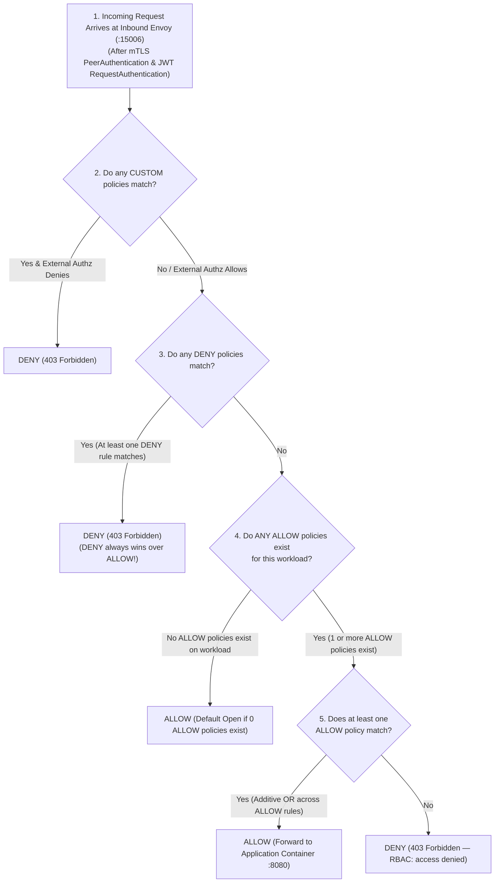

# Lesson 04.3: End-User JWT Authentication (`RequestAuthentication`), `AuthorizationPolicy` Precedence & the `AND` vs. `OR` YAML Trap

> **Navigation**: [Fellowship Portal](../../README.md) > [Week 05: Zero-Trust Security Architecture](../../fellowship/week-05-zero-trust-security-architecture/WEEK.md) > [Module 04 Hub](../README.md) > **Lesson 04.3**  
> **Estimated Completion Time**: 30 minutes  
> **Prerequisites**: [Lesson 04.1 (SPIFFE Identity)](./01-spiffe-identity-and-sds-lifecycle.md) & [Lesson 04.2 (`PeerAuthentication`)](./02-peer-authentication-and-mtls-migration.md)  
> **Authoritative Baseline**: Istio `1.32.0` | Envoy `v1.40` | Kubernetes `v1.36+` | Gateway API `v1.6.1`

### Learning Objectives
By the end of this lesson, you will be able to:
1. Explain why `RequestAuthentication` alone allows requests *without* a JWT token (`200 OK`) while rejecting *invalid* JWT tokens (`401 Unauthorized`), and how to pair it with `AuthorizationPolicy` (`403 Forbidden`) to mandate valid tokens and claims.
2. Trace Envoy's deterministic `AuthorizationPolicy` evaluation order (**`CUSTOM` $\rightarrow$ `DENY` $\rightarrow$ `ALLOW` $\rightarrow$ Default**) and implement the Zero-Trust `allow-nothing` (`spec: {}`) baseline pattern.
3. Diagnose and prevent the #1 production security bug in Istio: the **YAML list `AND` vs. `OR` indentation trap**, and attach route-scoped `AuthorizationPolicy` directly to Kubernetes Gateway API **`HTTPRoute`** resources in Istio `1.32.0`.

---

## 1. NovaPay Engineering Context & Alex Morgan's Briefing

### What Is Happening at NovaPay?
With `STRICT` mTLS active in `orderflow` (Lesson 04.2), every pod cryptographically proves *who it is* via its SPIFFE certificate (`spiffe://cluster.local/ns/orderflow/sa/...`). However, authentication is not authorization! Right now, any pod inside the mesh—such as `client-toolbox` (`toolbox-sa`) or `inventory-service` (`inventory-sa`)—is still allowed to call `payment-service:8080` directly.

For Ticket `NP-105` and Incident `INC-05`, Maya Patel requires:
1. A namespace-wide **Default-Deny (`allow-nothing`)** `AuthorizationPolicy` across `orderflow`, unlocked only for the exact microservice call graph (`frontend-sa` $\rightarrow$ `order-service`, `order-sa` $\rightarrow$ `payment-service` & `inventory-service`).
2. End-user **JWT verification (`RequestAuthentication`)** on `order-service`, paired with an `AuthorizationPolicy` restricting `/admin` endpoints to tokens carrying the right `groups` or `role` claim.

### Alex, Maya & Daniel's Briefing
> **Daniel Brooks (Staff Backend Engineer)**: *"Wait—if I apply a `RequestAuthentication` policy to `order-service` with our OIDC JWKS public keys, doesn't Envoy automatically block requests that don't have an `Authorization: Bearer <jwt>` header?"*
>
> **Alex Morgan (Senior Platform Engineer)**: *"No! That is the single most common misconception in Istio security. **`RequestAuthentication` only validates a token IF a token is present.** If a request carries a corrupted or expired JWT, `RequestAuthentication` rejects it with `401 Unauthorized`. But if a request carries **no JWT at all**, `RequestAuthentication` lets it pass right through as an anonymous request! To **require** a JWT, you must pair `RequestAuthentication` with an `AuthorizationPolicy` checking `requestPrincipals` or `request.auth.claims`."*
>
> **Maya Patel (Principal Security Engineer)**: *"And when you write your `AuthorizationPolicy` rules, check your YAML hyphens (`-`) three times! In `AuthorizationPolicy`, a single extra `-` before `to:` or `when:` splits one rule (`from` **AND** `to`) into two separate rules (`from` **OR** `to`). Last year, that exact 1-character YAML typo in a staging manifest accidentally allowed any pod in the cluster to invoke `DELETE` on an internal service—which is the exact failure mode you'll investigate in Friday's `INC-05` incident simulation!"*

---

## 2. Progressive Disclosure Technical Explanation

### 2.1 Core Concept: `RequestAuthentication` (JWT Validation Semantics)

While `PeerAuthentication` verifies the **immediate calling workload** (Peer Identity via mTLS), `RequestAuthentication` configures Envoy's `envoy.filters.http.jwt_authn` filter to verify the **end-user or external client** (Origin Identity via a JSON Web Token):

```yaml
apiVersion: security.istio.io/v1
kind: RequestAuthentication
metadata:
  name: order-service-jwt-authn
  namespace: orderflow
spec:
  selector:
    matchLabels:
      app: order-service
  jwtRules:
    - issuer: "testing@secure.istio.io"
      # Production uses jwksUri; air-gapped / sandboxed clusters can use inline jwks:
      jwks: |
        {"keys":[{"e":"AQAB","kid":"DHFbpoIUqrY8t2zpA2qXfCmr5VO5ZEr4RzHU_-QivvQ","kty":"RSA","n":"..."}]}
      forwardOriginalToken: true
```

#### The Three Possible Outcomes of `RequestAuthentication`

| Incoming Request State | `jwt_authn` Filter Result (`RequestAuthentication` Alone) | Extracted Envoy Dynamic Metadata (`istio_authn`) |How `AuthorizationPolicy` Sees It |
| :--- | :--- | :--- | :--- |
| **1. Valid Signed JWT** | **Passes (`200 OK`)** | Populates `request.auth.principal` (`<iss>/<sub>`) and `request.auth.claims[...]` | Matches `requestPrincipals: ["*"]` and specific claim rules (`request.auth.claims[groups]`). |
| **2. Invalid / Expired / Forged JWT** | **Rejected Immediately (`401 Unauthorized`)** | None (Request terminated before reaching RBAC filter) | Never reaches `AuthorizationPolicy`. |
| **3. NO JWT Header Present** | **Passes (`200 OK`)!** | `request.auth.principal` and `request.auth.claims` are **empty** | Blocked with **`403 Forbidden` (`RBAC: access denied`)** *only if* an `AuthorizationPolicy` requires `requestPrincipals` or `request.auth.claims`! |

---

### 2.2 Technical Deep Dive: `AuthorizationPolicy` Evaluation Order & Zero-Trust Baseline

`AuthorizationPolicy` programs Envoy's `envoy.filters.http.rbac` (L7) and `envoy.filters.network.rbac` (L4) filters. When multiple `AuthorizationPolicy` resources apply to a workload (inherited from `istio-system` plus namespace-wide and workload-specific policies in `orderflow`), Envoy evaluates them in a strict deterministic sequence:



#### 6-Part Mechanism Walkthrough: Inbound Envoy RBAC Filter Evaluation (`CUSTOM -> DENY -> ALLOW`)
1. **What initiates the operation?**
   A caller (`frontend`, `client-toolbox`, or an external request through the gateway) sends an HTTP request to `order-service:8080`.
2. **Which component receives it?**
   `order-service`'s inbound Envoy sidecar (`:15006`) terminates the mTLS connection (extracting the peer's SPIFFE ID from the X.509 client certificate SAN), runs the `jwt_authn` HTTP filter (extracting any verified JWT claims into dynamic metadata), and passes the request to the `envoy.filters.http.rbac` filter.
3. **What information is exchanged?**
   The RBAC filter evaluates the request tuple—**Source** (`source.principal` SPIFFE ID, `source.namespace`, `source.ip`, `requestPrincipals`), **Operation** (`methods`, `paths`, `ports`, `hosts`), and **Conditions** (`when` keys like `request.auth.claims[groups]` or `request.headers[...]`)—against up to three compiled Envoy RBAC engine instances (`CUSTOM`, `DENY`, and `ALLOW`).
4. **What changes in the system?**
   - **Step 1 (`CUSTOM`)**: If an `action: CUSTOM` policy matches, Envoy queries an external authorization service (`ext_authz`, e.g., Open Policy Agent) first. If denied, Envoy returns `403 Forbidden`.
   - **Step 2 (`DENY`)**: Next, Envoy evaluates all `action: DENY` policies. If **any** `DENY` rule matches, Envoy short-circuits and returns `403 Forbidden` immediately (`DENY` always overrides `ALLOW`).
   - **Step 3 & 4 (`ALLOW`)**: If **zero** `ALLOW` policies target the workload, the request is allowed by default. If **one or more** `ALLOW` policies target the workload, the request is permitted **only if at least one `ALLOW` rule matches**; otherwise Envoy rejects it with `403 Forbidden` (`RBAC: access denied`).
5. **How can you observe/verify it on your cluster?**
   - Run `istioctl proxy-config listener <pod>.orderflow --port 15006 -o json` and search for `envoy.filters.http.rbac` to inspect the compiled `rules.policies` map.
   - Enable RBAC debug logging temporarily via `istioctl proxy-config log <pod>.orderflow --level rbac:debug` to watch Envoy log exact policy match/mismatch decisions in real time.
6. **What happens if a component fails?**
   - **The Zero-Trust `allow-nothing` Pattern**: Because a workload with zero `ALLOW` policies defaults to *Default Open*, forgetting to attach an `ALLOW` policy to a newly deployed microservice leaves it wide open! To prevent this, NovaPay always deploys a namespace-wide **`allow-nothing`** policy (`spec: {}`, which defaults to `action: ALLOW` with empty rules). Because at least one `ALLOW` policy now exists on every pod in `orderflow`—and its empty rule list matches nothing—**100% of traffic is denied by default** until explicit additive `ALLOW` policies are applied for each service!

---

### 2.3 The Most Dangerous Production Bug: YAML `AND` vs. `OR` Semantics (`INC-05`)

In `AuthorizationPolicy`, a single YAML hyphen (`-`) changes boolean evaluation from **Logical AND (intersection)** to **Logical OR (union)**!

Compare these two policies carefully:

```yaml
# =====================================================================
# ✅ CORRECT (Logical AND):
# Caller MUST be toolbox-sa AND HTTP method MUST be HEAD
# =====================================================================
apiVersion: security.istio.io/v1
kind: AuthorizationPolicy
metadata:
  name: allow-toolbox-healthcheck-only
  namespace: orderflow
spec:
  selector:
    matchLabels:
      app: inventory-service
  action: ALLOW
  rules:
    - from:
        - source:
            principals: ["cluster.local/ns/orderflow/sa/toolbox-sa"]
      to:                # <--- NO hyphen before 'to:'! Same rule object as 'from:' (AND)
        - operation:
            methods: ["HEAD"]
---
# =====================================================================
# 🚨 CRITICAL SECURITY BUG (Logical OR):
# Caller is toolbox-sa (ANY HTTP method including DELETE!)
# OR HTTP method is HEAD (from ANY caller in the entire cluster!)
# =====================================================================
  rules:
    - from:
        - source:
            principals: ["cluster.local/ns/orderflow/sa/toolbox-sa"]
    - to:                # <--- BUG! Extra '-' starts a SECOND rule in rules[] (OR)!
        - operation:
            methods: ["HEAD"]
```

#### Summary of Boolean Logic Inside `AuthorizationPolicy`
1. **Fields inside the same single YAML object** (`from` + `to` + `when` inside one `rules[]` item, or `principals` + `namespaces` inside one `source` object, or `methods` + `paths` inside one `operation` object): **Logical AND**.
2. **Multiple items in the `when: []` list** under a single rule: **Logical AND**.
3. **Multiple items in `rules: []`, `from: []`, `to: []`, or string lists like `methods: ["GET", "POST"]`**: **Logical OR**.

---

### 2.4 Istio `1.32.0` Feature: Route-Scoped `AuthorizationPolicy` Targeting Gateway API `HTTPRoute`

In **Istio `1.32.0`** (with Kubernetes Gateway API `v1.6.1`), `AuthorizationPolicy` can attach directly to a specific Kubernetes Gateway API **`HTTPRoute`** via `spec.targetRefs` (in addition to `Gateway` or `Service` targets):

```yaml
apiVersion: security.istio.io/v1
kind: AuthorizationPolicy
metadata:
  name: orderflow-httproute-authz
  namespace: orderflow
spec:
  targetRefs:
    - kind: HTTPRoute
      group: gateway.networking.k8s.io
      name: orderflow-http-route
  action: ALLOW
  rules:
    - to:
        - operation:
            methods: ["GET", "POST"]
      when:
        - key: request.auth.claims[groups]
          values: ["group1", "admin"]
```

Why is this a game-changer for NovaPay? When multiple application teams share a single Kubernetes Gateway API `Gateway`, each team can attach their own JWT claim or RBAC requirements directly to their own `HTTPRoute` in their namespace without needing permissions to modify the shared `Gateway` policy!

---

## 3. Practical Observation & Investigation

When you execute Steps 3, 4, and 5 of [Lab 04](../LAB.md), use these commands to inspect how `istiod` compiles `RequestAuthentication` and `AuthorizationPolicy` into Envoy's inbound HTTP filter chain:

```bash
ORDER_POD=$(kubectl get pod -n orderflow -l app=order-service,version=v1 -o jsonpath='{.items[0].metadata.name}')

# 1. Inspect compiled jwt_authn and rbac HTTP filters on inbound listener 15006
istioctl proxy-config listener "$ORDER_POD.orderflow" --port 15006 -o json | \
  jq '.. | .httpFilters? | select(. != null)'

# 2. Check all active AuthorizationPolicies and RequestAuthentications in orderflow
kubectl get peerauthentication,requestauthentication,authorizationpolicy -n orderflow

# 3. Validate your YAML manifests for security warnings with istioctl analyze
istioctl analyze -n orderflow
```

---

## 4. Knowledge Check (Engineering Judgment)

### Question 1: `401 Unauthorized` vs. `403 Forbidden` in Istio JWT Auth
You configure both a `RequestAuthentication` (validating tokens from `issuer: https://auth.novapay.com`) and an `AuthorizationPolicy` (requiring `requestPrincipals: ["*"]` and `request.auth.claims[role]: ["admin"]`) on `order-service`.
Predict the exact HTTP status code returned by Envoy for each of these three requests:
1. Request A has header `Authorization: Bearer <tampered-signature-token>`.
2. Request B has **no** `Authorization` header at all.
3. Request C has a valid, cryptographically signed JWT from `https://auth.novapay.com`, but its payload has `"role": "customer"`.

<details>
<summary>Check Answer & Engineering Explanation</summary>

**Answer**:
1. **Request A (`<tampered-signature-token>`) $\rightarrow$ `401 Unauthorized`**: The `envoy.filters.http.jwt_authn` filter (`RequestAuthentication`) runs *before* the `rbac` filter. It detects the invalid signature and rejects the request immediately with `401 Unauthorized`.
2. **Request B (No `Authorization` header) $\rightarrow$ `403 Forbidden` (`RBAC: access denied`)**: `RequestAuthentication` allows requests with no token to pass through without populating `requestPrincipals`. Next, `envoy.filters.http.rbac` (`AuthorizationPolicy`) checks `requestPrincipals: ["*"]`, sees it is empty, and rejects the request with `403 Forbidden`.
3. **Request C (Valid JWT, `"role": "customer"`) $\rightarrow$ `403 Forbidden` (`RBAC: access denied`)**: `RequestAuthentication` succeeds (`200` at the authentication stage) and populates `request.auth.claims[role] = "customer"`. Next, `AuthorizationPolicy` checks `request.auth.claims[role]: ["admin"]`, sees a mismatch, and rejects the request with `403 Forbidden`.
</details>

### Question 2: Spotting the `AND` vs. `OR` Bug inside `source`
An engineer writes the following `from` block inside an `AuthorizationPolicy` intending to allow calls **only** if the caller is in namespace `orderflow` **AND** has SPIFFE principal `cluster.local/ns/orderflow/sa/order-sa`:
```yaml
    - from:
        - source:
            namespaces: ["orderflow"]
        - source:
            principals: ["cluster.local/ns/orderflow/sa/order-sa"]
```
What did this YAML actually configure, and how should it be fixed?

<details>
<summary>Check Answer & Engineering Explanation</summary>

**Answer**:
Because the engineer created **two separate `- source:` list items** inside `from: []`, Envoy evaluates them with **Logical OR**:
- Any pod in namespace `orderflow` (regardless of its `ServiceAccount`!) is allowed, **OR** any pod matching `order-sa` is allowed. That means `toolbox-sa` in `orderflow` is allowed!

**Fix**: Combine `namespaces` and `principals` inside a **single `- source:` object** so Envoy evaluates them with **Logical AND**:
```yaml
    - from:
        - source:
            namespaces: ["orderflow"]
            principals: ["cluster.local/ns/orderflow/sa/order-sa"]
```
</details>

---

## 5. Key Takeaways, Definition of Done & Next Steps

### Key Takeaways
- **`RequestAuthentication` vs. `AuthorizationPolicy`**: `RequestAuthentication` validates JWTs *if present* (`401` on bad token, passes if no token). You must pair it with `AuthorizationPolicy` (`403`) to *require* a JWT or enforce JWT claims.
- **Deterministic Evaluation Precedence**: `CUSTOM` $\rightarrow$ `DENY` $\rightarrow$ `ALLOW` $\rightarrow$ Default (`allow-nothing` baseline `spec: {}` flips Default Open to Default Deny).
- **Watch Every YAML Hyphen (`-`)**: Fields inside the same rule/source/operation object are combined with **Logical AND**; separate list items in `rules: []`, `from: []`, or `to: []` are combined with **Logical OR**.

### Definition of Done
- [ ] You have completed all three lessons in Module 04 (`04.1`, `04.2`, and `04.3`).
- [ ] You are ready to execute **[Module 04 Guided Lab (`../LAB.md`)](../LAB.md)** and solve **[Week 05 Ticket `NP-105` & Incident `INC-05`](../../fellowship/week-05-zero-trust-security-architecture/WEEK.md)**.

### Authoritative References
- [Istio 1.32 Documentation — Authorization Policy](https://istio.io/latest/docs/concepts/security/#authorization)
- [Istio 1.32 Documentation — JWT Claim-Based Authorization](https://istio.io/latest/docs/tasks/security/authorization/authz-jwt/)
- **Next Step**: Proceed to **[Module 04 Guided Lab (`../LAB.md`)](../LAB.md)** or **[Module 05: Resilience & Fault Injection (`../../05-resilience-and-fault-injection/README.md`)](../../05-resilience-and-fault-injection/README.md)**
