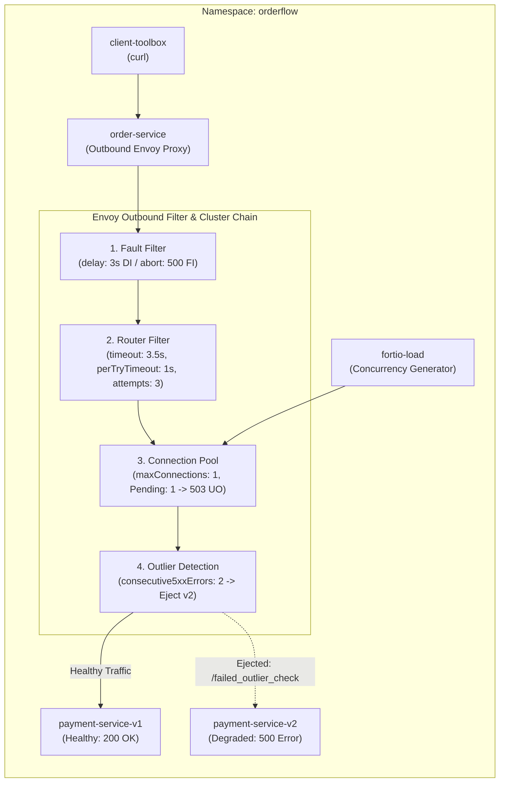

# Module 05 Lab: Fault Injection, Timeouts/Retries, Circuit Breaking & Outlier Ejection

> **Navigation**: [Fellowship Portal](../README.md) > [Week 06: Resilience Engineering & Chaos Testing](../fellowship/week-06-resilience-and-chaos-engineering/WEEK.md) > [Module 05 Hub](./README.md) > **Guided Lab 05**  
> **Lessons Covered**: [Lesson 05.1](./lessons/01-timeouts-retries-and-retry-storms.md) · [Lesson 05.2](./lessons/02-circuit-breaking-and-outlier-detection.md) · [Lesson 05.3](./lessons/03-chaos-fault-injection-and-locality-failover.md)

> [!TIP]
> **Execution Verification Status (November 2026 Baseline)**
> - **Verified Environment**: Istio `1.32.0` (`istiod`) | Envoy `v1.40` | Kubernetes `v1.36+` | Gateway API `v1.6.1`.
> - **Manifests Directory**: All manifests in [`./manifests/`](./manifests/) (`fault-injection-delay-abort.yaml`, `timeouts-and-retries.yaml`, `fortio-client.yaml`, `circuit-breaker-connection-pool.yaml`, `outlier-detection-ejection.yaml`) are validated for Istio `1.32.0` and ready to apply using relative paths.

---

## Learning Objectives
By the end of this hands-on lab, you will be able to:
1. Inject L7 latency (`fixedDelay` $\rightarrow$ `DI`) and HTTP errors (`abort` $\rightarrow$ `FI`) into `payment-service` using a `VirtualService`.
2. Enforce `timeout` and `retries` (`perTryTimeout`, `attempts`, `retryOn`) between `order-service` and `payment-service`, and verify `UT` (Upstream Request Timeout) flags and `upstream_rq_retry` counters in Envoy.
3. Configure a `DestinationRule` `connectionPool` circuit breaker, overload `payment-service` using `fortio`, and inspect `503 UO` (`UpstreamOverflow`) responses and `upstream_rq_pending_overflow` metrics.
4. Trigger passive health check pod ejection (`outlierDetection`) when `payment-service-v2` returns `500` errors, and inspect `/clusters` health flags (`/failed_outlier_check`) directly in Envoy's admin interface (`localhost:15000`).

---

## Prerequisites & Version Baseline Pre-Flight Verification

> **Version Baseline (November 2026)**: Istio `1.32.0` | Envoy `v1.40` | Kubernetes `v1.36+` | Gateway API `v1.6.1`  
> **Fellowship Reference**: **[Week 06: Resilience Engineering & Chaos Testing](../fellowship/week-06-resilience-and-chaos-engineering/WEEK.md)** | [`../VERSIONS.md`](../VERSIONS.md)

Ensure your Kubernetes `v1.36+` cluster has Istio `1.32.0` installed and the **OrderFlow** base workloads deployed in the `orderflow` namespace with sidecar injection enabled, working from the repository root:

```bash
istioctl version
kubectl get pods -n orderflow -l 'app in (frontend,order-service,payment-service,inventory-service,client-toolbox)'
```

Expected output (all pods showing `2/2 Running`):
```text
NAME                                 READY   STATUS    RESTARTS   AGE
client-toolbox-6b7d8f9c4-x9k2p       2/2     Running   0          15m
frontend-5c89d76f8b-j4m9n            2/2     Running   0          15m
inventory-service-v1-7d4b9c8-p2w4x   2/2     Running   0          15m
order-service-v1-85f9c6d4-t8r3v      2/2     Running   0          15m
order-service-v2-64d8b7c9-m1n5k      2/2     Running   0          15m
payment-service-v1-7c9f8b6-q7v2l     2/2     Running   0          15m
payment-service-v2-5b6d9f4-z3k8h     2/2     Running   0          15m
```

Clear any leftover routing or authorization rules from previous labs:
```bash
kubectl delete virtualservice,destinationrule,authorizationpolicy,requestauthentication,peerauthentication --all -n orderflow
```

---

## Architecture & Expected Traffic Flow



---

## Part 1: Fault Injection, Timeouts & Retries

### Step 1.1: Inject a 3-Second Latency & Header-Based Abort Fault

> 🤔 **Predict Before You Execute**  
> Inspect [`manifests/fault-injection-delay-abort.yaml`](./manifests/fault-injection-delay-abort.yaml). When you send a request with `-H "x-Chaos-Mode: abort"`, does the request ever reach the `payment-service` pod over the network, or is it terminated inside the caller's outbound Envoy `envoy.filters.http.fault` filter? How long will the response take?

Apply `fault-injection-delay-abort.yaml`, which injects a `3s` fixed delay on 50% of requests to `payment-service` and an immediate `HTTP 500` abort when the header `x-Chaos-Mode: abort` is present:

```bash
kubectl apply -f 05-resilience-and-fault-injection/manifests/fault-injection-delay-abort.yaml
```

Test the abort fault from `client-toolbox`:
```bash
TOOLBOX_POD=$(kubectl get pod -n orderflow -l app=client-toolbox -o jsonpath='{.items[0].metadata.name}')

kubectl exec -n orderflow "$TOOLBOX_POD" -c curl -- \
  curl -s -o /dev/null -w "HTTP Status: %{http_code} | Time: %{time_total}s\n" \
  -H "x-Chaos-Mode: abort" \
  http://payment-service:8080/
```

Expected output (`~4ms` total time because the caller's local Envoy proxy aborts the request with `FI` before sending it over the network!):
```text
HTTP Status: 500 | Time: 0.004120s
```

Now send 4 requests without the header to observe the 50% `3s` fixed delay (`DI`):
```bash
for i in 1 2 3 4; do
  kubectl exec -n orderflow "$TOOLBOX_POD" -c curl -- \
    curl -s -o /dev/null -w "Req $i -> HTTP Status: %{http_code} | Time: %{time_total}s\n" \
    http://payment-service:8080/
done
```

Expected output (roughly half take `~3.0s`, half take `~0.005s`):
```text
Req 1 -> HTTP Status: 200 | Time: 3.005412s
Req 2 -> HTTP Status: 200 | Time: 0.004910s
Req 3 -> HTTP Status: 200 | Time: 3.004881s
Req 4 -> HTTP Status: 200 | Time: 0.003995s
```

### Step 1.2: Simulate an Upstream Service Delay & Configure Timeouts + Retries
Remember from [Lesson 05.3](./lessons/03-chaos-fault-injection-and-locality-failover.md) that `VirtualService` `fault.delay` is injected in the caller's outbound proxy before the `router` filter. To test how `order-service` uses `perTryTimeout: 1s` and `attempts: 3` against a genuinely slow upstream pod (`payment-service-v2`) while `payment-service-v1` responds in `5ms`, let's configure `payment-service-v2` to take `3000ms` (`3s`):

```bash
kubectl set env deployment/payment-service-v2 -n orderflow TIMING_50_PERCENTILE=3000ms TIMING_90_PERCENTILE=3000ms
kubectl rollout status deployment/payment-service-v2 -n orderflow
```

Now delete the fault injection `VirtualService`, apply [`manifests/timeouts-and-retries.yaml`](./manifests/timeouts-and-retries.yaml) (`timeout: 3.5s`, `attempts: 3`, `perTryTimeout: 1s`), and let it balance across all `payment-service` pods (`v1` fast `5ms`, `v2` slow `3s`):

```bash
kubectl delete virtualservice payment-service-fault -n orderflow
kubectl apply -f 05-resilience-and-fault-injection/manifests/timeouts-and-retries.yaml
kubectl patch virtualservice payment-service-resilience -n orderflow --type='json' \
  -p='[{"op": "remove", "path": "/spec/http/0/route/0/destination/subset"}]'
```

Inspect the compiled Envoy route configuration inside `order-service-v1`:
```bash
ORDER_POD=$(kubectl get pod -n orderflow -l app=order-service,version=v1 -o jsonpath='{.items[0].metadata.name}')
istioctl proxy-config routes "$ORDER_POD" -n orderflow --name 8080 -o json
```

Expected output excerpt (notice `PreviousHostsPredicate` automatically injected by `istiod`!):
```json
{
  "name": "8080",
  "virtualHosts": [
    {
      "name": "payment-service.orderflow.svc.cluster.local:8080",
      "routes": [
        {
          "match": { "prefix": "/" },
          "route": {
            "cluster": "outbound|8080||payment-service.orderflow.svc.cluster.local",
            "timeout": "3.500s",
            "retryPolicy": {
              "retryOn": "5xx,connect-failure,refused-stream,reset",
              "numRetries": 3,
              "perTryTimeout": "1s",
              "retryHostPredicate": [
                {
                  "name": "envoy.retry_host_predicates.previous_hosts",
                  "typedConfig": {
                    "@type": "type.googleapis.com/envoy.extensions.retry.host.previous_hosts.v3.PreviousHostsPredicate"
                  }
                }
              ],
              "hostSelectionRetryMaxAttempts": "5"
            }
          }
        }
      ]
    }
  ]
}
```

### Step 1.3: Verify `perTryTimeout` (`UT`) and `upstream_rq_retry` Stats

> 🤔 **Predict Before You Execute**  
> When `order-service` calls `payment-service` and Attempt 1 lands on `payment-service-v2` (which takes `3.0s`), what happens at `t = 1.0s` (`perTryTimeout`), which pod will Attempt 2 pick, and what will the total response time and HTTP status code be?

Send 10 requests through `order-service` and watch how Envoy cancels attempts that hit `payment-service-v2` at `1.0s` (`perTryTimeout`) and immediately retries on `payment-service-v1`:

```bash
for i in $(seq 1 10); do
  kubectl exec -n orderflow "$TOOLBOX_POD" -c curl -- \
    curl -s -o /dev/null -w "Req $i -> Status: %{http_code} | Total Time: %{time_total}s\n" \
    http://order-service:8080/
done
```

Expected output (requests that initially hit `v2` time out at `1.0s` and succeed on retry to `v1` at `~1.03s`, never waiting the full `3.0s` and never returning `504`!):
```text
Req 1 -> Status: 200 | Total Time: 0.008214s
Req 2 -> Status: 200 | Total Time: 1.034192s
Req 3 -> Status: 200 | Total Time: 0.007419s
Req 4 -> Status: 200 | Total Time: 1.031884s
```

Now inspect the Envoy retry counters on `order-service-v1`:
```bash
kubectl exec -n orderflow "$ORDER_POD" -c istio-proxy -- \
  pilot-agent request GET stats | grep "payment-service.*upstream_rq_retry"
```

Expected output:
```text
cluster.outbound|8080||payment-service.orderflow.svc.cluster.local.upstream_rq_retry: 5
cluster.outbound|8080||payment-service.orderflow.svc.cluster.local.upstream_rq_retry_backoff_exponential: 5
cluster.outbound|8080||payment-service.orderflow.svc.cluster.local.upstream_rq_retry_limit_exceeded: 0
cluster.outbound|8080||payment-service.orderflow.svc.cluster.local.upstream_rq_retry_overflow: 0
cluster.outbound|8080||payment-service.orderflow.svc.cluster.local.upstream_rq_retry_success: 5
```

Restore `payment-service-v2` latency to normal before Part 2:
```bash
kubectl set env deployment/payment-service-v2 -n orderflow TIMING_50_PERCENTILE- TIMING_90_PERCENTILE-
kubectl rollout status deployment/payment-service-v2 -n orderflow
```

---

## Part 2: Circuit Breaking with `connectionPool` and `fortio`

### Step 2.1: Deploy `fortio` and Configure a Strict Connection Pool
Deploy the `fortio-load` load generator pod and apply [`manifests/circuit-breaker-connection-pool.yaml`](./manifests/circuit-breaker-connection-pool.yaml), which restricts `payment-service` to `maxConnections: 1` and `http1MaxPendingRequests: 1`:

```bash
kubectl apply -f 05-resilience-and-fault-injection/manifests/fortio-client.yaml
kubectl delete virtualservice payment-service-resilience -n orderflow --ignore-not-found
kubectl apply -f 05-resilience-and-fault-injection/manifests/circuit-breaker-connection-pool.yaml
kubectl rollout status deployment/fortio-load -n orderflow
```

Verify that the `fortio-load` sidecar has received the circuit breaker thresholds in its Envoy cluster configuration:
```bash
FORTIO_POD=$(kubectl get pod -n orderflow -l app=fortio-load -o jsonpath='{.items[0].metadata.name}')
istioctl proxy-config cluster "$FORTIO_POD" -n orderflow --fqdn payment-service.orderflow.svc.cluster.local -o json | grep -A 12 "circuitBreakers"
```

Expected output:
```json
"circuitBreakers": {
  "thresholds": [
    {
      "maxConnections": 1,
      "maxPendingRequests": 1,
      "maxRequests": 1,
      "maxRetries": 1,
      "trackRemaining": true
    }
  ]
}
```

### Step 2.2: Trip the Circuit Breaker with Concurrent Connections
First, send a single baseline request stream with `fortio` (`-c 1` concurrency, `-n 20` requests):
```bash
kubectl exec -n orderflow "$FORTIO_POD" -c fortio -- \
  /usr/bin/fortio load -c 1 -qps 0 -n 20 -loglevel Warning http://payment-service:8080/
```

Expected output (`100%` `Code 200` because concurrency is `1`):
```text
Code 200 : 20 (100.0 %)
All done 20 calls (plus 0 warmup) 2.412 ms avg, 414.5 qps
```

> 🤔 **Predict Before You Execute**  
> Now we will increase `fortio` concurrency to **4 simultaneous connections (`-c 4`)** while `maxConnections: 1` and `http1MaxPendingRequests: 1` are active. At any given instant, how many requests can be active + queued, and what HTTP status code and Envoy response flag will the excess concurrent requests receive?

Run `fortio` with `-c 4` for `100` requests (`-n 100`):

```bash
kubectl exec -n orderflow "$FORTIO_POD" -c fortio -- \
  /usr/bin/fortio load -c 4 -qps 0 -n 100 -loglevel Warning http://payment-service:8080/
```

Expected output:
```text
Code 200 : 38 (38.0 %)
Code 503 : 62 (62.0 %)
All done 100 calls (plus 0 warmup) 1.815 ms avg, 2203.8 qps
```

### Step 2.3: Inspect `upstream_rq_pending_overflow` and `503 UO` Logs
Query the Envoy stats inside `fortio-load`'s `istio-proxy` container:
```bash
kubectl exec -n orderflow "$FORTIO_POD" -c istio-proxy -- \
  pilot-agent request GET stats | grep "payment-service.v1.*upstream_rq_pending"
```

Expected output:
```text
cluster.outbound|8080|v1|payment-service.orderflow.svc.cluster.local.upstream_rq_pending_active: 0
cluster.outbound|8080|v1|payment-service.orderflow.svc.cluster.local.upstream_rq_pending_failure_eject: 0
cluster.outbound|8080|v1|payment-service.orderflow.svc.cluster.local.upstream_rq_pending_overflow: 62
cluster.outbound|8080|v1|payment-service.orderflow.svc.cluster.local.upstream_rq_pending_total: 58
```

Check `fortio-load`'s sidecar access logs to confirm the **`UO`** (*UpstreamOverflow*) response flag:
```bash
kubectl logs "$FORTIO_POD" -n orderflow -c istio-proxy --tail=15 | grep " 503 UO "
```

Expected output:
```text
[2026-11-17T15:52:10.412Z] "GET / HTTP/1.1" 503 UO upstream_reset_before_response_started{overflow} - "-" 0 81 0 - "-" "fortio.org/fortio-1.65.0" "f19d82a1-..." "payment-service:8080" "-" - - 10.96.142.88:8080 10.244.0.19:48312 - -
```

---

## Part 3: Outlier Detection & Pod Ejection

### Step 3.1: Make `payment-service-v2` Return HTTP 500 Errors
Configure `payment-service-v2` (`nicholasjackson/fake-service`) to return `HTTP 500` on 100% of requests using its `ERROR_RATE` and `ERROR_CODE` environment variables:

```bash
kubectl set env deployment/payment-service-v2 -n orderflow ERROR_RATE=1.0 ERROR_CODE=500 ERROR_TYPE=http_error
kubectl rollout status deployment/payment-service-v2 -n orderflow
```

Clean up the Part 2 connection pool rule and apply [`manifests/outlier-detection-ejection.yaml`](./manifests/outlier-detection-ejection.yaml), which configures:
- `consecutive5xxErrors: 2`
- `interval: 5s`
- `baseEjectionTime: 30s`
- `maxEjectionPercent: 100`

```bash
kubectl delete destinationrule payment-service-circuit-breaker -n orderflow --ignore-not-found
kubectl delete virtualservice payment-service-cb-route -n orderflow --ignore-not-found
kubectl apply -f 05-resilience-and-fault-injection/manifests/outlier-detection-ejection.yaml
```

### Step 3.2: Trigger Ejection and Inspect `/clusters` Health Flags
Get the pod IPs of `payment-service-v1` and `payment-service-v2`:
```bash
kubectl get pods -n orderflow -l app=payment-service -L version -o wide
```

Example output:
```text
NAME                                 READY   STATUS    IP            NODE          VERSION
payment-service-v1-7c9f8b6-q7v2l     2/2     Running   10.244.0.14   istio-worker  v1
payment-service-v2-6d8c9f4-r2m9p     2/2     Running   10.244.0.22   istio-worker  v2
```

> 🤔 **Predict Before You Execute**  
> We have 2 endpoints (`v1` returning `200`, `v2` returning `500`) and `consecutive5xxErrors: 2`. When we send 10 sequential requests from `client-toolbox` to `payment-service:8080`, how many `HTTP 500` responses will you see before `v2` is ejected and all remaining requests return `HTTP 200`?

Send 10 sequential requests from `client-toolbox` to `http://payment-service:8080/`:
```bash
for i in $(seq 1 10); do
  kubectl exec -n orderflow "$TOOLBOX_POD" -c curl -- \
    curl -s -o /dev/null -w "Req $i -> HTTP %{http_code}\n" \
    http://payment-service:8080/
done
```

Expected output (Notice that after `v2` returns two `500` responses, Envoy ejects `v2` and all subsequent requests succeed with `200` from `v1`!):
```text
Req 1 -> HTTP 200
Req 2 -> HTTP 500
Req 3 -> HTTP 200
Req 4 -> HTTP 500
Req 5 -> HTTP 200
Req 6 -> HTTP 200
Req 7 -> HTTP 200
Req 8 -> HTTP 200
Req 9 -> HTTP 200
Req 10 -> HTTP 200
```

Immediately inspect the Envoy `/clusters` endpoint inside `client-toolbox`'s `istio-proxy` to verify the `/failed_outlier_check` flag on `payment-service-v2`'s IP (`10.244.0.22`):
```bash
kubectl exec -n orderflow "$TOOLBOX_POD" -c istio-proxy -- \
  pilot-agent request GET clusters | grep "outbound|8080||payment-service.orderflow.svc.cluster.local::10.244" | grep -E "health_flags|outlier"
```

Expected output:
```text
outbound|8080||payment-service.orderflow.svc.cluster.local::10.244.0.14:8080::health_flags::healthy
outbound|8080||payment-service.orderflow.svc.cluster.local::10.244.0.14:8080::outlier_success_rate::-1
outbound|8080||payment-service.orderflow.svc.cluster.local::10.244.0.22:8080::health_flags::/failed_outlier_check
outbound|8080||payment-service.orderflow.svc.cluster.local::10.244.0.22:8080::outlier_success_rate::-1
```

Also inspect the cluster-level outlier detection metrics:
```bash
kubectl exec -n orderflow "$TOOLBOX_POD" -c istio-proxy -- \
  pilot-agent request GET stats | grep "outbound|8080||payment-service.*outlier_detection"
```

Expected output:
```text
cluster.outbound|8080||payment-service.orderflow.svc.cluster.local.outlier_detection.ejections_active: 1
cluster.outbound|8080||payment-service.orderflow.svc.cluster.local.outlier_detection.ejections_consecutive_5xx: 1
cluster.outbound|8080||payment-service.orderflow.svc.cluster.local.outlier_detection.ejections_enforced_consecutive_5xx: 1
cluster.outbound|8080||payment-service.orderflow.svc.cluster.local.outlier_detection.ejections_enforced_total: 1
cluster.outbound|8080||payment-service.orderflow.svc.cluster.local.outlier_detection.ejections_total: 1
```

---

## Troubleshooting Exercises (With Progressive Hints)

### Exercise 1: Why Didn't My Retries Trigger on `HTTP 500`?
**Scenario**: You configured `retries.attempts: 3`, `perTryTimeout: 1s` in a `VirtualService` for `payment-service`, and also added `fault.abort.httpStatus: 500` (`100%`) in that *same* `VirtualService` route. When `order-service` calls `payment-service`, it immediately returns `500` with `0` retries (`upstream_rq_retry: 0`). Why?

<details>
<summary>💡 Hint 1: Which Envoy proxy evaluates the `VirtualService` for `payment-service`?</summary>

When `order-service` calls `payment-service`, the `VirtualService` for host `payment-service` is evaluated inside **`order-service`'s own outbound Envoy sidecar (`:15001`)**.
</details>

<details>
<summary>💡 Hint 2: Check the order of HTTP filters inside Envoy's HTTP Connection Manager</summary>

Inside Envoy's HCM filter pipeline, which filter runs first: `envoy.filters.http.fault` or `envoy.filters.http.router`? And which of those two filters is responsible for executing `retryPolicy`?
</details>

<details>
<summary>✅ Full Solution & Root Cause Analysis</summary>

- **Root Cause**: Envoy evaluates HTTP filters sequentially: **`envoy.filters.http.fault` runs BEFORE `envoy.filters.http.router`**. When `fault.abort` triggers inside the caller's outbound `fault` filter, Envoy immediately aborts the request and returns `500` (`FI`) before the request ever reaches the `router` filter where `retryPolicy` lives!
- **Fix**: To test caller retries against `500` responses, either inject the error at the **upstream workload** (as we did with `payment-service-v2`'s `ERROR_RATE=1.0`), or test from one hop further downstream (`frontend` $\rightarrow$ `order-service` retries when `order-service` $\rightarrow$ `payment-service` has a fault).
</details>

---

### Exercise 2: Why Did `outlierDetection` Refuse to Eject a Failing Pod?
**Scenario**: You have 2 replicas of `payment-service` (`v1` healthy, `v2` returning 100% `500` errors). You configured `outlierDetection: { consecutive5xxErrors: 3, maxEjectionPercent: 40 }`. Even after 100 errors, `v2` is never ejected (`ejections_enforced_total: 0`). Why?

<details>
<summary>💡 Hint 1: Calculate the percentage of the pool represented by 1 pod</summary>

In a 2-pod cluster (`v1` and `v2`), what percentage of the total endpoints does 1 pod represent?
</details>

<details>
<summary>💡 Hint 2: Compare that percentage against `maxEjectionPercent` and `minHealthPercent`</summary>

1 pod out of 2 is **$50\%$** of the pool. If `maxEjectionPercent: 40`, is Envoy allowed to eject $50\%$ of the endpoints?
</details>

<details>
<summary>✅ Full Solution & Root Cause Analysis</summary>

- **Root Cause**: Ejecting 1 out of 2 pods removes `50%` of the pool, which exceeds `maxEjectionPercent: 40`. Envoy detects the consecutive `5xx` errors (`ejections_detected_consecutive_5xx` increments) but **refuses to enforce** the ejection (`ejections_enforced_total: 0`).
- **Fix**: In small replica sets (2–3 pods), set `maxEjectionPercent: 50` (or `100` in lab environments) so Envoy is permitted to eject at least 1 replica (`50%` of the pool).
</details>

---

## Cleanup Procedure

Restore `payment-service-v2` to healthy operation and remove the Module 05 test manifests before proceeding to Module 06:

```bash
kubectl set env deployment/payment-service-v2 -n orderflow ERROR_RATE- ERROR_CODE- ERROR_TYPE- TIMING_50_PERCENTILE- TIMING_90_PERCENTILE-
kubectl rollout status deployment/payment-service-v2 -n orderflow
kubectl delete -f 05-resilience-and-fault-injection/manifests/outlier-detection-ejection.yaml --ignore-not-found
kubectl delete -f 05-resilience-and-fault-injection/manifests/circuit-breaker-connection-pool.yaml --ignore-not-found
kubectl delete -f 05-resilience-and-fault-injection/manifests/timeouts-and-retries.yaml --ignore-not-found
kubectl delete -f 05-resilience-and-fault-injection/manifests/fault-injection-delay-abort.yaml --ignore-not-found
kubectl delete -f 05-resilience-and-fault-injection/manifests/fortio-client.yaml --ignore-not-found
```

---

## Production Considerations for NovaPay Engineers

1. **Never Leave Istio HTTP Timeouts at Default (`0s`)**: Audit every production `VirtualService` / `HTTPRoute` to ensure explicit timeouts are set and obey the **Timeout Math Rule** across every synchronous call hop.
2. **Size `connectionPool` with Little's Law, Not Lab Values (`1`)**: Use `maxConnections: 1` only in labs to force `503 UO`. In production, size `http2MaxRequests` and `maxConnections` to $1.5\times \text{Peak RPS} \times \text{P99 Latency}$, and always set `maxRetries` (`3–5`) to prevent cluster-wide retry storms.
3. **Alert on Envoy Resilience Response Flags**: Create dedicated Prometheus/Grafana alert rules grouping `istio_requests_total` by `response_flags` (`UO`, `UT`, `UF`, `UH`, `URX`) so on-call SREs can immediately distinguish circuit breaker trips (`UO`) from upstream timeouts (`UT`) or dead pods (`UF`/`UH`).
