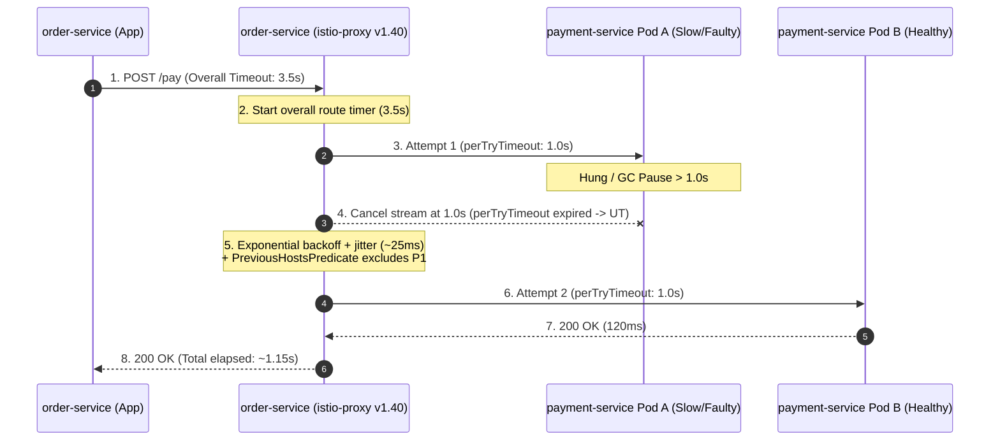
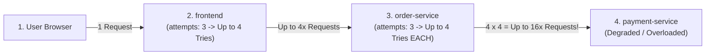
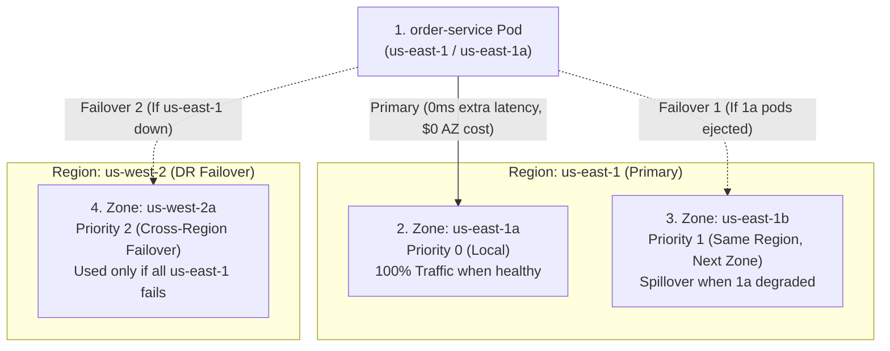

# Module 05: Network Resilience, Circuit Breaking, Outlier Detection & Chaos Fault Injection

> **Navigation**: [Fellowship Portal](../README.md) > [Week 06: Resilience Engineering & Chaos Testing](../fellowship/week-06-resilience-and-chaos-engineering/WEEK.md) > **Module 05 Architecture Hub** | [Guided Lab (`LAB.md`)](./LAB.md)  
> **Version Baseline (November 2026)**: Istio `1.32.0` | Envoy `v1.40` | Kubernetes `v1.36+` | Gateway API `v1.6.1` — see [`../VERSIONS.md`](../VERSIONS.md) and [`../COMPATIBILITY.md`](../COMPATIBILITY.md).  
> **Fellowship Cohort 01 Mapping**: Complete this module alongside **[Week 06: Resilience Engineering & Chaos Testing](../fellowship/week-06-resilience-and-chaos-engineering/WEEK.md)** (Engineering Ticket `NP-106` & Incident `INC-06`).

---

## 🎙️ Alex Morgan & Sarah Chen's Module 05 Architecture Briefing

> **Sarah Chen (SRE Lead, NovaPay)**: *"In a high-throughput financial platform like NovaPay's `orderflow` (`frontend` $\rightarrow$ `order-service` $\rightarrow$ `payment-service` & `inventory-service`), transient latency spikes, GC pauses, and partial database brownouts happen every single day. What turns a minor 400ms pod slowdown into a catastrophic site-wide blackout is **bad resilience configuration**: missing timeouts (Istio's default HTTP timeout is `0s`—infinite!), uncoordinated multi-tier retry amplification ($4 \times 4 = 16\times$ retry storms), unbounded connection queues, and waiting 30 seconds for Kubernetes `readinessProbe` checks while a failing pod drops thousands of payment requests."*

> **Alex Morgan (Senior Platform Engineer, NovaPay)**: *"In Module 05, you will learn how to engineer Envoy `v1.40`'s resilience control system across **three focused 25–30 minute lessons**:*
> - *In **Lesson 05.1**, we master hierarchical timeouts (`timeout` vs. `perTryTimeout`), the **Timeout Math Rule**, idempotency boundaries on `POST /charge`, and stopping multi-tier retry storms.*
> - *In **Lesson 05.2**, we configure `DestinationRule` **Circuit Breaking (`connectionPool`)** to fail fast locally (`503 UO`) and **Outlier Detection (`outlierDetection`)** to quarantine degraded Pod IPs (`/failed_outlier_check`) in milliseconds.*
> - *In **Lesson 05.3**, we validate our architecture using declarative **Chaos Fault Injection (`DI` / `FI`)** and configure **Multi-Zone Locality-Aware Failover**."*

---

## 🗺️ Progressive Lesson Milestones Table

Complete these three modular lessons in order before executing the hands-on **[Module 05 Guided Lab (`./LAB.md`)](./LAB.md)**:

| Lesson | Title & Core Architecture Focus | Est. Time | NovaPay Fellowship Milestone |
| :--- | :--- | :--- | :--- |
| **[Lesson 05.1](./lessons/01-timeouts-retries-and-retry-storms.md)** | **Timeouts, Bounded Retries, Idempotency & Cascading Retry Storms**<br/>Proxy resilience vs. application `Idempotency-Key` responsibility, overall `timeout` (`0s` default!) vs. `retries.perTryTimeout`, the Timeout Math Rule, `retryOn` semantics, and stopping $4 \times 4 = 16\times$ multi-tier retry amplification. | **25 min** | Design NovaPay's multi-tier timeout hierarchy (`NP-106`) and prevent premature `504 UT` cutoffs & double charges (`INC-06`). |
| **[Lesson 05.2](./lessons/02-circuit-breaking-and-outlier-detection.md)** | **Circuit Breaking (`connectionPool`) & Passive Health Checking (`outlierDetection`)**<br/>`maxConnections`, `http1MaxPendingRequests`, `http2MaxRequests`, local short-circuiting (`503 UO` & `x-envoy-overloaded: true`), and `outlierDetection` state machine (`consecutive5xxErrors`, `baseEjectionTime`, `maxEjectionPercent`, `minHealthPercent` panic mode). | **30 min** | Protect `payment-service` from concurrency overload (`503 UO`) and quarantine failing replicas in milliseconds (`/failed_outlier_check`). |
| **[Lesson 05.3](./lessons/03-chaos-fault-injection-and-locality-failover.md)** | **Chaos Fault Injection (`DI` / `FI`) & Multi-Zone Locality Failover**<br/>`envoy.filters.http.fault` (`delay` flag `DI` and `abort` flag `FI` evaluated *before* `envoy.filters.http.router`), header-scoped chaos testing (`x-Chaos-Mode`), and multi-zone `localityLbSetting` (`failover` vs. `distribute`). | **25 min** | Execute Black Friday chaos verification drills and configure zero-cost intra-AZ locality routing with automatic cross-AZ spillover. |
| **[Guided Lab](./LAB.md)** | **Hands-On Lab 05: Fault Injection, Timeouts/Retries, `fortio` Circuit Breaking & Outlier Ejection**<br/>Step-by-step cluster verification with "Predict Before You Execute" checks and progressive troubleshooting hints. | **45 min** | Trigger and inspect `DI`, `FI`, `UT`, `UO`, and `/failed_outlier_check` live in Envoy `:15000`. |

---

## 1. Timeouts, Bounded Retries & Multi-Tier Amplification Synthesis

> 📖 **Deep Dive**: Read **[Lesson 05.1: Timeouts, Bounded Retries, Idempotency & Multi-Tier Cascading Retry Storms](./lessons/01-timeouts-retries-and-retry-storms.md)** for full `retryOn` tables and idempotency rules.

Always satisfy the **Single-Hop Timeout Math Rule** and **Multi-Tier Timeout Hierarchy**:

$$\text{Overall Timeout} \ge \left((\text{Retries} + 1) \times \text{perTryTimeout}\right) + \sum \text{Backoff Delays}$$



### 6-Part Mechanism Walkthrough: `timeout` vs. `perTryTimeout` Execution
1. **What initiates the operation?**
   `order-service` sends an outbound HTTP request (`POST /pay`) to `payment-service:8080`.
2. **Which component receives it?**
   `order-service`'s outbound Envoy sidecar (`:15001`) intercepts the request and evaluates the `VirtualService` route action (`timeout: 3.5s`, `attempts: 3`, `perTryTimeout: 1.0s`).
3. **What information is exchanged?**
   Envoy starts the `3.5s` overall timer and the `1.0s` per-try timer, dispatching Attempt 1 to `payment-service` Pod A. When Pod A stalls beyond `1.0s`, Envoy resets the stream (`UT`), applies a jittered exponential backoff (`~25ms` base), and uses `PreviousHostsPredicate` to pick Pod B for Attempt 2.
4. **What changes in the system?**
   Envoy increments `upstream_rq_retry` and `upstream_rq_retry_success`, receives `200 OK` from Pod B in `120ms`, and returns `200 OK` to `order-service` in `~1.15s` total elapsed time.
5. **How can you observe/verify it on your cluster?**
   Inspect `istioctl proxy-config routes <order-pod>.orderflow --name 8080 -o json` and query `pilot-agent request GET stats | grep upstream_rq_retry`.
6. **What happens if a component fails?**
   If all retry attempts time out or the overall `3.5s` `timeout` expires first, Envoy aborts the request and returns `504 Gateway Timeout` to the caller with access log flags **`UT`** (and **`URX`** if all retry attempts were exhausted).

---

### Cascading Retry Storms Across Multi-Tier Architectures



#### 6-Part Mechanism Walkthrough: Multi-Tier Retry Amplification Storm
1. **What initiates the operation?**
   A client sends 1 checkout request to `frontend` while `payment-service` is experiencing a database slowdown.
2. **Which component receives it?**
   `frontend`'s outbound Envoy sidecar calls `order-service`, and `order-service`'s outbound Envoy sidecar calls `payment-service`, both configured with `retries.attempts: 3` (up to 4 total tries per tier).
3. **What information is exchanged?**
   While `order-service` is executing its 4 tries against `payment-service`, `frontend`'s `perTryTimeout` fires and `frontend` retries `order-service` up to 4 times.
4. **What changes in the system?**
   Each of `frontend`'s 4 tries spawns 4 tries from `order-service` to `payment-service`, multiplying 1 user request into **$4 \times 4 = 16$ upstream requests** and saturating `payment-service` CPU and connection pools.
5. **How can you observe/verify it on your cluster?**
   Monitor `upstream_rq_retry` and request rate amplification across tiers in Prometheus (`istio_requests_total`).
6. **What happens if a component fails (Prevention)?**
   Configure retries at a single layer (the immediate caller of the leaf dependency, `order-service` $\rightarrow$ `payment-service`), set upper layers (`frontend` $\rightarrow$ `order-service`) to fail fast or retry only `connect-failure,refused-stream`, and enforce a cluster-wide retry concurrency cap (`connectionPool.http.maxRetries`).

---

## 2. Circuit Breaking (`connectionPool`) & Outlier Detection Synthesis

> 📖 **Deep Dive**: Read **[Lesson 05.2: Circuit Breaking (`connectionPool` `503 UO`) & Passive Health Checking (`outlierDetection`)](./lessons/02-circuit-breaking-and-outlier-detection.md)** for Little's Law sizing and Panic Mode math.


### 6-Part Mechanism Walkthrough: `connectionPool` & `outlierDetection` Defense Pipeline
1. **What initiates the operation?**
   `order-service` sends concurrent HTTP requests to `payment-service:8080`.
2. **Which component receives it?**
   `order-service`'s local outbound Envoy sidecar (`:15001`) intercepts each request and evaluates the `outbound|8080||payment-service...` cluster policies compiled from the `DestinationRule`.
3. **What information is exchanged?**
   First, Envoy checks active connections and pending requests against `connectionPool` thresholds. Second, if within limits, Envoy selects an upstream Pod IP from the EDS pool filtered by `outlierDetection`.
4. **What changes in the system?**
   - If concurrency exceeds `maxConnections` + `http1MaxPendingRequests` (or `http2MaxRequests`), Envoy short-circuits locally with `503 Service Unavailable` (flag **`UO`**, header `x-envoy-overloaded: true`, counter `upstream_rq_pending_overflow`) without sending a network packet.
   - If `payment-service` Pod `v2` returns consecutive `5xx` errors reaching `consecutive5xxErrors`, Envoy marks Pod `v2` with `/failed_outlier_check` and ejects it for $\text{baseEjectionTime} \times \text{ejection\_count}$, routing 100% of traffic to healthy Pod `v1`.
5. **How can you observe/verify it on your cluster?**
   Query `pilot-agent request GET stats | grep -E "upstream_rq_pending_overflow|outlier_detection"` and inspect endpoint health flags via `pilot-agent request GET clusters | grep health_flags`.
6. **What happens if a component fails?**
   If widespread failures cause the percentage of healthy pods in the cluster to fall below `minHealthPercent` (Panic Threshold), Envoy enters **Panic Mode** and distributes traffic across all endpoints to avoid overwhelming the last remaining healthy pod.

---

### Step-by-Step Outlier Detection State Machine

```mermaid
stateDiagram-v2
    [*] --> Healthy: 1. Pod discovered via EDS (health_flags::healthy)
    Healthy --> CounterIncrement: 2. Returns 5xx or Timeout
    CounterIncrement --> Healthy: Returns 200 OK (Resets consecutive counter to 0)
    CounterIncrement --> Ejected: 3. consecutive5xxErrors reaches threshold (e.g., 2)
    
    state Ejected {
        [*] --> Quarantined
        Quarantined: Flagged /failed_outlier_check in Envoy
        Quarantined: Excluded from load balancing
        Quarantined: Timer = baseEjectionTime * ejection_count
    }

    Ejected --> Probation: 4. Timer expires on next sweep interval
    Probation --> Healthy: 5a. Serves requests with 2xx (Consecutive counter stays 0)
    Probation --> Ejected: 5b. Fails again -> Ejection count increments (2x, 3x penalty!)
```

#### 6-Part Mechanism Walkthrough: Outlier Detection State Transitions
1. **What initiates the operation?**
   An upstream pod (`payment-service-v2`) begins returning HTTP `500–599` status codes or timing out on TCP/HTTP requests.
2. **Which component receives it?**
   The caller sidecar's per-endpoint outlier detector monitors every response code from each upstream Pod IP in the EDS cluster.
3. **What information is exchanged?**
   Each `5xx` or timeout increments the endpoint's consecutive `5xx` counter (whereas any `2xx` response resets the consecutive counter back to `0`).
4. **What changes in the system?**
   Once the counter reaches `consecutive5xxErrors`, the endpoint transitions to `Ejected` (`/failed_outlier_check`) for $\text{baseEjectionTime} \times \text{ejection\_count}$. When the timer expires on the next `interval` sweep, the endpoint enters `Probation` (`healthy`); a single failure cycle immediately re-ejects it with an incremented penalty multiplier (`2x`, `3x`).
5. **How can you observe/verify it on your cluster?**
   Inspect `/clusters` on port `15000` (`pilot-agent request GET clusters`) for `/failed_outlier_check` and `/stats` for `outlier_detection.ejections_active`.
6. **What happens if a component fails?**
   If `maxEjectionPercent` is left at the default `10%` (or set below `50%` in a 2-pod cluster), Envoy may be blocked from enforcing the ejection (`ejections_enforced_total: 0`). Always size `maxEjectionPercent` appropriately for your replica count!

---

## 3. Chaos Fault Injection & Multi-Zone Locality Failover Synthesis

> 📖 **Deep Dive**: Read **[Lesson 05.3: Chaos Engineering with Fault Injection (`DI` / `FI`) & Multi-Zone Locality Failover](./lessons/03-chaos-fault-injection-and-locality-failover.md)** for `envoy.filters.http.fault` vs. `envoy.filters.http.router` execution order.



### 6-Part Mechanism Walkthrough: Multi-Zone Locality-Aware Failover
1. **What initiates the operation?**
   `istiod` reads `topology.kubernetes.io/region` and `topology.kubernetes.io/zone` labels from cluster nodes and assigns locality priorities (`Priority 0` = same zone, `Priority 1` = same region/neighboring zone, `Priority 2` = failover region) to EDS endpoints pushed to `order-service`.
2. **Which component receives it?**
   `order-service`'s outbound Envoy proxy in `us-east-1a` receives the locality-weighted EDS load assignment along with the `DestinationRule`'s `outlierDetection` configuration.
3. **What information is exchanged?**
   Envoy continuously evaluates the health percentage of `Priority 0` (`us-east-1a`) endpoints based on local `outlierDetection` ejections.
4. **What changes in the system?**
   While `us-east-1a` endpoints are healthy, 100% of requests stay inside `us-east-1a` ($0\text{ms}$ cross-AZ latency, $\$0$ cross-AZ transfer cost). When `outlierDetection` ejects `us-east-1a` pods (`/failed_outlier_check`), traffic automatically spills over to `Priority 1` (`us-east-1b`), and subsequently to `Priority 2` (`us-west-2a`).
5. **How can you observe/verify it on your cluster?**
   Run `istioctl proxy-config endpoint <pod>.orderflow --cluster "outbound|8080||payment-service..." -o json` to verify `locality` and `priority` values.
6. **What happens if a component fails?**
   If `outlierDetection` is omitted from the `DestinationRule`, Envoy has no health signal for locality priorities and silently disables locality failover, reverting to flat cross-zone load balancing.

---

## 4. Quick Reference: Decoding Envoy Resilience Response Flags

| Envoy Access Log Flag | Full Name | Meaning & Primary Cause |
| :--- | :--- | :--- |
| **`UT`** | *UpstreamRequestTimeout* | `VirtualService` `timeout` or `retries.perTryTimeout` expired (`504 Gateway Timeout`). |
| **`UO`** | *UpstreamOverflow* | `DestinationRule` `connectionPool` circuit breaker tripped locally (`503 Service Unavailable` + `x-envoy-overloaded: true`). |
| **`UF`** | *UpstreamConnectionFailure* | TCP socket handshake or mTLS handshake to upstream pod failed (`503`). |
| **`UH`** | *NoHealthyUpstream* | All upstream pods were ejected by `outlierDetection` or zero endpoints exist in EDS (`503`). |
| **`URX`** | *UpstreamRetryLimitExceeded* | All configured `retries.attempts` failed (`503` or `504`). |
| **`DI`** | *DelayInjected* | `VirtualService` `fault.delay` paused this HTTP request stream. |
| **`FI`** | *FaultInjected* | `VirtualService` `fault.abort` short-circuited this HTTP request stream. |

---

## 🚀 Next Steps

1. Complete the three lessons above (`05.1` $\rightarrow$ `05.2` $\rightarrow$ `05.3`).
2. Execute the hands-on **[Module 05 Lab (`./LAB.md`)](./LAB.md)**.
3. Complete your Thursday engineering ticket (`NP-106`) and Friday incident simulation (`INC-06`) in **[Week 06: Resilience Engineering & Chaos Testing (`../fellowship/week-06-resilience-and-chaos-engineering/WEEK.md`)](../fellowship/week-06-resilience-and-chaos-engineering/WEEK.md)**.
