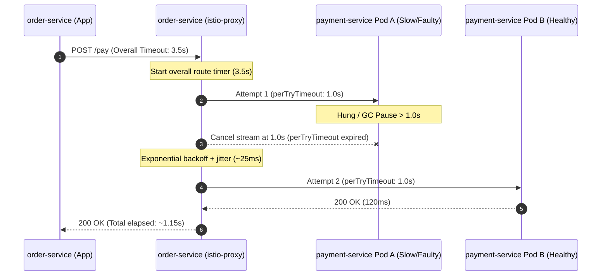
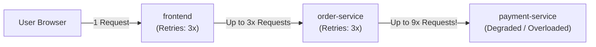
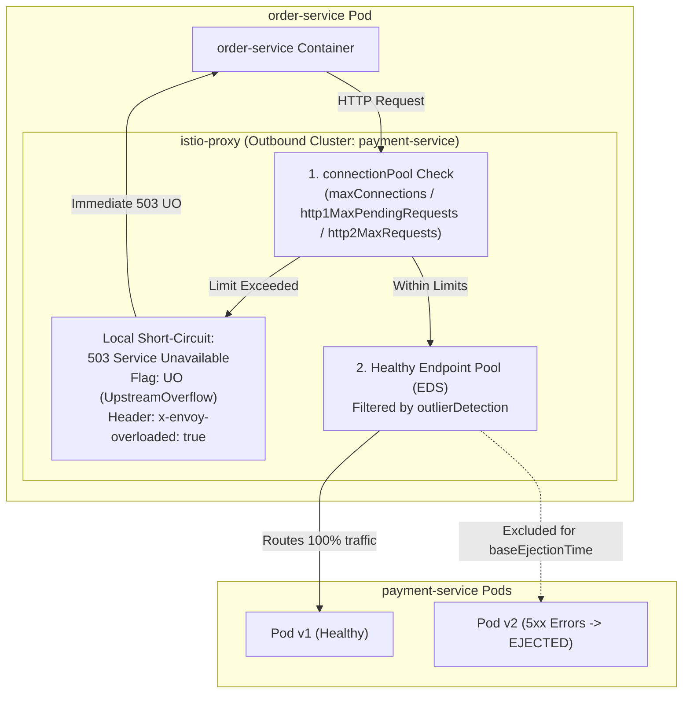
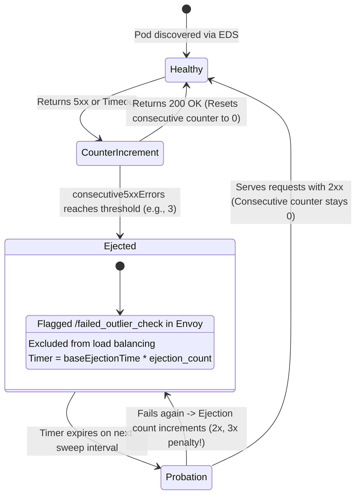

# Module 05: Network Resilience, Circuit Breaking & Fault Injection

> **Version & Fellowship Context**
> - **Version Baseline (November 2026)**: Istio `1.32.0` | Envoy `v1.40` | Kubernetes `v1.36+` | Gateway API `v1.6.1` — see [`../VERSIONS.md`](../VERSIONS.md) and [`../COMPATIBILITY.md`](../COMPATIBILITY.md).
> - **Fellowship Cohort 01 Mapping**: Complete this module alongside **[Week 06: Resilience Engineering & Chaos Testing](../fellowship/week-06-resilience-engineering-and-chaos/WEEK.md)**.

In a distributed microservices architecture like **OrderFlow** (`frontend` $\rightarrow$ `order-service` $\rightarrow$ `payment-service` & `inventory-service`), network failures, GC pauses, noisy neighbors, and transient saturation are not edge cases—they are continuous operational realities.

Traditionally, engineers embedded resilience libraries (such as Netflix Hystrix, Resilience4j, or Polly) directly inside application code. While functional, this approach breaks down in polyglot environments:
1. **Inconsistent Behavior**: Go, Java, Python, and Node.js services implement retry backoff, jitter, and connection pooling with subtle semantic differences.
2. **Configuration Drift**: Tuning a timeout or circuit breaker threshold requires rebuilding and redeploying application containers.
3. **Blind Spots at the Network Layer**: Application libraries often sit above raw TCP socket pools and HTTP/2 multiplexing layers, making it difficult to coordinate connection limits with passive endpoint ejection.

By shifting network resilience into the **Envoy sidecar proxy**, Istio enforces uniform, language-agnostic timeouts, retries, connection pools, outlier detection, and locality failover across every workload in the mesh—while giving operators dynamic runtime control via Kubernetes CRDs (`VirtualService` and `DestinationRule`).

---

## 1. Where Proxy Resilience Ends and Application Awareness Begins

While Envoy handles *transport and protocol-level* resilience, it is not a magic bullet that eliminates all application responsibility.

| Capability | Layer | Why? |
| :--- | :--- | :--- |
| **Timeouts, Per-Try Timeouts, TCP Connect Timeouts** | **Envoy Proxy** (`VirtualService` / `DestinationRule`) | Enforced consistently at the socket/HTTP stream level regardless of language runtime bugs or hung threads. |
| **Idempotency Keys & Deduplication** | **Application Layer** | If Envoy retries a `POST /charge` request after a `503` or read timeout, `payment-service` must inspect an `Idempotency-Key` header so the customer's credit card is not billed twice. |
| **Connection Pooling & Pending Queue Caps (`503 UO`)** | **Envoy Proxy** (`DestinationRule`) | Prevents thread/goroutine exhaustion and memory bloat by failing fast locally when an upstream is saturated. |
| **Business Fallback Logic** | **Application Layer** | Envoy cannot synthesize a domain-specific fallback (e.g., "return cached inventory count or queue order for async processing" when `inventory-service` returns `503`). |
| **Outlier Detection (Pod Ejection)** | **Envoy Proxy** (`DestinationRule`) | Envoy observes real-time 5xx/timeout behavior across requests and removes degraded pod IPs from its local Endpoint Discovery Service (EDS) load balancing pool. |

> [!IMPORTANT]
> **Never blindly retry non-idempotent mutations (`POST`, `PATCH`) at the proxy layer unless the upstream service enforces idempotency keys.** If a request times out *after* the upstream database commits the transaction, an automatic Envoy retry will execute the mutation a second time.

---

## 2. Timeouts & Retries (`VirtualService`)

Istio configures request timeouts and retry policies on `VirtualService` HTTP routes, which `istiod` translates into Envoy `RouteConfiguration` objects (`envoy.config.route.v3.RouteAction`).



### Overall `timeout` vs. `retries.perTryTimeout`
In a `VirtualService` HTTP route:
- **`timeout`**: The maximum total wall-clock duration Envoy will wait for a complete response (including all retry attempts and backoff delays) before returning `504 Gateway Timeout` (logged with Envoy response flag **`UT`** — *UpstreamRequestTimeout*) to the caller. By default in Istio, if omitted, HTTP route timeouts are **disabled (`0s`)**!
- **`retries.attempts`**: The maximum number of *retry* attempts Envoy will perform after the initial attempt fails (e.g., `attempts: 3` means up to **1 initial request + 3 retries = 4 total attempts**).
- **`retries.perTryTimeout`**: The maximum time allowed for any single attempt. If an upstream pod does not respond within `perTryTimeout`, Envoy cancels that attempt and triggers a retry (provided time remains within the overall `timeout`).

### The Timeout Math Rule
A frequent production misconfiguration is setting `perTryTimeout` and `attempts` whose product exceeds the overall route `timeout`. When this happens, the overall `timeout` kills the request before the final retry can complete.

 Always satisfy the **Timeout Math Rule**:

$$\text{Overall Timeout} \ge \left((\text{Retries} + 1) \times \text{perTryTimeout}\right) + \sum \text{Backoff Delays}$$

For example, if `attempts: 3` (4 total tries) and `perTryTimeout: 1s`, with Envoy's default exponential backoff base interval of `25ms` ($\approx 25\text{ms} + 50\text{ms} + 100\text{ms} = 175\text{ms}$ max jittered backoff):
- Minimum required overall `timeout`: $(4 \times 1\text{s}) + 0.2\text{s} \approx 4.2\text{s}$ (or if you configure `timeout: 3.5s` for 3 total tries, keep `attempts: 2`).
- Conversely, if you want 3 attempts of `1s` to fit inside a `3.5s` window, remember that Envoy cancels whichever timer fires first.

### Deep Dive into `retryOn` Conditions
The `retryOn` field is a comma-separated list of conditions passed directly to Envoy's router filter (`x-envoy-retry-on` / `x-envoy-retry-grpc-on`):

| `retryOn` Condition | Trigger Condition | Safe for Non-Idempotent Requests? |
| :--- | :--- | :--- |
| **`connect-failure`** | TCP handshake fails (e.g., `ECONNREFUSED` or TCP SYN timeout because the pod is dead). | **Yes** — Zero bytes of the HTTP request were transmitted. |
| **`refused-stream`** | Upstream HTTP/2 peer resets the stream with `REFUSED_STREAM` before processing. | **Yes** — RFC 7540 guarantees the server did not process the frame. |
| **`reset`** | Upstream TCP connection is abruptly closed (`RST`) or times out (`perTryTimeout` triggers a reset internally). | **No** — Upstream may have partially or fully processed the request before crashing or timing out. |
| **`5xx`** | Upstream responds with any HTTP `500–599` status code (`500`, `502`, `503`, `504`). | **No** — A `500 Internal Server Error` may occur after a database write. |
| **`gateway-error`** | Subset of `5xx`: only retries on `502`, `503`, or `504`. | **Safer than `5xx`**, though `504` can still follow a slow commit. |
| **`retriable-4xx`** | Retries only on HTTP `409 Conflict`. | Application-dependent (useful for optimistic concurrency retries). |
| **`retriable-status-codes`** | Retries on arbitrary HTTP status codes specified in Envoy config (default Istio aliases map standard codes). | Application-dependent. |
| **`cancelled` / `deadline-exceeded` / `resource-exhausted` / `unavailable`** | gRPC status code equivalents sent in `grpc-status` trailers. | Same semantics as their HTTP counterparts. |

### Cascading Retry Storms Across Multi-Tier Architectures
Consider what happens in **OrderFlow** (`frontend` $\rightarrow$ `order-service` $\rightarrow$ `payment-service`) if **every** tier is configured with `attempts: 3` (which means up to 4 tries per hop when counting the initial attempt, or 3 tries total depending on failures):



If `payment-service` experiences a brief database slowdown:
1. `order-service` sends 1 request + 3 retries = **4 requests** to `payment-service`.
2. Before those finish, `frontend`'s `perTryTimeout` fires, so `frontend` retries its call to `order-service` **3 more times**.
3. Each of those 4 `frontend` calls spawns 4 `order-service` calls to `payment-service`, resulting in **$4 \times 4 = 16\times$ traffic amplification** hammering an already dying `payment-service`!

#### Production Rules to Prevent Retry Storms:
1. **Retry at a Single Layer**: Configure retries at the immediate caller of the leaf dependency (`order-service` $\rightarrow$ `payment-service`), and configure upper layers (`frontend` $\rightarrow$ `order-service`) with **fail-fast timeouts and `attempts: 0`** (or only `connect-failure,refused-stream`).
2. **Pair Retries with Circuit Breakers**: Cap `http1MaxPendingRequests` and `maxRequests` via a `DestinationRule` so excess retry amplification is short-circuited locally inside the caller's sidecar (`503 UO`) before ever hitting the network.

---

## 3. Circuit Breaking (`DestinationRule` `trafficPolicy`)

While `VirtualService` controls **how requests are routed**, `DestinationRule` controls **what happens after a route is selected**: load balancing, TLS, connection pooling, and outlier detection.

In Istio, "Circuit Breaking" is composed of two distinct mechanisms inside `DestinationRule.spec.trafficPolicy`:
1. **`connectionPool`**: Active concurrency and queue limiting (protects upstream services from overload and prevents resource exhaustion).
2. **`outlierDetection`**: Passive health checking and host ejection (protects callers from routing to broken or degraded pods).



### 3.1 Connection Pool Limits (`connectionPool`)

Envoy tracks active TCP connections, active HTTP requests, and queued pending requests per upstream cluster (or subset).

```yaml
trafficPolicy:
  connectionPool:
    tcp:
      maxConnections: 100
      connectTimeout: 30ms
    http:
      http1MaxPendingRequests: 50
      http2MaxRequests: 1000
      maxRequestsPerConnection: 10
      maxRetries: 3
```

#### How the Fields Interact in Envoy:
- **`tcp.maxConnections`**: Maximum number of Layer 4 TCP connections Envoy will establish to all endpoints of the upstream service for **HTTP/1.1** traffic (and raw TCP). (Note: For HTTP/2, Envoy multiplexes streams over a single TCP connection per upstream host by default unless configured otherwise).
- **`http.http1MaxPendingRequests`**: Maximum number of requests waiting in Envoy's local memory queue for an available HTTP/1.1 connection from the pool. If all `maxConnections` are busy and `http1MaxPendingRequests` is full, Envoy immediately rejects the request locally.
- **`http.http2MaxRequests`**: Maximum number of concurrent active requests allowed across the cluster (primary concurrency knob for HTTP/2 and gRPC, and also enforced as an overall active request cap in Envoy).
- **`http.maxRequestsPerConnection`**: Forces Envoy to close and recycle the underlying TCP connection after $N$ requests. Useful for disabling keep-alive (`maxRequestsPerConnection: 1`) or forcing periodic connection re-balancing across newly scaled pods.
- **`http.maxRetries`**: Cluster-wide cap on concurrent active retries. Even if every individual request's `VirtualService` allows 3 retries, if more than `maxRetries` are simultaneously in flight across the cluster, Envoy stops retrying (`upstream_rq_retry_overflow`) to prevent a retry storm!

#### What Happens When the Circuit Trips (`503 UO`):
When `http1MaxPendingRequests` or `http2MaxRequests` is exceeded:
1. **Zero Network Packets Sent**: The caller's `istio-proxy` does not send the request over the network.
2. **Response Code & Headers**: Envoy immediately returns `503 Service Unavailable` to the calling application and injects the header `x-envoy-overloaded: true`.
3. **Envoy Access Log Flag**: The access log records the response flag **`UO`** (**UpstreamOverflow**).
4. **Envoy Counter Incremented**: `cluster.<cluster_name>.upstream_rq_pending_overflow` is incremented.

---

### 3.2 Outlier Detection / Passive Health Checking (`outlierDetection`)

Kubernetes `readinessProbe` and `livenessProbe` execute periodically (typically every `10s` with `failureThreshold: 3`, taking **30 seconds** to remove a failing pod from `Endpoints`). In a high-throughput service handling 2,000 RPS, a pod that starts throwing `500 Internal Server Error` or timing out will drop **60,000 requests** before kubelet marks it unready!

Envoy's **Outlier Detection** solves this in milliseconds by passively monitoring live request outcomes inside the caller's sidecar proxy and immediately ejecting failing pod IPs from its local load-balancing pool.

```yaml
trafficPolicy:
  outlierDetection:
    consecutive5xxErrors: 3
    consecutiveGatewayErrors: 3
    interval: 10s
    baseEjectionTime: 30s
    maxEjectionPercent: 50
    minHealthPercent: 30
```

#### Key Parameters Explained:
- **`consecutive5xxErrors`**: Number of consecutive `500–599` responses (plus TCP connection failures/timeouts, which Envoy maps to synthetic `5xx` internally) from a specific pod IP before it is marked for ejection.
- **`consecutiveGatewayErrors`**: Like `consecutive5xxErrors`, but only counts `502`, `503`, and `504` responses (plus local origin TCP failures/timeouts). Use this when `500` indicates an application validation/bug across all pods rather than an instance-specific failure.
- **`interval`**: Time interval between Envoy outlier detection sweeps (e.g., `10s`).
- **`baseEjectionTime`**: Minimum duration a pod stays ejected on its *first* offense. Envoy multiplies this by the number of times the host has been ejected:

$$\text{Ejection Duration} = \text{baseEjectionTime} \times \text{Ejection Count}$$

  If `baseEjectionTime: 30s`, the 1st ejection lasts `30s`, the 2nd lasts `60s`, the 3rd lasts `90s`, up to a maximum cap (default `300s` in Envoy unless overridden).
- **`maxEjectionPercent`**: Maximum percentage of upstream pods in the cluster that can be ejected simultaneously (default `10%`). Setting `50` or `100` in smaller replica sets (e.g., 2–4 pods) is critical—Notice that with the default `10%`, Envoy uses integer truncation (`floor(0.10 * N)` unless at least 1 host is allowed), which in small pools only ever ejects at most 1 pod!
- **`minHealthPercent`** (Panic Threshold): When the percentage of healthy pods in the upstream cluster drops below `minHealthPercent` (default `0%` in Istio's CRD wrapper unless specified, Envoy default `50%`), Envoy enters **Panic Mode**: it disregards health/ejection flags and load-balances traffic across **all** pods (healthy and unhealthy alike) to avoid crushing the last remaining healthy pod with 100% of the cluster's traffic.

#### Step-by-Step Outlier Detection State Machine:



---

## 4. Fault Injection (`VirtualService` `fault`)

Chaos engineering verifies whether your timeouts, retries, and circuit breakers actually work *before* a real outage hits production. Istio enables declarative fault injection at Layer 7 via the `fault` stanza in a `VirtualService`.

```yaml
http:
  - fault:
      delay:
        percentage:
          value: 50.0
        fixedDelay: 3s
      abort:
        percentage:
          value: 10.0
        httpStatus: 500
    route:
      - destination:
          host: payment-service
```

### How Envoy's `envoy.filters.http.fault` Works Under the Hood
When `istiod` compiles a `VirtualService` containing a `fault` specification:
1. It configures the `envoy.filters.http.fault` HTTP filter inside the HTTP Connection Manager (HCM) filter chain **before** the `envoy.filters.http.router` filter.
2. **Faults Happen Before Routing**:
   - For **`delay`**: Envoy pauses the HTTP stream inside the filter timer for `fixedDelay` (and adds the response flag **`DI`** — *DelayInjected*) *before* forwarding the request to the upstream pod.
   - For **`abort`**: Envoy short-circuits the request inside the proxy, immediately returning the configured `httpStatus` (with response flag **`FI`** — *FaultInjected*). The upstream pod never sees an aborted request!
3. **Crucial Interaction Between Caller Retries and Fault Injection**:
   Because `VirtualService` rules are attached to the **host** (`payment-service`), both the caller's outbound sidecar (`order-service`) and any matching mesh gateways evaluate the route configuration. When `order-service` calls `payment-service`, `order-service`'s own outbound `istio-proxy` evaluates the `VirtualService`:
   - If you configure `timeout`/`retries` **and** `fault` in the same `VirtualService` route, the caller's outbound proxy injects the delay/abort *and* executes the route's timeout/retry logic against that delayed stream!

---

## 5. Locality-Aware Load Balancing & Failover

In multi-zone and multi-region Kubernetes clusters, cross-zone network traffic incurs both **cloud egress charges** (often \$0.01–\$0.02 per GB in each direction on AWS/GCP) and **higher tail latency** (1–3ms cross-AZ vs <0.2ms intra-AZ).

Istio automatically reads standard Kubernetes node topology labels from each Pod's assigned Node:
- `topology.kubernetes.io/region` (e.g., `us-east-1`)
- `topology.kubernetes.io/zone` (e.g., `us-east-1a`, `us-east-1b`)
- `topology.istio.io/subzone` (optional finer-grained rack/subzone grouping)

### Why `outlierDetection` is Mandatory for Locality Load Balancing
> [!WARNING]
> **Istio's Locality Load Balancing will NOT activate unless `outlierDetection` is configured on the `DestinationRule`!**
> Without `outlierDetection`, Envoy has no way of knowing when the local zone's pods are unhealthy and when it must spill traffic over to a neighboring zone.

### Mode 1: Locality Prioritized Failover (`failover`)
By default (whenever `outlierDetection` is present), Istio keeps 100% of traffic within the same region and zone (`us-east-1a` $\rightarrow$ `us-east-1a`). Only when pods in `us-east-1a` are ejected by `outlierDetection` (or zero healthy pods exist locally) does Envoy automatically spill traffic over to the next closest locality (`us-east-1b`, and then to a backup region defined in `localityLbSetting.failover`):

```mermaid
flowchart TD
    Caller["order-service Pod<br/>(us-east-1 / us-east-1a)"]
    
    subgraph Region1["Region: us-east-1 (Primary)"]
        Z1A["Zone: us-east-1a<br/>Priority 0 (Local)<br/>100% Traffic when healthy"]
        Z1B["Zone: us-east-1b<br/>Priority 1 (Same Region, Next Zone)<br/>Spillover when 1a degraded"]
    end

    subgraph Region2["Region: us-west-2 (DR Failover)"]
        Z2A["Zone: us-west-2a<br/>Priority 2 (Cross-Region Failover)<br/>Used only if all us-east-1 fails"]
    end

    Caller -->|Primary (0ms extra latency, $0 AZ cost)| Z1A
    Caller -.->|Failover 1 (If 1a pods ejected)| Z1B
    Caller -.->|Failover 2 (If us-east-1 down)| Z2A
```

### Mode 2: Locality Weighted Distribution (`distribute`)
When you want explicit deterministic percentages across zones or regions (e.g., 80% local zone, 20% secondary zone to keep caches warm in the secondary zone), use `localityLbSetting.distribute`:

```yaml
localityLbSetting:
  enabled: true
  distribute:
    - from: us-east-1/us-east-1a/*
      to:
        "us-east-1/us-east-1a/*": 80
        "us-east-1/us-east-1b/*": 20
```

---

## 6. Learning vs. Production Configurations & Common Failure Modes

| Parameter / Feature | Lab / Learning Config | Production Config | Why & Common Failure Mode |
| :--- | :--- | :--- | :--- |
| **`timeout`** | `2s` – `5s` | P99.9 latency + retry budget (e.g., `800ms` for fast RPCs, `10s` for batch endpoints) | Istio's default HTTP timeout is **`0s` (infinite)**. Leaving it unset in production allows hung upstream sockets to tie up caller connections indefinitely. |
| **`retries.retryOn`** | `5xx,connect-failure` | `connect-failure,refused-stream,gateway-error` (unless endpoint is strictly idempotent) | Retrying `500` or `reset` on non-idempotent `POST` endpoints causes duplicate database records or double financial charges. |
| **`connectionPool`** | `maxConnections: 1`, `http1MaxPendingRequests: 1` | Sized to $1.5\times \text{Peak RPS} \times \text{Mean Latency (Little's Law)}$ | Setting `maxConnections: 1` makes it easy to trigger `503 UO` in a lab, but in production it serializes all HTTP/1.1 traffic and destroys throughput. |
| **`outlierDetection.maxEjectionPercent`** | `100` | `30` – `50` (paired with `minHealthPercent: 50`) | Ejecting 100% of pods in production leaves 0 endpoints in the load balancer. Always cap `maxEjectionPercent` or rely on `minHealthPercent` panic mode. |
| **Envoy Response Flags** | Checked manually via `curl -v` | Alerted on via Prometheus/Loki (`UO`, `UT`, `UF`, `UH`, `URX`) | A `503` in Istio is ambiguous without response flags: `503 UC` is connection termination, `503 UF` is connect failure, `503 UO` is circuit breaker overflow, `503 UH` is no healthy upstream! |

### Quick Reference: Decoding Envoy Resilience Response Flags
When troubleshooting `503` or `504` responses in Istio access logs, always inspect `%RESPONSE_FLAGS%`:
- **`UT`** (*UpstreamRequestTimeout*): The `VirtualService` `timeout` or `perTryTimeout` expired (`504`).
- **`UO`** (*UpstreamOverflow*): Circuit breaker (`connectionPool`) tripped locally (`503`).
- **`UF`** (*UpstreamConnectionFailure*): TCP connection or mTLS handshake to upstream pod failed (`503`).
- **`UH`** (*NoHealthyUpstream*): All upstream pods were ejected by `outlierDetection` (or zero endpoints exist in EDS) (`503`).
- **`URX`** (*UpstreamRetryLimitExceeded*): All configured `retries.attempts` failed (`503` or `504`).
- **`DI`** (*DelayInjected*): `VirtualService` `fault.delay` was applied to this request.
- **`FI`** (*FaultInjected*): `VirtualService` `fault.abort` terminated this request.
