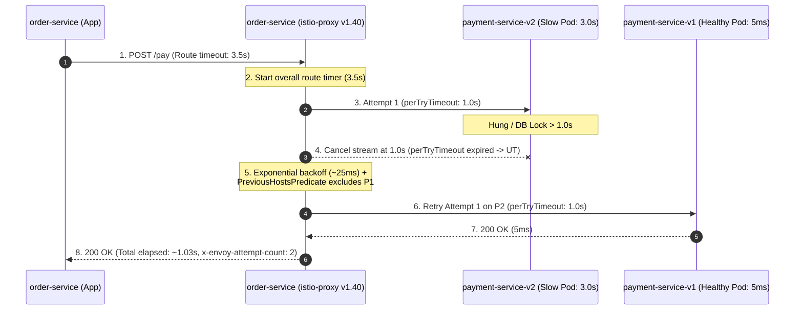
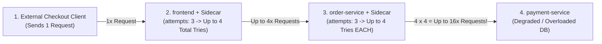

# Lesson 05.1: Timeouts, Bounded Retries, Idempotency & Multi-Tier Cascading Retry Storms

> **Navigation**: [Fellowship Portal](../../README.md) > [Week 06: Resilience Engineering & Chaos Testing](../../fellowship/week-06-resilience-and-chaos-engineering/WEEK.md) > [Module 05 Hub](../README.md) > **Lesson 05.1**  
> **Estimated Completion Time**: 25 minutes  
> **Prerequisites**: [Module 02 (`VirtualService` & `DestinationRule`)](../../02-service-discovery-and-routing/README.md)  
> **Authoritative Baseline**: Istio `1.32.0` | Envoy `v1.40` | Kubernetes `1.36+` | Gateway API `v1.6.1`

### Learning Objectives
By the end of this lesson, you will be able to:
1. Define the boundary between Envoy proxy resilience (timeouts, connection pools, socket-level retries) and application-level resilience (`Idempotency-Key` deduplication on `POST /charge` and domain fallback logic).
2. Configure `VirtualService` `timeout`, `retries.attempts`, `retries.perTryTimeout`, and `retryOn` conditions while satisfying the **Timeout Math Rule**.
3. Prevent multi-tier cascading retry amplification storms ($4 \times 4 = 16\times$ or $5 \times 5 = 25\times$) across synchronous call graphs (`frontend` $\rightarrow$ `order-service` $\rightarrow$ `payment-service`).

---

## 1. NovaPay Engineering Context & Alex Morgan's Briefing

### What Is Happening at NovaPay?
During a weekend Black Friday staging drill at NovaPay (Ticket `NP-106`), one of our `payment-service` pods experienced a 400ms database slowdown. Instead of recovering gracefully, inbound traffic to `payment-service` exploded from `1,000 RPS` to over `16,000 RPS` in 60 seconds, pinning CPU at 100% and causing cascading `504 Gateway Timeout` (`UT`) errors across checkout. Worse, during Friday's incident (`INC-06`), several test cardholders were billed twice when background retries succeeded after `frontend` had already timed out!

### Alex, Sarah, Daniel & Maya's Briefing
> **Sarah Chen (SRE Lead)**: *"Look at the incident timeline from Saturday's load test. Why did a 400ms pause on one `payment-service` pod multiply `1,000 RPS` at `frontend` into `16,000 RPS` at `payment-service`? Because both `frontend -> order-service` AND `order-service -> payment-service` were configured with `retries.attempts: 3` (which means 1 initial try + 3 retries = **4 total tries per tier**). When `payment-service` slowed down, `order-service` tried 4 times. Before those finished, `frontend`'s timer expired and `frontend` tried 4 times—spawning **$4 \times 4 = 16$ requests** to an already drowning database! An uncoordinated multi-tier retry policy isn't resilience; it's a self-inflicted DDoS attack."*
>
> **Alex Morgan (Senior Platform Engineer)**: *"Think of `timeout` and `retries.perTryTimeout` like an **emergency room triage budget**. The overall route `timeout` (`3.5s`) is the maximum time the patient can stay in triage before you must give an answer (`504 UT`). `perTryTimeout` (`1.0s`) is your stopwatch on a single doctor (`Pod A`): if Doctor A freezes for `1.0s`, Envoy cancels that stream, waits a brief jittered exponential backoff (`~25ms`), and hands the chart to Doctor B (`Pod B`)—all without exceeding the `3.5s` overall budget!"*
>
> **Maya Patel (Principal Security Engineer)** & **Daniel Brooks (Staff Backend Engineer)**: *"And never forget where proxy resilience stops and application engineering begins: Envoy can retry a timed-out HTTP `POST /charge`, but if `payment-service` committed the charge to the database 5 milliseconds before the socket timed out, an automatic retry will **double-charge the customer** unless Daniel's application enforces an `Idempotency-Key` header or we restrict `retryOn` to pre-transmission failures (`connect-failure,refused-stream`)!"*

---

## 2. Progressive Disclosure Technical Explanation

### 2.1 Core Concept: Where Proxy Resilience Ends and Application Responsibility Begins

Shifting network resilience out of polyglot application libraries (Hystrix, Resilience4j, Go wrappers) into the Envoy `v1.40` sidecar ensures uniform behavior across every language and allows instant runtime tuning via Kubernetes CRDs. However, platform engineers must enforce a clear contract with application teams:

| Capability | Owner | Engineering Rationale |
| :--- | :--- | :--- |
| **Route Timeouts, `perTryTimeout` & TCP Connect Timeouts** | **Envoy Proxy** (`VirtualService` / `DestinationRule`) | Enforced deterministically at the HTTP stream and socket layer even if application threads or GC freeze. |
| **Idempotency Keys & Mutation Deduplication** | **Application Code** (`order-service` / `payment-service`) | If Envoy retries a `POST /charge` after a read timeout or `503`, only the application database can inspect `Idempotency-Key` to avoid double-billing a credit card. |
| **Connection Pooling & Pending Queue Caps (`503 UO`)** | **Envoy Proxy** (`DestinationRule` `connectionPool`) | Protects upstreams from thread exhaustion by failing fast locally when concurrency thresholds trip (Lesson 05.2). |
| **Domain-Specific Business Fallbacks** | **Application Code** | Envoy returns an HTTP status code (`503`/`504`); the application decides whether to queue the order asynchronously or display cached inventory. |
| **Passive Endpoint Ejection (`outlierDetection`)** | **Envoy Proxy** (`DestinationRule` `outlierDetection`) | Envoy observes real-time `5xx`/timeout outcomes across all requests and ejects degraded pod IPs from its local EDS pool in milliseconds (Lesson 05.2). |

---

### 2.2 Technical Deep Dive: `timeout`, `perTryTimeout`, the Timeout Math Rule & `retryOn`

In a `VirtualService` HTTP route, `istiod` compiles `timeout` and `retries` into an Envoy `RouteAction` (`envoy.config.route.v3.RouteAction`):
- **`timeout`**: Maximum total wall-clock time Envoy waits for a complete response—**including all retry attempts and exponential backoff delays**—before aborting and returning `504 Gateway Timeout` with Envoy access log flag **`UT`** (*UpstreamRequestTimeout*). *(Crucial Gotcha: In Istio, if `timeout` is omitted, the default HTTP route timeout is **`0s` — disabled/infinite**!)*
- **`retries.attempts`**: Maximum number of **retry** attempts after the initial attempt fails (`attempts: 3` = **1 initial attempt + 3 retries = 4 total attempts**).
- **`retries.perTryTimeout`**: Maximum duration allowed for any single attempt before Envoy cancels that attempt and triggers a retry (if time remains in the overall `timeout`).

#### The Timeout Math Rule (Single-Hop & Multi-Tier Hierarchy)
1. **Single-Hop Timeout Math Rule**:
   To ensure the overall route `timeout` does not kill a request while its final retry attempt is still in flight, always satisfy:

$$\text{Overall Timeout} \ge \left((\text{Retries} + 1) \times \text{perTryTimeout}\right) + \sum \text{Backoff Delays}$$

   *(Envoy uses a jittered exponential backoff with a base interval of `25ms`: $\approx 25\text{ms} + 50\text{ms} + 100\text{ms} \approx 175\text{ms}$ across 3 retries).*
2. **Multi-Tier Timeout Hierarchy Rule (`INC-06` Prevention)**:
   Across a synchronous call chain (`frontend` $\rightarrow$ `order-service` $\rightarrow$ `payment-service`), the downstream caller's timeout must **always** exceed the upstream dependency's total timeout budget ($\text{Timeout}_{\text{frontend} \rightarrow \text{order}} > \text{Timeout}_{\text{order} \rightarrow \text{payment}}$). If `frontend` gives up at `2.0s` while `order-service` is still retrying `payment-service` up to `3.5s`, the user sees a `504 Gateway Timeout` even though the orphaned background payment charge succeeds at `t = 2.8s`!

#### Deep Dive into `retryOn` Conditions

| `retryOn` Condition | When Envoy Triggers a Retry | Safe for Non-Idempotent `POST` Without Idempotency Key? |
| :--- | :--- | :--- |
| **`connect-failure`** | TCP 3-way handshake fails (`ECONNREFUSED` or SYN timeout). | **Yes** — Zero HTTP payload bytes were sent to the server. |
| **`refused-stream`** | Upstream HTTP/2 peer resets the stream with `REFUSED_STREAM` prior to processing. | **Yes** — RFC 7540 guarantees the upstream application never processed the frame. |
| **`reset`** | Upstream TCP socket is abruptly closed (`RST`) or `perTryTimeout` fires. | **No** — Upstream may have committed the database transaction right before timing out or crashing. |
| **`5xx`** | Upstream returns any HTTP `500–599` status code. | **No** — A `500` or `504` can occur *after* a state mutation. |
| **`gateway-error`** | Only retries on HTTP `502`, `503`, or `504`. | **Safer than `5xx`**, though `504` still requires idempotency keys on mutations. |
| **`retriable-4xx`** | Retries on HTTP `409 Conflict`. | Useful for optimistic concurrency control retries. |

---

### 2.3 Mechanism Diagrams & 6-Part Step-by-Step Walkthroughs

#### Diagram A: Per-Try Timeout & Previous-Host Retry Avoidance



##### 6-Part Mechanism Walkthrough: Bounded Retry with `perTryTimeout` & Host Avoidance
1. **What initiates the operation?**
   `order-service` sends an outbound HTTP request to `http://payment-service:8080/pay`.
2. **Which component receives it?**
   `order-service`'s outbound Envoy sidecar (`15001`) intercepts the request and matches the `VirtualService` route for `payment-service:8080` (`timeout: 3.5s`, `attempts: 3`, `perTryTimeout: 1s`).
3. **What information is exchanged?**
   Envoy starts two timers simultaneously: the overall route timer (`3.5s`) and Attempt 1's `perTryTimeout` timer (`1.0s`), forwarding Attempt 1 to `payment-service-v2` (`P1`). When `P1` fails to respond within `1.0s`, Envoy resets the upstream stream (`UT`), waits a jittered backoff (`~25ms`), and evaluates its automatic **`envoy.retry_host_predicates.previous_hosts`** filter so the retry avoids `P1` and selects `payment-service-v1` (`P2`).
4. **What changes in the system?**
    Envoy increments `cluster.outbound|8080||payment-service...upstream_rq_retry` and `upstream_rq_retry_success`, injects `x-envoy-attempt-count: 2` on the retry to `P2`, receives `200 OK` from `P2` in `5ms`, and returns `200 OK` to `order-service` in `~1.03s`—completely hiding `P1`'s 3-second stall from the caller!
5. **How can you observe/verify it on your cluster?**
   - Inspect the compiled retry policy and `PreviousHostsPredicate`: `istioctl proxy-config routes <order-pod>.orderflow --name 8080 -o json`.
   - Query retry counters: `kubectl exec -n orderflow <order-pod> -c istio-proxy -- pilot-agent request GET stats | grep upstream_rq_retry`.
6. **What happens if a component fails?**
   If **all** replicas of `payment-service` take longer than `1.0s`, Envoy exhausts its attempt budget (or hits the `3.5s` overall `timeout`), increments `upstream_rq_retry_limit_exceeded`, and returns `504 Gateway Timeout` to `order-service` with response flags **`UT,URX`** (*UpstreamRequestTimeout* + *UpstreamRetryLimitExceeded*).

---

#### Diagram B: Multi-Tier Cascading Retry Amplification Storm ($4 \times 4 = 16\times$)



##### 6-Part Mechanism Walkthrough: Multi-Tier Cascading Retry Amplification
1. **What initiates the operation?**
   A single user checkout request arrives at `frontend` while `payment-service` is experiencing elevated latency.
2. **Which component receives it?**
   `frontend` calls `order-service`, and `order-service`'s outbound Envoy sidecar calls `payment-service`. Both tiers have independently configured `retries.attempts: 3` (4 total tries per hop).
3. **What information is exchanged?**
   For `frontend`'s 1st try, `order-service`'s sidecar sends up to 4 tries to `payment-service`. When `frontend`'s `perTryTimeout` expires before `order-service` finishes, `frontend`'s sidecar initiates its 2nd, 3rd, and 4th tries against `order-service`.
4. **What changes in the system?**
   Each of `frontend`'s 4 tries triggers up to 4 tries from `order-service` to `payment-service` ($4 \times 4 = 16\times$ amplification—and if the application SDK also retries, $4 \times 4 \times 4 = 64\times$!). Connection queues fill up, CPU spikes to 100%, and `payment-service` collapses completely.
5. **How can you observe/verify it on your cluster?**
   Compare `rate(istio_requests_total{destination_service=~"frontend.*"}[1m])` against `rate(istio_requests_total{destination_service=~"payment-service.*"}[1m])` and check `upstream_rq_retry` across every tier.
6. **What happens if a component fails (and how we prevent it at NovaPay)?**
   To prevent retry amplification storms:
   - **Rule 1 (Single-Layer Retries)**: Disable application-SDK retries (`MaxRetries = 0`) for in-mesh calls, retry at the immediate caller of the leaf service (`order-service` $\rightarrow$ `payment-service`), and configure upper tiers (`frontend` $\rightarrow$ `order-service`) with `attempts: 0` (or only `connect-failure,refused-stream`).
   - **Rule 2 (Cluster-Wide Retry Cap)**: Configure `DestinationRule` `connectionPool.http.maxRetries` to cap concurrent active retries across the cluster (`upstream_rq_retry_overflow`).

---

## 3. Practical Observation & Investigation

Run these commands during Part 1 of [Lab 05](../LAB.md) to inspect how `istiod` compiles `timeout`, `retryPolicy`, and `PreviousHostsPredicate` into Envoy's RDS config:

```bash
ORDER_POD=$(kubectl get pod -n orderflow -l app=order-service,version=v1 -o jsonpath='{.items[0].metadata.name}')

# 1. Inspect the compiled RouteAction timeout, retryPolicy, and PreviousHostsPredicate
istioctl proxy-config routes "$ORDER_POD" -n orderflow --name 8080 -o json

# 2. Check live Envoy retry statistics on order-service
kubectl exec -n orderflow "$ORDER_POD" -c istio-proxy -- \
  pilot-agent request GET stats | grep "payment-service.*upstream_rq_retry"
```

---

## 4. Knowledge Check (Engineering Judgment)

### Question 1: Diagnosing a Premature `504 UT` Cutoff (`INC-06` Preview)
An engineer configures the following `VirtualService` route for `order-service` calling `payment-service`:
```yaml
timeout: 2s
retries:
  attempts: 3
  perTryTimeout: 1s
  retryOn: 5xx,connect-failure,reset
```
When 2 out of 3 `payment-service` pods are experiencing a 1.5s stall and 1 pod is healthy (`10ms`), requests that hit the two slow pods on their first two tries fail with `504 Gateway Timeout` (`UT`) at `2.0s` before the 3rd try can reach the healthy pod. Why did the configuration fail, and what should `timeout` be?

<details>
<summary>Check Answer & Engineering Explanation</summary>

**Answer**:
The engineer violated the **Single-Hop Timeout Math Rule**:
With `attempts: 3` (1 initial try + 3 retries = **4 total tries**) and `perTryTimeout: 1s`, 4 tries require up to $4 \times 1\text{s} = 4.0\text{s}$ plus $\approx 175\text{ms}$ of exponential backoff ($\approx 4.2\text{s}$ total). Because the overall route `timeout` was set to `2s`, Envoy's overall route timer fired at exactly `2.0s` (right as Try #2 timed out), killing the request with `504 UT` before Try #3 could execute against the healthy pod!

**Fix**: Either increase overall `timeout` to at least `3.5s`–`4.5s` (while keeping `attempts: 2` or `3`), or reduce `perTryTimeout` to `500ms` so all tries + backoff fit cleanly inside the overall `timeout` budget.
</details>

### Question 2: Choosing Safe `retryOn` Conditions for Financial Mutations
`order-service` calls `POST /v1/payments/charge` on `payment-service`. Suppose a legacy partner endpoint behind `payment-service` does **not** yet support `Idempotency-Key` deduplication. Which `retryOn` conditions are 100% safe to enable on that route without risking double-charging a customer, and which conditions must be avoided?

<details>
<summary>Check Answer & Engineering Explanation</summary>

**Answer**:
- **100% Safe Conditions (`connect-failure,refused-stream`)**:
  - `connect-failure` triggers only when the TCP socket handshake fails before a single HTTP byte is transmitted.
  - `refused-stream` triggers only when an HTTP/2 server explicitly refuses the stream via an HTTP/2 `RST_STREAM (REFUSED_STREAM)` frame before any application processing occurs.
- **Unsafe Conditions Without Idempotency Keys (`5xx`, `reset`, `gateway-error` / `504`)**:
  - A TCP `reset`, `perTryTimeout`, `500`, or `504` can happen *after* the upstream service has already transmitted or committed the credit card charge, meaning a retry would bill the cardholder a second time.
</details>

---

## 5. Key Takeaways, Definition of Done & Next Lesson

### Key Takeaways
- **Default Istio HTTP Timeout is `0s` (Infinite)**: Always set explicit `timeout` and `perTryTimeout` budgets in production.
- **Obey the Timeout Math Rule**: $\text{Overall Timeout} \ge ((\text{Retries} + 1) \times \text{perTryTimeout}) + \text{Backoff}$, and downstream timeout must strictly exceed upstream timeout ($\text{Timeout}_{\text{caller}} > \text{Timeout}_{\text{callee}}$).
- **Stop Retry Storms at the Source**: Retry at a single layer, never stack application SDK retries on top of Envoy retries, and require idempotency keys before retrying `5xx` or `reset` on mutations.

### Definition of Done
- [ ] You can calculate a multi-tier timeout and retry budget across `frontend` $\rightarrow$ `order-service` $\rightarrow$ `payment-service`.
- [ ] You can verify `upstream_rq_retry` and `PreviousHostsPredicate` in Envoy's runtime configuration.

### Authoritative References
- [Istio 1.32 Documentation — Request Timeouts](https://istio.io/latest/docs/tasks/traffic-management/request-timeouts/)
- [Istio 1.32 Documentation — Retries (`HTTPetry`)](https://istio.io/latest/docs/reference/config/networking/virtual-service/#HTTPRetry)
- **Next Lesson**: **[Lesson 05.2: Circuit Breaking (`connectionPool` `503 UO`) & Passive Health Checking (`outlierDetection`)](./02-circuit-breaking-and-outlier-detection.md)**
