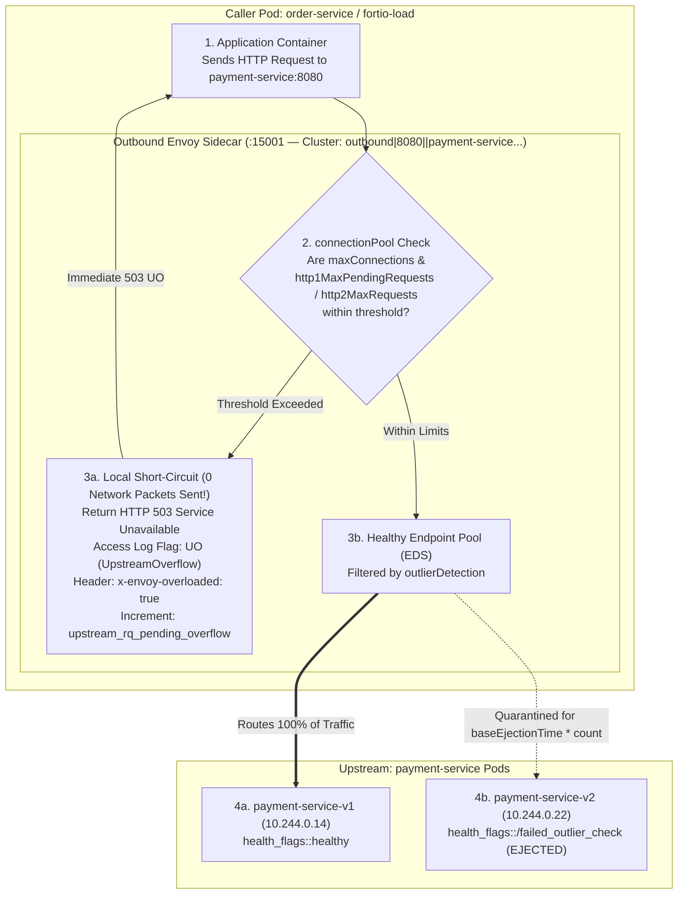

# Lesson 05.2: Circuit Breaking (`connectionPool` `503 UO`) & Passive Health Checking (`outlierDetection`)

> **Navigation**: [Fellowship Portal](../../README.md) > [Week 06: Resilience Engineering & Chaos Testing](../../fellowship/week-06-resilience-and-chaos-engineering/WEEK.md) > [Module 05 Hub](../README.md) > **Lesson 05.2**  
> **Estimated Completion Time**: 30 minutes  
> **Prerequisites**: [Lesson 05.1: Timeouts, Retries & Retry Storms](./01-timeouts-retries-and-retry-storms.md)  
> **Authoritative Baseline**: Istio `1.32.0` | Envoy `v1.40` | Kubernetes `1.36+` | Gateway API `v1.6.1`

### Learning Objectives
By the end of this lesson, you will be able to:
1. Configure `DestinationRule` `connectionPool` limits (`maxConnections`, `http1MaxPendingRequests`, `http2MaxRequests`, `maxRetries`) and identify local short-circuiting via **`503 UO`** (*UpstreamOverflow*), `x-envoy-overloaded: true`, and `upstream_rq_pending_overflow`.
2. Engineer passive health checking with `outlierDetection` (`consecutive5xxErrors`, `interval`, `baseEjectionTime`, `maxEjectionPercent`, `minHealthPercent` panic mode) to eject failing pod IPs in milliseconds.
3. Inspect live endpoint health flags (`/failed_outlier_check` vs. `healthy`) in Envoy's `:15000/clusters` admin endpoint.

---

## 1. NovaPay Engineering Context & Alex Morgan's Briefing

### What Is Happening at NovaPay?
At NovaPay, two critical failure modes threatened `payment-service` during our Black Friday stress test (Ticket `NP-106`):
1. **Queue Saturation & Memory OOM**: When database latency blipped, hundreds of concurrent checkout requests queued up inside `order-service` waiting for `payment-service` sockets, exhausting Go goroutines and triggering container OOMKills.
2. **The 30-Second Kubernetes Readiness Blind Spot**: When one replica (`payment-service-v2`) lost its database connection pool and started returning immediate `500 Internal Server Error` responses, Kubernetes `readinessProbe` (`periodSeconds: 10`, `failureThreshold: 3`) took **30 full seconds** to remove that pod from `Endpoints`. At `2,000 RPS`, that single broken pod dropped **30,000 customer payment requests** before Kubernetes noticed!

### Alex & Sarah's Briefing & Intuition Analogy
> **Alex Morgan (Senior Platform Engineer)**: *"In Istio, what people casually call 'Circuit Breaking' is actually **two distinct mechanisms** inside a `DestinationRule`'s `trafficPolicy`:*
> 1. ***`connectionPool` (The Nightclub Bouncer / Electrical Breaker)**: Protects a healthy upstream service from being crushed by too much concurrency. If `payment-service` can only handle 100 concurrent connections and 50 waiting in line (`http1MaxPendingRequests`), the 151st request doesn't even leave the caller's pod—the caller's own Envoy sidecar trips locally in 0 milliseconds, returning **`503 Service Unavailable`** with response flag **`UO` (`UpstreamOverflow`)** and header `x-envoy-overloaded: true`.*
> 2. ***`outlierDetection` (The Instant Quarantine Doctor)**: Protects callers from routing to a sick upstream pod. Instead of waiting 30 seconds for a Kubernetes `readinessProbe`, the caller's Envoy sidecar watches live production responses. The moment `payment-service-v2` returns 2 or 3 consecutive `5xx` errors (`consecutive5xxErrors`), Envoy immediately stamps that pod's IP with `/failed_outlier_check` and ejects it from load balancing for `baseEjectionTime` (`30s`, then `60s`, then `90s` on repeat offenses)!"*
>
> **Sarah Chen (SRE Lead)**: *"Watch out for a subtle production math trap with `outlierDetection`: Istio's default `maxEjectionPercent` is **`10%`**. In a 2-pod or 3-pod deployment (`payment-service-v1` and `v2`), examine how `maxEjectionPercent` interacts with `minHealthPercent` (Panic Mode)—if you don't tune `maxEjectionPercent: 50` (or `100` in a 2-pod lab), Envoy might refuse to eject a failing pod or drop into Panic Mode!"*

---

## 2. Progressive Disclosure Technical Explanation

### 2.1 Core Concept: `connectionPool` (Active Concurrency & Queue Limiting)

Configured under `DestinationRule.spec.trafficPolicy.connectionPool`, Envoy tracks active L4 TCP sockets, active L7 HTTP streams, and pending queued requests **locally inside each caller sidecar** per upstream cluster (or subset):

```yaml
apiVersion: networking.istio.io/v1
kind: DestinationRule
metadata:
  name: payment-service-cb
  namespace: orderflow
spec:
  host: payment-service.orderflow.svc.cluster.local
  trafficPolicy:
    connectionPool:
      tcp:
        maxConnections: 100           # Max L4 TCP connections (primary HTTP/1.1 connection cap)
        connectTimeout: 100ms
      http:
        http1MaxPendingRequests: 50   # Max requests queued waiting for a free connection
        http2MaxRequests: 1000        # Max concurrent active requests (HTTP/2 & overall cap)
        maxRequestsPerConnection: 100 # Recycle TCP connection after N requests
        maxRetries: 3                 # Cluster-wide cap on concurrent active retries
```



#### 6-Part Mechanism Walkthrough: `connectionPool` Local Short-Circuiting (`503 UO`)
1. **What initiates the operation?**
   A caller container (`order-service` or `fortio-load`) sends bursts of concurrent HTTP requests to `http://payment-service:8080/`.
2. **Which component receives it?**
   The caller pod's own outbound Envoy sidecar (`15001`) intercepts the requests and routes them to the upstream cluster `outbound|8080||payment-service.orderflow.svc.cluster.local`.
3. **What information is exchanged?**
   Before allocating a socket or sending a single byte over the network, Envoy's cluster circuit breaker checks its local in-memory counters (`upstream_cx_active`, `upstream_rq_active`, and `upstream_rq_pending_active`) against the thresholds pushed via CDS from the `DestinationRule` (`maxConnections`, `maxPendingRequests`, `maxRequests`, `maxRetries`).
4. **What changes in the system?**
   - Requests within `maxConnections` are dispatched immediately over active sockets.
   - Requests arriving while all connections are busy wait in Envoy's local memory queue up to `http1MaxPendingRequests`.
   - The moment concurrency exceeds `maxConnections + http1MaxPendingRequests` (or `http2MaxRequests`), Envoy **trips the circuit breaker locally**: it increments `upstream_rq_pending_overflow`, attaches response header `x-envoy-overloaded: true`, logs response flag **`UO`** (*UpstreamOverflow*), and immediately returns `503 Service Unavailable` to the calling application.
5. **How can you observe/verify it on your cluster?**
   - Check compiled thresholds: `istioctl proxy-config cluster <caller-pod>.orderflow --fqdn payment-service.orderflow.svc.cluster.local -o json | grep -A 12 circuitBreakers`.
   - Query overflow stats: `kubectl exec -n orderflow <caller-pod> -c istio-proxy -- pilot-agent request GET stats | grep upstream_rq_pending_overflow`.
   - Check access logs: `kubectl logs -n orderflow <caller-pod> -c istio-proxy | grep " 503 UO "`.
6. **What happens if a component fails?**
   Because `connectionPool` is enforced **inside the caller's sidecar before crossing the network**, a downstream traffic spike is shed in sub-millisecond time at the caller without opening extra TCP sockets or overwhelming `payment-service`'s threads/memory!

---

### 2.2 Technical Deep Dive: `outlierDetection` (Passive Health Checking & Pod Ejection)

While `connectionPool` limits *how much* traffic enters an upstream cluster, `outlierDetection` controls *which specific Pod IPs* inside that cluster are healthy enough to receive traffic:

```yaml
  trafficPolicy:
    outlierDetection:
      consecutive5xxErrors: 2      # Eject pod after 2 consecutive 5xx or TCP timeouts/resets
      interval: 5s                 # Sweep interval for ejection / recovery checks
      baseEjectionTime: 30s        # 1st ejection = 30s, 2nd = 60s, 3rd = 90s...
      maxEjectionPercent: 100      # Max % of pool that can be ejected (Prod: 30-50%)
      minHealthPercent: 0          # Panic threshold (Prod: 50%; Lab: 0% to test 2-pod ejection)
```

```mermaid
stateDiagram-v2
    [*] --> Healthy: 1. Pod IP discovered via EDS (health_flags::healthy)
    Healthy --> CounterIncrement: 2. Pod returns HTTP 5xx or TCP Timeout/Reset
    CounterIncrement --> Healthy: Returns HTTP 2xx (Resets consecutive counter to 0)
    CounterIncrement --> Ejected: 3. consecutive5xxErrors reaches threshold (e.g., 2)
    
    state Ejected {
        [*] --> Quarantined
        Quarantined: Stamped with /failed_outlier_check in Envoy :15000/clusters
        Quarantined: Excluded from EDS load balancing pool
        Quarantined: Quarantine Timer = baseEjectionTime * ejection_count
    }

    Ejected --> Probation: 4. Quarantine Timer expires on next sweep interval
    Probation --> Healthy: 5a. Serves requests with HTTP 2xx (Remains healthy)
    Probation --> Ejected: 5b. Fails again -> Ejection count increments (2x, 3x penalty!)
```

#### 6-Part Mechanism Walkthrough: `outlierDetection` Ejection & Probation State Machine
1. **What initiates the operation?**
   An upstream replica (`payment-service-v2`, IP `10.244.0.22`) experiences a localized failure (broken DB connection, corrupted state, or OOM thrashing) and starts returning HTTP `500` responses (or timing out) while `payment-service-v1` (`10.244.0.14`) remains healthy (`200 OK`).
2. **Which component receives it?**
   The caller pod's outbound Envoy sidecar (`order-service` or `client-toolbox`) receives the HTTP `500` responses from `10.244.0.22:8080` and feeds each response status into its per-endpoint outlier detector monitor.
3. **What information is exchanged?**
   Each consecutive `5xx` response (or local origin TCP timeout/connect failure, which Envoy maps to a synthetic `5xx`) increments the endpoint's consecutive error counter. When the counter hits `consecutive5xxErrors: 2`, the detector checks whether ejecting this host stays within `maxEjectionPercent` and above `minHealthPercent`.
4. **What changes in the system?**
   - Envoy marks endpoint `10.244.0.22:8080` with health flag **`/failed_outlier_check`**, removes it from the active load-balancing pool immediately, and increments `outlier_detection.ejections_active` and `ejections_enforced_consecutive_5xx`.
   - 100% of subsequent requests are routed exclusively to the healthy replica (`10.244.0.14:8080`).
   - After $\text{baseEjectionTime} \times \text{ejection\_count}$ (`30s` on first ejection) elapses, Envoy clears `/failed_outlier_check` on the next `interval` sweep and places the pod back into the pool on probation. If it fails again, its ejection penalty doubles (`60s`), then triples (`90s`)!
5. **How can you observe/verify it on your cluster?**
   - Query live endpoint health flags: `kubectl exec -n orderflow <caller-pod> -c istio-proxy -- pilot-agent request GET clusters | grep "payment-service.*health_flags"`.
   - Query ejection metrics: `kubectl exec -n orderflow <caller-pod> -c istio-proxy -- pilot-agent request GET stats | grep outlier_detection`.
6. **What happens if a component fails (Panic Mode / `minHealthPercent`)?**
   What if a bad configuration push causes **every** replica of `payment-service` to return `500` errors? If Envoy ejected 100% of pods, zero endpoints would remain (`503 UH` — *NoHealthyUpstream*). In production, we set `maxEjectionPercent: 50` and `minHealthPercent: 50` (Envoy's Panic Threshold): if healthy pods drop below 50%, Envoy enters **Panic Mode** (`lb_healthy_panic` metric) and distributes traffic across all endpoints rather than routing 100% of cluster load onto the last surviving pod and crushing it!

### 2.3 Engineering Insight & Production Trade-Offs

- **Per-Sidecar Local State**:
  Remember that `connectionPool` counters and `outlierDetection` ejection flags are **local to each caller sidecar instance**—they are not synchronized across callers via `istiod`. If `order-service` has 5 replicas and `consecutive5xxErrors: 2` is configured, each of the 5 `order-service` sidecars will observe 2 errors from a broken `payment-service` pod ($5 \times 2 = 10$ errors total across the fleet) before all 5 sidecars have ejected that pod.
- **Sizing `connectionPool` Using Little's Law**:
  In our lab, we set `maxConnections: 1` and `http1MaxPendingRequests: 1` so we can easily trip `503 UO` with 4 concurrent requests (`fortio -c 4`). **Never use `maxConnections: 1` in production!** In production, size your connection pool using Little's Law ($L = \lambda \times W$): if `order-service` sends peak `500 RPS` ($\lambda$) to `payment-service` and P99 latency is `0.1s` ($W$), steady-state concurrency is $500 \times 0.1 = 50$ concurrent requests. Size `http2MaxRequests` / `maxConnections` to ~$1.5\times$–$2\times$ peak concurrency (`75–100`) with a small pending queue (`25–50`) so normal bursts pass while runaway stalls trip `503 UO`.

---

## 3. Practical Observation & Investigation

Run these commands during Parts 2 and 3 of [Lab 05](../LAB.md) to observe `503 UO` circuit breaking and `/failed_outlier_check` endpoint ejection:

```bash
FORTIO_POD=$(kubectl get pod -n orderflow -l app=fortio-load -o jsonpath='{.items[0].metadata.name}')
TOOLBOX_POD=$(kubectl get pod -n orderflow -l app=client-toolbox -o jsonpath='{.items[0].metadata.name}')

# 1. Inspect compiled circuitBreakers thresholds in Envoy CDS
istioctl proxy-config cluster "$FORTIO_POD" -n orderflow \
  --fqdn payment-service.orderflow.svc.cluster.local -o json | grep -A 12 "circuitBreakers"

# 2. Check pending overflow counter after tripping connectionPool
kubectl exec -n orderflow "$FORTIO_POD" -c istio-proxy -- \
  pilot-agent request GET stats | grep "upstream_rq_pending_overflow"

# 3. Inspect per-endpoint outlierDetection health flags (/failed_outlier_check vs healthy)
kubectl exec -n orderflow "$TOOLBOX_POD" -c istio-proxy -- \
  pilot-agent request GET clusters | grep "outbound|8080||payment-service" | grep "health_flags"
```

---

## 4. Knowledge Check (Engineering Judgment)

### Question 1: Decoding `503 UO` vs. `503 UF` vs. `503 UH` in Incident Response
During a peak traffic event at NovaPay, Sarah Chen sees a spike in HTTP `503 Service Unavailable` responses from `order-service` when calling `payment-service`. How does she tell in 10 seconds from the Envoy access log `%RESPONSE_FLAGS%` whether the `503` is caused by:
(A) The `DestinationRule` `connectionPool` circuit breaker tripping,
(B) All `payment-service` pods being ejected by `outlierDetection`, or
(C) A crashed/unready `payment-service` container refusing TCP connections?

<details>
<summary>Check Answer & Engineering Explanation</summary>

**Answer**:
Envoy's access log `%RESPONSE_FLAGS%` disambiguates `503` causes immediately:
- **(A) `503 UO` (`UpstreamOverflow`)**: The local `DestinationRule` `connectionPool` circuit breaker tripped (`maxConnections` / `http1MaxPendingRequests` / `http2MaxRequests` exceeded). Envoy also adds the `x-envoy-overloaded: true` response header and increments `upstream_rq_pending_overflow`.
- **(B) `503 UH` (`NoHealthyUpstream`)**: Every endpoint in the `payment-service` cluster has been ejected by `outlierDetection` (with `maxEjectionPercent: 100` and `minHealthPercent: 0`) or zero endpoints exist in EDS.
- **(C) `503 UF` (`UpstreamConnectionFailure`)**: Envoy attempted to open a TCP/mTLS connection to a `payment-service` Pod IP, and the socket connection was refused or timed out at L4.
</details>

### Question 2: Why Did `outlierDetection` Refuse to Eject 1 of 2 Pods?
You have 2 replicas of `payment-service` (`v1` healthy, `v2` returning 100% HTTP `500` errors). You apply an `outlierDetection` rule with `consecutive5xxErrors: 3` and `maxEjectionPercent: 40` (or rely on custom panic thresholds). Even after sending 50 requests that hit `v2` and return `500`, `v2` is never removed from load balancing (`ejections_enforced_total: 0`). Why?

<details>
<summary>Check Answer & Engineering Explanation</summary>

**Answer**:
With 2 total pods in the upstream cluster, ejecting 1 pod removes **$1 / 2 = 50\%$** of the endpoints! Because `maxEjectionPercent` was set to `40%` (which is less than `50%`), Envoy's outlier detector is forbidden from ejecting even a single pod (`floor(0.40 * 2) = 0` pods allowed to be ejected).

**Fix**: In a 2-pod deployment, `maxEjectionPercent` must be at least **`50`** (or `100` in lab testing) so Envoy is permitted to eject 1 of the 2 replicas (`50%` of the pool).
</details>

---

## 5. Key Takeaways, Definition of Done & Next Lesson

### Key Takeaways
- **`connectionPool` fails fast locally (`503 UO`)**: Caps concurrent TCP connections, active HTTP requests, pending queues, and cluster-wide retries inside the caller's sidecar before packets ever hit the wire.
- **`outlierDetection` quarantines bad pods in milliseconds (`/failed_outlier_check`)**: Passively tracks consecutive `5xx`/timeout failures per Pod IP and ejects failing endpoints for $\text{baseEjectionTime} \times \text{ejection\_count}$.
- **Watch `maxEjectionPercent` and `minHealthPercent`**: Ensure `maxEjectionPercent` is high enough for small replica counts (e.g., `50%` for 2–4 pods) while keeping `minHealthPercent: 50` in production to prevent complete pool starvation via Panic Mode.

### Definition of Done
- [ ] You can configure a `DestinationRule` with both `connectionPool` and `outlierDetection`.
- [ ] You can verify `503 UO` (`upstream_rq_pending_overflow`) and `/failed_outlier_check` (`ejections_active`) using `pilot-agent request GET stats` and `clusters`.

### Authoritative References
- [Istio 1.32 Documentation — Circuit Breaking](https://istio.io/latest/docs/tasks/traffic-management/circuit-breaking/)
- [Envoy v1.40 Documentation — Outlier Detection Architecture](https://www.envoyproxy.io/docs/envoy/latest/intro/arch_overview/upstream/outlier)
- **Next Lesson**: **[Lesson 05.3: Chaos Engineering with Fault Injection (`DI` / `FI`) & Multi-Zone Locality Failover](./03-chaos-fault-injection-and-locality-failover.md)**
