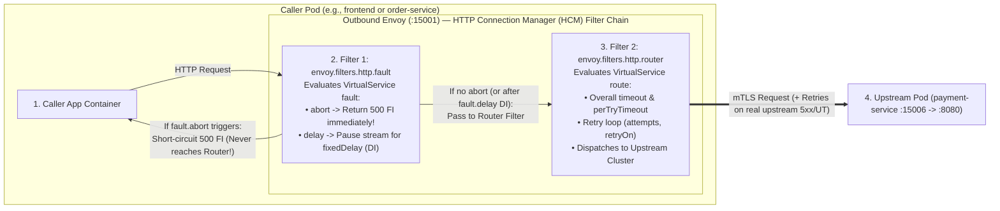
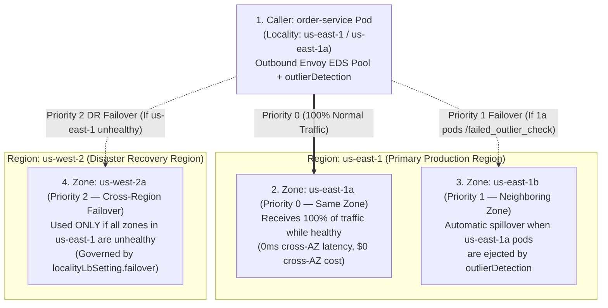

# Lesson 05.3: Chaos Engineering with Fault Injection (`DI` / `FI`) & Multi-Zone Locality Failover

> **Navigation**: [Fellowship Portal](../../README.md) > [Week 06: Resilience Engineering & Chaos Testing](../../fellowship/week-06-resilience-and-chaos-engineering/WEEK.md) > [Module 05 Hub](../README.md) > **Lesson 05.3**  
> **Estimated Completion Time**: 25 minutes  
> **Prerequisites**: [Lesson 05.1 (Timeouts & Retries)](./01-timeouts-retries-and-retry-storms.md) & [Lesson 05.2 (Circuit Breaking & Outlier Detection)](./02-circuit-breaking-and-outlier-detection.md)  
> **Authoritative Baseline**: Istio `1.32.0` | Envoy `v1.40` | Kubernetes `1.36+` | Gateway API `v1.6.1`

### Learning Objectives
By the end of this lesson, you will be able to:
1. Inject controlled L7 chaos faults (`fault.delay` logged as **`DI`** and `fault.abort` logged as **`FI`**) via `VirtualService`, and explain why `envoy.filters.http.fault` executes *before* `envoy.filters.http.router`.
2. Architect header-scoped chaos experiments (`x-Chaos-Mode: abort`) so synthetic chaos drills never impact real production customer traffic.
3. Configure Multi-Zone **Locality-Aware Load Balancing** (`localityLbSetting.failover` vs. `distribute`) and explain why `outlierDetection` is mandatory for locality failover to activate.

---

## 1. NovaPay Engineering Context & Alex Morgan's Briefing

### What Is Happening at NovaPay?
You have configured timeout budgets, bounded retries, connection pools, and outlier detection across `orderflow` (Ticket `NP-106`). But as Sarah Chen says at every SRE review: *"Untested resilience is just wishful YAML."* Before NovaPay signs off on Black Friday readiness, we need two things:
1. A safe, surgical way to inject **synthetic latency (`delay`) and HTTP crashes (`abort`)** into `payment-service` to verify our timeouts and alerts without modifying application code or taking down real users.
2. **Multi-Zone Locality-Aware Failover** across availability zones (`us-east-1a`, `us-east-1b`) and our disaster-recovery region (`us-west-2a`) so `order-service` keeps traffic local ($0\text{ms}$ cross-AZ penalty, $\$0$ cross-AZ egress cost) when healthy, and fails over automatically the instant local pods degrade.

### Alex & Sarah's Briefing & Intuition Analogy
> **Sarah Chen (SRE Lead)**: *"Think of Istio's `VirtualService` `fault` block as a **crash-test simulator built straight into the highway**. Instead of pulling the power cord on a production database or recompiling `payment-service` with a `sleep(3000)` call, we tell Envoy's HTTP filter chain (`envoy.filters.http.fault`) to inject a `3s` delay on 50% of requests—or better yet, **only** on requests carrying our synthetic test header `x-Chaos-Mode: abort`!*
>
> *Pay attention to one critical Envoy filter-ordering detail that catches everyone in Lab 05: inside the caller's outbound proxy, **`envoy.filters.http.fault` runs BEFORE `envoy.filters.http.router`**. Why does that matter? Because `router` is the filter that executes `retries`! If you configure `fault.abort` (100% HTTP `500`) and `retries` in the **exact same `VirtualService` route**, the caller's own outbound proxy aborts the request in the `fault` filter before it ever reaches the `router` filter—so 0 retries occur!"*
>
> **Alex Morgan (Senior Platform Engineer)**: *"And when we look at **Locality-Aware Load Balancing**, remember the golden rule: **Locality failover will NOT work unless `outlierDetection` is configured on the `DestinationRule`!** Without `outlierDetection`, Envoy has no health signal telling it that the pods in `us-east-1a` are failing and that it should spill traffic over to `us-east-1b`."*

---

## 2. Progressive Disclosure Technical Explanation

### 2.1 Core Concept: Declarative L7 Chaos Engineering (`VirtualService` `fault`)

Istio supports two types of L7 HTTP fault injection under `VirtualService.spec.http[].fault`:
1. **`fault.delay` (`fixedDelay` + `percentage`)**:
   Envoy holds the HTTP request stream inside an in-memory timer for `fixedDelay` (e.g., `3s`) *before* forwarding it to the upstream pod, and records the response flag **`DI`** (*DelayInjected*) in Envoy access logs. Used to test downstream `timeout`, `perTryTimeout`, and thread/connection pool saturation.
2. **`fault.abort` (`httpStatus` / `grpcStatus` + `percentage`)**:
   Envoy immediately short-circuits the request inside the proxy and returns the synthetic `httpStatus` (e.g., `500` or `503`) to the caller with response flag **`FI`** (*FaultInjected*). **The upstream pod never receives the aborted request.**

```yaml
apiVersion: networking.istio.io/v1
kind: VirtualService
metadata:
  name: payment-service-fault
  namespace: orderflow
spec:
  hosts:
    - payment-service.orderflow.svc.cluster.local
  http:
    # Rule 1: Surgical Header-Scoped Abort (Safe for Production Chaos Drills!)
    - match:
        - headers:
            x-Chaos-Mode:
              exact: abort
      fault:
        abort:
          percentage:
            value: 100.0
          httpStatus: 500
      route:
        - destination:
            host: payment-service.orderflow.svc.cluster.local
    # Rule 2: 50% Latency Injection (3s fixedDelay)
    - fault:
        delay:
          percentage:
            value: 50.0
          fixedDelay: 3s
      route:
        - destination:
            host: payment-service.orderflow.svc.cluster.local
```

---

### 2.2 Technical Deep Dive: Envoy HCM Filter Ordering (`fault` vs. `router`)

Why does the position of `envoy.filters.http.fault` inside Envoy `v1.40`'s HTTP Connection Manager (HCM) filter chain matter when testing retries?



#### 6-Part Mechanism Walkthrough: Envoy `fault` Filter vs. `router` Filter Execution
1. **What initiates the operation?**
   A caller container (`frontend`, `order-service`, or `client-toolbox`) sends an HTTP request to `http://payment-service:8080/`.
2. **Which component receives it?**
   The caller pod's outbound Envoy sidecar (`15001`) matches the request to the `payment-service:8080` virtual host and enters the HTTP Connection Manager (HCM) L7 filter pipeline.
3. **What information is exchanged?**
   - The request hits **`envoy.filters.http.fault` first**.
   - If `fault.abort` matches (e.g., `x-Chaos-Mode: abort`), `envoy.filters.http.fault` synthesizes an `HTTP 500` response immediately, stamps the access log with **`FI`** (*FaultInjected*), and returns the response to the caller container. **The request never reaches `envoy.filters.http.router`!**
   - If `fault.delay` matches (`50%`, `fixedDelay: 3s`), `envoy.filters.http.fault` pauses the stream for `3.0s`, stamps **`DI`** (*DelayInjected*), and then passes the request downstream to `envoy.filters.http.router`.
4. **What changes in the system?**
   Once the request reaches `envoy.filters.http.router`, Envoy selects an endpoint from the upstream cluster (`outbound|8080||payment-service...`) and enforces route `timeout` and `retryPolicy` against the upstream call.
5. **How can you observe/verify it on your cluster?**
   - Check the HTTP filter order on the outbound listener: `istioctl proxy-config listener <caller-pod>.orderflow --port 8080 -o json` shows `envoy.filters.http.fault` positioned ahead of `envoy.filters.http.router`.
   - Inspect access logs on the caller sidecar for `DI` (*DelayInjected*) and `FI` (*FaultInjected*).
6. **What happens if a component fails (The Lab Testing Nuance)?**
   - Because `fault.abort` in a `VirtualService` executes in the **direct caller's outbound `fault` filter** *before* the `router` filter, a caller **cannot** test its own `retries` against a `fault.abort` configured on that same hop!
   - **How to test retries properly**: Either inject `fault` one hop further upstream (e.g., test `frontend` $\rightarrow$ `order-service` timeouts/retries by injecting a `fault` on `order-service` $\rightarrow$ `payment-service`), **or** configure the upstream pod itself (`payment-service-v2` via `ERROR_RATE=1.0` / `TIMING_50_PERCENTILE=3000ms`) to return real `500` errors or delays so the caller's `router` filter executes its full retry loop!

---

### 2.3 Technical Deep Dive: Multi-Zone Locality-Aware Load Balancing & Failover

In multi-zone (`us-east-1a`, `us-east-1b`, `us-east-1c`) and multi-region Kubernetes clusters, cross-zone network hops add **1–3ms of tail latency** and incur **\$0.01–\$0.02/GB cloud cross-AZ data transfer fees** in each direction.

Istio automatically reads standard Kubernetes node topology labels (`topology.kubernetes.io/region`, `topology.kubernetes.io/zone`, and `topology.istio.io/subzone`) and groups EDS endpoints into **Locality Priority Levels**:



#### 6-Part Mechanism Walkthrough: Locality-Prioritized Load Balancing & Failover
1. **What initiates the operation?**
   `istiod` reads the `topology.kubernetes.io/region` and `topology.kubernetes.io/zone` labels from the Kubernetes `Node` objects hosting `order-service` and `payment-service` pods.
2. **Which component receives it?**
   When `istiod` pushes EDS (`ClusterLoadAssignment`) updates to `order-service`'s sidecar in `us-east-1a`, it assigns **Priority `0`** to `payment-service` endpoints in `us-east-1/us-east-1a`, **Priority `1`** to endpoints in `us-east-1/us-east-1b`, and **Priority `2`** to endpoints in `us-west-2/us-west-2a` (when `localityLbSetting.failover` is configured).
3. **What information is exchanged?**
   On every outbound call from `order-service` (`us-east-1a`), Envoy checks the health of Priority `0` (`us-east-1a`) endpoints using its local **`outlierDetection`** state.
4. **What changes in the system?**
   - **Normal State**: As long as Priority `0` (`us-east-1a`) endpoints are healthy, Envoy routes **100%** of traffic within `us-east-1a`.
   - **Zone Brownout / Ejection**: The moment `payment-service` pods in `us-east-1a` throw consecutive `5xx` errors and are marked `/failed_outlier_check` by `outlierDetection`, Envoy automatically spills traffic over to Priority `1` (`us-east-1b`)—and if `us-east-1b` also fails, to Priority `2` (`us-west-2a`).
   - **Explicit Weighted Distribution (`distribute`)**: Alternatively, if an operator configures `localityLbSetting.distribute` (e.g., `80%` `us-east-1a`, `20%` `us-east-1b` to keep secondary zone caches warm), Envoy routes deterministically according to those weights.
5. **How can you observe/verify it on your cluster?**
   Run `istioctl proxy-config endpoint <order-pod>.orderflow --cluster "outbound|8080||payment-service.orderflow.svc.cluster.local" -o json` to inspect the `locality` (`region`, `zone`) and `priority` (`0`, `1`, `2`) assigned to every upstream Pod IP.
6. **What happens if a component fails (Missing `outlierDetection` Trap)?**
   **If you configure `localityLbSetting` on a `DestinationRule` (or in `meshConfig`) WITHOUT configuring `outlierDetection` on that `DestinationRule`, Istio's locality-aware load balancing silently remains inactive** and Envoy falls back to flat global round-robin across all zones! `outlierDetection` is the mandatory health signal that drives Envoy's priority spillover engine.

---

## 3. Practical Observation & Investigation

Run these commands during Part 1 of [Lab 05](../LAB.md) to verify fault injection filters and endpoint locality metadata:

```bash
TOOLBOX_POD=$(kubectl get pod -n orderflow -l app=client-toolbox -o jsonpath='{.items[0].metadata.name}')

# 1. Inspect the HTTP fault filter configuration on client-toolbox's outbound listener
istioctl proxy-config listener "$TOOLBOX_POD.orderflow" --port 8080 -o json | grep -A 20 "envoy.filters.http.fault"

# 2. Inspect EDS endpoint locality and priority assignments
istioctl proxy-config endpoint "$TOOLBOX_POD.orderflow" \
  --cluster "outbound|8080||payment-service.orderflow.svc.cluster.local"
```

---

## 4. Knowledge Check (Engineering Judgment)

### Question 1: Why Didn't My Retries Trigger When `fault.abort` Returned `500`?
An engineer creates a single `VirtualService` for `payment-service` containing both `fault.abort: { percentage: { value: 100 }, httpStatus: 500 }` and `retries: { attempts: 3, retryOn: 5xx }`. When `order-service` calls `payment-service`, it immediately receives `HTTP 500`, and `order-service`'s Envoy stats show `upstream_rq_retry: 0`. Explain the exact Envoy internal mechanism that caused `0` retries.

<details>
<summary>Check Answer & Engineering Explanation</summary>

**Answer**:
When `order-service` calls `payment-service`, `order-service`'s own outbound Envoy proxy (`:15001`) evaluates the `payment-service` `VirtualService`. Inside Envoy's HTTP Connection Manager (HCM) filter chain, **`envoy.filters.http.fault` executes BEFORE `envoy.filters.http.router`**.

When `fault.abort` triggers inside `order-service`'s `envoy.filters.http.fault` filter, Envoy immediately aborts the stream and returns `500` (`FI`) to `order-service`'s application container. Because the request was terminated before ever reaching `envoy.filters.http.router` (where the retry policy and upstream cluster dispatch live), zero retries are attempted.
</details>

### Question 2: Cross-AZ Cloud Bill Still High After Enabling `localityLbSetting`
NovaPay's FinOps team notices that `order-service` pods in `us-east-1a` are still sending 66% of their traffic across availability zones to `payment-service` pods in `us-east-1b` and `us-east-1c`, even though all nodes have valid `topology.kubernetes.io/zone` labels and `localityLbSetting.enabled: true` is set in `DestinationRule`. What single block is missing from the `DestinationRule`?

<details>
<summary>Check Answer & Engineering Explanation</summary>

**Answer**:
The `DestinationRule` is missing **`trafficPolicy.outlierDetection`**!
In Istio and Envoy, locality-prioritized load balancing requires `outlierDetection` to be configured on the target cluster so Envoy can calculate the health percentage of each locality priority level (`Priority 0`, `Priority 1`) and know when to keep traffic local vs. spill over to neighboring zones. Without `outlierDetection`, Envoy ignores locality priorities and distributes requests evenly across all pods in all zones.
</details>

---

## 5. Key Takeaways, Definition of Done & Next Steps

### Key Takeaways
- **Chaos Engineering via `envoy.filters.http.fault`**: Injects L7 delays (`DI`) and HTTP/gRPC aborts (`FI`) inside the HTTP filter chain *before* the `router` filter. Scope production chaos experiments to synthetic test headers (e.g., `x-Chaos-Mode: abort`).
- **Locality Load Balancing Requires `outlierDetection`**: Always pair `localityLbSetting` (`failover` or `distribute`) with `outlierDetection` on the `DestinationRule` to keep healthy traffic intra-zone ($0\text{ms}$ penalty, $\$0$ cross-AZ cost) while failing over automatically during zone brownouts.
- **Master Envoy's Resilience Response Flags**: `UT` (Timeout), `UO` (Circuit Breaker Overflow), `UF` (Connect Failure), `UH` (No Healthy Upstream), `URX` (Retry Limit Exceeded), `DI` (Delay Injected), `FI` (Fault Injected).

### Definition of Done
- [ ] You have completed all three lessons in Module 05 (`05.1`, `05.2`, and `05.3`).
- [ ] You are ready to execute **[Module 05 Guided Lab (`../LAB.md`)](../LAB.md)** and complete **[Week 06 Ticket `NP-106` & Incident `INC-06`](../../fellowship/week-06-resilience-and-chaos-engineering/WEEK.md)**.

### Authoritative References
- [Istio 1.32 Documentation — Fault Injection](https://istio.io/latest/docs/tasks/traffic-management/fault-injection/)
- [Istio 1.32 Documentation — Locality Load Balancing](https://istio.io/latest/docs/tasks/traffic-management/locality-load-balancing/)
- **Next Step**: Proceed to **[Module 05 Guided Lab (`../LAB.md`)](../LAB.md)** or **[Module 06: Progressive Delivery (`../../06-progressive-delivery/README.md`)](../../06-progressive-delivery/README.md)**
