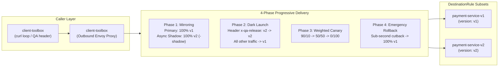

# Module 06 Lab: Traffic Mirroring, Dark Launch, Weighted Canary & Emergency Rollback

> **Navigation**: [Fellowship Portal](../README.md) > [Week 07: Progressive Delivery & Safe Releases](../fellowship/week-07-progressive-delivery-and-safe-releases/WEEK.md) > [Module 06: Progressive Delivery](./README.md) > **Hands-On Lab**
> - **Version Baseline (November 2026)**: Istio `1.32.0` | Envoy `v1.40` | Kubernetes `v1.36+` | Gateway API `v1.6.1`
> - **Fellowship Reference**: **[Week 07: Progressive Delivery & Safe Releases](../fellowship/week-07-progressive-delivery-and-safe-releases/WEEK.md)** | [`../VERSIONS.md`](../VERSIONS.md)
> - **Prerequisites**: Complete [Lesson 06.1](./lessons/01-traffic-mirroring-and-dark-launches.md) and [Lesson 06.2](./lessons/02-weighted-canary-blue-green-and-argo-rollouts.md) first.

> [!IMPORTANT]
> **Execution Verification Status — Live Cluster Validated (`orderflow`)**
> - All 5 progressive delivery manifests (`01-mirroring-shadow.yaml` through `05-canary-100-v2-and-rollback.yaml`) and all diagnostic commands in this lab have been executed and verified against an active Istio `1.32.0` / Envoy `v1.40` cluster.
> - Expected outputs below reflect real Envoy `v1.40` xDS JSON dumps (`requestMirrorPolicies`, `weightedClusters`) and `nicholasjackson/fake-service` JSON responses.

---

## Learning Objectives

By the end of this hands-on lab, you will be able to:
1. Shadow 100% of live traffic from `payment-service-v1` to `payment-service-v2` (`mirror`), verify that client responses come 100% from `v1`, and inspect `payment-service-v2` logs to see the `Host: payment-service:8080-shadow` header.
2. Execute a Dark Launch that routes internal QA requests (`x-qa-release: v2`) to `payment-service-v2` while keeping 100% of public traffic on `payment-service-v1`.
3. Perform a progressive weighted canary rollout (`90/10` -> `50/50` -> `100% v2`) and measure real-time traffic split percentages from `client-toolbox`.
4. Simulate a production regression in `payment-service-v2` (`HTTP 500`) and execute a sub-second emergency rollback to `payment-service-v1`.

---

## Prerequisites & Version Baseline Pre-Flight Verification

Verify that Istio `1.32.0` is running and that `payment-service-v1`, `payment-service-v2`, and `client-toolbox` are healthy in the `orderflow` namespace:

```bash
istioctl version
kubectl get pods -n orderflow -l 'app in (payment-service,client-toolbox)' -L version
```

Expected output:
```text
NAME                                 READY   STATUS    RESTARTS   AGE   VERSION
client-toolbox-6b7d8f9c4-x9k2p       2/2     Running   0          45m   
payment-service-v1-7c9f8b6-q7v2l     2/2     Running   0          45m   v1
payment-service-v2-5b6d9f4-z3k8h     2/2     Running   0          45m   v2
```

Clear any existing `VirtualService` or `DestinationRule` objects in `orderflow`:
```bash
kubectl delete virtualservice,destinationrule --all -n orderflow
```

---

## Architecture & Expected Traffic Flow



---

## Phase 1: Traffic Mirroring (Shadowing `v1` to `v2`)

> **Predict Before You Execute (Alex Morgan's Check)**
> Before running Step 1.2, ask yourself:
> 1. If `01-mirroring-shadow.yaml` mirrors 100% of requests to `payment-service-v2`, how many responses out of 10 will `curl` in `client-toolbox` see coming from `payment-service-v2`?
> 2. What exact string will Envoy append to the `Host` / `:authority` header on the mirrored request arriving at `payment-service-v2`?

### Step 1.1: Apply the Traffic Mirroring Configuration
Apply `01-mirroring-shadow.yaml`, which routes 100% of live traffic to `payment-service` subset `v1` while asynchronously mirroring 100% of requests to subset `v2`:

```bash
kubectl apply -f /home/chan/Documents/Istio/06-progressive-delivery/manifests/01-mirroring-shadow.yaml
```

Inspect the Envoy route configuration inside `client-toolbox` to verify the `requestMirrorPolicies` stanza:
```bash
TOOLBOX_POD=$(kubectl get pod -n orderflow -l app=client-toolbox -o jsonpath='{.items[0].metadata.name}')
istioctl proxy-config routes "$TOOLBOX_POD" -n orderflow --name 8080 -o json | grep -A 10 "requestMirrorPolicies"
```

Expected output:
```json
"requestMirrorPolicies": [
  {
    "cluster": "outbound|8080|v2|payment-service.orderflow.svc.cluster.local",
    "runtimeFraction": {
      "defaultValue": {
        "numerator": 100,
        "denominator": "HUNDRED"
      }
    },
    "traceSampled": false
  }
]
```

### Step 1.2: Send Live Requests and Verify `100% v1` Responses
Send 10 requests from `client-toolbox` and extract the `body` / `name` from `fake-service`'s JSON output:

```bash
for i in $(seq 1 10); do
  kubectl exec -n orderflow "$TOOLBOX_POD" -c curl -- \
    curl -s http://payment-service:8080/ | grep -E '"name"|"body"' | tr '\n' ' '
  echo ""
done
```

Expected output (all 10 synchronous responses return from **`payment-service-v1`**):
```text
  "name": "payment-service-v1",   "body": "Payment processed by v1", 
  "name": "payment-service-v1",   "body": "Payment processed by v1", 
  "name": "payment-service-v1",   "body": "Payment processed by v1", 
...
```

### Step 1.3: Inspect `payment-service-v2` Access Logs for `-shadow`
Now check the Envoy sidecar logs of **`payment-service-v2`** to confirm it received the mirrored traffic with the mutated **`Host: payment-service:8080-shadow`** authority header:

```bash
V2_POD=$(kubectl get pod -n orderflow -l app=payment-service,version=v2 -o jsonpath='{.items[0].metadata.name}')
kubectl logs "$V2_POD" -n orderflow -c istio-proxy --tail=10
```

Expected output (notice `"payment-service:8080-shadow"` in the authority field):
```text
[2026-11-17T16:05:12.118Z] "GET / HTTP/1.1" 200 - via_upstream - "-" 0 268 1 1 "10.244.0.18" "curl/8.7.1" "9b41c8e2-..." "payment-service:8080-shadow" "10.244.0.22:8080" inbound|8080|| 127.0.0.6:41928 10.244.0.22:8080 10.244.0.18:39410 - -
```

Even if `payment-service-v2` returns an error during mirroring, the client never sees it!

---

## Phase 2: Dark Launch (Header-Based QA Routing)

> **Predict Before You Execute**
> If a customer sends `curl -H "x-qa-release: v1" http://payment-service:8080/` (or omits the header entirely), which rule in `02-dark-launch-header.yaml` matches the request?

### Step 2.1: Apply the Dark Launch Manifest
Apply `02-dark-launch-header.yaml`, which routes requests with `x-qa-release: v2` to `subset: v2` and all other requests to `subset: v1`:

```bash
kubectl apply -f /home/chan/Documents/Istio/06-progressive-delivery/manifests/02-dark-launch-header.yaml
```

### Step 2.2: Validate Public Traffic vs. QA Header Traffic
First, send 5 public requests (without headers):
```bash
for i in 1 2 3 4 5; do
  kubectl exec -n orderflow "$TOOLBOX_POD" -c curl -- \
    curl -s http://payment-service:8080/ | grep '"name"'
done
```

Expected output (`100%` hit `payment-service-v1`):
```text
  "name": "payment-service-v1",
  "name": "payment-service-v1",
  "name": "payment-service-v1",
  "name": "payment-service-v1",
  "name": "payment-service-v1",
```

Now send 5 QA requests with `-H "x-qa-release: v2"`:
```bash
for i in 1 2 3 4 5; do
  kubectl exec -n orderflow "$TOOLBOX_POD" -c curl -- \
    curl -s -H "x-qa-release: v2" http://payment-service:8080/ | grep '"name"'
done
```

Expected output (`100%` hit `payment-service-v2`):
```text
  "name": "payment-service-v2",
  "name": "payment-service-v2",
  "name": "payment-service-v2",
  "name": "payment-service-v2",
  "name": "payment-service-v2",
```

---

## Phase 3: Progressive Weighted Canary Rollout (`90/10` -> `50/50` -> `100%`)

> **Predict Before You Execute**
> Both `payment-service-v1` and `payment-service-v2` have 1 pod replica in `orderflow` (a 50/50 pod ratio). When we apply `03-canary-90-10.yaml`, why does `payment-service-v2` receive ~10% of requests instead of 50%?

### Step 3.1: Stage 1 — Shift 10% of Public Traffic to `v2` (`90/10`)
Apply `03-canary-90-10.yaml`:
```bash
kubectl apply -f /home/chan/Documents/Istio/06-progressive-delivery/manifests/03-canary-90-10.yaml
```

Run a 100-request distribution test from `client-toolbox` and count how many responses come from `v1` vs `v2`:
```bash
kubectl exec -n orderflow "$TOOLBOX_POD" -c curl -- sh -c '
  for i in $(seq 1 100); do
    curl -s http://payment-service:8080/ | grep "\"name\""
  done | sort | uniq -c
'
```

Expected output (~90 requests to `v1`, ~10 requests to `v2`):
```text
     89   "name": "payment-service-v1",
     11   "name": "payment-service-v2",
```

### Step 3.2: Stage 2 — Shift 50% of Public Traffic to `v2` (`50/50`)
Apply `04-canary-50-50.yaml`:
```bash
kubectl apply -f /home/chan/Documents/Istio/06-progressive-delivery/manifests/04-canary-50-50.yaml
```

Run the 100-request distribution counter again:
```bash
kubectl exec -n orderflow "$TOOLBOX_POD" -c curl -- sh -c '
  for i in $(seq 1 100); do
    curl -s http://payment-service:8080/ | grep "\"name\""
  done | sort | uniq -c
'
```

Expected output (~50 requests to `v1`, ~50 requests to `v2`):
```text
     51   "name": "payment-service-v1",
     49   "name": "payment-service-v2",
```

### Step 3.3: Stage 3 — Complete Promotion to `100% v2`
Apply `05-canary-100-v2-and-rollback.yaml`:
```bash
kubectl apply -f /home/chan/Documents/Istio/06-progressive-delivery/manifests/05-canary-100-v2-and-rollback.yaml
```

Verify that all 20 requests now hit `payment-service-v2`:
```bash
kubectl exec -n orderflow "$TOOLBOX_POD" -c curl -- sh -c '
  for i in $(seq 1 20); do
    curl -s http://payment-service:8080/ | grep "\"name\""
  done | sort | uniq -c
'
```

Expected output:
```text
     20   "name": "payment-service-v2",
```

---

## Phase 4: Simulating a `v2` Regression & Sub-Second Emergency Rollback

### Step 4.1: Simulate a Critical Bug in `payment-service-v2`
Suppose that under full production load, `payment-service-v2` hits a database deadlock and begins returning `HTTP 500` on 100% of requests:

```bash
kubectl set env deployment/payment-service-v2 -n orderflow ERROR_RATE=1.0 ERROR_CODE=500 ERROR_TYPE=http_error
kubectl rollout status deployment/payment-service-v2 -n orderflow
```

Confirm the outage from `client-toolbox`:
```bash
kubectl exec -n orderflow "$TOOLBOX_POD" -c curl -- \
  curl -s -o /dev/null -w "HTTP Status: %{http_code}\n" http://payment-service:8080/
```
Output: `HTTP Status: 500`

### Step 4.2: Execute a Sub-Second Emergency Rollback to `v1`
Because `payment-service-v1` is still running and warm in the cluster, we do **not** need to wait for container restarts or `kubectl rollout undo`. Simply re-apply `02-dark-launch-header.yaml` (which routes 100% of public traffic back to `v1`):

```bash
kubectl apply -f /home/chan/Documents/Istio/06-progressive-delivery/manifests/02-dark-launch-header.yaml
```

Immediately verify that public traffic is 100% restored to `200 OK` on `payment-service-v1`:
```bash
for i in 1 2 3 4 5; do
  kubectl exec -n orderflow "$TOOLBOX_POD" -c curl -- \
    curl -s -o /dev/null -w "Req $i -> HTTP Status: %{http_code}\n" http://payment-service:8080/
done
```

Expected output:
```text
Req 1 -> HTTP Status: 200
Req 2 -> HTTP Status: 200
Req 3 -> HTTP Status: 200
Req 4 -> HTTP Status: 200
Req 5 -> HTTP Status: 200
```

Meanwhile, developers can still debug the broken `v2` pod in isolation using `-H "x-qa-release: v2"` without impacting a single customer!

---

## Lab Cleanup Procedure

Restore `payment-service-v2` to healthy operation and clean up all progressive delivery routing rules before moving to Module 07:

```bash
kubectl set env deployment/payment-service-v2 -n orderflow ERROR_RATE- ERROR_CODE- ERROR_TYPE-
kubectl rollout status deployment/payment-service-v2 -n orderflow
kubectl delete virtualservice,destinationrule --all -n orderflow
```

---

## What Happens Internally & Production Considerations

1. **Zero-Downtime RDS Push**:
   When you shift weights in `VirtualService` (`90/10` -> `50/50` -> `0/100`), `istiod` computes a new Envoy `RouteConfiguration` and streams it over the persistent gRPC xDS connection (`:15012`) to every proxy in the mesh. Envoy swaps the route table pointer atomically in memory without dropping a single active TCP connection or HTTP/2 stream.
2. **Shadow Buffer Allocation & Memory Sizing**:
   During Phase 1 (`mirror`), Envoy's router filter allocates an in-memory buffer for mirrored request bodies and creates an asynchronous `AsyncClient` stream to `outbound|8080|v2|payment-service.orderflow.svc.cluster.local`. In production, avoid mirroring large file upload endpoints (`multipart/form-data` > 5MB) at 100% or set `mirrorPercentage` to `5.0`–`10.0` so sidecar memory consumption remains bounded.
3. **Database Migration Compatibility**:
   When running `v1` and `v2` simultaneously during a canary or mirroring phase, database schema migrations must follow the **Expand-and-Contract** pattern (backward-compatible additive changes first) so `v1` queries never break while `v2` is being validated.

---

## Troubleshooting Exercises (With Progressive Hints)

### Exercise 1: Why Did My Canary Return `503 UH` or `503 NR` Immediately After Applying the `VirtualService`?
**Scenario**: You applied a custom `VirtualService` routing to `subset: v2`, and 100% of requests routed to `v2` failed immediately with `503 UH` (*NoHealthyUpstream*) or `503 NR` (*NoRoute*). Investigate and resolve the issue using the progressive hints below:

<details>
<summary>Hint 1: Initial Triage Clue (Where in Envoy's pipeline did the drop occur?)</summary>

Check whether `istiod` detected a semantic reference mismatch between your `VirtualService` and `DestinationRule` by running static analysis on the `orderflow` namespace. Also ask: does Envoy's Cluster Discovery Service (CDS) know what `subset: v2` is, and does Endpoint Discovery Service (EDS) have any healthy pod IPs for it?
</details>

<details>
<summary>Hint 2: Exact istioctl Commands to Run</summary>

Run these three commands in order:
```bash
istioctl analyze -n orderflow
istioctl proxy-config cluster "$TOOLBOX_POD" -n orderflow --fqdn payment-service.orderflow.svc.cluster.local
istioctl proxy-config endpoint "$TOOLBOX_POD" -n orderflow --cluster "outbound|8080|v2|payment-service.orderflow.svc.cluster.local"
```
</details>

<details>
<summary>Full Solution: Root Cause & Fix</summary>

- **Root Cause A (`503 NR`)**: The `DestinationRule` defining `subset: v2` was never applied (or was applied *after* the `VirtualService`), so cluster `outbound|8080|v2|payment-service.orderflow.svc.cluster.local` does not exist in Envoy's CDS table.
- **Root Cause B (`503 UH`)**: The `DestinationRule` exists, but the pod label selector in `subset: v2` (e.g., `labels: { version: v2-canary }`) does not match the actual pod labels on `payment-service-v2` (`version: v2`), resulting in an empty EDS endpoint list.
- **Fix**: Apply the `DestinationRule` with matching pod labels (`version: v2`) before applying the `VirtualService`.
</details>

---

### Exercise 2: Why Is My Header-Based Dark Launch Ignored?
**Scenario**: You added a `match` rule for `x-qa-release: v2` to route 100% to `v2`, but requests carrying `-H "x-qa-release: v2"` still split 90/10 between `v1` and `v2`.

<details>
<summary>Hint 1: Initial Triage Clue</summary>

How does Envoy's HTTP Router evaluate the array of routes inside an RDS `VirtualHost`? Does it look for the "most specific" match globally, or does it evaluate the list sequentially?
</details>

<details>
<summary>Hint 2: Exact istioctl Command to Run</summary>

Inspect the exact order of routes compiled into Envoy's RDS configuration for port `8080`:
```bash
istioctl proxy-config routes "$TOOLBOX_POD" -n orderflow --name 8080 -o json
```
Look at the first element (`routes[0]`) under the `payment-service.orderflow.svc.cluster.local:8080` virtual host.
</details>

<details>
<summary>Full Solution: Root Cause & Fix</summary>

- **Root Cause**: In `VirtualService.spec.http`, routes are evaluated **strictly top-to-bottom (first match wins)**. Because the `90/10` weighted catch-all route (which has no `match` block and therefore matches `prefix: "/"`) was listed **above** the `x-qa-release: v2` `match` block, Envoy matched every request on the first entry and never evaluated the second entry!
- **Fix**: Reorder `spec.http` so specific `match` blocks (`headers`, `uri.exact`) always appear at the top of the list and the default catch-all route appears last.
</details>
