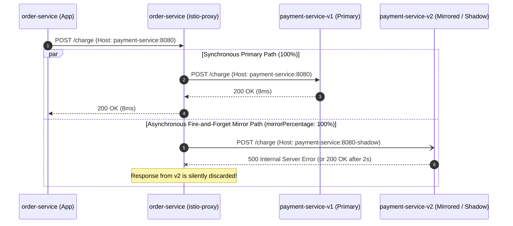
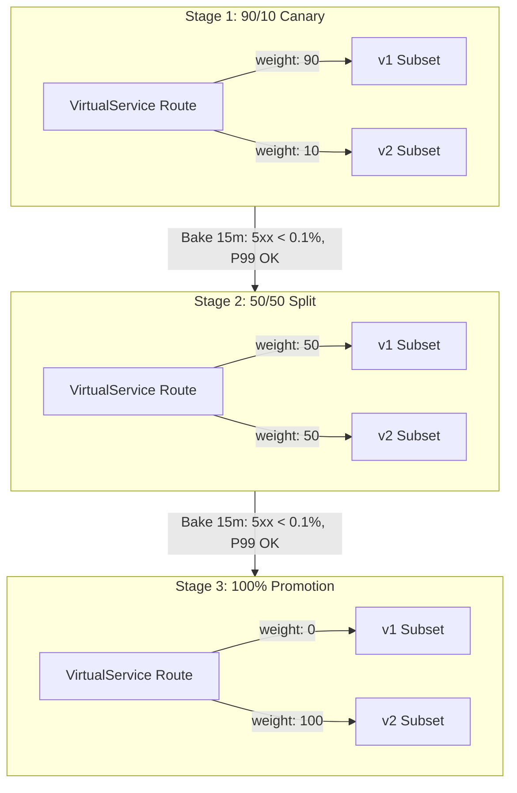
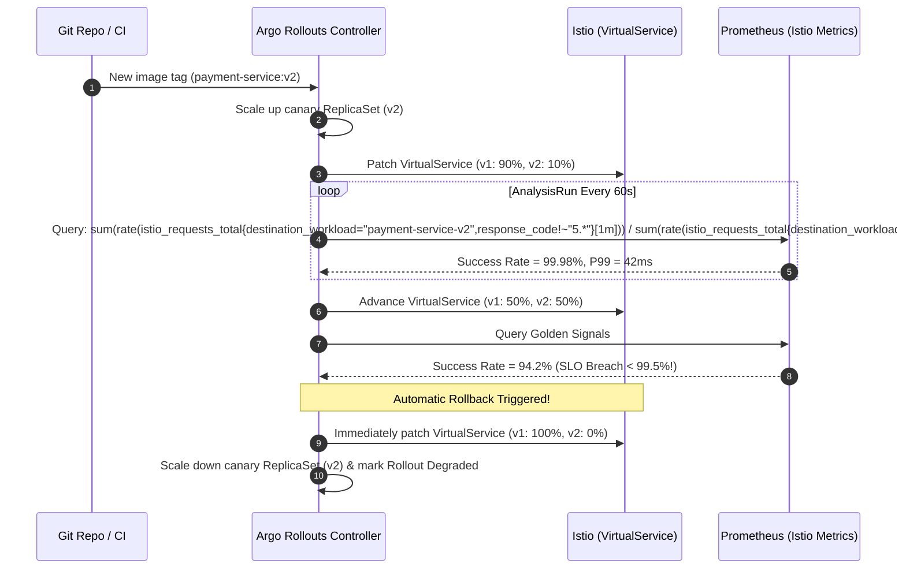

# Module 06: Progressive Delivery — Traffic Mirroring, Dark Launches, Canary & Blue-Green

> **Version & Fellowship Context**
> - **Version Baseline (November 2026)**: Istio `1.32.0` | Envoy `v1.40` | Kubernetes `v1.36+` | Gateway API `v1.6.1` — see [`../VERSIONS.md`](../VERSIONS.md) and [`../COMPATIBILITY.md`](../COMPATIBILITY.md).
> - **Fellowship Cohort 01 Mapping**: Complete this module alongside **[Week 07: Progressive Delivery & Traffic Shadowing](../fellowship/week-07-progressive-delivery-and-shadowing/WEEK.md)**.

Deploying a new version of a critical service like `payment-service` or `order-service` is one of the highest-risk events in production operations. Most outages are not caused by infrastructure hardware failures—they are triggered by software deployments introducing regressions, schema incompatibilities, or latency spikes under real production load.

**Progressive Delivery** decouples **code deployment** (starting containers in Kubernetes) from **traffic release** (exposing live users to those containers), allowing teams to validate new versions in production with blast-radius control and instant, zero-downtime rollback.

---

## 1. Why Standard Kubernetes `RollingUpdate` Is Insufficient for High-Stakes Production

By default, a Kubernetes `Deployment` uses `strategy.type: RollingUpdate` with `maxSurge: 25%` and `maxUnavailable: 25%`. While adequate for simple internal tools, standard Kubernetes rolling updates have four critical architectural flaws for mission-critical services:

| Limitation | Kubernetes `RollingUpdate` | Istio Progressive Delivery (`VirtualService` + `DestinationRule`) |
| :--- | :--- | :--- |
| **1. Traffic Ratio is Coupled to Pod Count** | `kube-proxy` distributes traffic equally across all Ready `EndpointSlice` IPs. To send **1%** of traffic to `v2`, you must run **99 pods of `v1`** and **1 pod of `v2`**! | **100% Decoupled**: You can run **1 pod of `v1`** and **1 pod of `v2`** while routing **99%** of requests to `v1` and **1%** to `v2` at Layer 7. |
| **2. Coarse L4 Health Gate** | Advances to 100% rollout as soon as `readinessProbe` returns HTTP `200` on `/healthz`, even if `/pay` is throwing `500` errors on 15% of real user requests or P99 latency tripled. | **L7 Golden Signal Gating**: Can hold at 5% or 10% weight and query Prometheus for `istio_requests_total` success rate and P99 latency before advancing. |
| **3. No User/Header Segmentation** | Cannot route internal QA engineers or beta customers to `v2` while keeping regular customers on `v1`. | **Fine-Grained L7 Matching**: Routes based on HTTP headers (`x-qa-release: v2`), cookies, JWT claims, or URI prefixes. |
| **4. Slow Rollback** | `kubectl rollout undo` must terminate `v2` pods and spin up/warm up `v1` pods, taking 30–180 seconds during an active outage. | **Sub-Second Atomic Rollback**: Updating `VirtualService` weight from `v2` to `v1` pushes an RDS update to Envoy proxies in **<200 milliseconds**. |

---

## 2. Traffic Mirroring / Shadowing (`VirtualService` `mirror`)

Before sending even 1% of live customer responses from a new version (`payment-service-v2`), how can you know how `v2` behaves with real production payloads and production concurrency?

**Traffic Mirroring** (also called **Shadowing** or **Dark Traffic**) solves this by instructing Envoy to send the primary request to `v1` as usual, while asynchronously cloning the request and sending a copy to `v2` in the background.



### How Traffic Mirroring Works Under the Hood in Envoy
When you configure `mirror` and `mirrorPercentage` on a `VirtualService` route:
1. `istiod` programs Envoy's `RouteAction` with `request_mirror_policies` (`envoy.config.route.v3.RouteAction.RequestMirrorPolicy`).
2. **Fire-and-Forget Asynchronous Duplication**: When a request arrives at the caller's outbound `istio-proxy`, Envoy buffers the request body (up to the stream buffer limit) and dispatches the primary request to `payment-service-v1` and an asynchronous clone to `payment-service-v2`.
3. **The `-shadow` Authority Header Mutation**: Envoy automatically appends **`-shadow`** to the `Host` (HTTP/1.1) or `:authority` (HTTP/2) header of the mirrored request:
   - Primary request header: `Host: payment-service:8080`
   - Mirrored request header: `Host: payment-service:8080-shadow`
   This allows the receiving application (`payment-service-v2`) and log aggregators to immediately distinguish shadowed traffic from real traffic!
4. **Zero Impact on Production Latency or Errors**: Envoy completely ignores the response from the mirrored cluster (`v2`). If `payment-service-v2` takes 5 seconds or crashes with `HTTP 500`, the caller (`order-service`) still receives `payment-service-v1`'s `200 OK` in 8 milliseconds!

> [!CAUTION]
> **Critical Caveat: Stateful Side-Effects & Database Writes**
> Because mirrored requests carry real production payloads (including `POST` bodies), **never mirror write/mutation traffic to a `v2` service that shares the same production database or calls real external payment gateways (`Stripe`, `Adyen`)** unless:
> 1. `v2` writes to an isolated shadow/staging database, OR
> 2. `v2` inspects the `Host: *-shadow` header and executes in dry-run/read-only transaction rollback mode!
> Otherwise, mirroring `payment-service` would charge every customer's credit card twice!

---

## 3. Dark Launches / Header-Based Canary Testing

Once `payment-service-v2` passes shadow traffic validation, the next stage in progressive delivery is a **Dark Launch** (or **Internal Ring / QA Canary**): `v2` is live in production, but **0% of public users** can reach it. Only requests carrying a specific HTTP header (e.g., `x-qa-release: v2`, or a JWT claim identifying an internal employee) are routed to `v2`.

```mermaid
flowchart LR
    Public["Public User<br/>(No special header)"]
    QA["Internal QA Tester<br/>(Header: x-qa-release: v2)"]
    
    subgraph EnvoyRouter["order-service Outbound Envoy"]
        M1{"Match Rule 1:<br/>x-qa-release == v2?"}
    end

    V1["payment-service-v1<br/>(Stable Production)"]
    V2["payment-service-v2<br/>(Dark Launch Canary)"]

    Public --> M1
    QA --> M1
    M1 -->|Yes (Match 1)| V2
    M1 -->|No (Default Fallback)| V1
```

### Route Ordering Rule in `VirtualService`
In Istio, `VirtualService.spec.http` is an **ordered list of match rules evaluated top-to-bottom** (first match wins):
1. **Rule 1 (Top)**: Must contain the `match` condition (`headers.x-qa-release.exact: v2`) routing `100%` to `subset: v2`.
2. **Rule 2 (Bottom / Catch-All)**: Omits the `match` stanza and routes `100%` to `subset: v1`.

If you accidentally place the catch-all route first, Envoy will match every request on Rule 1 and **never evaluate** your header-based canary rule!

> [!IMPORTANT]
> **Header Propagation Requirement for Deep Services**:
> If the user sends `x-qa-release: v2` to the edge (`frontend`), and you want that header to control routing all the way down at `payment-service` (`frontend` $\rightarrow$ `order-service` $\rightarrow$ `payment-service`), intermediate services must forward custom headers—or you can propagate them via W3C `baggage` headers!

---

## 4. Weighted Canary Rollouts (`90/10` $\rightarrow$ `50/50` $\rightarrow$ `0/100`)

After internal QA validates `v2` via Dark Launch, you gradually shift public production traffic using `VirtualService` `route.weight`:



### How Envoy Enforces `weight` + `DestinationRule` Subsets
1. **`DestinationRule` Defines the Named Subsets**:
   `istiod` creates separate Envoy outbound clusters for each subset in `DestinationRule`:
   - `outbound|8080|v1|payment-service.orderflow.svc.cluster.local` (contains only pods matching `version: v1`)
   - `outbound|8080|v2|payment-service.orderflow.svc.cluster.local` (contains only pods matching `version: v2`)
2. **`VirtualService` Distributes Requests Across Subsets**:
   Envoy's `RouteAction` uses a weighted cluster selector (`weighted_clusters`). For every incoming HTTP request (not just per TCP connection!), Envoy draws a pseudo-random number `0–99` and picks `v1` or `v2` according to their exact weights.

> [!WARNING]
> **The "503 NR / UH" Subset Ordering Trap**:
> Always apply or update your **`DestinationRule` subsets BEFORE** applying a `VirtualService` that routes to those subsets (or apply both in the same manifest). If a `VirtualService` routes traffic to `subset: v2` before `istiod` knows that `subset: v2` exists in a `DestinationRule`, Envoy will drop requests with `503 UH` (*NoHealthyUpstream*) or `503 NR` (*NoRoute*)!

---

## 5. Blue-Green Deployments via Subset Pointer Switching

When a release cannot tolerate running two versions simultaneously for public traffic (for example, an API contract change that requires an atomic cutover after cache pre-warming), Istio enables **Blue-Green Deployments**:
1. **Blue (`v1`)** is serving 100% of live traffic (`subset: v1`, `weight: 100`).
2. **Green (`v2`)** is deployed alongside Blue at full replica scale. You can test Green via `mirror` or a Dark Launch header (`x-qa-release: v2`).
3. **Atomic Cutover**: Switch the `VirtualService` default route from `subset: v1` (`100%`) to `subset: v2` (`100%`). Envoy drains in-flight requests on `v1` and shifts all new requests to `v2` across the entire fleet in milliseconds.
4. **Instant Rollback**: Keep the `v1` Deployment running (warm standby) for 30–60 minutes after cutover. If an anomaly occurs, re-apply the `v1` `VirtualService` for an instantaneous rollback without waiting for pod scheduling or JVM/runtime warmup.

---

## 6. Automated Progressive Delivery in Production (Argo Rollouts & Flagger)

In a large production organization with hundreds of microservices, engineers do not manually run `kubectl apply` to shift weights from `10%` $\rightarrow$ `25%` $\rightarrow$ `50%` $\rightarrow$ `100%` while staring at Grafana dashboards.

Instead, production teams pair Istio with a GitOps progressive delivery controller—most commonly **Argo Rollouts** or **Flagger**:



### How Argo Rollouts Integrates with Istio
1. You replace the standard Kubernetes `Deployment` with an `argoproj.io/v1alpha1` **`Rollout`** resource.
2. In `spec.strategy.canary.trafficRouting.istio`, you reference your Istio `VirtualService` and `DestinationRule` subsets.
3. In `spec.strategy.canary.steps`, you define declarative steps (`setWeight: 10`, `pause: {duration: 5m}`, `setWeight: 50`, etc.) coupled with an **`AnalysisTemplate`** that runs PromQL queries against Istio's built-in telemetry (`istio_requests_total` and `istio_request_duration_milliseconds_bucket`).
4. See [`manifests/argo-rollouts-istio-example.yaml`](./manifests/argo-rollouts-istio-example.yaml) for a complete, production-ready specification.
