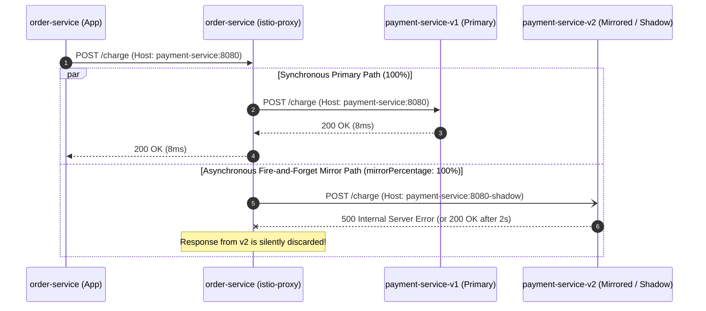
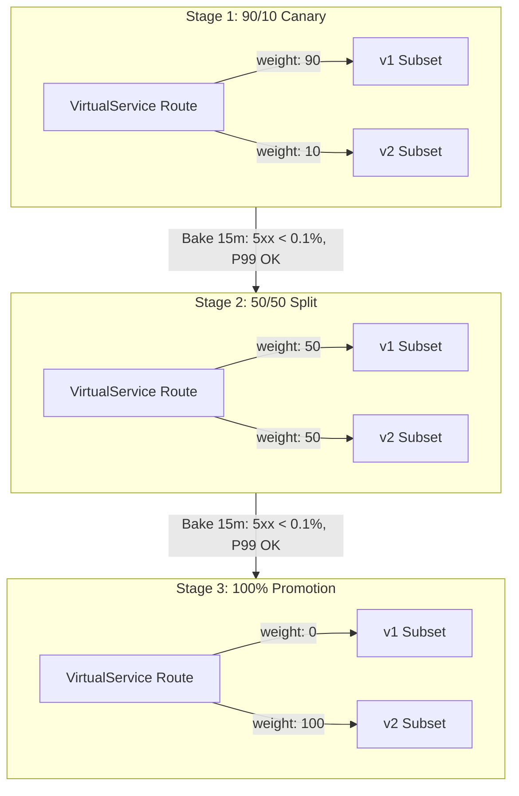
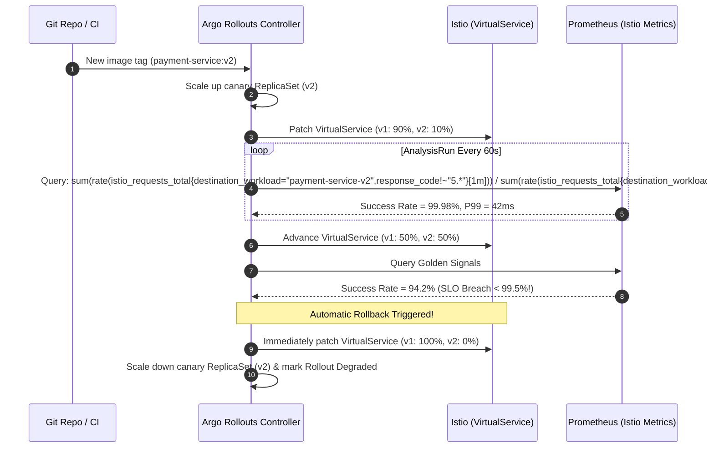

# Module 06: Progressive Delivery — Traffic Mirroring, Dark Launches, Canary & Blue-Green

> **Navigation**: [Fellowship Portal](../README.md) > [Week 07: Progressive Delivery & Safe Releases](../fellowship/week-07-progressive-delivery-and-safe-releases/WEEK.md) > **Module 06: Progressive Delivery**
> - **Version Baseline (November 2026)**: Istio `1.32.0` | Envoy `v1.40` | Kubernetes `v1.36+` | Gateway API `v1.6.1` — see [`../VERSIONS.md`](../VERSIONS.md) and [`../COMPATIBILITY.md`](../COMPATIBILITY.md).
> - **Fellowship Cohort 01 Mapping**: Complete this module alongside **[Week 07: Progressive Delivery & Safe Releases](../fellowship/week-07-progressive-delivery-and-safe-releases/WEEK.md)**.
> - **Estimated Module Completion Time**: 75 minutes (2 Lessons + 1 Hands-On Lab)

---

## NovaPay Engineering Briefing: Safe Releases for High-Stakes Payment Pipelines

> **Alex Morgan (Senior Platform Engineer)**:
> "Deploying a new version of `payment-service` or `order-service` at **NovaPay** is one of the highest-risk moments in production operations. Over 70% of major FinTech incidents are triggered not by hardware failures, but by software releases that pass unit tests and `/healthz` readiness checks yet fail under real production payloads or concurrency.
>
> In Module 06, you will work alongside **Daniel Brooks (Staff Backend Engineer)** and **Sarah Chen (SRE Lead)** to replace coarse Kubernetes `RollingUpdate` deployments with a 4-stage **Progressive Delivery** pipeline for `payment-service-v2`: asynchronous **Traffic Mirroring** (`-shadow`), **Header-Based Dark Launches** (`x-qa-release: v2`), **Weighted Canary Rollouts** (`90/10` -> `50/50` -> `100%`), and automated **Argo Rollouts** gated by Prometheus Golden Signals."

---

## Progressive Lesson Milestones & Learning Path

Start with the two focused lessons in [`./lessons/`](./lessons/) before executing the hands-on verification lab:

| Milestone | Lesson / Lab | Core Engineering Concepts Covered | Est. Time |
| :---: | :--- | :--- | :---: |
| **Lesson 06.1** | **[Why `RollingUpdate` Fails, Traffic Mirroring & Dark Launches](./lessons/01-traffic-mirroring-and-dark-launches.md)** | Flaws of K8s `RollingUpdate` (replica coupling, L4 probes, slow rollback); Envoy `request_mirror_policies` & `-shadow` `:authority` mutation; preventing duplicate DB/Stripe writes; Dark Launches (`x-qa-release: v2`) & top-to-bottom route evaluation precedence. | 25 min |
| **Lesson 06.2** | **[Weighted Canary Rollouts, Blue-Green Cutovers & Automated Argo Rollouts](./lessons/02-weighted-canary-blue-green-and-argo-rollouts.md)** | `DestinationRule` subsets + `VirtualService` `weighted_clusters`; avoiding the `503 NR / UH` subset ordering trap; Blue-Green subset pointer switching & `<200ms` warm-standby rollback; automated GitOps delivery with **Argo Rollouts** (`Rollout` + Prometheus `AnalysisTemplate`). | 25 min |
| **Hands-On Lab** | **[Module 06 Lab: 4-Phase Progressive Delivery & Emergency Rollback](./LAB.md)** | Live verification of `100%` shadow mirroring, `x-qa-release: v2` dark launch routing, `90/10` -> `50/50` -> `100%` weighted canary promotion, simulated `v2` outage (`HTTP 500`), and sub-second rollback in `orderflow`. | 25 min |

---

## 1. Why Standard Kubernetes `RollingUpdate` Is Insufficient for High-Stakes Production

By default, a Kubernetes `Deployment` uses `strategy.type: RollingUpdate` with `maxSurge: 25%` and `maxUnavailable: 25%`. While adequate for simple internal tools, standard Kubernetes rolling updates have four critical architectural flaws for mission-critical services:

| Limitation | Kubernetes `RollingUpdate` | Istio Progressive Delivery (`VirtualService` + `DestinationRule`) |
| :--- | :--- | :--- |
| **1. Traffic Ratio is Coupled to Pod Count** | `kube-proxy` distributes traffic equally across all Ready `EndpointSlice` IPs. To send **1%** of traffic to `v2`, you must run **99 pods of `v1`** and **1 pod of `v2`**! | **100% Decoupled**: You can run **1 pod of `v1`** and **1 pod of `v2`** while routing **99%** of requests to `v1` and **1%** to `v2` at Layer 7. |
| **2. Coarse L4 Health Gate** | Advances to 100% rollout as soon as `readinessProbe` returns HTTP `200` on `/healthz`, even if `/pay` is throwing `500` errors on 15% of real user requests or P99 latency tripled. | **L7 Golden Signal Gating**: Can hold at 5% or 10% weight and query Prometheus for `istio_requests_total` success rate and P99 latency before advancing. |
| **3. No User/Header Segmentation** | Cannot route internal QA engineers or beta customers to `v2` while keeping regular customers on `v1`. | **Fine-Grained L7 Matching**: Routes based on HTTP headers (`x-qa-release: v2`), cookies, JWT claims, or URI prefixes. |
| **4. Slow Rollback** | `kubectl rollout undo` must terminate `v2` pods and spin up/warm up `v1` pods, taking 30–180 seconds during an active outage. | **Sub-Second Atomic Rollback**: Updating `VirtualService` weight from `v2` to `v1` pushes an RDS update to Envoy proxies in **<200 milliseconds**. |

---

## 2. Traffic Mirroring / Shadowing (`VirtualService` `mirror`)

Before sending even 1% of live customer responses from a new version (`payment-service-v2`), **Traffic Mirroring** (also called **Shadowing** or **Dark Traffic**) instructs Envoy to send the primary request to `v1` as usual, while asynchronously cloning the request and sending a copy to `v2` in the background.



### 6-Part Mechanism Walkthrough: Asynchronous Traffic Mirroring
1. **What initiates the operation?**
   A Platform Engineer applies a `VirtualService` containing a primary `route` to `subset: v1` (`weight: 100`) and a `mirror` stanza targeting `subset: v2` with `mirrorPercentage.value: 100.0`.
2. **Which component receives it?**
   `istiod` (`1.32.0`) compiles an Envoy `RouteConfiguration` with `request_mirror_policies` (`envoy.config.route.v3.RouteAction.RequestMirrorPolicy`) and pushes it via RDS to every caller's Envoy sidecar (`order-service` and `client-toolbox`).
3. **What information is exchanged?**
   When `order-service` calls `POST /charge` (`Host: payment-service:8080`), its outbound Envoy proxy buffers the request headers and body, sends the primary request synchronously to `outbound|8080|v1|payment-service.orderflow.svc.cluster.local`, and dispatches an asynchronous clone via `AsyncClient` to `outbound|8080|v2|payment-service.orderflow.svc.cluster.local`.
4. **What changes in the system?**
   Envoy automatically appends **`-shadow`** to the `Host` (HTTP/1.1) or `:authority` (HTTP/2) header of the mirrored copy (`Host: payment-service:8080-shadow`) and marks `traceSampled: false` by default.
5. **How can you observe/verify it on your cluster?**
   Run `istioctl proxy-config routes <caller-pod> -n orderflow --name 8080 -o json | grep -A 10 requestMirrorPolicies` and inspect `payment-service-v2`'s `istio-proxy` logs for `"payment-service:8080-shadow"`.
6. **What happens if a component fails?**
   Envoy completely discards the response from the mirrored cluster (`v2`). If `payment-service-v2` takes 5 seconds or crashes with `HTTP 500`, `order-service` still receives `payment-service-v1`'s `200 OK` in 8 milliseconds!

> [!CAUTION]
> **Critical Caveat: Stateful Side-Effects & Database Writes**
> Because mirrored requests carry real production payloads (including `POST` bodies), **never mirror write/mutation traffic to a `v2` service that shares the same production database or calls real external payment gateways (`Stripe`, `Adyen`)** unless:
> 1. `v2` writes to an isolated shadow/staging database, OR
> 2. `v2` inspects the `Host: *-shadow` header and executes in dry-run/read-only transaction rollback mode!
> Otherwise, mirroring `payment-service` would charge every customer's credit card twice!

---

## 3. Dark Launches / Header-Based Canary Testing

Once `payment-service-v2` passes shadow traffic validation, the next stage in progressive delivery is a **Dark Launch** (or **Internal Ring / QA Canary**): `v2` is live in production, but **0% of public users** can reach it. Only requests carrying a specific HTTP header (e.g., `x-qa-release: v2`) are routed to `v2`.

```mermaid
flowchart LR
    Public["Public User<br/>(No special header)"]
    QA["Internal QA Tester<br/>(Header: x-qa-release: v2)"]
    
    subgraph EnvoyRouter["order-service Outbound Envoy"]
        M1{"Match Rule 1:<br/>x-qa-release == v2?"}
    end

    V1["payment-service-v1<br/>(Stable Production)"]
    V2["payment-service-v2<br/>(Dark Launch Canary)"]

    Public --> M1
    QA --> M1
    M1 -->|Yes (Match 1)| V2
    M1 -->|No (Default Fallback)| V1
```

### 6-Part Mechanism Walkthrough: Dark Launch Header Routing
1. **What initiates the operation?**
   An internal QA tester or synthetic monitor sends a request with `-H "x-qa-release: v2"`, while public users send requests without that header.
2. **Which component receives it?**
   The caller's outbound Envoy sidecar (`:15001`) intercepts the HTTP request and evaluates the RDS `VirtualHost` route list for `payment-service:8080`.
3. **What information is exchanged?**
   Envoy inspects the request's HTTP headers against the ordered list of route rules in `VirtualService.spec.http`.
4. **What changes in the system?**
   Because `VirtualService.spec.http` is evaluated **top-to-bottom (first match wins)**, Rule 1 (`headers.x-qa-release.exact: v2`) directs matching requests to `subset: v2`, while non-matching requests fall through to Rule 2 (the default catch-all route) and go to `subset: v1`.
5. **How can you observe/verify it on your cluster?**
   Run `istioctl proxy-config routes <caller-pod> -n orderflow --name 8080 -o json` and verify that the header-matching route precedes the default catch-all route.
6. **What happens if a component fails?**
   If the catch-all route is mistakenly placed above the `match` rule in `VirtualService.spec.http`, Envoy matches 100% of requests on the first rule and never routes QA traffic to `v2`.

---

## 4. Weighted Canary Rollouts (`90/10` -> `50/50` -> `0/100`) & Blue-Green Cutovers

After internal QA validates `v2` via Dark Launch, you gradually shift public production traffic using `VirtualService` `route.weight`:



### 6-Part Mechanism Walkthrough: Weighted Canary Progression
1. **What initiates the operation?**
   A Platform Engineer (or Argo Rollouts controller) applies a `DestinationRule` defining subsets `v1` and `v2`, followed by a `VirtualService` specifying `weight: 90` for `v1` and `weight: 10` for `v2`.
2. **Which component receives it?**
   `istiod` compiles separate CDS clusters (`outbound|8080|v1|payment-service...` and `outbound|8080|v2|payment-service...`) and an RDS route with `weighted_clusters`, streaming both to all client Envoy proxies.
3. **What information is exchanged?**
   For every incoming Layer 7 HTTP request, the caller's Envoy router generates a pseudo-random value `0–99` and compares it against the cumulative cluster weights.
4. **What changes in the system?**
   Roughly 90% of requests are routed to `v1` endpoints and 10% to `v2` endpoints, completely independent of the number of pod replicas in each Deployment.
5. **How can you observe/verify it on your cluster?**
   Inspect `istioctl proxy-config cluster <caller-pod> -n orderflow --fqdn payment-service.orderflow.svc.cluster.local` to verify both subset clusters exist, and query Prometheus `sum(rate(istio_requests_total{destination_service_name="payment-service"}[1m])) by (destination_workload)`.
6. **What happens if a component fails?**
   - If the `VirtualService` is applied before the `DestinationRule` defines `subset: v2`, requests routed to `v2` fail with **`503 NR`** or **`503 UH`**.
   - If `v2` throws `500` errors during the rollout, patching the `VirtualService` back to `v1: 100, v2: 0` restores 100% healthy traffic in `<200ms` while `v1` pods remain running as a warm standby (also enabling atomic **Blue-Green** subset pointer switching).

---

## 5. Automated Progressive Delivery in Production (Argo Rollouts & Prometheus)

In production, NovaPay pairs Istio with **Argo Rollouts** so weight shifts and SLO-triggered rollbacks execute automatically without human intervention:



### 6-Part Mechanism Walkthrough: Automated Argo Rollouts Integration
1. **What initiates the operation?**
   A Git commit updates the pod template image in the `argoproj.io/v1alpha1` `Rollout` resource (`payment-service`).
2. **Which component receives it?**
   The Argo Rollouts controller scales up the canary ReplicaSet (`v2`) and begins stepping through `spec.strategy.canary.steps`.
3. **What information is exchanged?**
   Argo Rollouts patches the Istio `VirtualService` route weights via the Kubernetes API and launches a background `AnalysisRun` from the `AnalysisTemplate` that queries Prometheus (`istio_requests_total`).
4. **What changes in the system?**
   As long as `result[0] >= 0.995` (99.5% non-5xx success rate), Argo Rollouts advances the `VirtualService` through each canary weight step (`10%` -> `25%` -> `50%` -> `100%`).
5. **How can you observe/verify it on your cluster?**
   Examine the production manifest in [`./manifests/argo-rollouts-istio-example.yaml`](./manifests/argo-rollouts-istio-example.yaml) and check live `Rollout` and `AnalysisRun` objects.
6. **What happens if a component fails?**
   If `payment-service-v2` breaches the 99.5% success rate threshold in Prometheus, Argo Rollouts immediately patches the `VirtualService` back to `v1: 100, v2: 0`, restoring customer traffic in under a second before scaling down the degraded `v2` ReplicaSet.

---

## Next Step
Start with **[Lesson 06.1: Why `RollingUpdate` Fails, Traffic Mirroring & Dark Launches](./lessons/01-traffic-mirroring-and-dark-launches.md)**, continue to **[Lesson 06.2: Weighted Canary Rollouts, Blue-Green Cutovers & Automated Argo Rollouts](./lessons/02-weighted-canary-blue-green-and-argo-rollouts.md)**, and then validate your skills in **[LAB.md](./LAB.md)**.
