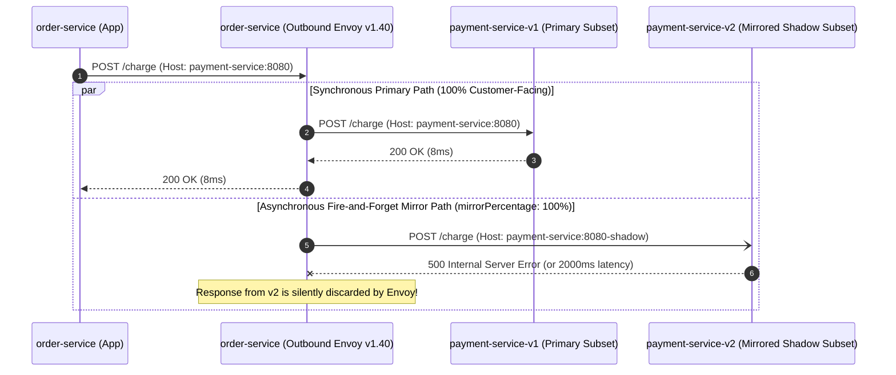
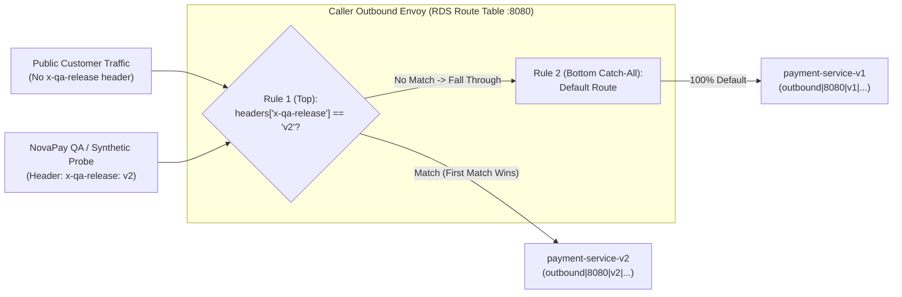

# Lesson 06.1: Why `RollingUpdate` Fails, Traffic Mirroring & Dark Launches

> **Navigation**: [Fellowship Portal](../../README.md) > [Week 07: Progressive Delivery & Safe Releases](../../fellowship/week-07-progressive-delivery-and-safe-releases/WEEK.md) > [Module 06: Progressive Delivery](../README.md) > **Lesson 06.1**
> - **Estimated Completion Time**: 25 minutes
> - **Prerequisites**: [Module 02: Service Discovery & Routing](../../02-service-discovery-and-routing/README.md) (`VirtualService` & `DestinationRule`), [Module 05: Resilience & Fault Injection](../../05-resilience-and-fault-injection/README.md)
> - **Authoritative Version Baseline**: Istio `1.32.0` | Envoy `v1.40` | Kubernetes `v1.36+` | Gateway API `v1.6.1`

---

## Learning Objectives

By the end of this lesson, you will be able to:
1. Explain the four architectural flaws of standard Kubernetes `RollingUpdate` deployments in high-stakes financial platforms.
2. Architect asynchronous, fire-and-forget **Traffic Mirroring (Shadowing)** using `VirtualService.spec.http[].mirror`, and explain how Envoy `v1.40` mutates the `:authority` (`Host`) header with `-shadow`.
3. Prevent catastrophic duplicate database writes and double credit-card charges when mirroring stateful `POST` requests.
4. Implement **Header-Based Dark Launches** (`x-qa-release: v2`) and order `VirtualService.spec.http` rules so specific match rules are never shadowed by catch-all routes.

---

## 1. NovaPay Engineering Context & Alex Morgan's Briefing

### What Is Happening at NovaPay?
At **NovaPay**, **Daniel Brooks (Staff Backend Engineer)** and the Payments squad have just rewritten the settlement currency-conversion engine inside **`payment-service-v2`** in our `orderflow` cluster. The new version cuts CPU utilization by 35% in synthetic staging benchmarks, and product leadership wants it promoted to production before the Black Friday volume surge.

However, synthetic load tests in staging never reproduce the chaotic edge cases of real production traffic: malformed ISO-4217 currency codes from legacy mobile apps, UTF-8 multibyte cardholder names, and bursty multi-item checkout concurrency.

### Alex's Briefing & Intuition Analogy

> **Alex Morgan (Senior Platform Engineer)**:
> "Sixteen months ago—before we adopted Istio progressive delivery—we deployed a minor patch to `payment-service` using a standard Kubernetes `RollingUpdate`. Its `/healthz` readiness probe returned `200 OK` in 40 milliseconds, so the `Deployment` controller happily replaced all `v1` pods in 45 seconds. What `/healthz` didn't check was a nil-pointer dereference triggered whenever a customer checked out with a saved American Express card. Within two minutes, 100% of Amex checkouts were throwing `HTTP 500`, and running `kubectl rollout undo` took another 90 seconds while JVM pods cold-started.
>
> **Progressive Delivery** breaks the link between **deploying a container** (starting pods in Kubernetes) and **releasing traffic** (exposing live customers to that code). Think of Traffic Mirroring like training a newly hired air-traffic controller by feeding their radar screen a live, real-time feed of Heathrow Airport while their microphone is physically unplugged from the radio tower. They process every real plane and make every real routing decision, so we can see if they make a mistake—without ever putting a single passenger plane at risk."

---

## 2. Core Concept: Why Kubernetes `RollingUpdate` Fails for FinTech Releases

By default, a Kubernetes `Deployment` uses `strategy.type: RollingUpdate` (`maxSurge: 25%`, `maxUnavailable: 25%`). While acceptable for low-risk internal utilities, `RollingUpdate` has four critical flaws for tier-1 services like `payment-service`:

| Architectural Dimension | Kubernetes `RollingUpdate` (`kube-proxy`) | Istio Progressive Delivery (`VirtualService` + `DestinationRule`) |
| :--- | :--- | :--- |
| **1. Traffic Ratio vs. Replica Count** | **Tightly Coupled**: `kube-proxy` distributes connections equally across all Ready `EndpointSlice` IPs. To send **1%** of traffic to `v2`, you must run **99 pods of `v1`** and **1 pod of `v2`**. | **100% Decoupled**: Run **2 pods of `v1`** and **2 pods of `v2`** while routing **99%** of requests to `v1` and **1%** to `v2` at Layer 7. |
| **2. Health Gate Granularity** | **Coarse L4/Health Probe Gate**: Advances to 100% as soon as `readinessProbe` returns `200 OK` on `/healthz`, even if `POST /charge` is failing on 20% of live user requests. | **L7 Golden Signal Gate**: Holds at any traffic percentage and queries Prometheus `istio_requests_total` success rates and P99 latency before advancing. |
| **3. User / Cohort Segmentation** | **None**: Cannot route internal QA engineers or beta merchants to `v2` while keeping general customers on `v1`. | **Deterministic L7 Matching**: Routes based on HTTP headers (`x-qa-release: v2`), cookies, JWT claims, or source principals. |
| **4. Rollback Recovery Time (MTTR)** | **Slow (30–180s)**: `kubectl rollout undo` must terminate `v2` pods, schedule `v1` pods, pull images, and pass readiness probes during an active outage. | **Sub-Second (<200ms)**: Updating a `VirtualService` pushes an RDS update over gRPC xDS to Envoy proxies, shifting 100% of traffic back to warm `v1` pods instantaneously. |

---

## 3. Technical Deep Dive: Traffic Mirroring (Shadowing) Under the Hood

Before routing even 1% of live customer responses from `payment-service-v2`, we use **Traffic Mirroring** (`mirror` and `mirrorPercentage` in `VirtualService`) to test `v2` against 100% of live production requests with **zero customer blast radius**.



### 6-Part Mechanism Walkthrough: Asynchronous Traffic Mirroring
1. **What initiates the operation?**
   A Platform Engineer applies a `VirtualService` for `payment-service` containing a primary `route` to `subset: v1` (`weight: 100`), a `mirror` block pointing to `host: payment-service`, `subset: v2`, and `mirrorPercentage.value: 100.0`.
2. **Which component receives it?**
   `istiod` (`1.32.0`) validates the `VirtualService` against the `DestinationRule` subsets (`v1`, `v2`), compiles an Envoy `RouteConfiguration` containing `request_mirror_policies` (`envoy.config.route.v3.RouteAction.RequestMirrorPolicy`), and pushes it via RDS (`:15012`) to every client Envoy sidecar in `orderflow` (such as `order-service` and `client-toolbox`).
3. **What information is exchanged?**
   When `order-service` sends `POST /charge` (`Host: payment-service:8080`), its local outbound Envoy proxy (`:15001`) intercepts the request, buffers the HTTP headers and request body in memory (up to the per-stream buffer limit), and opens two independent upstream streams: the synchronous primary stream to `outbound|8080|v1|payment-service.orderflow.svc.cluster.local` and an asynchronous `AsyncClient` stream to `outbound|8080|v2|payment-service.orderflow.svc.cluster.local`.
4. **What changes in the system?**
   On the cloned shadow request only, Envoy automatically mutates the HTTP/1.1 `Host` (or HTTP/2 `:authority`) header by appending **`-shadow`** (`Host: payment-service:8080-shadow`). By default, Envoy also sets `trace_sampled: false` on the shadow policy so mirrored requests do not corrupt parent-child distributed trace waterfalls unless explicitly enabled.
5. **How can you observe/verify it on your cluster?**
   - Inspect the compiled Envoy route on the caller pod:
     `istioctl proxy-config routes deploy/client-toolbox.orderflow --name 8080 -o json` (look for `requestMirrorPolicies`).
   - Tail the Envoy access logs on `payment-service-v2`:
     `kubectl logs -n orderflow -l app=payment-service,version=v2 -c istio-proxy` and verify `"payment-service:8080-shadow"` in the `%REQ(:AUTHORITY)%` column.
6. **What happens if a component fails?**
   If `payment-service-v2` panics with `HTTP 500`, times out after 10 seconds, or has zero healthy pods (`503 UH`), the caller (`order-service`) experiences **zero impact**. Envoy immediately returns `payment-service-v1`'s `200 OK` (in 8ms) to `order-service` and silently discards the shadow response or error from `v2`.

> [!CAUTION]
> **Daniel Brooks's Production Warning: Stateful Side-Effects & Double Charging**
> "Because Envoy mirrors the *exact* production HTTP method, headers, and payload—including `POST /charge` JSON bodies—**never mirror write or mutation traffic to a `v2` service that writes to the live production database or calls real external payment processors (Stripe/Adyen)** unless you enforce one of two safeguards:
> 1. **`v2` connects to an isolated shadow/ephemeral database** and mock external sandbox endpoints, OR
> 2. **Your application middleware inspects the `Host` header for the `-shadow` suffix** (`strings.HasSuffix(r.Host, "-shadow")`) and executes the database transaction in read-only / dry-run rollback mode!
> Without this safeguard, mirroring 100% of `payment-service` traffic will charge every NovaPay customer's credit card twice!"

---

## 4. Technical Deep Dive: Dark Launches (Header-Based Canary Routing)

Once `payment-service-v2` processes 24 hours of mirrored traffic with zero panics or latency regressions, the next milestone is a **Dark Launch** (also called an **Internal Ring Deployment**). In a Dark Launch, `v2` is deployed in production, yet **0% of public traffic** reaches it. Only requests carrying an explicit HTTP header (such as `x-qa-release: v2`) are routed to `v2`.



### 6-Part Mechanism Walkthrough: Dark Launch Header Evaluation
1. **What initiates the operation?**
   A QA testing suite (or internal engineer) sends an HTTP request to `http://payment-service:8080/` with the header `x-qa-release: v2`, while regular customer traffic arrives without that header.
2. **Which component receives it?**
   The caller's outbound Envoy proxy (`:15001`) intercepts the request and passes it through the HTTP Connection Manager (`envoy.filters.network.http_connection_manager`) and into the Router filter for virtual host `payment-service.orderflow.svc.cluster.local:8080`.
3. **What information is exchanged?**
   Envoy compares the incoming HTTP request headers against the ordered array of `routes` in its RDS `VirtualHost` configuration.
4. **What changes in the system?**
   Envoy evaluates `VirtualService.spec.http` **strictly top-to-bottom (first match wins)**:
   - If `x-qa-release: v2` is present, Rule 1 matches immediately and Envoy routes the request to `outbound|8080|v2|payment-service.orderflow.svc.cluster.local`.
   - If the header is absent or has any other value, Rule 1 fails, evaluation falls through to Rule 2 (the catch-all route with no `match` block), and Envoy routes the request to `outbound|8080|v1|payment-service.orderflow.svc.cluster.local`.
5. **How can you observe/verify it on your cluster?**
   Run `istioctl proxy-config routes deploy/client-toolbox.orderflow --name 8080 -o json` and confirm that the route entry containing `"headers": [{"name": "x-qa-release", "stringMatch": {"exact": "v2"}}]` appears at index `0` (before the catch-all route at index `1`).
6. **What happens if a component fails?**
   If an engineer accidentally places the catch-all route (`route` without a `match` stanza) at index `0` (the top of `spec.http`), Envoy matches 100% of requests on index `0` and **never evaluates** index `1`. The dark launch header is silently ignored!

### Engineering Insight: Header Propagation Across Deep Call Trees
Suppose a QA engineer sends `x-qa-release: v2` to the edge `frontend` service (`frontend` -> `order-service` -> `payment-service`), intending to trigger `payment-service-v2` three hops deep.
- Envoy does **not** magically teleport custom headers like `x-qa-release` across your application logic inside `frontend` and `order-service`.
- For deep-service dark launches to work from the ingress edge, intermediate services must forward custom `x-qa-*` headers—or propagate release ring metadata inside the standard W3C **`baggage`** header (`baggage: release-ring=v2`), which OpenTelemetry SDKs propagate automatically alongside `traceparent`!

---

## 5. Practical Observation & Investigation in `orderflow`

Use these commands in your cluster (and during [LAB.md](../LAB.md)) to inspect how `istiod` compiles mirroring and dark-launch rules into Envoy `v1.40`:

```bash
# 1. Inspect the mirroring manifest and apply it to orderflow
kubectl apply -f 06-progressive-delivery/manifests/01-mirroring-shadow.yaml

# 2. Verify that Envoy compiled the requestMirrorPolicies block on client-toolbox's port 8080 RDS route
TOOLBOX_POD=$(kubectl get pod -n orderflow -l app=client-toolbox -o jsonpath='{.items[0].metadata.name}')
istioctl proxy-config routes "$TOOLBOX_POD" -n orderflow --name 8080 -o json | grep -A 12 "requestMirrorPolicies"

# 3. Inspect the Dark Launch manifest to see top-to-bottom route ordering
cat 06-progressive-delivery/manifests/02-dark-launch-header.yaml
```

---

## 6. Knowledge Check (Engineering Judgment)

### Question 1: Diagnosis of a Silent Mirror Failure
You configure `mirror` (100%) from `payment-service-v1` to `payment-service-v2`. While mirroring is active, a bug in `payment-service-v2` causes it to crash with `HTTP 500` on every request and take 4,000ms before failing. What HTTP status code and latency does `order-service` observe when calling `payment-service`?

<details>
<summary>Check Answer & Engineering Explanation</summary>

**Answer**: `order-service` receives **`200 OK`** with `payment-service-v1`'s normal latency (e.g., `8ms`).

**Engineering Explanation**: Envoy's `request_mirror_policies` dispatches the shadow request asynchronously ("fire-and-forget") using an internal `AsyncClient` stream. Envoy does not wait for the shadow cluster (`v2`) to respond before returning the primary cluster's (`v1`) response to the downstream caller, and it completely discards any `5xx` status code or timeout generated by the shadow cluster. However, note that `payment-service-v2`'s inbound Envoy proxy will still record `response_code="500"` under `reporter="destination"` in Prometheus, allowing SREs to catch the `v2` regression before any customer is affected!
</details>

### Question 2: The Dead Dark Launch Rule
A junior engineer writes the following `VirtualService` to enable a Dark Launch for `payment-service-v2`:
```yaml
spec:
  hosts:
    - payment-service
  http:
    - route:
        - destination:
            host: payment-service
            subset: v1
    - match:
        - headers:
            x-qa-release:
              exact: v2
      route:
        - destination:
            host: payment-service
            subset: v2
```
When QA sends `curl -H "x-qa-release: v2" http://payment-service:8080/`, every request hits `v1`. Why, and does `istioctl analyze` reject this YAML as a syntax error?

<details>
<summary>Check Answer & Engineering Explanation</summary>

**Answer**: The YAML is syntactically valid Kubernetes/Istio schema, but because `spec.http` is evaluated **top-to-bottom (first match wins)**, the first route entry has no `match` condition—meaning it matches **100% of all HTTP requests** (`prefix: "/"`). Envoy routes the request to `v1` on Rule 1 and never reaches Rule 2.

**Fix**: Always place the most specific `match` rules (headers, exact paths, query params) at the **top** of `spec.http`, and place the unconditional default catch-all route at the very **bottom**.
</details>

---

## 7. Key Takeaways, Definition of Done & Next Lesson

### Key Takeaways
- Kubernetes `RollingUpdate` couples traffic percentage to replica count and cannot gate rollouts on Layer 7 Golden Signals.
- Envoy Traffic Mirroring (`request_mirror_policies`) duplicates requests asynchronously and appends `-shadow` to the `:authority` / `Host` header while discarding `v2` responses.
- Stateful services receiving mirrored traffic must either use an isolated shadow data store or inspect `Host: *-shadow` to execute in dry-run mode.
- `VirtualService.spec.http` rules evaluate top-to-bottom; specific header-based Dark Launch matches must precede the default fallback route.

### Definition of Done
- [ ] You can explain why a `500` error in a mirrored subset (`v2`) never causes a caller-facing error.
- [ ] You understand how to detect mirrored requests inside application code or Envoy access logs via the `-shadow` suffix on `:authority`.
- [ ] You can write an ordered `VirtualService` that isolates `x-qa-release: v2` traffic to `subset: v2`.

### Authoritative References
- [Istio Documentation: Traffic Mirroring](https://istio.io/latest/docs/tasks/traffic-management/mirroring/)
- [Envoy Proxy v1.40 Documentation: `RouteAction.RequestMirrorPolicy`](https://www.envoyproxy.io/docs/envoy/latest/api-v3/config/route/v3/route_components.proto#config-route-v3-routeaction-requestmirrorpolicy)

**Next Lesson**: Proceed to **[Lesson 06.2: Weighted Canary Rollouts, Blue-Green Cutovers & Automated Argo Rollouts](./02-weighted-canary-blue-green-and-argo-rollouts.md)**.
