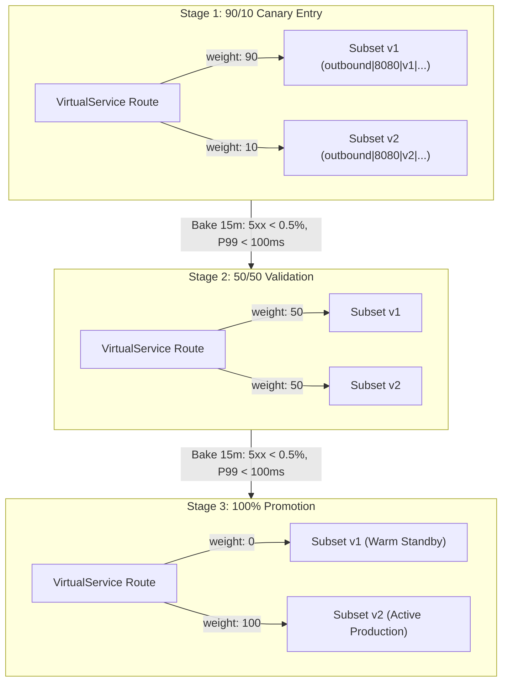
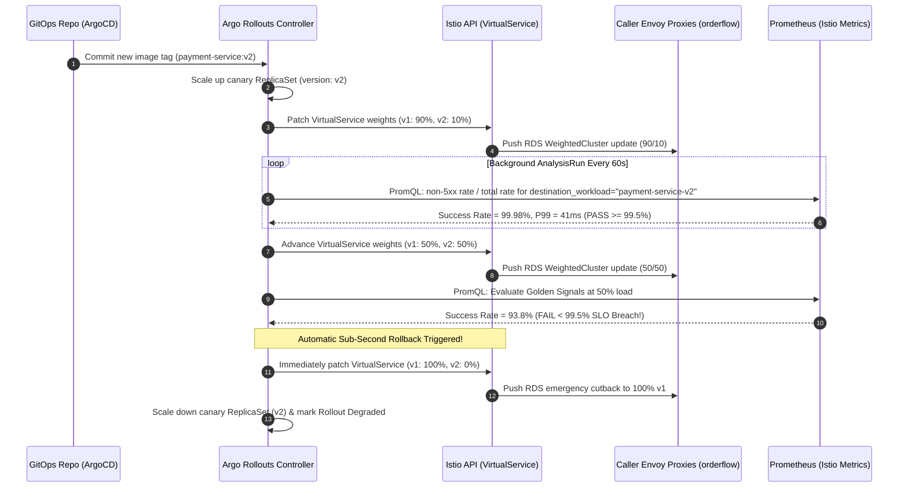

# Lesson 06.2: Weighted Canary Rollouts, Blue-Green Cutovers & Automated Argo Rollouts

> **Navigation**: [Fellowship Portal](../../README.md) > [Week 07: Progressive Delivery & Safe Releases](../../fellowship/week-07-progressive-delivery-and-safe-releases/WEEK.md) > [Module 06: Progressive Delivery](../README.md) > **Lesson 06.2**
> - **Estimated Completion Time**: 25 minutes
> - **Prerequisites**: [Lesson 06.1: Traffic Mirroring & Dark Launches](./01-traffic-mirroring-and-dark-launches.md)
> - **Authoritative Version Baseline**: Istio `1.32.0` | Envoy `v1.40` | Kubernetes `v1.36+` | Gateway API `v1.6.1`

---

## Learning Objectives

By the end of this lesson, you will be able to:
1. Architect a multi-stage **Weighted Canary Rollout** (`90/10` -> `50/50` -> `100%`) using `DestinationRule` subsets and `VirtualService` `route.weight`.
2. Explain how Envoy `v1.40` distributes individual HTTP requests (rather than just TCP connections) across `weighted_clusters`, and avoid the **`503 NR / UH` Subset Ordering Trap**.
3. Execute atomic **Blue-Green Cutovers** and sub-second emergency rollbacks via subset pointer switching.
4. Design an automated GitOps progressive delivery pipeline combining **Argo Rollouts** (`Rollout` + `AnalysisTemplate`) with Istio Prometheus Golden Signal queries (`istio_requests_total`).

---

## 1. NovaPay Engineering Context & Alex Morgan's Briefing

### What Is Happening at NovaPay?
At **NovaPay**, `payment-service-v2` has passed 24 hours of asynchronous shadow mirroring (`-shadow`) and internal QA sign-off via our `x-qa-release: v2` Dark Launch ring. Now it is time to expose real customer checkouts to `payment-service-v2`—starting with a 10% canary slice, expanding to 50%, and finally promoting to 100%.

At the same time, **Sarah Chen (SRE Lead)** has a strict production requirement: *"No engineer at NovaPay should be manually running `kubectl apply` at 2:00 AM while refreshing a Grafana dashboard with a stopwatch. If `payment-service-v2`'s success rate drops below our 99.5% SLO at any point during the canary, the platform must roll back to `v1` in under a second automatically."*

### Alex's Briefing & Intuition Analogy

> **Alex Morgan (Senior Platform Engineer)**:
> "Think of a **Weighted Canary Rollout** like opening a newly constructed bridge lane using an electronic highway toll gate. Even if the new lane (`v2`) has the exact same physical width (pod count) as the old lane (`v1`), the electronic gate (`VirtualService` `weight`) lets us direct exactly 1 out of every 10 cars onto the new lane while sensors measure vibration and structural load (Prometheus Golden Signals). If a sensor detects an anomaly, the electronic gate flips back to `100% v1` in 100 milliseconds—we don't have to demolish and rebuild the old bridge first!
>
> And when we have a major schema or API contract change where `v1` and `v2` cannot serve public customers simultaneously, we use **Blue-Green Subset Pointer Switching**: we warm up the entire Green (`v2`) fleet alongside Blue (`v1`), test Green via a dark-launch header, and then flip the `VirtualService` pointer from `100% v1` to `100% v2` atomically."

---

## 2. Core Concept: Weighted Canary Rollouts (`90/10` -> `50/50` -> `0/100`)

In Istio, weighted canary delivery relies on the partnership between two CRDs:
1. **`DestinationRule` (Defines the Named Subsets)**: Partitions the backing pods of `payment-service` into distinct Envoy upstream clusters based on pod labels (`version: v1` vs. `version: v2`).
2. **`VirtualService` (Controls the L7 Traffic Weights)**: Instructs caller Envoys what percentage of requests (`weight: 0–100`) to forward to each subset.



---

## 3. Technical Deep Dive: How Envoy Enforces `weighted_clusters` & The Subset Ordering Trap

### Request-Level L7 Load Balancing vs. L4 Connection Pinning
Why does `kube-proxy` fail at canary traffic splitting for gRPC or HTTP/1.1 keep-alive connections? Because `kube-proxy` operates at Layer 4 (TCP connection setup). Once `order-service` opens a persistent HTTP/2 or gRPC connection through `kube-proxy`, 100% of subsequent RPC calls on that connection stay pinned to whichever pod IP won the initial TCP SYN lottery.

In contrast, Envoy (`v1.40`) terminates and parses Layer 7 HTTP/1.1 and HTTP/2 frames:
1. `istiod` (`1.32.0`) creates two separate CDS clusters in every caller's Envoy proxy:
   - `outbound|8080|v1|payment-service.orderflow.svc.cluster.local` (EDS endpoints matching `app=payment-service,version=v1`)
   - `outbound|8080|v2|payment-service.orderflow.svc.cluster.local` (EDS endpoints matching `app=payment-service,version=v2`)
2. In the caller's RDS `RouteConfiguration`, `istiod` programs an `envoy.config.route.v3.WeightedCluster` (`weighted_clusters`) with `total_weight: 100`.
3. **For every individual HTTP request or gRPC stream**, Envoy draws a pseudo-random integer in `[0, 99]` and dispatches that specific request to either the `v1` cluster or the `v2` cluster according to the configured weights—even if the caller application reuses a single persistent local TCP connection!

> [!WARNING]
> **The `503 NR / UH` Subset Ordering Trap**
> What happens if your CI/CD pipeline applies a `VirtualService` that routes traffic to `subset: v2` **before** applying the `DestinationRule` that defines `subset: v2`?
> - Envoy receives an RDS route pointing to cluster `outbound|8080|v2|payment-service.orderflow.svc.cluster.local`.
> - Because the `DestinationRule` does not yet exist, that cluster is absent from Envoy's CDS table (or has 0 EDS endpoints).
> - Envoy immediately rejects requests matched to `v2` with **`503 NR` (`route_not_found`)** or **`503 UH` (`no_healthy_upstream`)**!
>
> **Mandatory Production Rule**: Always apply or update your **`DestinationRule` subsets first** (or package the `DestinationRule` and initial `100% v1` `VirtualService` in the same baseline manifest) and verify `istioctl proxy-status` is `SYNCED` before shifting `VirtualService` traffic weights to a new subset!

---

## 4. Blue-Green Deployments via Subset Pointer Switching

When a release introduces a breaking cache format or API response contract that cannot be mixed `90/10` across a user's multi-request session, use **Blue-Green Subset Pointer Switching**:

1. **Blue (`subset: v1`)** serves 100% of live customer traffic (`weight: 100`).
2. **Green (`subset: v2`)** is scaled up to full production replica count (`replicas: 10`). Because `v2` receives 0% of public weight, its pods can warm up caches and establish database pools safely.
3. **Pre-Cutover Verification**: QA validates Green in production using the Dark Launch header (`x-qa-release: v2`) from Lesson 06.1.
4. **Atomic Cutover**: Update the default route in `VirtualService` from `subset: v1 (100%)` to `subset: v2 (100%)`. `istiod` streams the RDS update to all proxies in `<200ms`. Envoy cleanly finishes in-flight requests on `v1` and sends all new requests to `v2`.
5. **Warm-Standby Rollback Window**: Leave the Blue (`v1`) Deployment running for 30–60 minutes after cutover. If a latent defect appears under full load, re-apply the `100% v1` `VirtualService` for an instantaneous rollback without waiting for container scheduling.

---

## 5. Automated Progressive Delivery with Argo Rollouts & Prometheus

In enterprise production at NovaPay, **Argo Rollouts** automates the entire canary lifecycle by reconciling an `argoproj.io/v1alpha1` **`Rollout`** resource, patching our Istio `VirtualService` weights, and querying Prometheus via an **`AnalysisTemplate`**.



### 6-Part Mechanism Walkthrough: Automated Argo Rollouts + Istio Telemetry Gate
1. **What initiates the operation?**
   A developer merges a pull request updating the container image spec in the `payment-service` Argo `Rollout` resource from `v1` to `v2`.
2. **Which component receives it?**
   The **Argo Rollouts Controller** detects the new Pod template hash, scales up the canary `ReplicaSet` (`payment-service-v2`), waits for its pods to pass Kubernetes readiness probes, and executes Step 1 of `spec.strategy.canary.steps` (`setWeight: 10`).
3. **What information is exchanged?**
   Argo Rollouts patches the referenced Istio `VirtualService` (`payment-service-vs`) via the Kubernetes API server, changing the destination weights on route `primary-route` to `v1: 90` and `v2: 10`. Simultaneously, Argo Rollouts spawns an `AnalysisRun` custom resource from the `istio-success-rate` `AnalysisTemplate`.
4. **What changes in the system?**
   `istiod` pushes the `90/10` RDS update to all Envoy sidecars. Every 60 seconds, the `AnalysisRun` controller executes a PromQL query against Prometheus calculating the ratio of non-5xx requests to total requests for `istio_requests_total{destination_workload="payment-service-v2"}` and checks `successCondition: result[0] >= 0.995`.
5. **How can you observe/verify it on your cluster?**
   - Inspect the declarative specification in [`../manifests/argo-rollouts-istio-example.yaml`](../manifests/argo-rollouts-istio-example.yaml).
   - Watch the live rollout and analysis status with `kubectl argo rollouts get rollout payment-service -n orderflow --watch` or inspect the `VirtualService` weights via `kubectl get virtualservice payment-service-vs -n orderflow -o yaml`.
6. **What happens if a component fails?**
   If `payment-service-v2` leaks database connections at 50% traffic and its Prometheus success rate drops below `0.995` (or if Prometheus returns an error/NaN for `failureLimit: 2` consecutive checks), Argo Rollouts aborts the promotion, patches the `VirtualService` back to `v1: 100, v2: 0` (which `istiod` propagates to Envoy proxies in milliseconds), scales down the faulty `v2` ReplicaSet, and alerts on-call engineers.

---

## 6. Practical Observation & Investigation in `orderflow`

Inspect the production Argo Rollouts + Istio manifest and test weighted canary distribution in `orderflow`:

```bash
# 1. Inspect the production Argo Rollouts + AnalysisTemplate specification
cat 06-progressive-delivery/manifests/argo-rollouts-istio-example.yaml

# 2. Apply the 90/10 weighted canary manifest in orderflow
kubectl apply -f 06-progressive-delivery/manifests/03-canary-90-10.yaml

# 3. Inspect how Envoy compiles the 90/10 weightedClusters in RDS
TOOLBOX_POD=$(kubectl get pod -n orderflow -l app=client-toolbox -o jsonpath='{.items[0].metadata.name}')
istioctl proxy-config routes "$TOOLBOX_POD" -n orderflow --name 8080 -o json | grep -A 18 "weightedClusters"
```

---

## 7. Knowledge Check (Engineering Judgment)

### Question 1: Why Did `503 NR` Spike During Our First Canary Deployment?
Your team deploys a brand-new microservice `settlement-service`. In their Helm chart, the `VirtualService` routing `90%` to `subset: v1` and `10%` to `subset: v2` is applied 4 seconds *before* the `DestinationRule` defining `subsets: [v1, v2]`. What happens during those 4 seconds, and why?

<details>
<summary>Check Answer & Engineering Explanation</summary>

**Answer**: During those 4 seconds, **100% of requests fail with `503 NR` (`No Route Configured`)**!

**Engineering Explanation**: When `istiod` compiles the `VirtualService` before the `DestinationRule` exists, the routes point to subset clusters `outbound|8080|v1|settlement-service...` and `outbound|8080|v2|settlement-service...`. Because no `DestinationRule` has declared `v1` or `v2`, Envoy's CDS table only contains the default un-subsetted cluster `outbound|8080||settlement-service...`. When Envoy's router matches a request and looks up a subset cluster that does not exist in CDS, it immediately returns `503 NR`. Always apply the `DestinationRule` before (or atomically with) the `VirtualService`.
</details>

### Question 2: Sub-Second Emergency Rollback Mechanics
At `100% v2`, `payment-service-v2` begins returning `HTTP 500` due to an upstream schema bug. You still have `payment-service-v1` pods running in `orderflow`. Compare the operational mechanics and recovery time of running `kubectl rollout undo deployment/payment-service-v2` vs. patching the `VirtualService` weight back to `v1: 100, v2: 0`.

<details>
<summary>Check Answer & Engineering Explanation</summary>

**Answer**: Patching the `VirtualService` weight to `v1: 100, v2: 0` restores production traffic in **under 200 milliseconds** without starting or stopping a single container, whereas `kubectl rollout undo` takes **30 to 180 seconds**.

**Engineering Explanation**: Because `payment-service-v1` pods are already running, warm, and present in Envoy's `outbound|8080|v1|...` EDS endpoint table, updating the `VirtualService` only requires `istiod` to push a lightweight RDS `RouteConfiguration` JSON message over the existing xDS gRPC stream (`:15012`). Envoy atomically swaps the in-memory route table pointer on all caller sidecars, shifting 100% of new requests to `v1` while leaving `v2` pods running in isolation so engineers can inspect their heap dumps or debug them via the `x-qa-release: v2` header.
</details>

---

## 8. Key Takeaways, Definition of Done & Hands-On Lab

### Key Takeaways
- `DestinationRule` subsets partition a Kubernetes Service's endpoints into distinct Envoy CDS clusters (`outbound|<port>|<subset>|<fqdn>`), while `VirtualService` `weight` distributes L7 requests across those clusters via RDS `weighted_clusters`.
- Always apply `DestinationRule` subsets before referencing them in a `VirtualService` to prevent `503 NR` / `503 UH` errors.
- Keeping `v1` pods running as a warm standby during canary promotion or Blue-Green cutovers enables sub-second (`<200ms`) emergency rollbacks via RDS pointer updates.
- In production, pair Istio with **Argo Rollouts** and Prometheus `AnalysisTemplate` queries on `istio_requests_total` to automate canary promotion and SLO-breach rollbacks.

### Definition of Done
- [ ] You have inspected `weightedClusters` in Envoy's RDS config using `istioctl proxy-config routes`.
- [ ] You understand how [`../manifests/argo-rollouts-istio-example.yaml`](../manifests/argo-rollouts-istio-example.yaml) connects an Argo `Rollout` to an Istio `VirtualService`, `DestinationRule`, and Prometheus `AnalysisTemplate`.
- [ ] You are ready to execute the 4-phase progressive delivery and emergency rollback exercises in **[Module 06 Hands-On Lab (`LAB.md`)](../LAB.md)**.

### Authoritative References
- [Istio Documentation: Traffic Shifting (Canary Rollouts)](https://istio.io/latest/docs/tasks/traffic-management/traffic-shifting/)
- [Argo Rollouts Documentation: Istio Traffic Management Integration](https://argo-rollouts.readthedocs.io/en/stable/features/traffic-management/istio/)

**Next Step**: Proceed to the **[Module 06 Hands-On Lab: Traffic Mirroring, Dark Launch, Weighted Canary & Emergency Rollback (`../LAB.md`)](../LAB.md)**.
