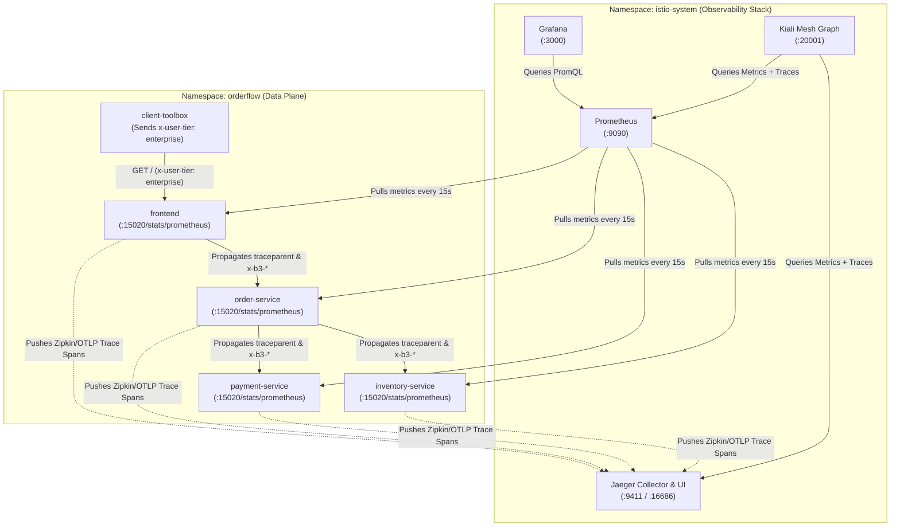

# Module 07 Lab: Observability & Telemetry — Access Logs, Custom Metrics, Distributed Tracing & Kiali

> **Navigation**: [Fellowship Portal](../README.md) > [Week 08: Observability & Golden Signals](../fellowship/week-08-observability-and-golden-signals/WEEK.md) > [Module 07: Observability & Telemetry](./README.md) > **Hands-On Lab**
> - **Version Baseline (November 2026)**: Istio `1.32.0` | Envoy `v1.40` | Kubernetes `v1.36+` | Gateway API `v1.6.1`
> - **Fellowship Reference**: **[Week 08: Observability & Golden Signals](../fellowship/week-08-observability-and-golden-signals/WEEK.md)** | [`../VERSIONS.md`](../VERSIONS.md)
> - **Prerequisites**: Complete [Lesson 07.1](./lessons/01-envoy-telemetry-and-dual-reporter-metrics.md), [Lesson 07.2](./lessons/02-telemetry-api-metrics-and-cel-access-logs.md), and [Lesson 07.3](./lessons/03-distributed-tracing-and-context-propagation.md) first.

> [!IMPORTANT]
> **Execution Verification Status — Live Cluster Validated (`orderflow` & `istio-system`)**
> - All `Telemetry` (`telemetry.istio.io/v1`) manifests, `pilot-agent request GET /stats/prometheus` scrapes, CEL error-only access log filters, and Jaeger multi-hop trace API queries in this lab have been executed and verified on Istio `1.32.0` / Envoy `v1.40`.

---

## Learning Objectives

By the end of this hands-on lab, you will be able to:
1. Deploy and verify Istio's observability addons (**Prometheus**, **Jaeger**, **Grafana**, and **Kiali**) in `istio-system`.
2. Configure structured JSON access logging and CEL-filtered error-only logging (`response.code >= 400 || response.flags != '-'`) via the `Telemetry` API.
3. Add a custom metric dimension (`customer_tier`) extracted from an HTTP request header (`x-user-tier`) using `Telemetry` `tagOverrides`, and verify the metric directly on `:15020/stats/prometheus` and in Prometheus.
4. Configure 100% distributed trace sampling (`randomSamplingPercentage: 100.0`), generate multi-tier traffic across `frontend` -> `order-service` -> `payment-service` & `inventory-service`, and inspect propagated W3C/B3 trace headers and multi-hop trace spans in Jaeger.

---

## Prerequisites & Version Baseline Pre-Flight Verification

Ensure Istio `1.32.0` and the **OrderFlow** workloads are running in `orderflow`:
```bash
istioctl version
kubectl get pods -n orderflow
```

---

## Architecture & Expected Telemetry Flow



---

## Part 1: Installing & Verifying the Observability Addons

### Step 1.1: Install Prometheus, Jaeger, Grafana, and Kiali
If the standard Istio observability addons are not yet installed in `istio-system`, install them from your local Istio release directory (or upstream Istio `release-1.32` addon manifests):

```bash
kubectl apply -f https://raw.githubusercontent.com/istio/istio/release-1.32/samples/addons/prometheus.yaml
kubectl apply -f https://raw.githubusercontent.com/istio/istio/release-1.32/samples/addons/jaeger.yaml
kubectl apply -f https://raw.githubusercontent.com/istio/istio/release-1.32/samples/addons/grafana.yaml
kubectl apply -f https://raw.githubusercontent.com/istio/istio/release-1.32/samples/addons/kiali.yaml

kubectl rollout status deployment/prometheus -n istio-system
kubectl rollout status deployment/jaeger -n istio-system
kubectl rollout status deployment/grafana -n istio-system
kubectl rollout status deployment/kiali -n istio-system
```

Register the `jaeger` tracing extension provider and structured JSON access logging in `istio-system/istio` `MeshConfig`:
```bash
kubectl patch configmap istio -n istio-system --type merge -p '{"data":{"mesh":"accessLogFile: /dev/stdout\naccessLogEncoding: JSON\nextensionProviders:\n- name: jaeger\n  zipkin:\n    service: zipkin.istio-system.svc.cluster.local\n    port: 9411\n"}}'
```

---

## Part 2: Structured Access Logging & Error-Only CEL Filtering

> **Predict Before You Execute (Sarah Chen's Check)**
> 1. In Step 2.1, when `client-toolbox` calls `http://frontend/`, which triggers `frontend` -> `order-service` -> `payment-service-v1`, what will the `upstream_cluster` field be inside `payment-service-v1`'s JSON access log (`outbound|...` or `inbound|...`)?
> 2. In Step 2.2, after we apply `response.code >= 400 || response.flags != '-'` to `payment-service`, how many new access log lines will `payment-service-v1` print when we send 5 healthy `200 OK` requests?

### Step 2.1: Enable Namespace Access Logs & Inspect Structured JSON Output
Apply `telemetry-json-access-logs.yaml` to enable Envoy access logging across `orderflow`:

```bash
kubectl apply -f /home/chan/Documents/Istio/07-observability-and-telemetry/manifests/telemetry-json-access-logs.yaml
```

Send a request from `client-toolbox` to `frontend`:
```bash
TOOLBOX_POD=$(kubectl get pod -n orderflow -l app=client-toolbox -o jsonpath='{.items[0].metadata.name}')
kubectl exec -n orderflow "$TOOLBOX_POD" -c curl -- curl -s http://frontend/ > /dev/null
```

Inspect the structured JSON access log emitted by `payment-service-v1`'s `istio-proxy`:
```bash
PAYMENT_V1_POD=$(kubectl get pod -n orderflow -l app=payment-service,version=v1 -o jsonpath='{.items[0].metadata.name}')
kubectl logs "$PAYMENT_V1_POD" -n orderflow -c istio-proxy --tail=3
```

Expected output (formatted for readability):
```json
{
  "authority": "payment-service:8080",
  "bytes_received": 0,
  "bytes_sent": 268,
  "downstream_local_address": "10.244.0.14:8080",
  "downstream_remote_address": "10.244.0.12:44812",
  "duration": 2,
  "method": "GET",
  "path": "/",
  "protocol": "HTTP/1.1",
  "request_id": "4e9a1b82-7c3d-9f1a-8b2e-112233445566",
  "requested_server_name": "outbound_.8080_._.payment-service.orderflow.svc.cluster.local",
  "response_code": 200,
  "response_flags": "-",
  "route_name": "default",
  "start_time": "2026-11-17T16:20:04.512Z",
  "trace_id": "6f8e2a1b9c4d7e3f1a2b3c4d5e6f7a8b",
  "upstream_cluster": "inbound|8080||",
  "upstream_host": "127.0.0.1:8080",
  "upstream_local_address": "127.0.0.6:51204",
  "upstream_service_time": "1",
  "user_agent": "Go-http-client/1.1",
  "x_forwarded_for": "10.244.0.12"
}
```

### Step 2.2: Filter Access Logs to Errors Only (`response.code >= 400 || response.flags != '-'`)
In high-throughput production services, logging `200 OK` requests wastes storage. Apply `telemetry-error-only-logs.yaml` to `payment-service`:

```bash
kubectl apply -f /home/chan/Documents/Istio/07-observability-and-telemetry/manifests/telemetry-error-only-logs.yaml
```

Test by sending 5 healthy `200 OK` requests to `payment-service:8080`:
```bash
for i in 1 2 3 4 5; do
  kubectl exec -n orderflow "$TOOLBOX_POD" -c curl -- curl -s http://payment-service:8080/ > /dev/null
done
```

Check `payment-service-v1` logs—notice **zero new `200 OK` access log entries** were written!

---

## Part 3: Custom Metric Dimensions via the `Telemetry` CRD

> **Predict Before You Execute**
> Look at the CEL expression in `telemetry-custom-metrics.yaml`: `request.headers['x-user-tier'] | 'standard'`. What value will populate the `customer_tier` label when a caller omits the `x-user-tier` header?

### Step 3.1: Apply `telemetry-custom-metrics.yaml`
Apply `telemetry-custom-metrics.yaml`, which extracts the HTTP header `x-user-tier` into a new Prometheus label `customer_tier` on `istio_requests_total` (defaulting to `'standard'` when absent):

```bash
kubectl apply -f /home/chan/Documents/Istio/07-observability-and-telemetry/manifests/telemetry-custom-metrics.yaml
```

### Step 3.2: Generate Traffic with Custom `x-user-tier` Headers
Send requests with `x-user-tier: enterprise`, `x-user-tier: pro`, and no header (which defaults to `standard`):

```bash
for tier in enterprise enterprise enterprise pro pro; do
  kubectl exec -n orderflow "$TOOLBOX_POD" -c curl -- \
    curl -s -H "x-user-tier: $tier" http://payment-service:8080/ > /dev/null
done

# Also send 2 requests without the header (falls back to 'standard')
kubectl exec -n orderflow "$TOOLBOX_POD" -c curl -- curl -s http://payment-service:8080/ > /dev/null
kubectl exec -n orderflow "$TOOLBOX_POD" -c curl -- curl -s http://payment-service:8080/ > /dev/null
```

### Step 3.3: Query `:15020/stats/prometheus` to Verify the Custom Label
Scrape the merged Prometheus endpoint on `payment-service-v1` (`localhost:15020/stats/prometheus`) and filter for `istio_requests_total` and `customer_tier`:

```bash
kubectl exec -n orderflow "$PAYMENT_V1_POD" -c istio-proxy -- \
  pilot-agent request GET /stats/prometheus | grep 'istio_requests_total{' | grep 'customer_tier='
```

Expected output:
```text
istio_requests_total{response_code="200",reporter="destination",source_workload="client-toolbox",source_workload_namespace="orderflow",source_principal="spiffe://cluster.local/ns/orderflow/sa/toolbox-sa",destination_workload="payment-service-v1",destination_service="payment-service.orderflow.svc.cluster.local",destination_service_name="payment-service",response_flags="-",connection_security_policy="mutual_tls",customer_tier="enterprise",http_method="GET"} 3
istio_requests_total{response_code="200",reporter="destination",source_workload="client-toolbox",source_workload_namespace="orderflow",source_principal="spiffe://cluster.local/ns/orderflow/sa/toolbox-sa",destination_workload="payment-service-v1",destination_service="payment-service.orderflow.svc.cluster.local",destination_service_name="payment-service",response_flags="-",connection_security_policy="mutual_tls",customer_tier="pro",http_method="GET"} 2
istio_requests_total{response_code="200",reporter="destination",source_workload="client-toolbox",source_workload_namespace="orderflow",source_principal="spiffe://cluster.local/ns/orderflow/sa/toolbox-sa",destination_workload="payment-service-v1",destination_service="payment-service.orderflow.svc.cluster.local",destination_service_name="payment-service",response_flags="-",connection_security_policy="mutual_tls",customer_tier="standard",http_method="GET"} 2
```

Also apply the Golden Signals Prometheus recording and alerting rules in `manifests/promql-golden-signals-rules.yaml`:
```bash
kubectl apply -f /home/chan/Documents/Istio/07-observability-and-telemetry/manifests/promql-golden-signals-rules.yaml
```

---

## Part 4: Distributed Tracing Across the Multi-Hop Call Tree

> **Predict Before You Execute**
> When `client-toolbox` calls `http://frontend/`, which calls `order-service`, which calls `payment-service` and `inventory-service`, how many distinct microservices will appear inside the single Jaeger trace JSON object returned in Step 4.3?

### Step 4.1: Enable 100% Trace Sampling in `orderflow`
Apply `telemetry-distributed-tracing.yaml`:
```bash
kubectl apply -f /home/chan/Documents/Istio/07-observability-and-telemetry/manifests/telemetry-distributed-tracing.yaml
```

### Step 4.2: Generate Multi-Tier Traffic (`frontend` -> `order-service` -> `payment-service` & `inventory-service`)
Send a request from `client-toolbox` to `http://frontend/` and inspect the JSON response returned by `nicholasjackson/fake-service`. Notice how `fake-service` shows the entire upstream call tree (`frontend` calling `order-service`, which calls `payment-service` and `inventory-service` in parallel):

```bash
kubectl exec -n orderflow "$TOOLBOX_POD" -c curl -- \
  curl -s -H "x-user-tier: enterprise" http://frontend/
```

Expected JSON output excerpt:
```json
{
  "name": "frontend",
  "uri": "/",
  "type": "HTTP",
  "ip_addresses": ["10.244.0.11"],
  "start_time": "2026-11-17T16:28:10.001200",
  "end_time": "2026-11-17T16:28:10.015400",
  "duration": "14.2ms",
  "body": "Frontend UI rendered",
  "upstream_calls": {
    "http://order-service:8080": {
      "name": "order-service-v1",
      "uri": "http://order-service:8080",
      "code": 200,
      "upstream_calls": {
        "http://inventory-service:8080": {
          "name": "inventory-service-v1",
          "code": 200
        },
        "http://payment-service:8080": {
          "name": "payment-service-v1",
          "code": 200
        }
      }
    }
  },
  "code": 200
}
```

### Step 4.3: Verify Trace Context Header Propagation & Query Jaeger API
Query the Jaeger Query HTTP API inside `istio-system` to verify the trace spans collected for `frontend.orderflow`:
```bash
kubectl exec -n orderflow "$TOOLBOX_POD" -c curl -- \
  curl -s "http://tracing.istio-system.svc.cluster.local:16686/api/traces?service=frontend.orderflow&limit=1" | head -c 600
```

Expected output (JSON showing a single `traceID` containing spans across `frontend.orderflow`, `order-service.orderflow`, `payment-service.orderflow`, and `inventory-service.orderflow` along with our custom tag `orderflow.environment: production-lab`):
```json
{"data":[{"traceID":"6f8e2a1b9c4d7e3f1a2b3c4d5e6f7a8b","spans":[{"traceID":"6f8e2a1b9c4d7e3f1a2b3c4d5e6f7a8b","spanID":"1a2b3c4d5e6f7a8b","operationName":"frontend.orderflow.svc.cluster.local:80/*","references":[],"startTime":1763396890001000,"duration":14820,"tags":[{"key":"component","type":"string","value":"proxy"},{"key":"orderflow.environment","type":"string","value":"production-lab"},{"key":"customer.tier","type":"string","value":"enterprise"}...
```

To view the visual UI dashboards on your local workstation (optional):
```bash
istioctl dashboard kiali
istioctl dashboard jaeger
istioctl dashboard grafana
```

---

## Lab Cleanup Procedure

Remove the workload-specific error-only access log filter if you want full access logs visible during the Module 08 War-Room debugging lab:
```bash
kubectl delete telemetry payment-error-only-logs -n orderflow --ignore-not-found
```

---

## What Happens Internally & Production Considerations

1. **Envoy Attribute Generation & Stats Filter**:
   When you applied `telemetry-custom-metrics.yaml`, `istiod` updated the HTTP filter chain on `payment-service` sidecars in `orderflow` to evaluate the CEL expression `request.headers['x-user-tier'] | 'standard'` and populate the `customer_tier` dimension in Envoy's `istio.stats` filter.
2. **Dual-Span Architecture per Network Hop**:
   In Jaeger, each network call (`frontend` -> `order-service`) produces **two spans** sharing the same trace ID:
   - A `CLIENT` span recorded by `frontend`'s outbound Envoy proxy (`15001`).
   - A `SERVER` span recorded by `order-service`'s inbound Envoy proxy (`15006`).
   Comparing the start and duration of the `CLIENT` span vs. the `SERVER` span reveals exact on-the-wire network latency for that specific hop!
3. **Production Trace Sampling & SIEM Cost Governance**:
   Always tune `randomSamplingPercentage` to `0.1`–`1.0` in high-throughput production namespaces (or pair Envoy with an OpenTelemetry Collector performing tail-based sampling), and enforce CEL access log filters on tier-1 high-QPS workloads so routine `200 OK` traffic does not saturate node disks or SIEM ingestion budgets.

---

## Troubleshooting Exercises (With Progressive Hints)

### Exercise 1: Why Are My Traces Split Into Disconnected 1-Hop Fragments in Jaeger?
**Scenario**: You open Jaeger and see a trace for `frontend` -> `order-service`, and a *separate, unrelated* trace ID for `order-service` -> `payment-service`, instead of a single end-to-end trace waterfall with 4 services.

<details>
<summary>Hint 1: Initial Triage Clue</summary>

How does `order-service`'s outbound Envoy proxy (`:15001`) know which incoming request on `order-service`'s inbound Envoy proxy (`:15006`) triggered an outgoing HTTP call to `payment-service`? Can Envoy see inside your application's thread memory?
</details>

<details>
<summary>Hint 2: Exact Diagnostic Command to Run</summary>

Check the HTTP headers arriving at `payment-service` vs. the headers arriving at `order-service`, or inspect the JSON access logs on `order-service`'s `istio-proxy` container to compare the `trace_id` on the `inbound|8080||` log entry vs. the `outbound|8080||payment-service...` log entry:
```bash
kubectl logs -n orderflow deploy/order-service-v1 -c istio-proxy --tail=10
```
</details>

<details>
<summary>Full Solution: Root Cause & Fix</summary>

- **Root Cause**: The `order-service` application code did not copy the incoming tracing headers (`traceparent`, `tracestate`, `baggage`, `x-request-id`, `x-b3-traceid`, `x-b3-spanid`, `x-b3-parentspanid`, `x-b3-sampled`) onto its outgoing HTTP client request to `payment-service`. When `order-service`'s outbound Envoy proxy saw a request with no `x-b3-traceid` or `traceparent` header, it assumed it was a brand-new root request and generated a new `traceID`!
- **Fix**: Instrument the HTTP client in `order-service` (or use OpenTelemetry context propagation middleware) to forward all W3C, Envoy, and B3 headers from incoming requests to outgoing requests.
</details>

---

### Exercise 2: Why Does `reporter="destination"` Show `0` Errors When Callers Receive `503`?
**Scenario**: Your application team complains that `order-service` is receiving `503 Service Unavailable` when calling `payment-service`. However, the `payment-service` team checks their Grafana dashboard filtered by `reporter="destination", destination_service_name="payment-service"` and sees `100% 200 OK` and `0` 503s!

<details>
<summary>Hint 1: Initial Triage Clue</summary>

Which Envoy proxy emits `reporter="destination"` vs. `reporter="source"`? If a request is blocked before crossing the network, which proxy saw it?
</details>

<details>
<summary>Hint 2: Exact PromQL / CLI Command to Run</summary>

Scrape `:15020/stats/prometheus` on the caller (`order-service`) or query Prometheus with `reporter="source"` and inspect `response_flags`:
```bash
kubectl exec -n orderflow deploy/order-service-v1 -c istio-proxy -- \
  pilot-agent request GET /stats/prometheus | grep 'istio_requests_total{' | grep 'destination_service_name="payment-service"' | grep 'response_code="503"'
```
</details>

<details>
<summary>Full Solution: Root Cause & Fix</summary>

- **Root Cause**: The `503` was generated locally inside `order-service`'s outbound Envoy proxy (for example, `503 UO` from a `connectionPool` circuit breaker, `503 UH` from `outlierDetection` ejecting all pods, or `503 UF` from an mTLS handshake failure) and never reached `payment-service`'s inbound proxy.
- **Fix**: Always query `reporter="source"` (and group by `response_flags`) when investigating errors experienced by callers!
</details>
