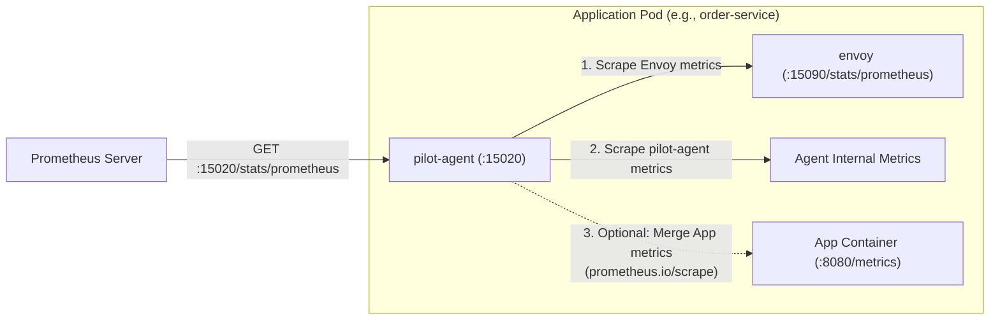
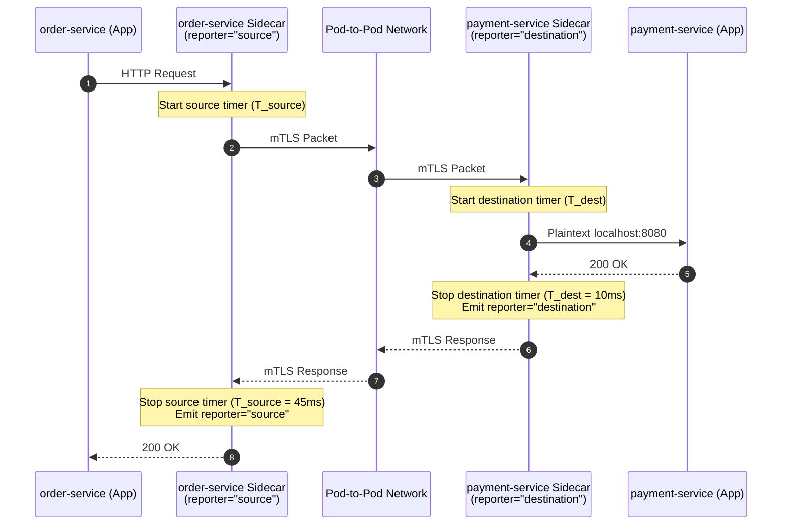
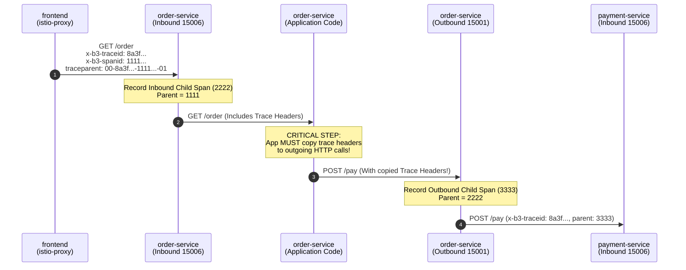

# Module 07: Observability & Telemetry — Golden Signals, Custom Metrics, Structured Logging & Distributed Tracing

In a monolith, debugging a slow request or an unexpected exception means inspecting a single process's logs or attaching a profiler. In a microservices architecture like **OrderFlow**, a single user click traverses `frontend` $\rightarrow$ `order-service` $\rightarrow$ `payment-service` and `inventory-service`. When tail latency spikes or a `503` appears, teams need immediate answers to *where* the failure occurred and *why*.

Because every inbound and outbound packet flows through the **Envoy sidecar proxy**, Istio acts as a **universal, language-agnostic telemetry sensor**. Without adding a single Prometheus client library or logging SDK to your application code, Istio emits uniform **Metrics**, **Access Logs**, and **Distributed Trace Spans** across the entire mesh.

---

## 1. How Envoy Generates and Exposes Telemetry Under the Hood

Inside every Istio-injected pod, the `istio-proxy` container runs two key processes:
1. **`envoy`**: The high-performance C++ proxy that intercepts application traffic on `15001` (outbound) and `15006` (inbound) and exposes raw Envoy stats on `localhost:15090/stats/prometheus`.
2. **`pilot-agent`**: The Go management agent that supervises Envoy, manages mTLS certificates, and exposes the merged telemetry scrape endpoint on **`:15020/stats/prometheus`**.



By scraping `:15020/stats/prometheus`, Prometheus collects standard Istio Layer 4 and Layer 7 metrics alongside Envoy health metrics and (when configured with standard `prometheus.io/*` pod annotations) the application's own Prometheus metrics in a single scrape!

---

## 2. Metrics & The Four Golden Signals (`istio_requests_total` & Histograms)

Google's SRE handbook defines the **Four Golden Signals** of service observability: **Latency**, **Traffic**, **Errors**, and **Saturation**. Istio's standard metrics (`istio_requests_total`, `istio_request_duration_milliseconds`, `istio_tcp_sent_bytes_total`, `istio_tcp_received_bytes_total`) cover the first three out of the box, while Envoy's cluster connection pool metrics cover saturation.

### 2.1 Anatomy of `istio_requests_total`
Every HTTP/gRPC request processed by an Envoy sidecar increments the counter `istio_requests_total` with rich dimensional labels:

| Label | Example Value | Purpose |
| :--- | :--- | :--- |
| **`reporter`** | `"source"` or `"destination"` | Whether this metric was recorded by the **caller's** outbound proxy (`source`) or the **server's** inbound proxy (`destination`). |
| **`source_workload`** | `"order-service-v1"` | Kubernetes Deployment/StatefulSet name of the caller. |
| **`source_principal`** | `"spiffe://cluster.local/ns/orderflow/sa/order-sa"` | Cryptographically verified mTLS SPIFFE identity of the caller. |
| **`destination_service_name`** | `"payment-service"` | Target Kubernetes Service name. |
| **`destination_workload`** | `"payment-service-v2"` | Actual upstream Deployment (`v1` or `v2`) that handled the request. |
| **`response_code`** | `"200"`, `"500"`, `"503"` | HTTP status code returned. |
| **`response_flags`** | `"-"`, `"UO"`, `"UT"`, `"UH"`, `"UF"` | Envoy response flag explaining *why* a failure occurred (`-` means normal response with no proxy fault/error flag). |
| **`connection_security_policy`** | `"mutual_tls"` or `"none"` | Reported by `destination` proxies: proves whether traffic arrived over mTLS or plaintext! |

### 2.2 Why Every Request Generates TWO Time Series (`reporter="source"` vs. `reporter="destination"`)

When `order-service` calls `payment-service`, **two** Envoy proxies observe the request:
1. **`order-service`'s outbound proxy** emits metrics with **`reporter="source"`**.
2. **`payment-service`'s inbound proxy** emits metrics with **`reporter="destination"`**.



#### How Production SREs Use Dual Reporting to Isolate Network vs. Application Issues:
1. **Isolating Network / Retransmission Latency**:
   $$\Delta \text{Latency} = \text{Latency}(\text{reporter="source"}) - \text{Latency}(\text{reporter="destination"})$$
   If `payment-service`'s `reporter="destination"` P99 latency is **10ms**, but `order-service`'s `reporter="source"` P99 latency to `payment-service` is **180ms**, the application is innocent! The remaining **170ms** is spent in the network, cross-AZ hops, mTLS handshake overhead, or caller-side retries!
2. **Detecting Drops That Never Reach the Server (`503 UO`, `503 UF`, `503 UH`)**:
   If a request is rejected locally by `order-service`'s circuit breaker (`503 UO`) or fails TCP connection setup (`503 UF`), it **never reaches `payment-service`**. Therefore, it appears **ONLY in `reporter="source"`** and is completely invisible in `reporter="destination"`!

### 2.3 Production PromQL Queries for the Golden Signals

#### 1. Traffic (Requests Per Second by Version)
```promql
sum(rate(istio_requests_total{
  reporter="destination",
  destination_service_namespace="orderflow",
  destination_service_name="payment-service"
}[1m])) by (destination_workload)
```

#### 2. Error Rate (Percentage of 5xx Responses Observed by Callers)
```promql
sum(rate(istio_requests_total{
  reporter="source",
  destination_service_namespace="orderflow",
  destination_service_name="payment-service",
  response_code=~"5.*"
}[1m]))
/
sum(rate(istio_requests_total{
  reporter="source",
  destination_service_namespace="orderflow",
  destination_service_name="payment-service"
}[1m])) * 100
```

#### 3. Tail Latency (P50, P95, P99 from `istio_request_duration_milliseconds_bucket`)
```promql
histogram_quantile(0.99,
  sum(rate(istio_request_duration_milliseconds_bucket{
    reporter="destination",
    destination_service_namespace="orderflow",
    destination_service_name="payment-service"
  }[1m])) by (le, destination_workload)
)
```

---

## 3. The `Telemetry` CRD (`telemetry.istio.io/v1`)

In older versions of Istio, customizing metrics, access logs, or trace sampling required editing the global `istio` ConfigMap (`MeshConfig`) or writing fragile `EnvoyFilter` patches. Modern Istio unifies all observability configuration into the **`Telemetry` (`telemetry.istio.io/v1`)** API.

### Inheritance & Scoping Hierarchy
The `Telemetry` CRD supports a clean 3-tier hierarchy:
1. **Mesh-Wide Root Scope**: A `Telemetry` resource created in the root configuration namespace (`istio-system`) with no `selector` applies to **every workload in the cluster**.
2. **Namespace Scope**: A `Telemetry` resource created in an application namespace (e.g., `orderflow`) with no `selector` overrides/extends the mesh defaults for **all pods in `orderflow`**.
3. **Workload Scope**: A `Telemetry` resource in `orderflow` with `spec.selector.matchLabels` (or `targetRefs`) applies **only to the matching pods** (e.g., `app: payment-service`).

### 3.1 Custom Metric Dimensions & Cardinality Management
You can add custom labels to `istio_requests_total` (extracted from Envoy attributes or HTTP headers using CEL — Common Expression Language) or **remove high-cardinality labels** to save Prometheus memory:

```yaml
apiVersion: telemetry.istio.io/v1
kind: Telemetry
metadata:
  name: payment-custom-metrics
  namespace: orderflow
spec:
  selector:
    matchLabels:
      app: payment-service
  metrics:
    - providers:
        - name: prometheus
      overrides:
        - match:
            metric: REQUEST_COUNT
            mode: CLIENT_AND_SERVER
          tagOverrides:
            # Extract HTTP header x-user-tier into a Prometheus label
            customer_tier:
              operation: UPSERT
              value: "request.headers['x-user-tier'] | 'standard'"
            # Drop unused label in high-scale environments to reduce cardinality
            request_protocol:
              operation: REMOVE
```

> [!CAUTION]
> **The Prometheus Cardinality Explosion Trap**:
> Never extract unbounded high-cardinality values (such as `user_id`, `order_id`, `session_token`, or raw URL paths with UUIDs) into Prometheus metric labels via `tagOverrides`! Every unique combination of labels creates a new time series in Prometheus TSDB. Only extract bounded enums (such as `customer_tier` in `["free", "pro", "enterprise"]`). Put high-cardinality IDs in **Access Logs** and **Distributed Traces** instead.

### 3.2 Structured JSON Access Logs & Error-Only Log Filtering
Enabling full access logging on every request in a cluster handling 50,000 RPS generates gigabytes of log volume per minute, often costing more in log ingestion (Datadog, Splunk, Loki) than the compute nodes themselves!

With the `Telemetry` API, you can:
1. Format Envoy access logs as **structured JSON** (defined in `meshConfig.extensionProviders`).
2. **Filter access logs with CEL expressions** so Envoy only writes an access log line when an error occurs (`response.code >= 400`), a proxy fault/error flag is present (`response.flags != "-"`), or latency exceeds an SLO threshold (`response.duration > duration("500ms")`):

```yaml
apiVersion: telemetry.istio.io/v1
kind: Telemetry
metadata:
  name: error-only-access-logs
  namespace: orderflow
spec:
  accessLogging:
    - providers:
        - name: envoy
      filter:
        expression: "response.code >= 400 || response.flags != '-'"
```

---

## 4. Distributed Tracing & The Golden Rule of Header Propagation

Metrics tell you *that* `order-service` is slow; **Distributed Tracing** shows you the exact waterfall timeline of a single request across `frontend` $\rightarrow$ `order-service` $\rightarrow$ `payment-service` and `inventory-service`.



### The Golden Rule of Istio Distributed Tracing
Why doesn't Envoy automatically stitch together the inbound request arriving at `order-service` (`15006`) with the outbound request leaving `order-service` (`15001`) to `payment-service`?

Because from Envoy's perspective, the application container (`order-service`) is a **black box**. `order-service` might be handling 500 concurrent requests across worker threads. When `order-service` opens an outbound HTTP connection to `payment-service`, Envoy has **no way of knowing which inbound request triggered that outbound call** unless the application forwards the correlation headers!

> [!IMPORTANT]
> **Applications MUST Propagate Trace Context Headers!**
> Even though Envoy generates the spans and sends them to Jaeger/Zipkin/Tempo automatically, your application code (or a lightweight OpenTelemetry HTTP client interceptor) **must copy these incoming headers onto outgoing upstream requests**:
> - **Envoy Correlation ID**: `x-request-id`
> - **W3C Trace Context (Standard)**: `traceparent`, `tracestate`, `baggage`
> - **B3 Multi-Header / Single-Header (Zipkin/Jaeger)**: `x-b3-traceid`, `x-b3-spanid`, `x-b3-parentspanid`, `x-b3-sampled`, `x-b3-flags`, `b3`
>
> *(Note: Our reference workload `nicholasjackson/fake-service` automatically propagates all W3C and B3 headers out of the box, which is why our multi-tier OrderFlow call tree produces complete end-to-end traces!)*

### Trace Sampling Rates: Learning vs. Production
- **Lab / Dev Environments (`randomSamplingPercentage: 100.0`)**: Sample 100% of requests so every `curl` command produces an inspectable trace in Jaeger.
- **High-Throughput Production (`randomSamplingPercentage: 0.1` to `1.0`)**: Sampling 100% of traces at 20,000 RPS will overwhelm network bandwidth and trace storage backends. Production meshes typically sample **0.1% – 1.0%** of baseline traffic at the proxy layer (head-based sampling) or use an OpenTelemetry Collector with **tail-based sampling** to retain 100% of traces that contain `5xx` errors or high latency while down-sampling healthy `200 OK` traces.

---

## 5. Visualizing the Mesh: Prometheus, Grafana, Jaeger/Tempo & Kiali

Istio integrates seamlessly with the standard cloud-native observability stack:
- **Prometheus**: Scrapes `:15020/stats/prometheus` across all pods and evaluates recording and alerting rules (`manifests/promql-golden-signals-rules.yaml`).
- **Grafana**: Renders Istio Service, Workload, and Control Plane dashboards.
- **Jaeger / Grafana Tempo**: Stores and visualizes distributed trace waterfalls across multi-hop calls.
- **Kiali**: Queries Prometheus and the Kubernetes/Istio API server to render a real-time **Service Mesh Topology Graph**, showing live RPS, error percentages, mTLS lock badges, and `VirtualService`/`DestinationRule` validation warnings on every edge.
