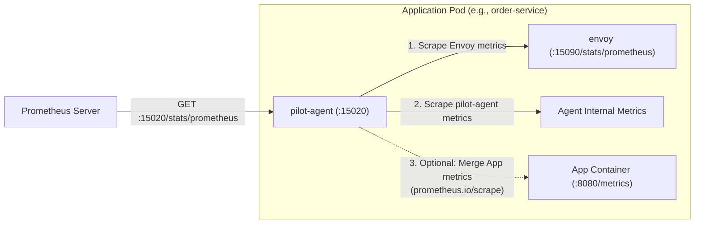
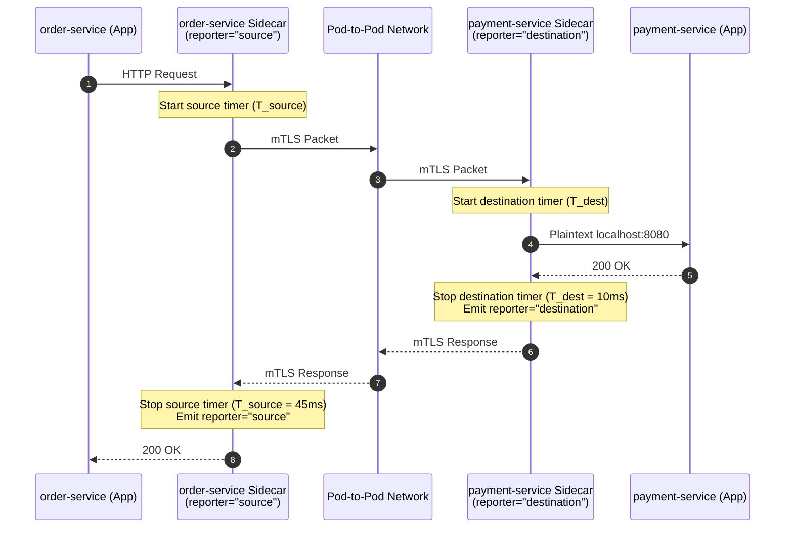
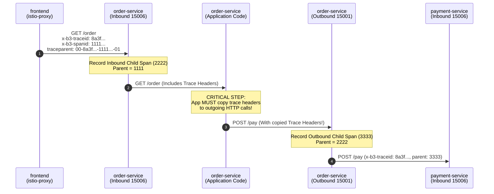

# Module 07: Observability & Telemetry — Golden Signals, Custom Metrics, Structured Logging & Distributed Tracing

> **Navigation**: [Fellowship Portal](../README.md) > [Week 08: Observability & Golden Signals](../fellowship/week-08-observability-and-golden-signals/WEEK.md) > **Module 07: Observability & Telemetry**
> - **Version Baseline (November 2026)**: Istio `1.32.0` | Envoy `v1.40` | Kubernetes `v1.36+` | Gateway API `v1.6.1` — see [`../VERSIONS.md`](../VERSIONS.md) and [`../COMPATIBILITY.md`](../COMPATIBILITY.md).
> - **Fellowship Cohort 01 Mapping**: Complete this module alongside **[Week 08: Observability & Golden Signals](../fellowship/week-08-observability-and-golden-signals/WEEK.md)**.
> - **Estimated Module Completion Time**: 100 minutes (3 Lessons + 1 Hands-On Lab)

---

## NovaPay Engineering Briefing: Universal Telemetry Without Code Sprawl

> **Alex Morgan (Senior Platform Engineer)** & **Sarah Chen (SRE Lead)**:
> "In a monolith, debugging a slow request or an unexpected exception means inspecting a single process's logs. In **OrderFlow** and **NovaPay**, a single checkout traverses `frontend` -> `order-service` -> `payment-service` and `inventory-service`. When tail latency spikes or a `503` appears, on-call engineers need immediate answers to *where* the failure occurred and *why*.
>
> Because every inbound (`:15006`) and outbound (`:15001`) packet flows through the **Envoy `v1.40` sidecar proxy**, Istio acts as a **universal, language-agnostic telemetry sensor**. In Module 07, you will master how `pilot-agent` exposes merged Prometheus metrics on `:15020/stats/prometheus`, how to compare `reporter="source"` vs. `reporter="destination"` to isolate network delays and caller-side circuit-breaker drops (`503 UO`), how to use the `Telemetry` (`telemetry.istio.io/v1`) CRD for custom dimensions and CEL error-only JSON access logs, and how to guarantee end-to-end distributed tracing across multi-hop call graphs."

---

## Progressive Lesson Milestones & Learning Path

Complete the three focused lessons in [`./lessons/`](./lessons/) before executing the hands-on verification lab:

| Milestone | Lesson / Lab | Core Engineering Concepts Covered | Est. Time |
| :---: | :--- | :--- | :---: |
| **Lesson 07.1** | **[Envoy Telemetry Architecture, Dual-Reporter Metrics & The Four Golden Signals](./lessons/01-envoy-telemetry-and-dual-reporter-metrics.md)** | `pilot-agent` (`:15020/stats/prometheus`) merging Envoy (`:15090`) & app metrics; `istio_requests_total` dimensions; Sarah Chen's `reporter="source"` vs. `reporter="destination"` forensic formulas; production PromQL for the Four Golden Signals. | 25 min |
| **Lesson 07.2** | **[The `Telemetry` API — Custom Metric Dimensions, Cardinality & CEL Access Log Filtering](./lessons/02-telemetry-api-metrics-and-cel-access-logs.md)** | 3-tier `telemetry.istio.io/v1` inheritance (`istio-system` -> namespace -> workload selector); `tagOverrides` (`customer_tier`); avoiding the Prometheus Cardinality Explosion Trap; structured JSON access logs & CEL error-only filtering (`response.code >= 400 \|\| response.flags != '-'`). | 25 min |
| **Lesson 07.3** | **[Distributed Tracing, The Golden Rule of Context Propagation & Sampling Strategies](./lessons/03-distributed-tracing-and-context-propagation.md)** | Dual-span (`CLIENT` `:15001` + `SERVER` `:15006`) architecture; **The Golden Rule of Istio Distributed Tracing** (propagating W3C `traceparent`/`tracestate`/`baggage`, `x-request-id`, and `x-b3-*`); head-based vs. tail-based sampling (`100%` lab vs. `0.1%–1.0%` production). | 25 min |
| **Hands-On Lab** | **[Module 07 Lab: Access Logs, Custom Metrics, Distributed Tracing & Kiali](./LAB.md)** | Deploying Prometheus, Jaeger, Grafana, and Kiali; configuring JSON access logs and CEL error filtering; verifying custom `customer_tier` metrics on `:15020`; inspecting 4-service distributed trace waterfalls in Jaeger. | 25 min |

---

## 1. How Envoy Generates and Exposes Telemetry Under the Hood

Inside every Istio-injected pod, the `istio-proxy` container runs two key processes:
1. **`envoy` (`v1.40`)**: The high-performance C++ proxy that intercepts application traffic on `15001` (outbound) and `15006` (inbound) and exposes raw Envoy stats on `localhost:15090/stats/prometheus`.
2. **`pilot-agent` (`1.32.0`)**: The Go management agent that supervises Envoy, manages mTLS certificates, and exposes the merged telemetry scrape endpoint on **`:15020/stats/prometheus`**.

### 6-Part Mechanism Walkthrough: Merged Prometheus Telemetry Scraping
1. **What initiates the operation?**
   Prometheus (`istio-system`) issues an HTTP `GET /stats/prometheus` scrape request every 15 seconds to port `15020` of each pod in the mesh.
2. **Which component receives it?**
   The `pilot-agent` process inside the pod's `istio-proxy` container receives the request on `:15020`.
3. **What information is exchanged?**
   `pilot-agent` scrapes Envoy's internal stats endpoint (`127.0.0.1:15090/stats/prometheus`), appends its own `pilot-agent` xDS/certificate metrics, and optionally scrapes the application container's `/metrics` endpoint over loopback if `prometheus.io/scrape: "true"` is present.
4. **What changes in the system?**
   `pilot-agent` returns a single combined OpenMetrics payload containing standard Istio metrics (`istio_requests_total`, `istio_request_duration_milliseconds_bucket`), Envoy cluster metrics (`envoy_cluster_*`), and application metrics.
5. **How can you observe/verify it on your cluster?**
   Run `kubectl exec -n orderflow <pod> -c istio-proxy -- pilot-agent request GET /stats/prometheus | grep istio_requests_total`.
6. **What happens if a component fails?**
   If the application container freezes or its metrics endpoint fails, `pilot-agent` still serves Envoy's Layer 4 and Layer 7 metrics on `:15020`, preserving network and error visibility during an incident.

---

## 2. Metrics & The Four Golden Signals (`istio_requests_total` & Dual Reporting)

Every HTTP/gRPC request processed by an Envoy sidecar increments `istio_requests_total` with rich dimensional labels (`reporter`, `source_workload`, `source_principal`, `destination_service_name`, `destination_workload`, `response_code`, `response_flags`, `connection_security_policy`).

### Why Every Request Generates TWO Time Series (`reporter="source"` vs. `reporter="destination"`)

### 6-Part Mechanism Walkthrough: Dual-Reporter Metric Emission
1. **What initiates the operation?**
   `order-service` sends an outbound HTTP request to `payment-service:8080`.
2. **Which component receives it?**
   `order-service`'s outbound Envoy proxy (`:15001`) intercepts the request first and starts timer $T_{\text{source}}$. When the mTLS packet arrives at `payment-service`, `payment-service`'s inbound Envoy proxy (`:15006`) intercepts it and starts timer $T_{\text{dest}}$.
3. **What information is exchanged?**
   `payment-service` processes the request over localhost (`10ms`) and returns `200 OK` through its inbound proxy back across the network to `order-service`'s outbound proxy (`45ms` total round-trip).
4. **What changes in the system?**
   `payment-service`'s inbound proxy records `istio_requests_total` and `istio_request_duration_milliseconds_bucket` with **`reporter="destination"`** ($10\text{ms}$), while `order-service`'s outbound proxy records the same metrics with **`reporter="source"`** ($45\text{ms}$).
5. **How can you observe/verify it on your cluster?**
   Compare `reporter="source"` vs. `reporter="destination"` in Prometheus for `destination_service_name="payment-service"`.
6. **What happens if a component fails?**
   - **Network vs. App Latency**: $\Delta \text{Latency} = \text{Latency}(\text{reporter="source"}) - \text{Latency}(\text{reporter="destination"})$ isolates wire, cross-AZ, mTLS handshake, and retry latency from application processing time.
   - **Caller-Side Proxy Drops (`503 UO`, `503 UF`, `503 UH`)**: Requests rejected locally by `order-service`'s circuit breaker (`503 UO`) or failing TCP/mTLS connection setup (`503 UF`) never reach `payment-service`, appearing **only in `reporter="source"`**!

---

## 3. The `Telemetry` CRD (`telemetry.istio.io/v1`)

Modern Istio unifies observability configuration into the **`Telemetry` (`telemetry.istio.io/v1`)** API across a 3-tier hierarchy:
1. **Mesh-Wide Root Scope (`istio-system`, no `selector`)**: Applies to every workload in the mesh.
2. **Namespace Scope (`orderflow`, no `selector`)**: Overrides mesh defaults for all workloads in `orderflow`.
3. **Workload Scope (`orderflow`, with `spec.selector.matchLabels` / `targetRefs`)**: Overrides defaults for specific pods (e.g., `app: payment-service`).

> [!CAUTION]
> **The Prometheus Cardinality Explosion Trap**:
> Never extract unbounded high-cardinality values (`user_id`, `order_id`, `session_token`, or raw URL paths with UUIDs) into Prometheus metric labels via `tagOverrides`! Only extract bounded enums (`customer_tier` in `["standard", "pro", "enterprise"]`). Put high-cardinality IDs in **Structured JSON Access Logs** (filtered with CEL: `response.code >= 400 || response.flags != '-'`) and **Distributed Traces** instead.

---

## 4. Distributed Tracing & The Golden Rule of Header Propagation

### 6-Part Mechanism Walkthrough: Distributed Trace Context Propagation
1. **What initiates the operation?**
   An incoming request at `frontend`'s Envoy proxy generates a 128-bit `traceId` (`8a3f...`) and root `spanId` (`1111...`) and injects W3C (`traceparent`, `tracestate`, `baggage`), Envoy (`x-request-id`), and B3 (`x-b3-*`) headers.
2. **Which component receives it?**
   `order-service`'s inbound Envoy listener (`:15006`) reads the trace headers, records an inbound `SERVER` child span (`2222` with parent `1111`), and forwards the HTTP headers to the `order-service` application container on `127.0.0.1:8080`.
3. **What information is exchanged?**
   The `order-service` application container **must copy** the incoming trace context headers (`traceparent`, `tracestate`, `baggage`, `x-request-id`, `x-b3-*`) onto its outgoing HTTP call (`POST /pay`) to `payment-service`.
4. **What changes in the system?**
   `order-service`'s outbound Envoy listener (`:15001`) reads the propagated headers, creates an outbound `CLIENT` child span (`3333` with parent `2222`), and forwards the context to `payment-service` (`:15006`), while asynchronously exporting completed spans to Jaeger/Tempo.
5. **How can you observe/verify it on your cluster?**
   Query Jaeger (`http://tracing.istio-system.svc.cluster.local:16686/api/traces?service=frontend.orderflow`) and verify that one `traceID` spans `frontend`, `order-service`, `payment-service`, and `inventory-service`.
6. **What happens if a component fails?**
   Because the application container is a black box to Envoy, if `order-service` fails to copy incoming trace headers onto its outgoing call, `order-service`'s outbound proxy (`:15001`) generates a brand-new `traceID`, breaking the end-to-end trace waterfall into disconnected 1-hop fragments.

---

## Next Step
Start with **[Lesson 07.1: Envoy Telemetry Architecture, Dual-Reporter Metrics & The Four Golden Signals](./lessons/01-envoy-telemetry-and-dual-reporter-metrics.md)**, continue through **[Lesson 07.2](./lessons/02-telemetry-api-metrics-and-cel-access-logs.md)** and **[Lesson 07.3](./lessons/03-distributed-tracing-and-context-propagation.md)**, and then validate your skills in **[LAB.md](./LAB.md)**.
