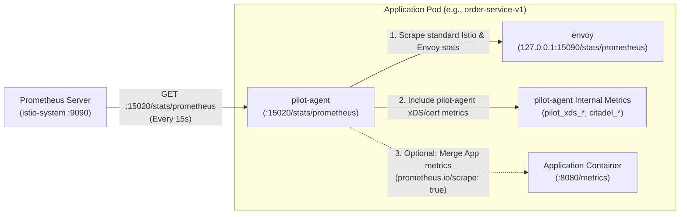
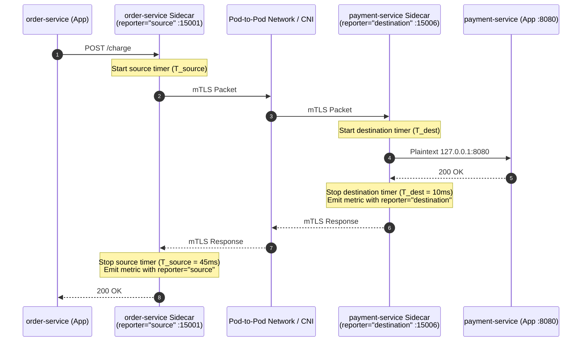

# Lesson 07.1: Envoy Telemetry Architecture, Dual-Reporter Metrics & The Four Golden Signals

> **Navigation**: [Fellowship Portal](../../README.md) > [Week 08: Observability & Golden Signals](../../fellowship/week-08-observability-and-golden-signals/WEEK.md) > [Module 07: Observability & Telemetry](../README.md) > **Lesson 07.1**
> - **Estimated Completion Time**: 25 minutes
> - **Prerequisites**: [Module 06: Progressive Delivery](../../06-progressive-delivery/README.md)
> - **Authoritative Version Baseline**: Istio `1.32.0` | Envoy `v1.40` | Kubernetes `v1.36+` | Gateway API `v1.6.1`

---

## Learning Objectives

By the end of this lesson, you will be able to:
1. Explain how `pilot-agent` (`:15020/stats/prometheus`) aggregates raw Envoy metrics (`:15090/stats/prometheus`), agent health metrics, and application metrics into a single Prometheus scrape target.
2. Decode every dimensional label on `istio_requests_total` (`reporter`, `source_workload`, `source_principal`, `destination_workload`, `response_code`, `response_flags`, `connection_security_policy`).
3. Apply **Sarah Chen's Dual-Reporter Forensic Technique** (`reporter="source"` vs. `reporter="destination"`) to isolate network/cross-AZ latency from application latency and detect caller-side drops (`503 UO`, `503 UF`, `503 UH`).
4. Write production PromQL queries for the **Four Golden Signals** (Traffic, Errors, Tail Latency, and Saturation).

---

## 1. NovaPay Engineering Context & Alex Morgan's Briefing

### What Is Happening at NovaPay?
At **NovaPay**, a single checkout click in `orderflow` traverses `frontend` -> `order-service` -> `payment-service` and `inventory-service`. Last Tuesday during peak afternoon settlement, the `order-service` team paged **Sarah Chen (SRE Lead)** claiming that `payment-service` was timing out and throwing `503 Service Unavailable` on 12% of requests.

Yet when **Daniel Brooks (Staff Backend Engineer)** checked the `payment-service` application logs and CPU dashboard, everything looked completely normal: `payment-service` showed 0 exceptions and a flat 9ms response time! Each team blamed the other until Sarah ran a single PromQL query comparing Istio's **`reporter="source"`** and **`reporter="destination"`** metrics.

### Alex's Briefing & Intuition Analogy

> **Alex Morgan (Senior Platform Engineer)**:
> "In a polyglot microservices org—where `order-service` is written in Go, `payment-service` in Java, and `fraud-service` in Python—relying on application developers to instrument every HTTP client with identical Prometheus histogram buckets and label names is a losing battle. One team names their metric `http_req_duration_ms`, another uses `rpc_latency_seconds`, and a third forgets to instrument their HTTP client entirely.
>
> Because every inbound (`:15006`) and outbound (`:15001`) packet flows through the Envoy `v1.40` sidecar proxy, Istio gives us a **universal, language-agnostic flight data recorder** at every network boundary. Better yet, every service-to-service hop is observed by **two independent witnesses**: the caller's outbound Envoy (`reporter="source"`) and the receiver's inbound Envoy (`reporter="destination"`). Comparing those two witnesses is like comparing the departure timestamp on a flight's takeoff runway with the arrival timestamp at the destination gate—it tells you immediately whether a delay happened inside the airport terminal or mid-air!"

---

## 2. Core Concept: How `pilot-agent` (:15020) Merges Envoy & App Telemetry

Inside every Istio-injected pod, the `istio-proxy` container runs two collaborating processes:
1. **`envoy` (`v1.40`)**: The C++ data plane proxy that processes packets on `:15001` (outbound) and `:15006` (inbound) and exposes its raw internal Prometheus counters and histograms on `localhost:15090/stats/prometheus`.
2. **`pilot-agent` (`1.32.0`)**: The Go lifecycle supervisor that manages Envoy, rotates SPIFFE mTLS certificates via SDS, and exposes the **merged telemetry scrape endpoint** on **`:15020/stats/prometheus`**.



### 6-Part Mechanism Walkthrough: Merged Prometheus Scraping via `:15020`
1. **What initiates the operation?**
   Every 15 seconds, the Prometheus server in `istio-system` sends an HTTP `GET /stats/prometheus` request to port `15020` of every pod in `orderflow`.
2. **Which component receives it?**
   The `pilot-agent` process listening on `:15020` inside the `istio-proxy` container receives the scrape request.
3. **What information is exchanged?**
   `pilot-agent` makes a local loopback call to `http://127.0.0.1:15090/stats/prometheus` to fetch Envoy's `istio.stats` metrics (`istio_requests_total`, `istio_request_duration_milliseconds_bucket`, `istio_tcp_*`) and raw `envoy_*` cluster counters. If the pod has `prometheus.io/scrape: "true"` and `prometheus.io/port` annotations (and mesh metric merging is enabled), `pilot-agent` also scrapes the application container's `/metrics` endpoint over localhost.
4. **What changes in the system?**
   `pilot-agent` merges all three metric streams (Envoy stats, `pilot-agent` internal metrics, and application metrics) into a single plain-text OpenMetrics/Prometheus response payload.
5. **How can you observe/verify it on your cluster?**
   Run `kubectl exec -n orderflow deploy/payment-service-v1 -c istio-proxy -- pilot-agent request GET /stats/prometheus | grep istio_requests_total` to inspect the live merged output directly from the sidecar.
6. **What happens if a component fails?**
   If the application container's `/metrics` endpoint hangs or crashes, `pilot-agent` still returns Envoy's `istio_requests_total` and `envoy_*` metrics so SREs never lose network-level visibility during an application hang! (Additionally, scraping `:15020` in plaintext works seamlessly even when `PeerAuthentication` enforces `STRICT` mTLS on the application port `:8080`!)

---

## 3. Technical Deep Dive: `istio_requests_total` & Dual-Reporter Forensics

### 3.1 Anatomy of `istio_requests_total`
Every HTTP or gRPC request traversing an Envoy sidecar increments `istio_requests_total` with rich dimensional labels:

| Label | Example Value | Engineering Purpose |
| :--- | :--- | :--- |
| **`reporter`** | `"source"` or `"destination"` | Identifies whether the metric was emitted by the **caller's** outbound proxy (`source`) or the **receiver's** inbound proxy (`destination`). |
| **`source_workload`** | `"order-service-v1"` | Kubernetes Deployment / StatefulSet name of the caller. |
| **`source_principal`** | `"spiffe://cluster.local/ns/orderflow/sa/order-sa"` | Cryptographically verified X.509 SPIFFE identity of the caller (populated when mTLS is used). |
| **`destination_service_name`** | `"payment-service"` | Target Kubernetes `Service` name. |
| **`destination_workload`** | `"payment-service-v2"` | Specific upstream Deployment subset (`v1` or `v2`) that actually handled the request. |
| **`response_code`** | `"200"`, `"500"`, `"503"` | HTTP status code returned to the caller. |
| **`response_flags`** | `"-"`, `"UO"`, `"UT"`, `"UH"`, `"UF"` | Envoy diagnostic flag explaining *why* a failure occurred (`-` means normal HTTP response with no proxy fault). |
| **`connection_security_policy`** | `"mutual_tls"` or `"none"` | Reported by `destination` proxies: proves whether traffic arrived over mTLS or plaintext. |

### 3.2 Why Every Request Generates TWO Time Series (`reporter="source"` vs. `reporter="destination"`)



### 6-Part Mechanism Walkthrough: Dual-Reporter Telemetry Generation
1. **What initiates the operation?**
   The `order-service` application initiates an outbound HTTP `POST /charge` call to `payment-service:8080`.
2. **Which component receives it?**
   First, `order-service`'s outbound Envoy listener (`:15001`) intercepts the request and starts its local request duration timer ($T_{\text{source}}$). Next, the packet crosses the pod network to `payment-service`'s inbound Envoy listener (`:15006`), which starts its own independent request timer ($T_{\text{dest}}$).
3. **What information is exchanged?**
   `payment-service`'s inbound proxy forwards the request over loopback (`127.0.0.1:8080`) to the `payment-service` container, receives `200 OK` in `10ms`, and sends the mTLS response back across the network to `order-service`'s outbound proxy.
4. **What changes in the system?**
   - `payment-service`'s inbound Envoy stops $T_{\text{dest}}$ at `10ms` and increments `istio_requests_total` and `istio_request_duration_milliseconds_bucket` with **`reporter="destination"`**.
   - `order-service`'s outbound Envoy stops $T_{\text{source}}$ at `45ms` (including cross-node network transit, mTLS handshake, and any caller retries) and increments `istio_requests_total` and `istio_request_duration_milliseconds_bucket` with **`reporter="source"`**.
5. **How can you observe/verify it on your cluster?**
   Query Prometheus for `istio_requests_total{source_workload="order-service-v1", destination_service_name="payment-service"}` without filtering on `reporter`: you will see two distinct series—one with `reporter="source"` (scraped from the `order-service` pod) and one with `reporter="destination"` (scraped from the `payment-service` pod).
6. **What happens if a component fails?**
   If `order-service`'s outbound Envoy rejects the request locally due to a tripped circuit breaker (`503 UO`), an empty endpoint list (`503 UH`), or a failed TCP/mTLS connection (`503 UF`), **the packet never reaches `payment-service`'s inbound proxy**. Consequently, the `503` error is recorded **ONLY in `reporter="source"`** and is completely absent (`0` errors) in `reporter="destination"`!

> [!TIP]
> **Sarah Chen's Two Dual-Reporter Forensic Formulas**
> 1. **Isolating Network / Retry Overhead vs. Application Execution Time**:
>    $$\Delta \text{Latency} = P_{99}(\text{reporter="source"}) - P_{99}(\text{reporter="destination"})$$
>    If `reporter="destination"` P99 is `10ms` while `reporter="source"` P99 is `180ms`, stop paging the `payment-service` developers! The extra `170ms` is occurring on the wire (cross-AZ latency, CNI packet drops, mTLS handshake overhead, or caller-side Envoy retries).
> 2. **Diagnosing "Phantom `503`s" (Why the Server Team Sees 100% Success)**:
>    Remember our NovaPay war story from the beginning of this lesson? When Sarah compared `reporter="source"` vs. `reporter="destination"`, she saw `12%` `503` with `response_flags="UO"` in `reporter="source"` and `0%` `503` in `reporter="destination"`. Someone had left `maxConnections: 10` on `payment-service`'s `DestinationRule`! `order-service`'s outbound Envoy was short-circuiting requests locally (`UO`), so `payment-service` never even knew those requests existed.

---

## 4. Production PromQL Queries for the Four Golden Signals

Review these authoritative PromQL queries (also codified in [`../manifests/promql-golden-signals-rules.yaml`](../manifests/promql-golden-signals-rules.yaml)):

### 1. Traffic (Requests Per Second by Destination Subset Version)
```promql
sum(rate(istio_requests_total{
  reporter="destination",
  destination_service_namespace="orderflow",
  destination_service_name="payment-service"
}[1m])) by (destination_workload)
```

### 2. Errors (Caller-Observed 5xx Error Percentage, Including Local Proxy Drops)
Always use **`reporter="source"`** when measuring caller-facing availability so local circuit-breaker (`UO`) and connection (`UF`/`UH`) failures are included:
```promql
sum(rate(istio_requests_total{
  reporter="source",
  destination_service_namespace="orderflow",
  destination_service_name="payment-service",
  response_code=~"5.*"
}[1m]))
/
sum(rate(istio_requests_total{
  reporter="source",
  destination_service_namespace="orderflow",
  destination_service_name="payment-service"
}[1m])) * 100
```

### 3. Latency (P99 Tail Latency by Workload Version)
```promql
histogram_quantile(0.99,
  sum(rate(istio_request_duration_milliseconds_bucket{
    reporter="destination",
    destination_service_namespace="orderflow",
    destination_service_name="payment-service"
  }[1m])) by (le, destination_workload)
)
```

### 4. Saturation (Envoy Upstream Pending Request Queue & Active Connections)
```promql
sum(envoy_cluster_upstream_rq_pending_active{
  cluster_name=~"outbound\\|8080\\|.*\\|payment-service\\.orderflow\\.svc\\.cluster\\.local"
}) by (cluster_name)
```

---

## 5. Practical Observation & Investigation in `orderflow`

Run these commands to inspect `:15020/stats/prometheus` on both a caller (`client-toolbox`) and a destination (`payment-service-v1`):

```bash
# 1. Generate a request from client-toolbox to payment-service
TOOLBOX_POD=$(kubectl get pod -n orderflow -l app=client-toolbox -o jsonpath='{.items[0].metadata.name}')
PAYMENT_V1_POD=$(kubectl get pod -n orderflow -l app=payment-service,version=v1 -o jsonpath='{.items[0].metadata.name}')
kubectl exec -n orderflow "$TOOLBOX_POD" -c curl -- curl -s http://payment-service:8080/ > /dev/null

# 2. Inspect reporter="source" on the caller's pilot-agent (:15020)
kubectl exec -n orderflow "$TOOLBOX_POD" -c istio-proxy -- \
  pilot-agent request GET /stats/prometheus | grep 'istio_requests_total{' | grep 'destination_service_name="payment-service"'

# 3. Inspect reporter="destination" on the server's pilot-agent (:15020)
kubectl exec -n orderflow "$PAYMENT_V1_POD" -c istio-proxy -- \
  pilot-agent request GET /stats/prometheus | grep 'istio_requests_total{' | grep 'destination_service_name="payment-service"'
```

---

## 6. Knowledge Check (Engineering Judgment)

### Question 1: The Missing `504 UT` Timeouts
`order-service` has a `VirtualService` route to `inventory-service` with `timeout: 500ms`. Under heavy load, `inventory-service` takes `800ms` to finish its SQL query and eventually returns `200 OK` to its local inbound Envoy proxy. What HTTP status code and `response_flags` are recorded in `reporter="source"` vs. `reporter="destination"`?

<details>
<summary>Check Answer & Engineering Explanation</summary>

**Answer**:
- **`reporter="source"`** (on `order-service`'s outbound proxy) records **`response_code="504"`** with **`response_flags="UT"`** (*Upstream Request Timeout*) at `500ms`.
- **`reporter="destination"`** (on `inventory-service`'s inbound proxy) records either **`response_code="0"` with `response_flags="DC"`** (*Downstream Connection Termination*, because the caller's Envoy reset/cancelled the stream at `500ms`) or `200` if headers were already flushing.

**Engineering Explanation**: Route timeouts in a `VirtualService` are enforced by the **caller's outbound Envoy router filter**. At `500ms`, `order-service`'s Envoy aborts waiting, returns a synthetic `504 Gateway Timeout` (`UT`) to `order-service`, and resets the upstream HTTP stream to `inventory-service`.
</details>

### Question 2: Verifying Zero-Trust mTLS Adoption via Prometheus
**Maya Patel (Principal Security Engineer)** wants to verify that 100% of traffic arriving at `payment-service` in `orderflow` is encrypted with mTLS before she switches `PeerAuthentication` from `PERMISSIVE` to `STRICT`. Which `istio_requests_total` label and `reporter` should she query?

<details>
<summary>Check Answer & Engineering Explanation</summary>

**Answer**: Query **`reporter="destination"`** grouped by **`connection_security_policy`** and **`source_workload`**:
```promql
sum(rate(istio_requests_total{
  reporter="destination",
  destination_service_namespace="orderflow",
  destination_service_name="payment-service",
  connection_security_policy!="mutual_tls"
}[5m])) by (source_workload, connection_security_policy)
```
**Engineering Explanation**: Only the receiving inbound Envoy proxy (`reporter="destination"`) terminates the incoming transport socket and knows definitively whether a caller connected via mTLS (`connection_security_policy="mutual_tls"`) or legacy plaintext (`connection_security_policy="none"`). If this query returns empty (`0`), every caller is using mTLS and switching to `STRICT` will cause zero disruption.
</details>

---

## 7. Key Takeaways, Definition of Done & Next Lesson

### Key Takeaways
- `pilot-agent` exposes `:15020/stats/prometheus`, merging Envoy (`:15090`), agent, and application Prometheus metrics into a single scrape endpoint.
- Every mesh request emits two metric series: `reporter="source"` (caller's outbound proxy) and `reporter="destination"` (server's inbound proxy).
- Comparing `reporter="source"` vs. `reporter="destination"` immediately distinguishes network/retry delays and caller-side circuit-breaker drops (`503 UO`) from server-side application failures.

### Definition of Done
- [ ] You have queried `:15020/stats/prometheus` on both a source and destination pod in `orderflow`.
- [ ] You can write PromQL queries for Traffic, 5xx Error Rate (`reporter="source"`), and P99 Latency (`histogram_quantile`).

### Authoritative References
- [Istio Documentation: Standard Metrics (`istio_requests_total`)](https://istio.io/latest/docs/reference/config/metrics/)
- [Google SRE Book: The Four Golden Signals](https://sre.google/sre-book/monitoring-distributed-systems/)

**Next Lesson**: Proceed to **[Lesson 07.2: The `Telemetry` API — Custom Metric Dimensions, Cardinality & CEL Access Log Filtering](./02-telemetry-api-metrics-and-cel-access-logs.md)**.
