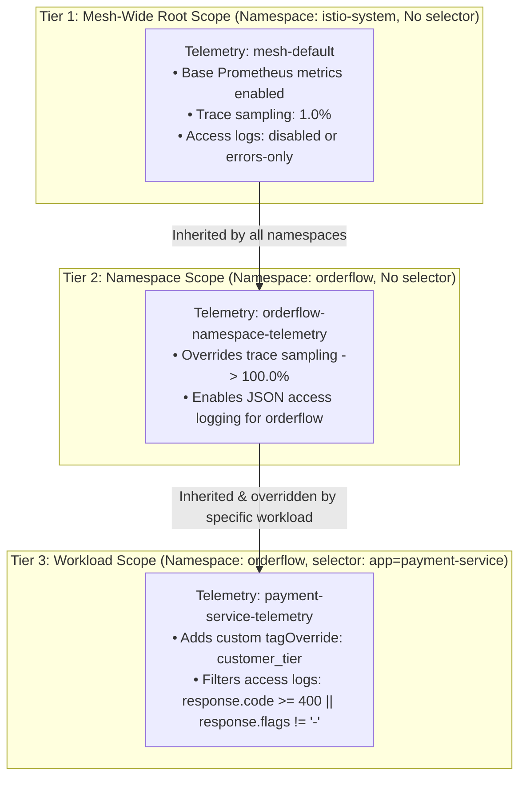

# Lesson 07.2: The `Telemetry` API — Custom Metric Dimensions, Cardinality & CEL Access Log Filtering

> **Navigation**: [Fellowship Portal](../../README.md) > [Week 08: Observability & Golden Signals](../../fellowship/week-08-observability-and-golden-signals/WEEK.md) > [Module 07: Observability & Telemetry](../README.md) > **Lesson 07.2**
> - **Estimated Completion Time**: 25 minutes
> - **Prerequisites**: [Lesson 07.1: Envoy Telemetry & Dual-Reporter Metrics](./01-envoy-telemetry-and-dual-reporter-metrics.md)
> - **Authoritative Version Baseline**: Istio `1.32.0` | Envoy `v1.40` | Kubernetes `v1.36+` | Gateway API `v1.6.1`

---

## Learning Objectives

By the end of this lesson, you will be able to:
1. Architect observability policies across Istio's 3-tier `Telemetry` (`telemetry.istio.io/v1`) inheritance hierarchy (Mesh-wide root `istio-system` -> Namespace `orderflow` -> Workload `selector` / `targetRefs`).
2. Add custom business dimensions (`customer_tier`) to `istio_requests_total` using `tagOverrides` and CEL expressions, and remove unused labels to reduce TSDB memory overhead.
3. Prevent the **Prometheus Cardinality Explosion Trap** by distinguishing bounded enum tags from unbounded high-cardinality identifiers.
4. Configure structured JSON Envoy access logs and apply **CEL Error-Only Filtering** (`response.code >= 400 || response.flags != '-'`) to cut SIEM/log ingestion volume by 95%+ without losing forensic fidelity.

---

## 1. NovaPay Engineering Context & Alex Morgan's Briefing

### What Is Happening at NovaPay?
At **NovaPay**, two competing observability crises hit our platform in the same week:
1. **Business SLA Blindness**: Product leadership signed a contract guaranteeing a `99.99%` checkout SLA specifically for `enterprise` tier merchants (who send `x-user-tier: enterprise`). However, default `istio_requests_total` metrics aggregate all traffic together—so a 2% error spike affecting only `enterprise` merchants was hidden inside the massive volume of `standard` tier traffic!
2. **Exploding Log & Prometheus Bills**: To debug intermittent failures, a team enabled full Envoy access logging across all pods at 40,000 RPS and tried to add `x-transaction-uuid` as a Prometheus metric label. Within three hours, our logging cluster ingested 1.4 terabytes of `200 OK` access logs, and our Prometheus server OOMKilled after spawning 12 million unique time series!

### Alex's Briefing & Intuition Analogy

> **Alex Morgan (Senior Platform Engineer)**:
> "Observability in a high-throughput service mesh is all about **signal-to-noise ratio** and **storage economics**:
> - **Prometheus (Metrics)** is like an aircraft's cockpit dashboard dials: it is designed for fast mathematical aggregation over a **small, fixed number of categories** (like `customer_tier` in `['standard', 'pro', 'enterprise']`). If you put a unique `transaction_uuid` or `user_id` into a Prometheus label, you're building a brand-new physical dial on the cockpit wall for every single passenger who boards the plane—until the cockpit collapses under the weight (`Cardinality Explosion`)!
> - **Envoy Access Logs** are like high-resolution security camera footage: every single frame contains rich high-cardinality details (`request_id`, `trace_id`, client IP, `%RESPONSE_FLAGS%`). Recording 24/7 4K video of an empty hallway (`200 OK` health checks) bankrupts your storage budget. Using the **`Telemetry` API (`telemetry.istio.io/v1`) with CEL filtering** is like configuring motion-activated security cameras that only write to disk when an anomaly occurs (`response.code >= 400 || response.flags != '-'`)!"

---

## 2. Core Concept: The 3-Tier `Telemetry` API Hierarchy (`telemetry.istio.io/v1`)

In legacy Istio versions, customizing metrics or access logs required hand-editing global `MeshConfig` YAML or maintaining brittle `EnvoyFilter` patches that broke on every Envoy upgrade. In Istio `1.32.0`, all metrics, access logging, and tracing configuration is unified under the **`Telemetry` (`telemetry.istio.io/v1`)** CRD with a clean 3-tier inheritance model:



### 6-Part Mechanism Walkthrough: `Telemetry` CRD Inheritance & xDS Compilation
1. **What initiates the operation?**
   A Platform Engineer applies a `Telemetry` resource at the root mesh level (`istio-system`), the namespace level (`orderflow`), or the workload level (`orderflow` with `spec.selector.matchLabels` or `spec.targetRefs`).
2. **Which component receives it?**
   `istiod` (`1.32.0`) watches `Telemetry` CRDs across all namespaces and merges the effective policy for each pod by merging Tier 1 (`istio-system`) -> Tier 2 (`orderflow`) -> Tier 3 (workload selector).
3. **What information is exchanged?**
   `istiod` translates the merged `Telemetry` specification into Envoy `v1.40` HTTP filter configurations (`envoy.filters.http.wasm` / `istio.stats` attribute generation filter for metrics, `envoy.access_loggers.file` with CEL evaluation filters for access logs, and `HttpConnectionManager.tracing` for distributed tracing) and pushes them via LDS (`:15012`).
4. **What changes in the system?**
   Target Envoy proxies dynamically reconfigure their in-memory HTTP filter chains and access loggers without dropping active connections or requiring pod restarts.
5. **How can you observe/verify it on your cluster?**
   Run `kubectl get telemetry -A` to see active policies across tiers, and run `istioctl proxy-config listener <pod> -n orderflow -o json` to inspect the compiled `accessLog` and `istio.stats` filter chains on the pod's Envoy proxy.
6. **What happens if a component fails?**
   If a workload-scoped `Telemetry` resource contains a malformed CEL expression, `istio-validator-istio-system` (or `istioctl analyze`) flags the syntax error so invalid filter configuration does not crash the data plane.

---

## 3. Technical Deep Dive: Custom Metric Dimensions & The Cardinality Explosion Trap

### 3.1 Adding `customer_tier` and Removing Unused Labels (`tagOverrides`)
To track Golden Signals per merchant SLA tier on `payment-service`, we use `metrics[].overrides[].tagOverrides` in [`../manifests/telemetry-custom-metrics.yaml`](../manifests/telemetry-custom-metrics.yaml):

```yaml
apiVersion: telemetry.istio.io/v1
kind: Telemetry
metadata:
  name: payment-custom-metrics
  namespace: orderflow
spec:
  selector:
    matchLabels:
      app: payment-service
  metrics:
    - providers:
        - name: prometheus
      overrides:
        - match:
            metric: REQUEST_COUNT
            mode: CLIENT_AND_SERVER
          tagOverrides:
            # Extract HTTP header x-user-tier into a Prometheus label (defaulting to 'standard')
            customer_tier:
              operation: UPSERT
              value: "request.headers['x-user-tier'] | 'standard'"
```

You can also use `operation: REMOVE` (for example, removing `request_protocol` or `destination_canonical_revision` in ultra-large clusters) to shrink the number of unique label combinations stored in Prometheus.

> [!CAUTION]
> **Sarah Chen's Golden Rule: The Prometheus Cardinality Explosion Trap**
> In Prometheus TSDB, total active time series equals the **Cartesian product** of all label cardinalities:
> $$\text{Total Series} = |\text{source}| \times |\text{destination}| \times |\text{response\_code}| \times |\text{response\_flags}| \times |\text{custom\_tag}|$$
> - Adding `customer_tier` with **3 bounded values** (`standard`, `pro`, `enterprise`) multiplies your series count by at most $3\times$—completely safe!
> - Adding `user_id`, `order_id`, `x-request-id`, client IP address, or un-normalized URL paths (`request.url_path` containing `/orders/9f8e7d6c-...`) multiplies your series count by **millions**, exhausting Prometheus RAM and crashing your monitoring stack!
> - **Rule of Thumb**: Only extract **bounded enums** ($\le 10$ distinct values) into Prometheus labels. Put unbounded high-cardinality identifiers (`user_id`, `order_id`, `trace_id`) in **Structured JSON Access Logs** and **Distributed Trace Tags**!

---

## 4. Technical Deep Dive: Structured JSON Access Logs & CEL Error-Only Filtering

### 4.1 Why Structured JSON Access Logs Beat Plaintext in Production
By default, Envoy's plaintext access log format requires fragile regex parsing (`grok`) in FluentBit, Vector, or Datadog. Switching `meshConfig.accessLogEncoding: JSON` forces Envoy to emit clean, machine-parseable JSON objects containing:
- **`response_code`** (`200`, `503`) and **`response_flags`** (`"-"`, `"UO"`, `"NR"`, `"UF"`)
- **`trace_id`** and **`request_id`** (directly linking the log line to the Jaeger trace waterfall!)
- **`upstream_cluster`** (`outbound|8080|v1|payment-service...`), **`upstream_host`** (exact target Pod IP:Port), and **`duration`** / **`upstream_service_time`**.

### 4.2 High-Signal, Low-Cost Logging with CEL (`filter.expression`)
In [`../manifests/telemetry-error-only-logs.yaml`](../manifests/telemetry-error-only-logs.yaml), we apply a Common Expression Language (CEL) filter to `payment-service` so Envoy only writes an access log entry when something actually goes wrong:

```yaml
apiVersion: telemetry.istio.io/v1
kind: Telemetry
metadata:
  name: payment-error-only-logs
  namespace: orderflow
spec:
  selector:
    matchLabels:
      app: payment-service
  accessLogging:
    - providers:
        - name: envoy
      filter:
        expression: "response.code >= 400 || response.flags != '-'"
```

Why do we include **`|| response.flags != '-'`** alongside `response.code >= 400`?
Because if a downstream client aborts the TCP connection before receiving a response, Envoy records `response.code == 0` with `response.flags == 'DC'` (*Downstream Connection Termination*). Checking `response.flags != '-'` ensures you capture `0 DC` client disconnects alongside all `4xx` and `5xx` responses, while suppressing 100% of routine `200 OK` requests!

---

## 5. Practical Observation & Investigation in `orderflow`

Test custom metric tag extraction and CEL access log filtering on `payment-service`:

```bash
# 1. Apply custom metrics Telemetry resource in orderflow
kubectl apply -f 07-observability-and-telemetry/manifests/telemetry-custom-metrics.yaml

# 2. Send a request carrying the x-user-tier: enterprise header
TOOLBOX_POD=$(kubectl get pod -n orderflow -l app=client-toolbox -o jsonpath='{.items[0].metadata.name}')
PAYMENT_V1_POD=$(kubectl get pod -n orderflow -l app=payment-service,version=v1 -o jsonpath='{.items[0].metadata.name}')
kubectl exec -n orderflow "$TOOLBOX_POD" -c curl -- \
  curl -s -H "x-user-tier: enterprise" http://payment-service:8080/ > /dev/null

# 3. Verify that customer_tier="enterprise" now appears on :15020/stats/prometheus
kubectl exec -n orderflow "$PAYMENT_V1_POD" -c istio-proxy -- \
  pilot-agent request GET /stats/prometheus | grep 'istio_requests_total{' | grep 'customer_tier="enterprise"'
```

---

## 6. Knowledge Check (Engineering Judgment)

### Question 1: Designing a Slow-Query & Error Access Log Filter
**Sarah Chen** asks you to update the `Telemetry` access log filter for `order-service` so that Envoy logs:
1. Any request returning HTTP status `400` or higher, OR
2. Any request with a non-empty Envoy response flag (`!= '-'`), OR
3. Any `200 OK` request whose total duration exceeds `500ms`.
What exact CEL `filter.expression` should you write?

<details>
<summary>Check Answer & Engineering Explanation</summary>

**Answer**:
```yaml
filter:
  expression: "response.code >= 400 || response.flags != '-' || response.duration > duration('500ms')"
```
**Engineering Explanation**: Envoy's CEL runtime exposes `response.duration` as a protobuf `Duration` type and supports the `duration('500ms')` literal constructor. Combining these three predicates with logical `||` gives SREs 100% visibility into HTTP errors, proxy-level connection drops, and slow tail-latency outliers while still dropping >98% of fast, healthy `200 OK` logs!
</details>

### Question 2: Avoiding a Prometheus Outage
A developer proposes adding the following `tagOverrides` block to `order-service`'s `Telemetry` CRD so they can query latency per customer order in Grafana:
```yaml
tagOverrides:
  order_id:
    operation: UPSERT
    value: "request.headers['x-order-id']"
```
As a Platform Engineer reviewing their PR, do you approve or reject this change, and what alternative do you provide?

<details>
<summary>Check Answer & Engineering Explanation</summary>

**Answer**: **Reject immediately!**

**Engineering Explanation**: `x-order-id` is an unbounded, unique per-transaction UUID. Extracting it into a Prometheus metric label (`istio_requests_total` / `istio_request_duration_milliseconds_bucket`) creates a brand-new time series for every single checkout order, triggering a **Prometheus Cardinality Explosion** that will OOMKill the Prometheus server.
- **Alternative**: Keep metrics bounded to low-cardinality dimensions (like `customer_tier`), and attach `x-order-id` as a custom **Distributed Trace Tag** (`tracing[].customTags.order_id.header.name: x-order-id`) or inspect it in **Structured JSON Access Logs**.
</details>

---

## 7. Key Takeaways, Definition of Done & Next Lesson

### Key Takeaways
- The `Telemetry` (`telemetry.istio.io/v1`) CRD cascades across 3 tiers: Mesh root (`istio-system`) -> Namespace (`orderflow`) -> Workload (`selector` / `targetRefs`).
- `tagOverrides` with CEL expressions (`request.headers['x-user-tier'] | 'standard'`) enrich `istio_requests_total` with business dimensions, but must only be used for bounded, low-cardinality values.
- CEL access log filters (`response.code >= 400 || response.flags != '-'`) eliminate noise from healthy `200 OK` traffic while capturing every HTTP error and proxy fault.

### Definition of Done
- [ ] You understand how `Telemetry` policies inherit from `istio-system` down to workload selectors.
- [ ] You can explain why high-cardinality headers belong in traces/logs rather than Prometheus `tagOverrides`.

### Authoritative References
- [Istio Documentation: Telemetry API Reference (`telemetry.istio.io/v1`)](https://istio.io/latest/docs/reference/config/telemetry/)
- [Istio Task: Customizing Metrics with the Telemetry API](https://istio.io/latest/docs/tasks/observability/metrics/customize-metrics/)

**Next Lesson**: Proceed to **[Lesson 07.3: Distributed Tracing, The Golden Rule of Context Propagation & Sampling Strategies](./03-distributed-tracing-and-context-propagation.md)**.
