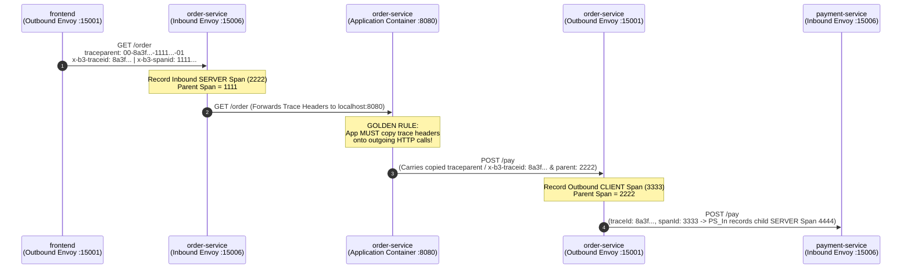

# Lesson 07.3: Distributed Tracing, The Golden Rule of Context Propagation & Sampling Strategies

> **Navigation**: [Fellowship Portal](../../README.md) > [Week 08: Observability & Golden Signals](../../fellowship/week-08-observability-and-golden-signals/WEEK.md) > [Module 07: Observability & Telemetry](../README.md) > **Lesson 07.3**
> - **Estimated Completion Time**: 25 minutes
> - **Prerequisites**: [Lesson 07.2: The `Telemetry` API — Metrics & CEL Access Logs](./02-telemetry-api-metrics-and-cel-access-logs.md)
> - **Authoritative Version Baseline**: Istio `1.32.0` | Envoy `v1.40` | Kubernetes `v1.36+` | Gateway API `v1.6.1`

---

## Learning Objectives

By the end of this lesson, you will be able to:
1. Explain how Envoy `v1.40` generates `CLIENT` (outbound `:15001`) and `SERVER` (inbound `:15006`) spans for every network hop in a multi-tier call tree.
2. Articulate **The Golden Rule of Istio Distributed Tracing**: why Envoy treats the application container as a black box and why applications **must** propagate W3C (`traceparent`, `tracestate`, `baggage`), Envoy (`x-request-id`), and B3 (`x-b3-*`) headers.
3. Diagnose and fix "disconnected 1-hop trace fragments" in Jaeger / Grafana Tempo.
4. Choose the right trace sampling architecture: **Head-Based Sampling** (`randomSamplingPercentage: 100.0` in lab vs. `0.1%–1.0%` in production) vs. **Tail-Based Sampling** via OpenTelemetry Collector.

---

## 1. NovaPay Engineering Context & Alex Morgan's Briefing

### What Is Happening at NovaPay?
At **NovaPay**, when a customer clicks "Pay Now" on `frontend`, the request fans out across a 3-tier call tree:
`frontend` -> `order-service` -> (`payment-service` + `inventory-service` in parallel).

When P99 checkout latency spiked to 420ms yesterday, Prometheus metrics told us `frontend` was slow, and `order-service` was slow—but we couldn't tell whether `order-service` was calling `payment-service` and `inventory-service` sequentially or in parallel, or which sub-call was blocking the critical path. Worse, when a new developer deployed a microservice that didn't forward HTTP trace headers, our 4-service Jaeger trace waterfall suddenly shattered into disconnected 1-hop fragments!

### Alex's Briefing & Intuition Analogy

> **Alex Morgan (Senior Platform Engineer)**:
> "One of the biggest myths in cloud-native engineering is: *'If we install Istio, we get end-to-end distributed tracing across 10 microservices with zero application code changes.'* That is **half true—and the half that's false bites every single engineering team at least once**!
>
> Yes, Envoy automatically generates the trace spans, timestamps every inbound (`:15006`) and outbound (`:15001`) network hop, attaches custom tags, and ships those spans asynchronously to Jaeger or Grafana Tempo. **However**, imagine `order-service` is a busy airport sorting facility with 500 packages arriving per second through the inbound door (`:15006`) and 1,000 packages leaving per second through the outbound door (`:15001`). Envoy stands at the doors outside the building. Envoy cannot see inside your application's memory or threads! Unless your application copies the **tracking barcode sticker** (`traceparent` / `x-b3-traceid`) from the incoming request onto the outgoing HTTP calls it makes to `payment-service` and `inventory-service`, the Envoy guard at the outbound door has no way to know that the outbound call belongs to that specific inbound request!"

---

## 2. Core Concept: Dual-Span Architecture & The Golden Rule of Header Propagation

When a request travels across the mesh (`frontend` -> `order-service` -> `payment-service`), Envoy records a **pair of spans (`CLIENT` + `SERVER`)** for every network hop:



### 6-Part Mechanism Walkthrough: Multi-Hop Trace Context Propagation
1. **What initiates the operation?**
   An external request (or a call from `client-toolbox` / `frontend`) enters the first Envoy proxy in the call chain. If no trace headers exist yet, the entry Envoy generates a new 128-bit `traceId` (`8a3f...`), a 64-bit root `spanId` (`1111...`), and a sampling decision (`sampled=1` based on `randomSamplingPercentage`).
2. **Which component receives it?**
   `order-service`'s inbound Envoy proxy (`:15006`) intercepts the incoming mTLS request from `frontend`, extracts the incoming `traceparent` / `x-b3-*` headers, creates an inbound `SERVER` child span (`spanId: 2222`, `parentSpanId: 1111`), and forwards the HTTP request—including all trace headers—to the `order-service` application container on `127.0.0.1:8080`.
3. **What information is exchanged?**
   Inside `order-service`, the application processes the order and initiates two upstream HTTP requests (`http://payment-service:8080` and `http://inventory-service:8080`). **The application code (or its OpenTelemetry HTTP client middleware) copies the incoming correlation headers onto both outgoing HTTP requests.**
4. **What changes in the system?**
   When `order-service`'s outbound Envoy proxy (`:15001`) intercepts the outgoing call to `payment-service`, it reads the propagated `traceId` (`8a3f...`) and current `spanId` (`2222`), creates a new outbound `CLIENT` child span (`spanId: 3333`, `parentSpanId: 2222`), and forwards the updated headers to `payment-service`'s inbound Envoy proxy (`:15006`). As each span finishes, each Envoy proxy asynchronously batches and transmits its spans to the tracing backend (`jaeger` / `zipkin` / OpenTelemetry Collector).
5. **How can you observe/verify it on your cluster?**
   Query the Jaeger API (`http://tracing.istio-system.svc.cluster.local:16686/api/traces?service=frontend.orderflow&limit=1`) and verify that a single `traceID` contains spans from all four services (`frontend.orderflow`, `order-service.orderflow`, `payment-service.orderflow`, and `inventory-service.orderflow`).
6. **What happens if a component fails (Broken Header Propagation)?**
   If `order-service` fails to copy the incoming trace headers onto its outgoing request to `payment-service`, `order-service`'s outbound Envoy (`:15001`) sees an HTTP request with **no trace headers**. It assumes this is a brand-new root request, generates a **brand-new unrelated `traceId` (`9c7d...`)**, and starts a disconnected trace! In Jaeger, you see two broken 1-hop traces instead of one end-to-end 4-service waterfall.

---

## 3. Technical Deep Dive: The Exact Headers Applications Must Propagate

> [!IMPORTANT]
> **The Mandatory Header Propagation Checklist**
> Every microservice in an Istio mesh should configure its HTTP/gRPC client middleware to forward these headers from inbound requests to outbound requests:
> 1. **W3C Trace Context (Modern Cloud-Native Standard)**:
>    - `traceparent` (Version, 128-bit Trace ID, 64-bit Parent Span ID, Trace Flags)
>    - `tracestate` (Vendor-specific trace key-value pairs)
>    - `baggage` (W3C cross-cutting context key-value pairs, e.g., `release-ring=v2,tenant=acme`)
> 2. **Envoy Correlation & Request ID**:
>    - `x-request-id` (Used by Envoy to correlate access logs and traces inside a single proxy)
> 3. **Zipkin / Jaeger B3 Headers (Multi-Header & Single-Header Compatibility)**:
>    - `x-b3-traceid`, `x-b3-spanid`, `x-b3-parentspanid`, `x-b3-sampled`, `x-b3-flags`, `b3`
>
> *(Note: Our reference workload `nicholasjackson/fake-service` in `orderflow` automatically propagates all W3C, Envoy, and B3 headers out of the box!)*

---

## 4. Production Engineering Insight: Head-Based vs. Tail-Based Trace Sampling

In [`../manifests/telemetry-distributed-tracing.yaml`](../manifests/telemetry-distributed-tracing.yaml), we configure `randomSamplingPercentage: 100.0` and attach custom trace tags (`orderflow.environment` and `customer.tier`):

```yaml
apiVersion: telemetry.istio.io/v1
kind: Telemetry
metadata:
  name: orderflow-distributed-tracing
  namespace: orderflow
spec:
  tracing:
    - providers:
        - name: jaeger
      randomSamplingPercentage: 100.0
      customTags:
        orderflow.environment:
          literal:
            value: "production-lab"
        customer.tier:
          header:
            name: x-user-tier
            defaultValue: "standard"
```

### Why `100.0%` Is Great for Labs—and Dangerous in High-Volume Production
| Sampling Strategy | How It Works | Where to Use It & Trade-Offs |
| :--- | :--- | :--- |
| **1. 100% Head-Based Sampling (`randomSamplingPercentage: 100.0`)** | The entry Envoy proxy marks `sampled=1` on 100% of requests. Every downstream proxy in the call tree honors `sampled=1` and emits spans. | **Dev, Staging & Lab Clusters**: Guarantees every `curl` test appears in Jaeger. **Never use at >5,000 RPS in production**—it will saturate network bandwidth and trace storage disks! |
| **2. Low-Rate Head-Based Sampling (`randomSamplingPercentage: 0.1` to `1.0`)** | The entry Envoy proxy randomly samples `0.1%` to `1.0%` of requests at the start ("head") of the request before knowing whether the request will succeed or fail. | **Simple Production Baseline**: Predictable, low overhead, and shows P50/P95 latency bottlenecks. Downside: may miss a rare `500` error that only occurs on `0.01%` of requests. |
| **3. Tail-Based Sampling (Envoy -> OpenTelemetry Collector -> Tempo/Jaeger)** | Envoy samples `10%–100%` of spans to a local DaemonSet/Deployment **OpenTelemetry Collector** equipped with the `tail_sampling` processor. The Collector buffers a trace for 5–10s in memory and evaluates the *completed* trace ("tail"). | **Enterprise FinTech Gold Standard**: The OTel Collector retains **100% of traces containing a `5xx` error, a non-empty Envoy response flag, or latency > 500ms**, while down-sampling healthy `200 OK` traces to `0.1%`! |

---

## 5. Practical Observation & Investigation in `orderflow`

Apply the distributed tracing `Telemetry` policy and inspect how `frontend` fans out across the `orderflow` call tree:

```bash
# 1. Apply 100% trace sampling and custom trace tags in orderflow
kubectl apply -f /home/chan/Documents/Istio/07-observability-and-telemetry/manifests/telemetry-distributed-tracing.yaml

# 2. Send a multi-tier request from client-toolbox to frontend with x-user-tier: enterprise
TOOLBOX_POD=$(kubectl get pod -n orderflow -l app=client-toolbox -o jsonpath='{.items[0].metadata.name}')
kubectl exec -n orderflow "$TOOLBOX_POD" -c curl -- \
  curl -s -H "x-user-tier: enterprise" http://frontend/ | grep -E '"name"|"uri"|"duration"|"code"'
```

---

## 6. Knowledge Check (Engineering Judgment)

### Question 1: Interpreting `CLIENT` vs. `SERVER` Span Gaps in Jaeger
In Jaeger, you open a single trace for `order-service` calling `payment-service`. You notice two spans for that single HTTP request:
- `order-service` outbound `CLIENT` span duration: **`85ms`**
- `payment-service` inbound `SERVER` span duration: **`7ms`**
Where were the remaining **`78ms`** spent?

<details>
<summary>Check Answer & Engineering Explanation</summary>

**Answer**: The remaining **`78ms`** were spent **between the two Envoy proxies**—either in the underlying network/CNI path, in an initial mTLS TCP/TLS handshake (`TLSv1.3`), queued in Envoy's outbound connection pool waiting for a free connection slot, or during a failed first attempt that Envoy automatically retried before succeeding on the second attempt!

**Engineering Explanation**: Because the `CLIENT` span starts when the request enters `order-service`'s outbound Envoy (`:15001`) and the `SERVER` span only starts when the packet arrives at `payment-service`'s inbound Envoy (`:15006`), subtracting the `SERVER` span duration from the `CLIENT` span duration isolates the exact proxy + network + retry overhead for that specific trace ID.
</details>

### Question 2: Who Decides Whether a Multi-Hop Trace Is Sampled?
Suppose `frontend` has a workload-scoped `Telemetry` policy with `randomSamplingPercentage: 100.0`, while `order-service` and `payment-service` have `randomSamplingPercentage: 1.0`. When a request enters `frontend` and flows through `order-service` -> `payment-service`, will `payment-service` emit trace spans 100% of the time or 1% of the time?

<details>
<summary>Check Answer & Engineering Explanation</summary>

**Answer**: `payment-service` will emit trace spans **100% of the time** for requests originating at `frontend`!

**Engineering Explanation**: In head-based distributed tracing (W3C `traceparent` / B3 `x-b3-sampled`), the **sampling decision is made once at the ingress/entry hop (`frontend`)** and encoded into the trace header (`x-b3-sampled: 1` or `traceparent` flags `01`). So long as intermediate applications propagate the trace headers, every downstream Envoy proxy (`order-service` and `payment-service`) honors the upstream `sampled=1` flag so that sampled traces are always captured end-to-end rather than missing random middle spans.
</details>

---

## 7. Key Takeaways, Definition of Done & Hands-On Lab

### Key Takeaways
- Envoy records both a `CLIENT` span (`:15001` outbound) and a `SERVER` span (`:15006` inbound) for every mesh hop.
- **The Golden Rule of Istio Distributed Tracing**: Applications **must** propagate `traceparent`, `tracestate`, `baggage`, `x-request-id`, and `x-b3-*` headers from incoming requests to outgoing requests so Envoy can stitch inbound and outbound spans into a single trace tree.
- Use `randomSamplingPercentage: 100.0` in dev/lab environments, and use low head-based sampling (`0.1%–1.0%`) or OpenTelemetry Collector tail-based sampling in high-QPS production.

### Definition of Done
- [ ] You can explain why failing to propagate trace headers inside an application splits an end-to-end trace into disconnected 1-hop fragments.
- [ ] You understand why custom high-cardinality tags (like `customer.tier` or `x-order-id`) are safe to attach via `Telemetry.spec.tracing[].customTags`.
- [ ] You are ready to execute the **[Module 07 Hands-On Lab (`../LAB.md`)](../LAB.md)**.

### Authoritative References
- [Istio Documentation: Distributed Tracing Overview & Context Propagation](https://istio.io/latest/docs/tasks/observability/distributed-tracing/overview/)
- [W3C Recommendation: Trace Context (`traceparent` & `tracestate`)](https://www.w3.org/TR/trace-context/)

**Next Step**: Proceed to the **[Module 07 Hands-On Lab: Access Logs, Custom Metrics, Distributed Tracing & Kiali (`../LAB.md`)](../LAB.md)**.
