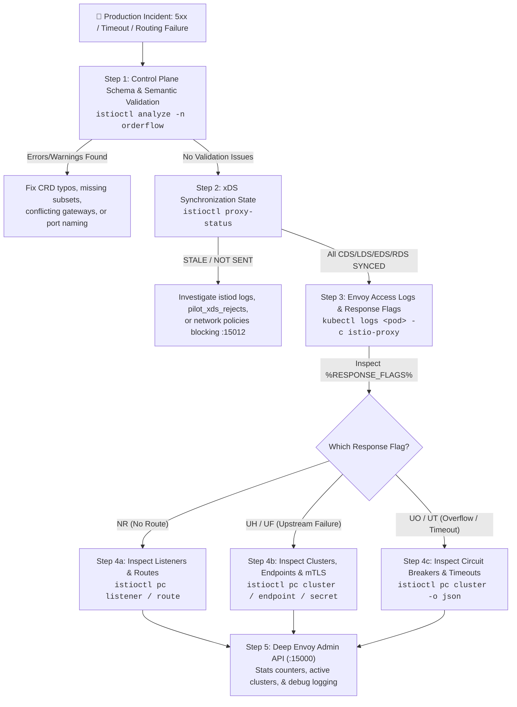
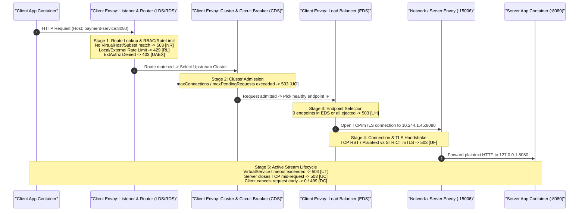
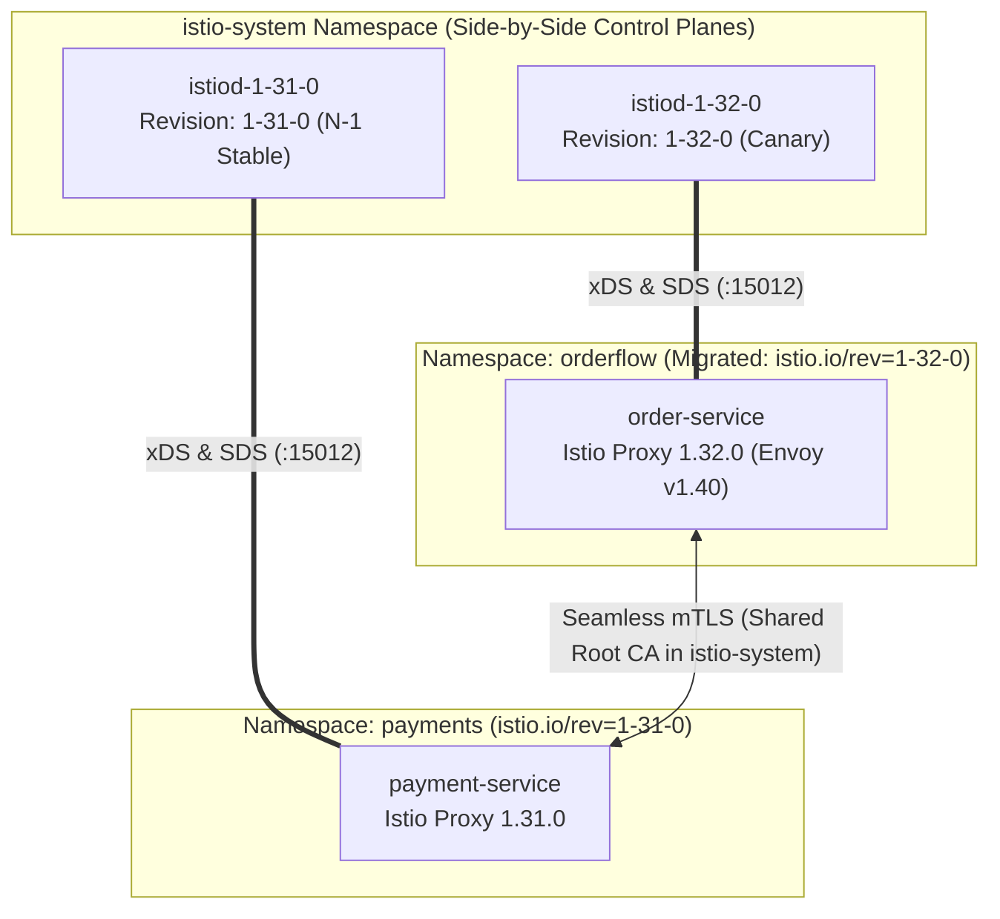

# Module 08: Debugging, Troubleshooting, and Production Operations

> **Navigation**: [Fellowship Portal](../README.md) > [Week 09: Incident Response & Control Plane Ops](../fellowship/week-09-incident-response-and-control-plane-ops/WEEK.md) > **Module 08: Debugging & Production Operations**
> - **Version Baseline (November 2026)**: Istio `1.32.0` (Canary Upgrade from `1.31.0`) | Envoy `v1.40` | Kubernetes `v1.36+` | Gateway API `v1.6.1` — see [`../VERSIONS.md`](../VERSIONS.md) and [`../COMPATIBILITY.md`](../COMPATIBILITY.md).
> - **Fellowship Cohort 01 Mapping**: Complete this module alongside **[Week 09: Incident Response & Control Plane Ops](../fellowship/week-09-incident-response-and-control-plane-ops/WEEK.md)**.
> - **Estimated Module Completion Time**: 90 minutes (2 Lessons + 1 War-Room Lab)

---

## NovaPay War-Room Briefing: From Guesswork to Deterministic Diagnostics

> **Alex Morgan (Senior Platform Engineer)** & **Sarah Chen (SRE Lead)**:
> "Operating a service mesh in enterprise production requires shifting from guesswork (*'restart the pod and hope it works'*) to a deterministic, layered diagnostic methodology. Because Istio intercepts every packet via Envoy (`istio-proxy`) or `ztunnel` and programs those proxies asynchronously via `istiod` over xDS (`:15012`), every failure leaves an exact, provable fingerprint in control plane validation (`istioctl analyze`), xDS synchronization state (`istioctl proxy-status`), Envoy access log response flags (`%RESPONSE_FLAGS%`), or the compiled Envoy configuration dump (`istioctl proxy-config`).
>
> In Module 08, you will master the **5-Step Istio Troubleshooting Decision Tree**, decode every **Envoy Response Flag** (`NR`, `UH`, `UF`, `UO`, `UT`, `UC`, `DC`, `URX`), eliminate the most common **Production Operational Pitfalls** (server-first protocol sniffing hangs, Kubernetes `Job` sidecar lifecycle deadlocks, and rolling deployment `503` race conditions), and execute **Zero-Downtime Revision-Based Canary Control Plane Upgrades** (`1-31-0` -> `1-32-0`)."

---

## Progressive Lesson Milestones & Learning Path

Complete the two focused lessons in [`./lessons/`](./lessons/) before entering the hands-on Production War-Room Lab:

| Milestone | Lesson / Lab | Core Engineering Concepts Covered | Est. Time |
| :---: | :--- | :--- | :---: |
| **Lesson 08.1** | **[The 5-Step Istio Troubleshooting Methodology & Complete Envoy Response Flags Decoder](./lessons/01-systematic-debugging-and-response-flags.md)** | 5-Step Troubleshooting Decision Tree (`istioctl analyze`, `proxy-status`, access logs, `proxy-config`, Envoy Admin `:15000` stats & dynamic loggers); 5-Stage Envoy Pipeline & complete 12-Flag Decoder (`NR`, `UH`, `UF`, `UO`, `UT`, `UC`, `DC`, `URX`, `RL`, `UAEX`, `NC`, `DT`). | 30 min |
| **Lesson 08.2** | **[Production Pitfalls, Control Plane High Availability & Revision-Based Canary Upgrades](./lessons/02-production-pitfalls-and-canary-control-plane-upgrades.md)** | Server-First Protocol Sniffing Deadlocks (`5s` MySQL/Redis hang vs. explicit port naming & `appProtocol`); K8s `Job`/`CronJob` Native Sidecars (`KEP-753` `ENABLE_NATIVE_SIDECARS=true` vs. `/quitquitquit`); Pod Shutdown Race Conditions (`EXIT_ON_ZERO_ACTIVE_CONNECTIONS` + `preStop`); `istiod` HA sizing & Revision-Based Canary Control Plane Upgrades (`1-31-0` -> `1-32-0`). | 25 min |
| **War-Room Lab** | **[Lab 08: The Production War-Room — 5 Mystery Outage Scenarios & Canary Upgrade](./LAB.md)** | On-call triage of 5 live outage scenarios (`503 NR`, `503 UF`, `503 UO`, `502/503 BlackHoleCluster`, `503 UC protocol_error`) with progressive investigation hints, followed by a live `1-32-canary` side-by-side control plane migration. | 35 min |

---

## 1. The 5-Step Systematic Istio Troubleshooting Methodology

When a request fails, times out, or routes unexpectedly inside an Istio mesh, never start by randomly editing `VirtualService` or `DestinationRule` manifests. Instead, follow a strict 5-step decision tree that narrows the blast radius from the control plane down to the individual socket.

### 6-Part Mechanism Walkthrough: The 5-Step Troubleshooting Decision Tree
1. **What initiates the operation?**
   A service in `orderflow` returns unexpected `5xx` errors, timeouts (`504`), or connection resets.
2. **Which component receives it?**
   The engineer starts at the **Control Plane semantic analyzer** (`istioctl analyze -n orderflow`) and **xDS sync table** (`istioctl proxy-status`).
3. **What information is exchanged?**
   `istioctl analyze` checks live Kubernetes/Istio resources for cross-CRD semantic conflicts (`IST0101` missing subset, `IST0156` mTLS conflict), while `istioctl proxy-status` queries `istiod` to verify that every Envoy proxy has acknowledged (`SYNCED`) the latest CDS, LDS, EDS, and RDS pushes.
4. **What changes in the system?**
   Next, the engineer reads the client and server Envoy access logs (`kubectl logs <pod> -c istio-proxy`) to extract `%RESPONSE_FLAGS%` (`NR`, `UH`, `UF`, `UO`, `UT`, `UC`, `DC`, `URX`) and `%UPSTREAM_CLUSTER%`.
5. **How can you observe/verify it on your cluster?**
   Using the response flag as an index, the engineer inspects the specific xDS layer inside the pod's Envoy proxy (`istioctl pc route`, `cluster`, `endpoint`, `listener`, `secret`) and queries internal Envoy counters (`pilot-agent request GET stats`).
6. **What happens if a component fails?**
   If the failure still requires deeper packet/header inspection, the engineer dynamically enables scoped debug logging on a single pod (`istioctl pc log <pod>.<ns> --level http:debug,router:debug`) without restarting the workload, captures the trace, and resets logging to `warning`.

---

## 2. Complete Deep-Dive into Envoy Response Flags

When Envoy generates a synthetic HTTP status code (most notoriously `503 Service Unavailable`) or terminates a connection, it records a **Response Flag** (`%RESPONSE_FLAGS%` in text logs, `response_flags` in JSON logs).

### 6-Part Mechanism Walkthrough: 5-Stage Envoy Pipeline & Response Flag Attribution
1. **What initiates the operation?**
   The client application container initiates an outbound HTTP request (`Host: payment-service:8080`), intercepted by its local Envoy sidecar (`:15001`).
2. **Which component receives it?**
   Envoy's outbound listener and HTTP Connection Manager pass the request sequentially through **Stage 1 (LDS/RDS Route & Filter Lookup)** -> **Stage 2 (CDS Circuit Breaker Admission)** -> **Stage 3 (EDS Endpoint Selection)** -> **Stage 4 (Transport Socket TCP/mTLS Handshake)** -> **Stage 5 (Active Upstream HTTP Stream)**.
3. **What information is exchanged?**
   At each stage, Envoy checks its compiled xDS tables (`RouteConfiguration`, `Cluster` circuit breakers, `ClusterLoadAssignment` endpoints, and `UpstreamTlsContext`).
4. **What changes in the system?**
   If any stage fails, Envoy short-circuits the pipeline at that exact boundary and emits the stage-specific response flag:
   - Stage 1: **`NR`** (No Route), **`NC`** (No Cluster), **`RL`** (Rate Limited `429`), **`UAEX`** (External Authz `401`/`403`)
   - Stage 2: **`UO`** (Upstream Overflow / Circuit Breaker tripped)
   - Stage 3: **`UH`** (No Healthy Upstream in EDS)
   - Stage 4: **`UF`** (Upstream Connection / mTLS Handshake Failure)
   - Stage 5: **`UT`** (Upstream Request Timeout `504`), **`DT`** (Duration Timeout), **`UC`** (Upstream Connection Termination / `protocol_error`), **`DC`** (Downstream Client Disconnect), **`URX`** (Upstream Retry Limit Exceeded).
5. **How can you observe/verify it on your cluster?**
   Inspect `kubectl logs <pod> -c istio-proxy` or query Prometheus `sum(rate(istio_requests_total[1m])) by (response_code, response_flags)`.
6. **What happens if a component fails?**
   Any failure occurring in Stages 1–3 (`NR`, `NC`, `RL`, `UO`, `UH`) is rejected locally inside the caller's Envoy proxy (`%UPSTREAM_HOST%` is `"-"`) and never crosses the network to the destination pod.

---

## 3. Production Operational Pitfalls & How to Solve Them

1. **Pitfall 1: Server-First Protocol Sniffing Deadlocks (`5s` MySQL / Redis / MongoDB Hang)**:
   Every Kubernetes `Service` port in an Istio mesh **must** declare its protocol explicitly via `<protocol>[-<suffix>]` (`http-*`, `grpc-*`, `tcp-*`, `mysql-*`) or `appProtocol`. Conversely, never name an HTTP/1.1 port `grpc-*` or `http2-*`, which forces HTTP/2 framing and triggers `503 UC` (`protocol_error`).
2. **Pitfall 2: Kubernetes `Job` & `CronJob` Sidecar Lifecycle**:
   Use Kubernetes Native Sidecar Containers (`KEP-753`, `ENABLE_NATIVE_SIDECARS=true` on K8s `1.29+` / `1.36+`) so `istio-proxy` starts before main containers and terminates automatically when `Job` containers exit `0` (or send `POST http://127.0.0.1:15020/quitquitquit` on legacy clusters).
3. **Pitfall 3: Pod Shutdown Race Conditions (`503 UC/UF` During Rolling Deployments)**:
   Configure `terminationDrainDuration: 30s` and `EXIT_ON_ZERO_ACTIVE_CONNECTIONS: "true"` on `istio-proxy` alongside a 5-second `preStop` hook (`sleep 5`) on application containers so terminating pods continue serving in-flight requests during the 1–3 second `istiod` EDS removal propagation window.

---

## 4. Control Plane High Availability & Revision-Based Canary Upgrades

Never upgrade a production service mesh using an in-place upgrade where a single `istiod` deployment is overwritten in place. Instead, use **Revision-Based Canary Control Plane Upgrades**:

### 6-Part Mechanism Walkthrough: Revision-Based Canary Control Plane Upgrade
1. **What initiates the operation?**
   A Platform Engineer installs a new control plane revision (`istioctl install --set revision=1-32-0`) alongside the existing `istiod-1-31-0` deployment.
2. **Which component receives it?**
   Kubernetes starts `istiod-1-32-0` and registers a revision-specific `MutatingWebhookConfiguration` (`istio-sidecar-injector-1-32-0`) in `istio-system`.
3. **What information is exchanged?**
   Both `istiod` revisions watch the same Istio CRDs and share the same Root CA secret in `istio-system`, allowing `1.31.0` and `1.32.0` proxies to authenticate via mTLS seamlessly.
4. **What changes in the system?**
   The engineer updates a namespace label to `istio.io/rev=1-32-0` and performs a gradual `kubectl rollout restart deployment` to migrate workloads one deployment at a time onto `istiod-1-32-0`.
5. **How can you observe/verify it on your cluster?**
   Run `istioctl proxy-status` to observe migrated pods connected to `istiod-1-32-0` while unmigrated namespaces remain connected to `istiod-1-31-0`.
6. **What happens if a component fails?**
   If an anomaly occurs on the new revision, flipping the namespace label back to `istio.io/rev=1-31-0` and restarting the deployment rolls back the data plane without touching other namespaces or downgrading the control plane.

---

## Next Step: Master the Lessons & Enter the Production War-Room
Start with **[Lesson 08.1: The 5-Step Istio Troubleshooting Methodology & Complete Envoy Response Flags Decoder](./lessons/01-systematic-debugging-and-response-flags.md)**, continue to **[Lesson 08.2: Production Pitfalls, Control Plane High Availability & Revision-Based Canary Upgrades](./lessons/02-production-pitfalls-and-canary-control-plane-upgrades.md)**, and then enter **[LAB.md](./LAB.md)** to resolve 5 live mystery outages!
