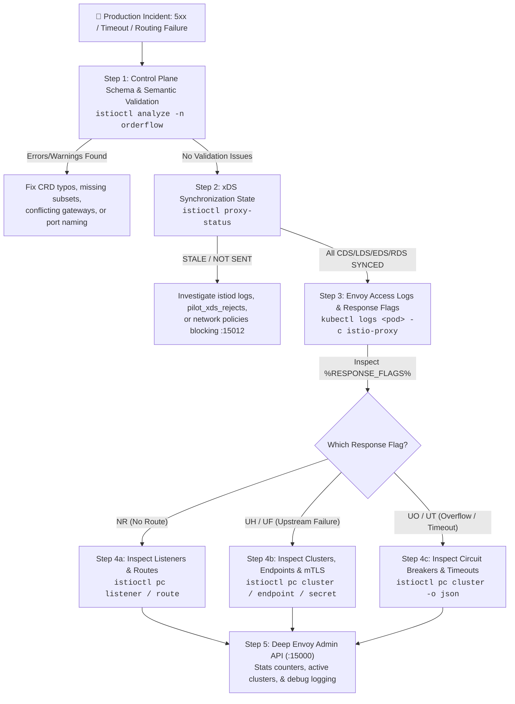
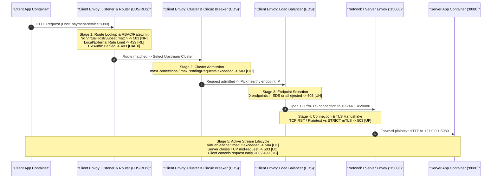
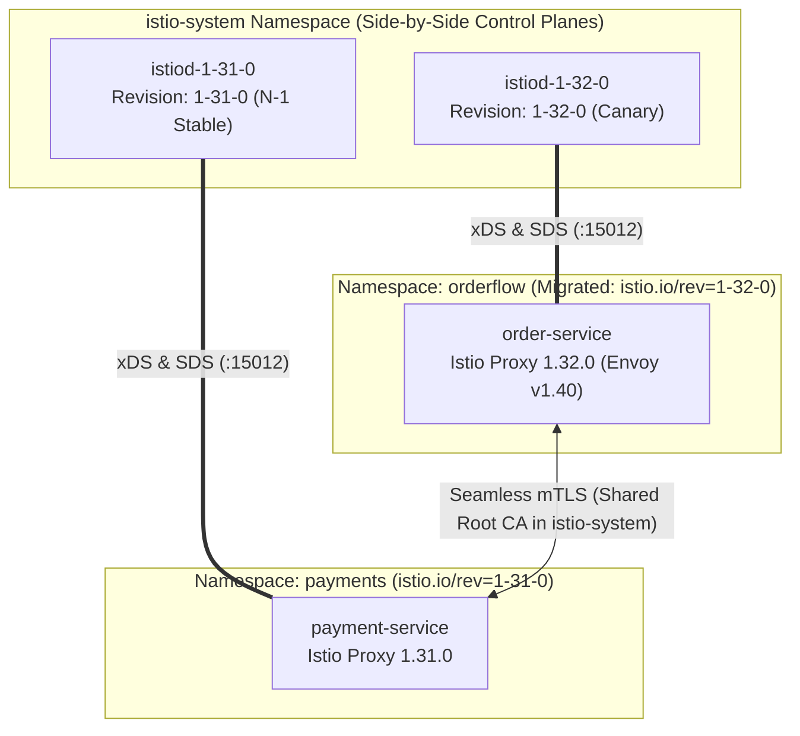

# Module 08: Debugging, Troubleshooting, and Production Operations

> **Version & Fellowship Context**
> - **Version Baseline (November 2026)**: Istio `1.32.0` (Canary Upgrade from `1.31.0`) | Envoy `v1.40` | Kubernetes `v1.36+` | Gateway API `v1.6.1` — see [`../VERSIONS.md`](../VERSIONS.md) and [`../COMPATIBILITY.md`](../COMPATIBILITY.md).
> - **Fellowship Cohort 01 Mapping**: Complete this module alongside **[Week 09: Production Operations & War-Room Debugging](../fellowship/week-09-production-operations-and-war-room/WEEK.md)**.

Operating a service mesh in enterprise production requires shifting from guesswork ("restart the pod and hope it works") to a deterministic, layered diagnostic methodology. Because Istio intercepts every packet via Envoy (`istio-proxy`) or `ztunnel` and programs those proxies asynchronously via `istiod` over xDS, failures almost always leave an exact, provable fingerprint in control plane validation, xDS synchronization state, Envoy access log response flags, or the compiled Envoy configuration dump.

In this module, you will master the **5-Step Istio Troubleshooting Methodology**, decode every **Envoy Response Flag**, eliminate the most common **Production Operational Pitfalls** (protocol sniffing hangs, Kubernetes Job sidecar lifecycle deadlocks, and rolling deployment `503` race conditions), and execute **Zero-Downtime Revision-Based Canary Control Plane Upgrades**.

---

## 1. The 5-Step Systematic Istio Troubleshooting Methodology

When a request fails, times out, or routes unexpectedly inside an Istio mesh, never start by randomly editing `VirtualService` or `DestinationRule` manifests. Instead, follow a strict 5-step decision tree that narrows the blast radius from the control plane down to the individual socket.



### Step 1: Control Plane Schema & Semantic Validation (`istioctl analyze`)
Kubernetes admission webhooks (`istio-validator-istio-system`) validate syntax when you run `kubectl apply`, but they **cannot** always catch cross-resource semantic errors (for example, a `VirtualService` referencing a subset `v3` when the `DestinationRule` only defines `v1` and `v2`, or a `Gateway` selecting a label that matches zero pods).

Run `istioctl analyze` against your live cluster or against candidate YAML manifests before applying them in CI/CD:

```bash
# Analyze a specific namespace in the live cluster
istioctl analyze -n orderflow

# Analyze local manifests combined with live cluster state before applying
istioctl analyze -n orderflow ./manifests/*.yaml

# Analyze all namespaces
istioctl analyze --all-namespaces
```

### Step 2: xDS Synchronization Verification (`istioctl proxy-status`)
Even if your YAML is valid, Envoy only knows what `istiod` has pushed to it via the xDS gRPC stream (`:15012`). Check whether every proxy has received and acknowledged (`ACK`) the latest configuration:

```bash
istioctl proxy-status
```

Example output:
```text
NAME                                                   CLUSTER        CDS        LDS        EDS        RDS          ECDS         ISTIOD                      VERSION
frontend-6b7f8c9d4-x9k2p.orderflow                     Kubernetes     SYNCED     SYNCED     SYNCED     SYNCED       NOT SENT     istiod-7f8b9c6d5-m4n2q      1.32.0
order-service-v1-84c9d7f5b-p2l9m.orderflow             Kubernetes     SYNCED     SYNCED     SYNCED     SYNCED       NOT SENT     istiod-7f8b9c6d5-m4n2q      1.32.0
payment-service-v1-5d9c8b7f4-k8j3v.orderflow           Kubernetes     SYNCED     SYNCED     SYNCED     STALE (Never Acknowledged) istiod-7f8b9c6d5-m4n2q  1.32.0
```

- **`SYNCED`**: `istiod` sent the latest version of that xDS API (CDS/LDS/EDS/RDS) and Envoy replied with an `ACK`.
- **`NOT SENT`**: `istiod` has nothing to send for that API (normal for `ECDS` unless you use `WasmPlugin`/`EnvoyFilter`, or normal for `RDS` on pure TCP proxies like `istio-egressgateway` with no HTTP routes).
- **`STALE`**: `istiod` pushed a new configuration, and either Envoy rejected it (`NACK` due to an invalid `EnvoyFilter` or malformed regex) or `istiod` is overloaded/disconnected.
- **Compare a single pod's Envoy config against what `istiod` *thinks* it should have**:
  ```bash
  istioctl proxy-status order-service-v1-84c9d7f5b-p2l9m.orderflow
  ```
  This performs a live diff between `istiod`'s internal xDS generator and the pod's `/config_dump` endpoint.

### Step 3: Envoy Access Logs & Response Flags
Always inspect **both** the client's outbound (`upstream_cluster: outbound|...`) and the server's inbound (`upstream_cluster: inbound|...`) Envoy access logs.
- If the request appears in the **client** sidecar log with `503 UF`, `503 NR`, or `503 UO`, and **never** appears in the **server** sidecar log, the failure happened during client-side routing, circuit breaking, or mTLS connection establishment.
- If the request appears in **both** the client and server sidecar logs, the network and mTLS handshake succeeded; look at the server sidecar log to see whether the local application container caused the error.

### Step 4: Envoy Configuration Inspection (`istioctl proxy-config`)
Inspect the exact xDS state programmed into a specific pod's Envoy proxy following the packet's lifecycle:

| xDS Resource | CLI Command (`istioctl pc ...`) | What It Controls in Envoy |
| :--- | :--- | :--- |
| **Listeners (LDS)** | `istioctl pc listener <pod>.<ns>` | IP/Port bindings (`0.0.0.0:8080`, `15001`, `15006`), Filter Chains, HTTP Connection Manager vs. TCP Proxy, and SNI matching. |
| **Routes (RDS)** | `istioctl pc route <pod>.<ns> --name 8080` | HTTP virtual hosts (`Domains`), path/header matching rules, timeouts, retries, and target cluster names. |
| **Clusters (CDS)** | `istioctl pc cluster <pod>.<ns> --fqdn <svc>` | Upstream service definitions, load balancing algorithm, circuit breaker thresholds (`maxConnections`), and outbound TLS settings. |
| **Endpoints (EDS)** | `istioctl pc endpoint <pod>.<ns> --cluster "..."` | Concrete Pod IP:Port targets belonging to a Cluster, along with their health status (`HEALTHY` / `UNHEALTHY`) and locality weight. |
| **Secrets (SDS)** | `istioctl pc secret <pod>.<ns>` | Workload X.509 mTLS certificate (`default`), root CA bundle (`ROOTCA`), and expiration timestamps. |

### Step 5: Live Envoy Admin API (`localhost:15000`) & Dynamic Logging
Every `istio-proxy` exposes its internal Admin interface on `127.0.0.1:15000`. You can query or modify a single pod's Envoy diagnostic level on the fly without restarting the pod:

```bash
# View non-zero Envoy metrics (circuit breaker overflows, TLS handshake failures, retries)
kubectl exec -n orderflow deploy/order-service-v1 -c istio-proxy -- \
  pilot-agent request GET stats | grep -E "overflow|cx_connect_fail|ssl.fail|retry"

# Dynamically enable debug logging on a single pod's Envoy for the 'http' and 'router' loggers
istioctl proxy-config log deploy/order-service-v1.orderflow --level http:debug,router:debug,connection:debug

# Reset logging back to warning after capturing the failure
istioctl proxy-config log deploy/order-service-v1.orderflow --level warning
```

---

## 2. Complete Deep-Dive into Envoy Response Flags

When Envoy generates a synthetic HTTP status code (most notoriously `503 Service Unavailable`) or terminates a connection, it records a **Response Flag** (`%RESPONSE_FLAGS%` in text logs, `response_flags` in JSON logs). Memorizing and referencing how Envoy's internal request pipeline produces these flags turns "mystery `503` errors" into 30-second root-cause diagnoses.



### Comprehensive Envoy Response Flags Reference Table

| Flag | Full Name | Typical HTTP Code | Envoy Pipeline Stage | Exact Istio / Kubernetes Root Causes & How to Fix |
| :--- | :--- | :--- | :--- | :--- |
| **`NR`** | **No Route Configured** | `503` or `404` | Listener / RDS Route Matching | 1. **`VirtualService` routes to a `subset` that does not exist** in the `DestinationRule` (Envoy creates the route pointing to cluster `outbound\|8080\|v3\|...`, which does not exist in CDS).<br/>2. **Missing `Host` match** in a `Gateway`-attached `VirtualService`.<br/>3. **`Sidecar` CRD egress restriction** omitted the destination service and outbound traffic policy is `REGISTRY_ONLY` (or a blackhole route matched). |
| **`UH`** | **No Healthy Upstream** | `503` | EDS Load Balancing | 1. **Zero running/ready pods** match the Kubernetes `Service` selector or the `DestinationRule` subset label selector (`istioctl pc endpoint` shows empty list).<br/>2. **100% of endpoints were ejected** by `outlierDetection` (`maxEjectionPercent: 100`). |
| **`UF`** | **Upstream Connection Failure** | `503` | Upstream TCP / TLS Handshake | 1. **mTLS Conflict**: Client `DestinationRule` specifies `tls.mode: DISABLE` (plaintext) while the server enforces `PeerAuthentication` `mode: STRICT`. Often paired with `URX` if retried.<br/>2. **Wrong `targetPort`** on the Kubernetes `Service` (no process listening on that container port, causing immediate `TCP RST`).<br/>3. **Kubernetes `NetworkPolicy`** dropping packets between pods or blocking port `15008` (HBONE). |
| **`UO`** | **Upstream Overflow** | `503` | CDS Circuit Breaker | **Circuit breaker tripped**: The upstream cluster exceeded `trafficPolicy.connectionPool.tcp.maxConnections`, `http.http1MaxPendingRequests`, `http.http2MaxRequests`, or `http.maxRequestsPerConnection` in its `DestinationRule`. Confirm via `upstream_rq_pending_overflow` counter in Envoy stats. |
| **`UT`** | **Upstream Request Timeout** | `504` | Router Filter Timer | The upstream failed to respond within the `timeout` or `retries.perTryTimeout` configured in the `VirtualService`. |
| **`UC`** | **Upstream Connection Termination** | `503` | Active Upstream Stream | 1. **HTTP Keep-Alive Race Condition**: The upstream application server (`Node.js` defaults to 5s keep-alive, `Go`, `Gunicorn`, `Tomcat`) closed an idle pooled TCP connection at the exact millisecond Envoy sent a new HTTP request over that socket.<br/>2. **Application Crash / OOMKill** mid-request.<br/>3. **Protocol Mismatch**: Envoy sent HTTP/2 frames (`PRI * HTTP/2.0`) to an HTTP/1.1 server because the Service port was mistakenly named `grpc-*` or `http2-*`. |
| **`DC`** | **Downstream Connection Termination** | `0` (`-`) or `499` | Downstream Listener | The **caller (client)** closed the TCP connection or hit its own client-side timeout before the upstream finished responding. If `response_code` is `0` with flag `DC`, stop blaming the server—either the client's timeout is shorter than the server's latency, or the user navigated away. |
| **`URX`** | **Upstream Retry Limit Exceeded** | `503` / `504` | Router Retry Policy | Envoy attempted all configured `retries.attempts` in the `VirtualService` and every attempt failed. `URX` always appears alongside the underlying failure flag (e.g., `UF,URX` or `UT,URX`). |
| **`RL`** | **Rate Limited** | `429` | Rate Limit Filter | Request was rejected by Envoy's `local_rate_limit` filter or an external Rate Limit Service (`RLS`) configured via `EnvoyFilter`. |
| **`UAEX`** | **Unauthorized External Service** | `401` / `403` | External Authz Filter | Request was rejected by a `CUSTOM` `AuthorizationPolicy` delegating to an external authorization provider (e.g., `oauth2-proxy` or external OPA). Note: Native Istio `DENY`/`ALLOW` policies return `403` with response details `rbac_access_denied_matched_policy[...]` rather than `UAEX`. |
| **`NC`** | **No Cluster Found** | `503` | Router Cluster Lookup | The route points to an upstream cluster name that is not present in Envoy's Cluster Discovery Service (CDS) table. |
| **`DT`** | **Duration Timeout** | `504` / `408` | HTTP Connection Manager | Request exceeded `max_stream_duration` configured on the connection pool. |

---

## 3. Production Operational Pitfalls & How to Solve Them

### Pitfall 1: Protocol Sniffing & Server-First Protocols (MySQL, Redis, PostgreSQL, MongoDB)
In Kubernetes, a `Service` port definition looks like:
```yaml
ports:
  - port: 3306
    targetPort: 3306
    # ❌ DANGER: No 'name' or 'appProtocol' specified!
```
When Istio does not know whether port `3306` carries HTTP/1.1, HTTP/2, gRPC, or raw TCP, Envoy falls back to **Automatic Protocol Sniffing**:
1. In **Client-First protocols** (like HTTP or TLS), the client connects and immediately sends bytes (`GET / HTTP/1.1` or a TLS `ClientHello`). Envoy inspects those initial bytes and routes accordingly.
2. In **Server-First protocols** (like **MySQL**, **MariaDB**, **SMTP**, **FTP**, and **MongoDB wire protocol** in certain handshakes), the client opens a TCP connection and **waits silently** for the server to send the initial greeting packet first.
3. Because the client is waiting for the server, and the client's Envoy sidecar is waiting up to **5 seconds** (`protocolDetectionTimeout`) for the client to send bytes so it can sniff the protocol, **every new database connection hangs for 5 seconds** (or fails outright if the client driver has a `<5s` connect timeout)!

#### The Mandatory Production Fix: Explicit Port Naming or `appProtocol`
Every single `Service` port in an Istio mesh **must** declare its protocol explicitly using either the `<protocol>[-<suffix>]` port `name` convention or the Kubernetes `appProtocol` field:

```yaml
apiVersion: v1
kind: Service
metadata:
  name: order-db
  namespace: orderflow
spec:
  ports:
    # Option A: Explicit prefix in port 'name'
    - name: tcp-mysql
      port: 3306
      targetPort: 3306
    # Option B: Standard Kubernetes 'appProtocol' field (K8s 1.20+)
    - name: api
      appProtocol: http
      port: 8080
      targetPort: 8080
    - name: rpc
      appProtocol: grpc
      port: 9090
      targetPort: 9090
```
**Supported Istio Protocol Prefixes**: `http`, `http2`, `https`, `grpc`, `grpc-web`, `mongo`, `redis`, `mysql`, `tls`, `tcp`, `udp`.
> [!WARNING]
> Conversely, never name a plain HTTP/1.1 port `grpc-*` or `http2-*`! If you do, Envoy disables protocol sniffing and forces upstream HTTP/2 framing, causing HTTP/1.1 servers to immediately reject the connection with `503 UC` (`upstream_reset_before_response_started{protocol_error}`).

---

### Pitfall 2: The Kubernetes `Job` & `CronJob` Sidecar Lifecycle Problem
In traditional Kubernetes (`< 1.28`), a Pod does not have a native distinction between a "main application container" and a "sidecar container."
- When you run a Kubernetes `Job` (for example, a database migration or batch settlement script) with Istio sidecar injection enabled, the Pod runs two regular containers: `db-migrator` and `istio-proxy`.
- When `db-migrator` finishes its work and exits with code `0`, **`istio-proxy` continues running indefinitely**.
- Because a Kubernetes `Job` only marks a Pod as `Completed` when **all** containers in the Pod have terminated with exit code `0`, the Job hangs forever in `Ready 1/2 (NotReady)`!

#### Solution A (Modern Standard: Kubernetes 1.29+ & Istio 1.20+): Native Sidecar Containers
Kubernetes 1.29 graduated `SidecarContainers` (`KEP-753`) to beta (enabled by default), and Kubernetes 1.33 graduated it to GA. When enabled in Istio (`values.pilot.env.ENABLE_NATIVE_SIDECARS=true`, which is the default in recent Istio versions on K8s 1.29+), Istio injects `istio-proxy` into `spec.initContainers` with `restartPolicy: Always`.
- **Startup benefit**: Kubernetes guarantees `istio-proxy` starts and passes its readiness probe **before** the main application container even starts (eliminating startup race conditions where an app tries to connect to a database before Envoy is ready!).
- **Shutdown benefit**: When all regular `spec.containers` in a `Job` exit `0`, the `kubelet` automatically terminates native sidecar containers (`SIGTERM`), allowing the `Job` to complete cleanly with zero application code changes!

#### Solution B (Legacy Workaround for Older K8s Clusters): `/quitquitquit`
If you are running without Kubernetes native sidecars, the `Job` container must explicitly tell the local `pilot-agent` to shut down at the end of its script:
```bash
#!/bin/sh
set -e
# 1. Run the actual batch job
/app/run-migration

# 2. Gracefully terminate the local istio-proxy sidecar via its localhost admin port
curl -fsI -X POST http://127.0.0.1:15020/quitquitquit
```

---

### Pitfall 3: Pod Shutdown Race Conditions (`503 UC/UF` During Rolling Deployments)
When Kubernetes terminates a Pod (during a rolling deployment or HPA scale-down), two events happen **in parallel** across the cluster:
1. **Control Plane Path (Slow: 1–3 seconds)**: The `kube-apiserver` removes the Pod IP from the `EndpointSlice` -> `istiod` watches the `EndpointSlice` -> `istiod` computes a new EDS update -> `istiod` pushes the EDS update to all client Envoys in the mesh.
2. **Node Kubelet Path (Immediate: < 50ms)**: The `kubelet` on the worker node immediately sends `SIGTERM` to **both** the application container and the `istio-proxy` container simultaneously.

If your application container or `istio-proxy` closes its listening socket immediately upon receiving `SIGTERM`, any upstream client Envoy that has not yet received the EDS removal update (during that 1–3 second propagation window) will still route live requests to the terminating Pod IP, resulting in a burst of `503 UF` or `503 UC` errors during every deployment!

#### How Istio Solves Pod Drain Race Conditions
1. **Default `drainDuration` (45s) & `TERMINATION_DRAIN_DURATION_SECONDS`**: When `pilot-agent` receives `SIGTERM`, it does **not** immediately kill Envoy. First, it marks the Envoy health check as failing, initiates graceful listener draining (`drainDuration: 45s` by default), and waits before sending `SIGTERM` to Envoy.
2. **`EXIT_ON_ZERO_ACTIVE_CONNECTIONS`**: Instead of forcing every pod termination to wait a static sleep period, set the proxy metadata `EXIT_ON_ZERO_ACTIVE_CONNECTIONS: "true"`:
   ```yaml
   metadata:
     annotations:
       proxy.istio.io/config: |
         terminationDrainDuration: 30s
         proxyMetadata:
           EXIT_ON_ZERO_ACTIVE_CONNECTIONS: "true"
   ```
   With this enabled, `pilot-agent` waits at least `MINIMUM_DRAIN_DURATION` (default `5s`, giving `istiod` plenty of time to remove the endpoint from EDS across the mesh), and then polls Envoy's active downstream connection gauges (`downstream_cx_active`). As soon as active connections hit `0`, Envoy exits immediately!
3. **Application `preStop` Hook**: Ensure your **application container** also does not exit immediately on `SIGTERM` while Envoy is still draining inbound requests to it:
   ```yaml
   lifecycle:
     preStop:
       exec:
         command: ["/bin/sh", "-c", "sleep 5"]
   ```

---

## 4. Control Plane Scaling, High Availability & Canary Upgrades

In production, `istiod` is a critical infrastructure dependency. While existing pods can continue forwarding traffic if `istiod` goes down briefly (because Envoy caches its last known xDS state in memory), **no new pods can start** (because `istiod` serves the MutatingAdmissionWebhook for sidecar injection and signs initial SPIFFE certificates via SDS), and **no endpoint changes can propagate**.

### High-Availability `istiod` Architecture
A production `istiod` deployment must configure:
1. **Minimum 3 Replicas across Availability Zones** (`topologySpreadConstraints` or `podAntiAffinity` on `topology.kubernetes.io/zone`).
2. **HorizontalPodAutoscaler (HPA)**: Scale `istiod` between `3` and `10+` replicas at `70%` CPU utilization. `istiod` CPU usage scales primarily with **(Number of Services/Endpoints) × (Number of Watching Proxies)** during xDS push storms.
3. **PodDisruptionBudget (PDB)**: Set `minAvailable: 2` (or `maxUnavailable: 1`) so cluster node upgrades (`kubectl drain`) never evict all `istiod` pods simultaneously.
4. **Scoped xDS Push Graphs via `Sidecar` CRDs**: As covered in Module 04, without a `Sidecar` resource, every Envoy receives EDS updates for every pod in the entire cluster ($O(N^2)$ memory and CPU). Scoping namespaces with `Sidecar` resources reduces `istiod` memory consumption and xDS push latency by up to 90%.

### In-Place Upgrades vs. Revision-Based Canary Control Plane Upgrades

Never upgrade a production service mesh using an in-place upgrade (`istioctl upgrade`) where a single `istiod` deployment is overwritten in place. Instead, use **Revision-Based Canary Control Plane Upgrades**.



#### How Revision-Based Canary Upgrades Work:
1. **Install the New Control Plane Side-by-Side**:
   When you install Istio `1.32.0` with `--set revision=1-32-0` (or via Helm `--set revision=1-32-0`), Istio creates a second, independent deployment named `istiod-1-32-0`, a dedicated service `istiod-1-32-0.istio-system.svc`, and a revision-specific `MutatingWebhookConfiguration` (`istio-sidecar-injector-1-32-0`).
2. **Zero Impact on Existing Workloads**:
   Both `istiod` revisions share the same cluster Root CA (`istio-ca-secret` or external `cacerts` in `istio-system`) and watch the same Istio CRDs (`VirtualService`, `DestinationRule`, `AuthorizationPolicy`). Pods managed by `1-31-0` and pods managed by `1-32-0` communicate seamlessly over mTLS with zero disruption.
3. **Granular Workload Migration (Namespace by Namespace)**:
   To migrate a namespace to the new revision, you update the namespace label from `istio.io/rev=1-31-0` (or `istio-injection=enabled`) to `istio.io/rev=1-32-0` and trigger a rolling restart (`kubectl rollout restart deployment -n orderflow`).
4. **Instant Rollback**:
   If you observe elevated latency or errors on the canary revision, you simply flip the namespace label back to the old revision and run `kubectl rollout restart`. No control plane downgrade is required!
5. **Decommission the Old Revision**:
   Once `istioctl proxy-status` confirms zero proxies remain connected to the old `istiod` revision, you cleanly uninstall the old control plane revision (`istioctl uninstall --revision=1-31-0` or `helm uninstall istiod-1-31-0 -n istio-system`).

---

## Next Step: Enter the Production War-Room
Proceed to **[LAB.md](./LAB.md)** to diagnose and resolve 5 live mystery outages in the `orderflow` cluster and execute a zero-downtime revision-based canary upgrade of `istiod`.
