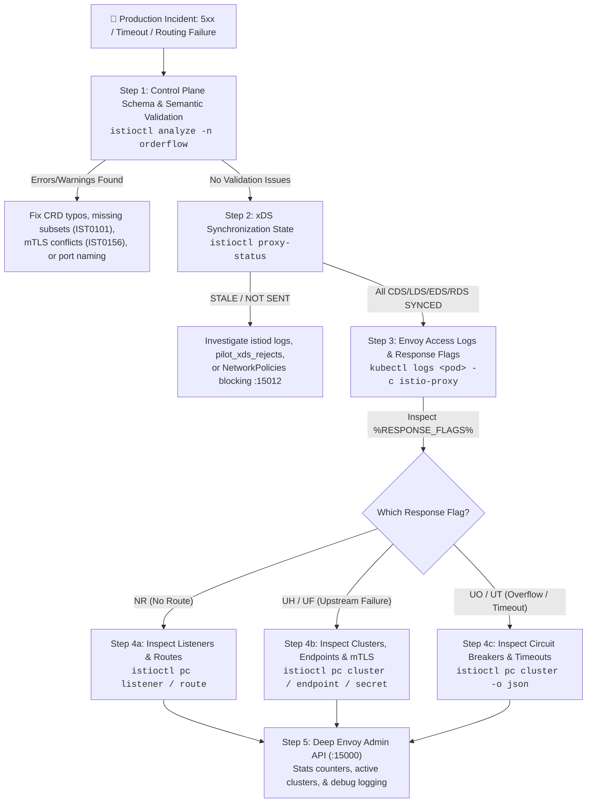
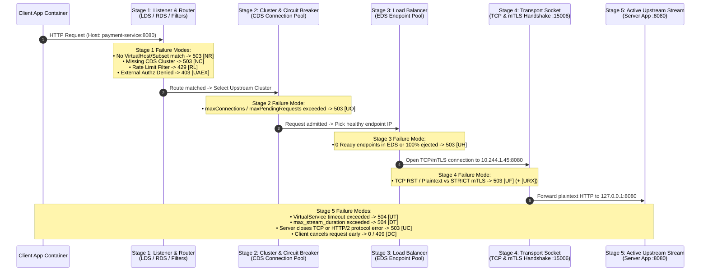

# Lesson 08.1: The 5-Step Istio Troubleshooting Methodology & Complete Envoy Response Flags Decoder

> **Navigation**: [Fellowship Portal](../../README.md) > [Week 09: Incident Response & Control Plane Ops](../../fellowship/week-09-incident-response-and-control-plane-ops/WEEK.md) > [Module 08: Debugging & Production Operations](../README.md) > **Lesson 08.1**
> - **Estimated Completion Time**: 30 minutes
> - **Prerequisites**: [Module 07: Observability & Telemetry](../../07-observability-and-telemetry/README.md)
> - **Authoritative Version Baseline**: Istio `1.32.0` | Envoy `v1.40` | Kubernetes `v1.36+` | Gateway API `v1.6.1`

---

## Learning Objectives

By the end of this lesson, you will be able to:
1. Execute the deterministic **5-Step Istio Troubleshooting Decision Tree** (`istioctl analyze` -> `istioctl proxy-status` -> Envoy Access Logs -> `istioctl proxy-config` -> Envoy Admin `:15000`).
2. Decode all 12 **Envoy Response Flags** (`NR`, `UH`, `UF`, `UO`, `UT`, `UC`, `DC`, `URX`, `RL`, `UAEX`, `NC`, `DT`) and map each flag to its exact failure stage inside Envoy `v1.40`'s request processing pipeline.
3. Inspect compiled xDS state (`listener`, `route`, `cluster`, `endpoint`, `secret`) and dynamically toggle Envoy debug loggers on a single pod without restarting containers.

---

## 1. NovaPay Engineering Context & Alex Morgan's Briefing

### What Is Happening at NovaPay?
At **NovaPay**, when an on-call engineer gets paged at 3:00 AM for a sudden spike in `HTTP 503 Service Unavailable` errors on `payment-service`, the worst possible reaction is "guess-and-restart": running `kubectl rollout restart`, randomly editing `VirtualService` YAML, or disabling mTLS in a panic.

Yesterday during a staging game-day drill led by **Sarah Chen (SRE Lead)**, three engineers were given the exact same `503 Service Unavailable` symptom. Two engineers spent 40 minutes guessing and reading application logs (which were completely empty!). The third engineer checked a single field in the caller's Envoy access log—**`%RESPONSE_FLAGS%`**—saw **`UF,URX`**, ran `istioctl analyze -n orderflow`, and resolved the mTLS conflict in **38 seconds**.

### Alex's Briefing & Intuition Analogy

> **Alex Morgan (Senior Platform Engineer)**:
> "To an uninitiated developer, Envoy returning `HTTP 503 Service Unavailable` feels frustratingly generic—five completely different failures (`No Route`, `No Healthy Pods`, `TLS Handshake Failure`, `Circuit Breaker Tripped`, and `Server Keep-Alive Disconnect`) all return HTTP `503` to the client!
>
> Why? Because the HTTP specification doesn't have separate status codes for 'your `DestinationRule` subset doesn't exist in CDS' versus 'your connection pool exceeded `maxConnections`.' Instead, Envoy attaches an exact forensic fingerprint to every access log line and Prometheus metric: the **Envoy Response Flag** (`NR`, `UH`, `UF`, `UO`, `UC`, `UT`, `DC`, `URX`).
>
> Learning the **5-Step Troubleshooting Decision Tree** and the **5-Stage Envoy Pipeline Decoder** is like switching from guessing why a car won't start to plugging an OBD-II diagnostic scanner directly into the engine computer. Every failure in Istio leaves a deterministic, provable fingerprint."

---

## 2. Core Concept: The 5-Step Istio Troubleshooting Decision Tree

When any request fails, times out, or routes unexpectedly inside an Istio mesh, walk this 5-step decision tree top-to-bottom to narrow the blast radius from the control plane down to the individual socket:



### 6-Part Mechanism Walkthrough: The 5-Step Diagnostic Flow
1. **What initiates the operation?**
   An alert fires (or a user reports `5xx` / timeout errors) on an Istio-managed service in `orderflow`.
2. **Which component receives it?**
   First, the on-call engineer interrogates the **Control Plane validator** (`istioctl analyze -n orderflow`) and the **xDS synchronization plane** (`istioctl proxy-status`).
3. **What information is exchanged?**
   - `istioctl analyze` fetches live CRDs (`VirtualService`, `DestinationRule`, `PeerAuthentication`, `Gateway`, `Service`) from the Kubernetes API server and runs cross-resource semantic analyzers (`IST0101` missing subset, `IST0156` mTLS conflict, `IST0118` unnamed port).
   - `istioctl proxy-status` queries `istiod` (`:15014/debug/syncz`) to verify whether every pod's Envoy proxy has acknowledged (`ACK` -> `SYNCED`) the latest CDS, LDS, EDS, and RDS pushes over `:15012`.
4. **What changes in the system?**
   Once control plane validity and xDS sync are confirmed, the engineer inspects **both** the caller's outbound (`outbound|...`) and the server's inbound (`inbound|...`) Envoy access logs (`kubectl logs <pod> -c istio-proxy`) to read the `%RESPONSE_FLAGS%` and `%RESPONSE_CODE_DETAILS%`.
5. **How can you observe/verify it on your cluster?**
   Based on the response flag, the engineer inspects the exact compiled xDS table inside the pod's Envoy proxy using `istioctl proxy-config` (`listener`, `route`, `cluster`, `endpoint`, `secret`) and queries Envoy's localhost Admin API (`pilot-agent request GET stats`).
6. **What happens if a component fails?**
   - If the request appears in the **client** sidecar log (`503 NR`, `503 UO`, `503 UF`, `503 UH`) and **never** appears in the **server** sidecar log, the failure occurred before HTTP bytes could cross the network to the server.
   - If the request appears in **both** client and server sidecar logs, the network and mTLS handshake succeeded; the failure occurred between the server's inbound Envoy (`127.0.0.1:8080`) and the application container.

---

## 3. Technical Deep Dive: The 5-Stage Envoy Pipeline & Complete Response Flags Decoder

To understand *why* Envoy emits a specific response flag, trace how an HTTP request travels through the 5 internal stages of a caller's outbound Envoy proxy (`v1.40`):



### 6-Part Mechanism Walkthrough: Envoy Request Pipeline & Flag Generation
1. **What initiates the operation?**
   The client application sends an outbound HTTP request (`Host: payment-service:8080`), which `iptables` / `istio-cni` redirects into Envoy's outbound capture port (`:15001`).
2. **Which component receives it?**
   Envoy's virtual outbound listener hands the connection to the port-specific **HTTP Connection Manager (HCM)** and **Router filter** (Stage 1: LDS/RDS).
3. **What information is exchanged?**
   The Router looks up the target `VirtualHost` and `Route` in RDS, checks rate-limit/authz filters, verifies cluster admission against **Circuit Breaker** thresholds in CDS (Stage 2), asks the **Load Balancer** for a healthy endpoint IP from EDS (Stage 3), initiates a **TCP + mTLS handshake** with the upstream pod (Stage 4), and streams the HTTP request while starting the route **Timeout timer** (Stage 5).
4. **What changes in the system?**
   If any of the 5 stages cannot proceed, Envoy aborts processing at that exact stage, generates a synthetic HTTP status code (`503`, `504`, `429`, `403`, or `0`), and stamps the corresponding **Response Flag** (`%RESPONSE_FLAGS%`) and **`%RESPONSE_CODE_DETAILS%`** onto the access log and Prometheus `istio_requests_total` metric.
5. **How can you observe/verify it on your cluster?**
   Inspect `kubectl logs <pod> -c istio-proxy` for the 2-to-4 letter uppercase flag (`NR`, `UH`, `UF`, `UO`, `UT`, `UC`, `DC`, `URX`) and check `%UPSTREAM_HOST%` (note: if `%UPSTREAM_HOST%` is `-`, the failure occurred in Stage 1, 2, or 3 before any upstream Pod IP was even contacted!).
6. **What happens if a component fails?**
   If a `VirtualService` retry policy covers the failure condition (e.g., `retryOn: connect-failure,reset,5xx`), Envoy repeats Stages 3–5 up to `retries.attempts` times. If all retry attempts fail, Envoy appends **`URX`** (*Upstream Retry Limit Exceeded*) alongside the root-cause flag (e.g., **`UF,URX`** or **`UT,URX`**).

---

### Master Envoy Response Flags Decoder Table

| Flag | Full Name | Typical HTTP Code | Pipeline Stage | Exact Istio / Kubernetes Root Causes & First Diagnostic Command |
| :--- | :--- | :---: | :--- | :--- |
| **`NR`** | **No Route Configured** | `503` / `404` | Stage 1 (LDS/RDS) | 1. **`VirtualService` routes to a `subset` missing from `DestinationRule`**. <br/>2. **`Sidecar` CRD egress restriction** stripped the target service (`BlackHoleCluster`).<br/>3. Missing `Host` match on a `Gateway` `VirtualService`.<br/>**Run**: `istioctl analyze -n <ns>` & `istioctl pc route <pod>.<ns> --name <port> -o json` |
| **`NC`** | **No Cluster Found** | `503` | Stage 1 (RDS -> CDS) | Route points to an upstream cluster name that does not exist in Envoy's CDS table.<br/>**Run**: `istioctl pc cluster <pod>.<ns>` |
| **`RL`** | **Rate Limited** | `429` | Stage 1 (HTTP Filter) | Request rejected by Envoy's `local_rate_limit` filter or external Rate Limit Service.<br/>**Run**: `istioctl pc listener <pod>.<ns> -o json` |
| **`UAEX`** | **Unauthorized External Service** | `401` / `403` | Stage 1 (ExtAuthz) | Rejected by a `CUSTOM` `AuthorizationPolicy` external authz provider. *(Note: native Istio RBAC denials return `403` with details `rbac_access_denied_matched_policy[...]` and flag `-`)*. |
| **`UO`** | **Upstream Overflow** | `503` | Stage 2 (CDS Circuit Breaker) | **Circuit breaker tripped**: Upstream cluster exceeded `maxConnections`, `http1MaxPendingRequests`, or `http2MaxRequests` in `DestinationRule`.<br/>**Run**: `kubectl exec <pod> -c istio-proxy -- pilot-agent request GET stats \| grep overflow` |
| **`UH`** | **No Healthy Upstream** | `503` | Stage 3 (EDS Load Balancer) | 1. **Zero running/ready pods** match the `Service` or `DestinationRule` subset selector.<br/>2. **100% of pods ejected** by `outlierDetection` (`maxEjectionPercent: 100`).<br/>**Run**: `istioctl pc endpoint <pod>.<ns> --cluster "outbound\|<port>\|<subset>\|<fqdn>"` |
| **`UF`** | **Upstream Connection Failure** | `503` | Stage 4 (TCP / mTLS Socket) | 1. **mTLS Conflict**: Caller `DestinationRule` has `tls.mode: DISABLE` while server `PeerAuthentication` requires `STRICT`.<br/>2. Wrong `targetPort` on `Service` (causes immediate `TCP RST`).<br/>3. Kubernetes `NetworkPolicy` dropping packets.<br/>**Run**: `istioctl analyze -n <ns>` & `istioctl pc cluster <pod>.<ns> --fqdn <fqdn> -o json` |
| **`UT`** | **Upstream Request Timeout** | `504` | Stage 5 (Router Timer) | Upstream did not respond within `VirtualService` `timeout` or `retries.perTryTimeout`.<br/>**Run**: `istioctl pc route <pod>.<ns> --name <port> -o json` |
| **`DT`** | **Duration Timeout** | `504` / `408` | Stage 5 (Stream Timer) | Request exceeded `max_stream_duration` configured on the connection pool. |
| **`UC`** | **Upstream Connection Termination** | `503` | Stage 5 (Active Stream) | 1. **Protocol Mismatch (`protocol_error`)**: Service port named `grpc-*` / `http2-*`, forcing Envoy to send HTTP/2 frames to an HTTP/1.1 server.<br/>2. **HTTP Keep-Alive Race**: Upstream app closed idle socket at the exact moment Envoy reused it.<br/>3. **Upstream OOMKill / crash** mid-request.<br/>**Run**: Check `%RESPONSE_CODE_DETAILS%` (`protocol_error` vs. `remote_reset`) & `istioctl pc cluster -o json` |
| **`DC`** | **Downstream Connection Termination** | `0` / `499` | Stage 5 (Downstream Socket) | **Caller closed the connection early** (caller timeout shorter than server latency, or user closed browser). Stop blaming the upstream server! |
| **`URX`** | **Upstream Retry Limit Exceeded** | `503` / `504` | Stage 5 (Retry Router) | Envoy exhausted all `retries.attempts` in `VirtualService`. Always inspect the companion flag (`UF,URX`, `UT,URX`, `UC,URX`) for the underlying failure cause. |

---

## 4. Deep Envoy Inspection: `istioctl proxy-config` & Admin Port `:15000`

### 4.1 Mapping `istioctl proxy-config` (`pc`) to the Packet Lifecycle
| xDS Layer | Command (`istioctl pc ...`) | What You Are Verifying |
| :--- | :--- | :--- |
| **Listeners (LDS)** | `istioctl pc listener <pod>.<ns> --port 8080 -o json` | IP/Port bindings, Filter Chains, RBAC rules, HTTP Connection Manager vs. TCP Proxy. |
| **Routes (RDS)** | `istioctl pc route <pod>.<ns> --name 8080 -o json` | VirtualHost domain matching, header/URI match order, target subset clusters, timeouts, retries. |
| **Clusters (CDS)** | `istioctl pc cluster <pod>.<ns> --fqdn <fqdn> -o json` | Subset definitions, circuit breaker thresholds, `http2ProtocolOptions`, and `transportSocket` mTLS settings. |
| **Endpoints (EDS)** | `istioctl pc endpoint <pod>.<ns> --cluster "outbound\|..."` | Concrete Pod IP:Port endpoints and their `HEALTHY` / `UNHEALTHY` status. |
| **Secrets (SDS)** | `istioctl pc secret <pod>.<ns>` | SPIFFE X.509 workload certificate validity, serial number, and expiration timestamps. |

### 4.2 Live Envoy Admin API (`127.0.0.1:15000`) & Dynamic Scoped Debug Logging
When access logs aren't enough, you can query Envoy's internal counters or turn on `debug` logging for a specific subsystem (`http`, `router`, `connection`, `rbac`, `jwt`) on **one pod** in real time without restarting it:

```bash
# 1. Query internal Envoy counters for circuit breaker overflows, connection failures, or TLS errors
kubectl exec -n orderflow deploy/client-toolbox -c istio-proxy -- \
  pilot-agent request GET stats | grep -E "overflow|cx_connect_fail|ssl.fail|retry"

# 2. Dynamically enable debug logging on a single pod's Envoy proxy
istioctl proxy-config log deploy/client-toolbox.orderflow --level http:debug,router:debug,connection:debug

# 3. Always reset log level back to warning after capturing the reproduction!
istioctl proxy-config log deploy/client-toolbox.orderflow --level warning
```

---

## 5. Knowledge Check (Engineering Judgment)

### Question 1: Decoding a Mystery `503` Log Entry
During an outage, you inspect `order-service-v1`'s `istio-proxy` logs and see:
```text
"POST /charge HTTP/1.1" 503 UO upstream_overflow - "-" 0 81 0 - "-" "Go-http-client/1.1" "a1b2..." "payment-service:8080" "-" outbound|8080|v1|payment-service.orderflow.svc.cluster.local - 10.244.0.15:8080 10.244.0.12:51234 - -
```
Notice that duration is `0` ms and `%UPSTREAM_HOST%` is `"-"`. Did `payment-service-v1` crash, and where should you look to fix the issue?

<details>
<summary>Check Answer & Engineering Explanation</summary>

**Answer**: `payment-service-v1` did **not** crash—in fact, the request never left the `order-service-v1` pod!

**Engineering Explanation**: The response flag **`UO` (`upstream_overflow`)** with `0` ms duration and `"-"` upstream host proves that `order-service-v1`'s outbound Envoy proxy short-circuited the request locally at **Stage 2 (CDS Circuit Breaker)** because the active connections or pending requests to `outbound|8080|v1|payment-service...` exceeded the `connectionPool` limits configured in `payment-service`'s `DestinationRule`. Confirm via `pilot-agent request GET stats | grep overflow` and increase `maxConnections` / `http1MaxPendingRequests` in the `DestinationRule`.
</details>

### Question 2: Decoding `503 UC,URX` with `protocol_error`
A developer deploys a new REST HTTP/1.1 service `tax-service` on port `8080`, and names the Kubernetes `Service` port `grpc-tax`. Every call from `order-service` to `tax-service` fails immediately with `503 UC,URX` and details `upstream_reset_before_response_started{protocol_error}`. Explain the exact mechanism of this failure.

<details>
<summary>Check Answer & Engineering Explanation</summary>

**Answer**: Because the Kubernetes `Service` port name begins with the `grpc-` prefix, `istiod` programs `http2ProtocolOptions` on the `outbound|8080||tax-service...` CDS cluster. When `order-service`'s outbound Envoy connects to `tax-service`, it disables protocol sniffing and immediately sends an **HTTP/2 connection preface** (`PRI * HTTP/2.0\r\n\r\nSM\r\n\r\n`). Because `tax-service` is an HTTP/1.1 server, its HTTP parser rejects `PRI * HTTP/2.0` as invalid syntax and closes the TCP connection, causing Envoy to log **`503 UC,URX` (`protocol_error`)**.

**Fix**: Rename the `Service` port to `http-tax` (or set `appProtocol: http`).
</details>

---

## 6. Key Takeaways, Definition of Done & Next Lesson

### Key Takeaways
- Always follow the **5-Step Troubleshooting Decision Tree** (`istioctl analyze` -> `istioctl proxy-status` -> Envoy Access Logs -> `istioctl proxy-config` -> Envoy Admin `:15000`).
- Envoy's 12 Response Flags (`NR`, `UH`, `UF`, `UO`, `UT`, `UC`, `DC`, `URX`, `RL`, `UAEX`, `NC`, `DT`) pinpoint the exact internal stage where a request failed.
- If `%UPSTREAM_HOST%` in the client access log is `"-"`, the request was rejected locally inside the client's Envoy proxy (`NR`, `NC`, `UO`, `UH`) and never touched the network.

### Definition of Done
- [ ] You can map `NR`, `UO`, `UH`, `UF`, `UT`, and `UC` to their corresponding stages in the Envoy pipeline.
- [ ] You know which `istioctl proxy-config` subcommand inspects Listeners, Routes, Clusters, Endpoints, and Secrets.

### Authoritative References
- [Istio Documentation: Common Problems & Diagnostic Tools](https://istio.io/latest/docs/ops/common-problems/)
- [Envoy Proxy v1.40 Documentation: Access Log `%RESPONSE_FLAGS%`](https://www.envoyproxy.io/docs/envoy/latest/configuration/observability/access_log/usage)

**Next Lesson**: Proceed to **[Lesson 08.2: Production Pitfalls, Control Plane High Availability & Revision-Based Canary Upgrades](./02-production-pitfalls-and-canary-control-plane-upgrades.md)**.
