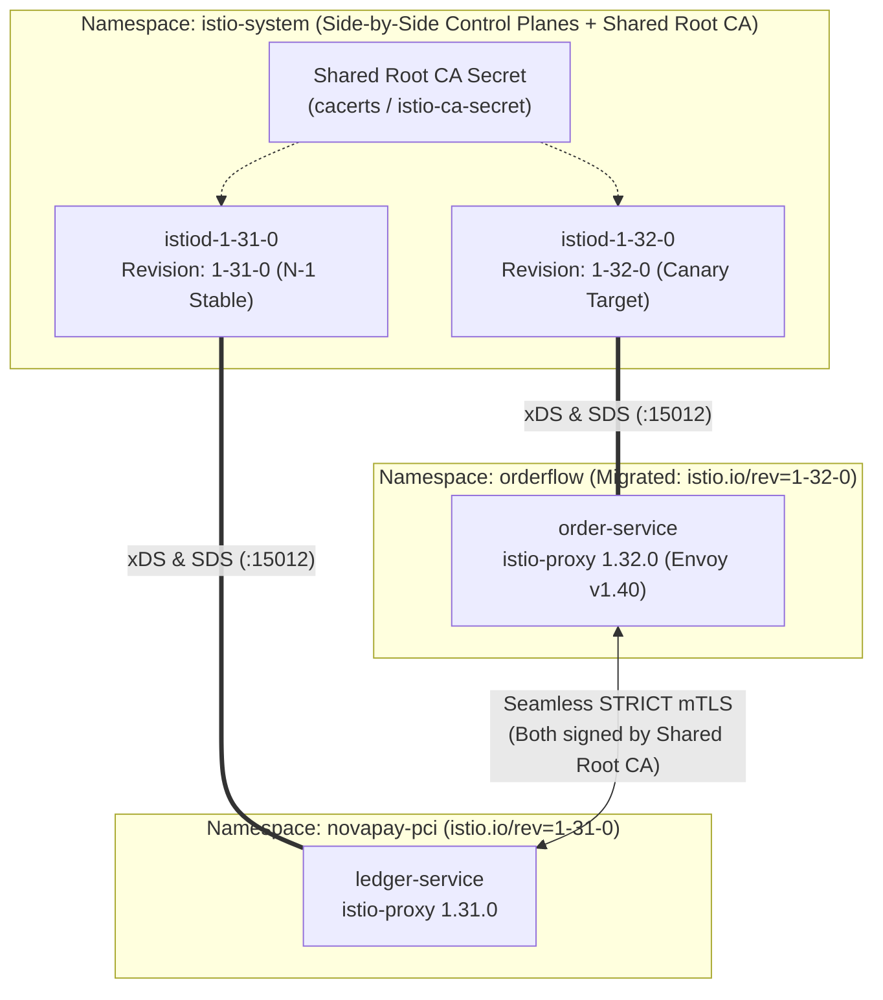

# Lesson 08.2: Production Pitfalls, Control Plane High Availability & Revision-Based Canary Upgrades

> **Navigation**: [Fellowship Portal](../../README.md) > [Week 09: Incident Response & Control Plane Ops](../../fellowship/week-09-incident-response-and-control-plane-ops/WEEK.md) > [Module 08: Debugging & Production Operations](../README.md) > **Lesson 08.2**
> - **Estimated Completion Time**: 25 minutes
> - **Prerequisites**: [Lesson 08.1: Systematic Debugging & Envoy Response Flags](./01-systematic-debugging-and-response-flags.md)
> - **Authoritative Version Baseline**: Istio `1.32.0` (`1.31.0` as N-1 Canary Baseline) | Envoy `v1.40` | Kubernetes `v1.36+` | Gateway API `v1.6.1`

---

## Learning Objectives

By the end of this lesson, you will be able to:
1. Prevent **Server-First Protocol Sniffing Deadlocks** (`5s` connection hangs on MySQL, Redis, and MongoDB) through mandatory explicit port naming (`http-*`, `grpc-*`, `tcp-*`) and `appProtocol`.
2. Solve the **Kubernetes `Job` / `CronJob` Sidecar Lifecycle Hang** using Kubernetes Native Sidecars (`KEP-753` / `ENABLE_NATIVE_SIDECARS=true`) or the `/quitquitquit` admin endpoint.
3. Eliminate **Pod Shutdown Race Conditions (`503 UC/UF` during rolling deployments)** using `EXIT_ON_ZERO_ACTIVE_CONNECTIONS: "true"`, `terminationDrainDuration`, and application `preStop` hooks.
4. Architect a High-Availability `istiod` control plane (3+ replicas, HPA, PDB, `Sidecar` CRD scoping) and execute **Zero-Downtime Revision-Based Canary Control Plane Upgrades** (`1-31-0` -> `1-32-0`).

---

## 1. NovaPay Engineering Context & Alex Morgan's Briefing

### What Is Happening at NovaPay?
As **NovaPay** prepares to migrate our PCI-DSS settlement workloads onto Istio `1.32.0`, **Sarah Chen (SRE Lead)** and **Daniel Brooks (Staff Backend Engineer)** compiled the post-mortems of three classic Day-2 operational pitfalls that hit engineering teams when they move from a toy demo cluster to high-scale production:
1. Every new connection from `order-service` to an in-cluster MySQL database mysteriously froze for **exactly 5.00 seconds** before succeeding.
2. Nightly Kubernetes `CronJob` settlement batches finished their SQL script in 12 seconds, yet the Job pods stayed stuck in `Running (1/2 Ready)` forever and never marked `Completed`.
3. Every time a team ran `kubectl rollout restart`, callers experienced a 2-second blip of `503 UF` and `503 UC` errors as old pods terminated.

### Alex's Briefing & Intuition Analogy

> **Alex Morgan (Senior Platform Engineer)**:
> "Every one of those three bugs comes from a mismatch between **how Kubernetes manages container lifecycles** and **how an asynchronous proxy intercepts sockets**:
> - **The 5-Second MySQL Freeze** is a classic polite standoff: MySQL is a *Server-First* protocol where the client connects and waits silently for the server to speak first. Meanwhile, if you forgot to name the Kubernetes Service port `tcp-mysql`, the client's Envoy sidecar intercepts the socket and waits silently for the *client* to speak first so it can sniff whether the bytes look like `GET / HTTP/1.1`! Both sides wait in silence until Envoy's 5-second `protocolDetectionTimeout` expires!
> - **The Rolling Deployment `503` Blip** happens because when Kubernetes deletes a pod, the local `kubelet` sends `SIGTERM` to the pod in **10 milliseconds**, while `istiod` takes **1 to 3 seconds** to propagate the endpoint removal (`EDS`) to every caller Envoy across a 200-node cluster. Unless the terminating pod stays alive and drains connections during that 3-second propagation window, callers will send live traffic to a dead socket!
> - And finally, when we upgrade Istio itself from `1.31.0` to `1.32.0`, we **never** overwrite `istiod` in place. We run both control planes side-by-side (`istiod-1-31-0` and `istiod-1-32-0`) and migrate namespaces one at a time."

---

## 2. Core Concept: Eliminating the Top 3 Production Data-Plane Pitfalls

### Pitfall 1: Server-First Protocol Sniffing Deadlocks (MySQL, MariaDB, SMTP, FTP, MongoDB)
When a Kubernetes `Service` port has no protocol prefix in `name` (e.g., `name: db-port`) and no `appProtocol`, Envoy falls back to **Automatic Protocol Sniffing**:
- For **Client-First protocols** (HTTP/1.1, HTTP/2, TLS), the client immediately sends bytes (`GET /...` or TLS `ClientHello`), so sniffing succeeds in microseconds.
- For **Server-First protocols** (MySQL on `:3306`, SMTP, FTP), the client opens a TCP connection and waits for the server's greeting banner. Meanwhile, the client's outbound Envoy holds the connection and waits up to **5 seconds (`protocolDetectionTimeout`)** for the client to send bytes before falling back to raw TCP!

#### The Mandatory Production Fix: Explicit Port Naming or `appProtocol`
Every `Service` port in your cluster **must** declare its protocol explicitly:
```yaml
apiVersion: v1
kind: Service
metadata:
  name: order-db
  namespace: orderflow
spec:
  ports:
    # Option A: Explicit Istio protocol prefix in port 'name' (<protocol>[-<suffix>])
    - name: tcp-mysql
      port: 3306
      targetPort: 3306
    # Option B: Standard Kubernetes 'appProtocol' field
    - name: api
      appProtocol: http
      port: 8080
      targetPort: 8080
```
**Supported Istio Protocol Prefixes**: `http`, `http2`, `https`, `grpc`, `grpc-web`, `mongo`, `redis`, `mysql`, `tls`, `tcp`, `udp`.

---

### Pitfall 2: The Kubernetes `Job` & `CronJob` Sidecar Lifecycle Problem
In legacy Kubernetes deployments where `istio-proxy` was injected as a standard entry in `spec.containers`, a Kubernetes `Job` (such as a database migration script) would finish its main container (`exit 0`), but `istio-proxy` would keep running forever—leaving the Job stuck in `1/2 Running` indefinitely!

#### Solution A (Modern Standard in Kubernetes `1.36+` & Istio `1.32.0`): Native Sidecars (`KEP-753`)
Kubernetes graduated Native Sidecar Containers (`KEP-753`) to GA (`spec.initContainers` with `restartPolicy: Always`). In Istio `1.32.0`, `ENABLE_NATIVE_SIDECARS=true` is enabled by default:
1. **Startup Ordering Guarantee**: `kubelet` starts `istio-proxy` and waits for Envoy to pass its readiness probe (`:15021/healthz/ready`) **before** starting your main application container—eliminating startup race conditions where an app crashes because it tried to connect to Postgres before Envoy initialized!
2. **Automatic `Job` Termination**: When all regular `spec.containers` in a `Job` exit `0`, `kubelet` automatically sends `SIGTERM` to native sidecar containers, allowing the `Job` to complete cleanly with zero script hacks!

#### Solution B (Legacy Fallback when Native Sidecars are disabled): `POST /quitquitquit`
If a workload runs without native sidecars, the job script must explicitly tell `pilot-agent` to terminate via localhost at the end of its run:
```bash
/app/run-settlement-batch && curl -fsI -X POST http://127.0.0.1:15020/quitquitquit
```

---

### Pitfall 3: Pod Shutdown Race Conditions (`503 UC/UF` During Rolling Deployments)
When a Pod is terminated during a deployment or scale-down, two asynchronous paths race each other:
1. **Node `kubelet` Path (<50ms)**: `kubelet` immediately sends `SIGTERM` to both the application container and `istio-proxy`.
2. **Control Plane EDS Propagation Path (1–3 seconds)**: `kube-apiserver` updates `EndpointSlice` -> `istiod` watches `EndpointSlice` -> `istiod` compiles and pushes an EDS removal update to hundreds of client Envoys across the cluster.

If the application container closes its listening socket immediately on `SIGTERM`, callers whose Envoy proxies have not yet received the EDS update will route live requests to the dying pod during that 1–3 second window, causing `503 UF` / `503 UC` errors!

#### The 2-Part Production Drain Architecture
1. **Enable `EXIT_ON_ZERO_ACTIVE_CONNECTIONS` on `istio-proxy`**:
   ```yaml
   metadata:
     annotations:
       proxy.istio.io/config: |
         terminationDrainDuration: 30s
         proxyMetadata:
           EXIT_ON_ZERO_ACTIVE_CONNECTIONS: "true"
   ```
   When `pilot-agent` receives `SIGTERM`, it fails `:15021/healthz/ready`, waits `MINIMUM_DRAIN_DURATION` (`5s`, giving `istiod` ample time to remove the pod from EDS across the entire mesh), initiates graceful listener draining, and exits as soon as `downstream_cx_active` reaches `0`.
2. **Add a 5-Second `preStop` Hook to the Application Container**:
   Prevent your application runtime from shutting down its localhost HTTP listener during the 5-second EDS propagation window:
   ```yaml
   lifecycle:
     preStop:
       exec:
         command: ["/bin/sh", "-c", "sleep 5"]
   ```

---

## 3. Technical Deep Dive: `istiod` High Availability & Revision-Based Canary Control Plane Upgrades

### 3.1 High-Availability `istiod` Sizing Rules
While existing Envoy proxies continue forwarding traffic if `istiod` is momentarily unavailable (using their last cached xDS configuration), an `istiod` outage prevents **new pods from starting** (MutatingAdmissionWebhook `:15017` and initial SDS certificate signing `:15012` fail) and halts **endpoint updates**. In production:
- Run **at least 3 `istiod` replicas** spread across Availability Zones (`topology.kubernetes.io/zone`) with a `PodDisruptionBudget` (`minAvailable: 2`) and `HorizontalPodAutoscaler` (`3` to `10+` replicas at `70%` CPU).
- Deploy namespace-scoped **`Sidecar` CRDs** (`egress.hosts`) so `istiod` only pushes relevant services to each proxy rather than an $O(N^2)$ full-mesh graph.

### 3.2 Zero-Downtime Revision-Based Canary Control Plane Upgrades (`1-31-0` -> `1-32-0`)
Never upgrade a production service mesh by overwriting `istiod` in place! Instead, install the new control plane revision side-by-side with the existing revision:



### 6-Part Mechanism Walkthrough: Revision-Based Canary Control Plane Upgrade
1. **What initiates the operation?**
   A Platform Engineer installs the new Istio `1.32.0` control plane with an explicit revision flag (`istioctl install --set revision=1-32-0` or Helm `--set revision=1-32-0`) after running `istioctl x precheck`.
2. **Which component receives it?**
   Kubernetes creates a parallel, isolated `Deployment` (`istiod-1-32-0`), `Service` (`istiod-1-32-0.istio-system.svc`), and revision-tagged `MutatingWebhookConfiguration` (`istio-sidecar-injector-1-32-0`) in `istio-system` without touching the running `istiod-1-31-0` deployment.
3. **What information is exchanged?**
   Both `istiod-1-31-0` and `istiod-1-32-0` read the same Istio CRDs (`VirtualService`, `DestinationRule`, `AuthorizationPolicy`) from the Kubernetes API server and load the same Root CA (`cacerts` / `istio-ca-secret`) in `istio-system`.
4. **What changes in the system?**
   To migrate a namespace (e.g., `orderflow`), the engineer swaps the namespace injection label from `istio.io/rev=1-31-0` (or `istio-injection=enabled`) to `istio.io/rev=1-32-0` and performs a staged `kubectl rollout restart deployment`. Note that relabeling the namespace alone restarts **zero** pods—giving you pod-by-pod or deployment-by-deployment blast-radius control! As new pods start, the `1-32-0` webhook injects Envoy `v1.40` (`1.32.0`) configured to connect to `istiod-1-32-0.istio-system.svc:15012`.
5. **How can you observe/verify it on your cluster?**
   Run `istioctl proxy-status` and inspect the `ISTIOD` and `VERSION` columns: migrated pods show `istiod-1-32-0-...` (`1.32.0`), while unmigrated pods remain on `istiod-1-31-0-...` (`1.31.0`). Both communicate seamlessly over `STRICT` mTLS because they share the same trust domain and Root CA.
6. **What happens if a component fails?**
   If a regression is detected on `1-32-0`, rollback does **not** require downgrading the control plane: simply flip the namespace label back to `istio.io/rev=1-31-0` and run `kubectl rollout restart`. Once 100% of namespaces have migrated and baked on `1-32-0`, decommission the old revision cleanly with `istioctl uninstall --revision=1-31-0 -y`.

---

## 4. Practical Observation & Investigation in `orderflow`

Run these commands to check your cluster's pre-upgrade readiness and inspect port naming across `orderflow`:

```bash
# 1. Run pre-upgrade compatibility and semantic checks
istioctl x precheck
istioctl analyze -n orderflow

# 2. Verify that every Service port in orderflow uses explicit port naming or appProtocol
kubectl get svc -n orderflow -o custom-columns="SERVICE:.metadata.name,PORT_NAME:.spec.ports[*].name,PORT:.spec.ports[*].port,APP_PROTOCOL:.spec.ports[*].appProtocol"
```

---

## 5. Knowledge Check (Engineering Judgment)

### Question 1: The 5-Second Redis/MySQL Connection Delay
A team deploys an in-cluster MySQL database with a Kubernetes `Service` whose port is defined as `port: 3306, targetPort: 3306, name: database`. Every new TCP connection from `order-service` to `order-db:3306` takes **5,004 milliseconds** to establish, after which queries run in `1ms`. Why is there a 5-second delay on connection setup, and how do you fix it?

<details>
<summary>Check Answer & Engineering Explanation</summary>

**Answer**: The port name `database` does not start with a recognized Istio protocol prefix (`tcp-` or `mysql-`), and `appProtocol` is omitted. Envoy attempts automatic protocol sniffing by waiting for the **client** to send the first packet. Because MySQL is a **Server-First protocol** (the client waits silently for the MySQL server's initial handshake packet), a deadlock occurs until Envoy's `5s` `protocolDetectionTimeout` expires and falls back to raw TCP.

**Fix**: Rename the Service port to `tcp-mysql` (or `mysql-db`) or add `appProtocol: tcp` / `appProtocol: mysql`.
</details>

### Question 2: Blast Radius of Relabeling a Namespace During a Canary Upgrade
During a canary upgrade from `1-31-0` to `1-32-0`, you run:
```bash
kubectl label namespace orderflow istio.io/rev=1-32-0 --overwrite
```
How many running pods in `orderflow` immediately restart or reconnect to `istiod-1-32-0` at the moment you run that `kubectl label` command?

<details>
<summary>Check Answer & Engineering Explanation</summary>

**Answer**: **Zero!**

**Engineering Explanation**: Namespace labels (`istio.io/rev` or `istio-injection`) are only evaluated by the Kubernetes `MutatingAdmissionWebhook` **at Pod creation time (`CREATE` admission review)**. Existing running pods keep their current `istio-proxy` image and stay connected to `istiod-1-31-0` until they are recreated (e.g., via `kubectl rollout restart deployment/<name> -n orderflow`), allowing you to migrate a single Deployment at a time and verify Golden Signals before restarting the rest of the namespace.
</details>

---

## 6. Key Takeaways, Definition of Done & Hands-On War-Room Lab

### Key Takeaways
- Every Kubernetes `Service` port in an Istio mesh must declare its protocol via `<protocol>[-<suffix>]` (`http-*`, `grpc-*`, `tcp-*`) or `appProtocol` to avoid 5-second Server-First protocol sniffing hangs.
- Enable Kubernetes Native Sidecars (`ENABLE_NATIVE_SIDECARS=true`, `KEP-753`) so `istio-proxy` starts before main containers and terminates automatically when Kubernetes `Job`/`CronJob` containers finish.
- Configure `EXIT_ON_ZERO_ACTIVE_CONNECTIONS: "true"`, `terminationDrainDuration`, and a 5-second application `preStop` hook to prevent `503 UC/UF` errors during rolling deployments.
- Always upgrade `istiod` using side-by-side **Revision-Based Canary Control Plane Upgrades** (`istio.io/rev=<revision>`) rather than in-place upgrades.

### Definition of Done
- [ ] You can explain the race condition between `kubelet` `SIGTERM` and `istiod` EDS propagation during pod shutdown.
- [ ] You understand how side-by-side `istiod` revisions maintain seamless cross-revision mTLS via a shared Root CA.
- [ ] You are ready to enter **[Lab 08: The Production War-Room (`../LAB.md`)](../LAB.md)** and solve 5 live mystery outages!

### Authoritative References
- [Istio Documentation: Protocol Selection (`appProtocol` & Port Naming)](https://istio.io/latest/docs/ops/configuration/traffic-management/protocol-selection/)
- [Istio Documentation: Canary Control Plane Upgrades (Revisions)](https://istio.io/latest/docs/setup/upgrade/canary/)

**Next Step**: Enter **[Lab 08: The Production War-Room — 5 Mystery Outage Scenarios & Canary Control Plane Upgrade (`../LAB.md`)](../LAB.md)**.
