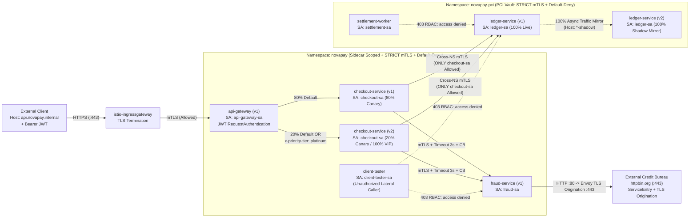

# Module 10: Capstone Project — Architecting & Operating the "NovaPay" Multi-Namespace FinTech Production Mesh

Welcome to the Capstone Project! Over the previous nine modules, you mastered Istio's control plane and data plane internals, progressive traffic management, resilience engineering, zero-trust security (`PeerAuthentication`, `RequestAuthentication`, `AuthorizationPolicy`), observability (`Telemetry`), Ambient Mode, and production war-room troubleshooting.

Now you will bring **all six production pillars together** to architect, deploy, secure, and verify **NovaPay**—a multi-namespace, PCI-DSS segmented FinTech payment processing platform running inside your Kubernetes cluster.

---

## 1. NovaPay Target Production Architecture

NovaPay is segmented into two isolated Kubernetes namespaces to satisfy strict financial compliance boundaries:
1. **`novapay` (General Application Tier)**:
   - **`api-gateway`** (`ServiceAccount: api-gateway-sa`, port `8080`): Entry point for external traffic arriving from `istio-ingressgateway`. Forwards validated requests to `checkout-service`.
   - **`checkout-service`** (`v1` and `v2`, `ServiceAccount: checkout-sa`, port `8080`): Orchestrates payment checkouts by calling `fraud-service` (in `novapay`) and `ledger-service` (across the namespace boundary in `novapay-pci`).
   - **`fraud-service`** (`v1`, `ServiceAccount: fraud-sa`, port `8080`): Evaluates transaction risk and queries an external credit bureau API (`httpbin.org`) over TLS.
   - **`client-tester`** (`ServiceAccount: client-tester-sa`): An internal testing pod (`curlimages/curl`) used to simulate both legitimate traffic and lateral-movement attacks inside the `novapay` namespace.
2. **`novapay-pci` (High-Security PCI-DSS Payment Vault Tier)**:
   - **`ledger-service`** (`v1` and `v2`, `ServiceAccount: ledger-sa`, port `8080`): Records immutable financial ledger entries. **Only** `checkout-sa` from the `novapay` namespace is authorized to invoke `GET`/`POST` on `ledger-service`. `ledger-service` `v1` asynchronously mirrors 100% of live traffic to `ledger-service` `v2` for shadow validation.
   - **`settlement-worker`** (`ServiceAccount: settlement-sa`): A background worker pod in the PCI zone used to verify that even pods *inside* `novapay-pci` cannot call `ledger-service` unless explicitly authorized by SPIFFE identity!



---

## 2. The 6 Production Architecture Pillars

Your implementation in `./manifests/` satisfies all six enterprise architecture requirements:

### Pillar 1: Namespace Isolation & Resource Scoping (`01-namespaces-and-sidecars.yaml`)
- Both `novapay` and `novapay-pci` are labeled with `istio-injection: enabled`.
- Each namespace defines a default **`Sidecar` CRD** with `outboundTrafficPolicy.mode: REGISTRY_ONLY`:
  - Workloads in `novapay` only receive xDS configuration for `novapay/*`, `istio-system/*`, and the single cross-namespace service `novapay-pci/ledger-service.novapay-pci.svc.cluster.local`.
  - Workloads in `novapay-pci` are completely isolated from external egress and only receive xDS configuration for `novapay-pci/*` and `istio-system/*`.

### Pillar 2: Zero-Trust Security (`03-zero-trust-security.yaml`)
- **Strict Mutual TLS**: `PeerAuthentication` policies in both `novapay` and `novapay-pci` enforce `mtls.mode: STRICT`.
- **Default-Deny (`allow-nothing`) Baseline**: Both namespaces deploy an empty `AuthorizationPolicy` (`spec: {}`) that blocks all requests by default.
- **Cryptographic SPIFFE Allow-Lists**:
  - `api-gateway` only accepts traffic from `cluster.local/ns/istio-system/sa/istio-ingressgateway-service-account` (and `client-tester-sa` on `/` or `/api/v1/checkout` for internal gateway verification).
  - `checkout-service` only accepts `GET`/`POST` from `cluster.local/ns/novapay/sa/api-gateway-sa` (and `client-tester-sa` only when testing canary headers).
  - `fraud-service` **only** accepts `GET`/`POST` from `cluster.local/ns/novapay/sa/checkout-sa`. Direct calls from `client-tester-sa` or `api-gateway-sa` are rejected with `403 RBAC: access denied`.
  - `ledger-service` (in `novapay-pci`) **only** accepts `GET`/`POST` from `cluster.local/ns/novapay/sa/checkout-sa`. Direct calls from `client-tester-sa` (in `novapay`) or `settlement-sa` (inside `novapay-pci`!) are rejected with `403 RBAC: access denied`.
- **End-User JWT Authentication & Claim Enforcement**:
  - `RequestAuthentication` on `api-gateway` validates JWT tokens issued by `testing@secure.istio.io`.
  - An `AuthorizationPolicy` on `api-gateway` enforces that any call to `/api/v1/checkout*` **must** carry a valid JWT principal (`requestPrincipals: ["*"]`).

### Pillar 3: North-South Ingress & Controlled Egress (`04-ingress-egress-gateways.yaml`)
- **TLS-Terminated North-South Ingress**: An Istio `Gateway` on `istio-ingressgateway` exposes `api.novapay.internal` over HTTP (`:80`) and HTTPS (`:443`, `mode: SIMPLE` with credential `novapay-tls-cert`).
- **Controlled Egress with Envoy TLS Origination**: A `ServiceEntry` registers the external credit bureau (`httpbin.org`) on port `80` (internal HTTP) and `443` (external HTTPS), paired with a `DestinationRule` (`tls.mode: SIMPLE`) and `VirtualService` that transparently upgrades plaintext HTTP calls on port `80` from `fraud-service` into HTTPS on port `443` without application TLS code!

### Pillar 4: Resilience & Chaos Hardening (`05-resilience-and-routing.yaml`)
- **`DestinationRule` Circuit Breaking & Outlier Detection**: Both `fraud-service` and `ledger-service` configure connection pool limits (`maxConnections: 100`, `http1MaxPendingRequests: 50`, `maxRequestsPerConnection: 50`) and passive health checking (`consecutive5xxErrors: 3`, `interval: 10s`, `baseEjectionTime: 30s`, `maxEjectionPercent: 50`).
- **Explicit Timeouts & Bounded Retries**: `VirtualService` definitions for `checkout-service`, `fraud-service`, and `ledger-service` enforce a `3s` overall timeout and bounded retries (`attempts: 2`, `perTryTimeout: 1s`, `retryOn: connect-failure,refused-stream,unavailable,cancelled,reset,5xx`).

### Pillar 5: Progressive Delivery (`05-resilience-and-routing.yaml`)
- **Header-Driven VIP Routing + 80/20 Canary Split (`checkout-service`)**:
  - Requests carrying header `x-priority-tier: platinum` route **100%** to `checkout-service` `v2`.
  - All other requests split **80% to `v1`** and **20% to `v2`**.
- **Asynchronous Traffic Mirroring (`ledger-service`)**:
  - 100% of live production traffic routes to `ledger-service` `v1`, while Envoy asynchronously mirrors (`mirrorPercentage: 100.0`) a shadow copy of every transaction to `ledger-service` `v2` (`Host: ledger-service...:8080-shadow`) out-of-band.

### Pillar 6: Production Telemetry (`06-telemetry-and-observability.yaml`)
- A namespace-scoped `Telemetry` resource enables Envoy access logging, sets **100% trace sampling** (`randomSamplingPercentage: 100.0`) for complete visibility across the payment call graph, and injects a custom `priority_tier` dimension (`request.headers['x-priority-tier'] | 'standard'`) into the `REQUEST_COUNT` Prometheus metric.

---

## 3. Step-by-Step Deployment Guide

### Step 1: Create Namespaces, TLS Certificate, and `Sidecar` Boundaries
Generate a self-signed TLS certificate for `api.novapay.internal` in `istio-system` (for the Ingress Gateway) and apply the namespace and `Sidecar` manifests:

```bash
# 1. Create a TLS certificate for api.novapay.internal in istio-system (if not already present)
openssl req -x509 -nodes -days 365 -newkey rsa:2048 \
  -keyout /tmp/novapay.key -out /tmp/novapay.crt \
  -subj "/CN=api.novapay.internal/O=NovaPay FinTech" \
  -addext "subjectAltName = DNS:api.novapay.internal" 2>/dev/null

kubectl create secret tls novapay-tls-cert -n istio-system \
  --key=/tmp/novapay.key --cert=/tmp/novapay.crt \
  --dry-run=client -o yaml | kubectl apply -f -

# 2. Apply namespaces and Sidecar isolation boundaries
kubectl apply -f manifests/01-namespaces-and-sidecars.yaml
```

### Step 2: Deploy All NovaPay & PCI Vault Workloads
```bash
kubectl apply -f manifests/02-workloads.yaml

# Wait for all deployments in novapay and novapay-pci to become Ready (2/2)
kubectl rollout status deployment -n novapay --timeout=120s
kubectl rollout status deployment -n novapay-pci --timeout=120s
```

### Step 3: Apply Zero-Trust Security Policies (`STRICT` mTLS, Default-Deny, SPIFFE RBAC, & JWT)
```bash
kubectl apply -f manifests/03-zero-trust-security.yaml
```

### Step 4: Apply North-South Ingress Gateway & Egress TLS Origination
```bash
kubectl apply -f manifests/04-ingress-egress-gateways.yaml
```

### Step 5: Apply Resilience Policies, Canary Routing & Traffic Mirroring
```bash
kubectl apply -f manifests/05-resilience-and-routing.yaml
```

### Step 6: Apply Production Telemetry Configuration
```bash
kubectl apply -f manifests/06-telemetry-and-observability.yaml
```

---

## 4. Automated Verification & Chaos Testing

Run the automated Capstone Verification Script to validate all 6 production architecture pillars end-to-end:

```bash
chmod +x verify-capstone.sh
./verify-capstone.sh
```

### What `verify-capstone.sh` Validates Automatically:
1. **Control Plane & xDS Sync Check**: Runs `istioctl analyze -n novapay -n novapay-pci` and verifies zero configuration errors and `SYNCED` proxy status.
2. **Pillar 1 (`Sidecar` Egress Isolation)**: Inspects `settlement-worker.novapay-pci` via `istioctl pc cluster` to prove that `novapay` services are completely invisible inside the PCI vault's Envoy CDS table.
3. **Pillar 2 (Zero-Trust Lateral Movement Prevention)**:
   - Verifies that `client-tester` (`novapay`) attempting to directly call `fraud-service` or `ledger-service` (`novapay-pci`) is blocked with **`403 RBAC: access denied`**.
   - Verifies that `settlement-worker` (`novapay-pci`) attempting to directly call `ledger-service` inside the *same* PCI namespace is also blocked with **`403 RBAC: access denied`**.
   - Verifies that an unauthenticated request to `api-gateway` on `/api/v1/checkout` is blocked with **`403`**, while a request with a valid JWT succeeds with **`200 OK`**.
4. **Pillar 3 (End-to-End Authorized Call Graph)**: Verifies that legitimate requests flowing through `api-gateway` -> `checkout-service` -> (`fraud-service` + `ledger-service`) succeed with **`200 OK`** over `STRICT` mTLS.
5. **Pillar 4 & 5 (Canary 80/20 Split, VIP Header Routing & Shadow Mirroring)**:
   - Sends 20 standard requests and verifies approximately 80% land on `checkout-service-v1` and 20% on `checkout-service-v2`.
   - Sends requests with `-H "x-priority-tier: platinum"` and verifies **100%** route deterministically to `checkout-service-v2`.
   - Inspects the logs of `ledger-service-v2` to prove it received mirrored shadow requests (`Host: ...-shadow`) while `ledger-service-v1` served the live responses.

---

## 5. Capstone Grading Rubric

| Pillar | Verification Criteria | Weight |
| :--- | :--- | :---: |
| **1. Namespace & `Sidecar` Scoping** | `Sidecar` CRDs active in `novapay` and `novapay-pci` with `REGISTRY_ONLY`; `novapay-pci` proxies have zero CDS clusters for `novapay`. | **15%** |
| **2. Zero-Trust Security** | `PeerAuthentication` `STRICT` in both namespaces; unauthorized callers receive `403 RBAC: access denied`; `/api/v1/checkout` enforces valid JWT. | **25%** |
| **3. Ingress & Controlled Egress** | `Gateway` serves `api.novapay.internal`; `ServiceEntry` + `DestinationRule` originates TLS on `:443` for `httpbin.org`. | **15%** |
| **4. Resilience & Circuit Breaking** | `DestinationRule` configures `connectionPool` and `outlierDetection`; `VirtualService` configures `3s` timeout and bounded retries (`2` attempts, `1s` `perTryTimeout`). | **15%** |
| **5. Progressive Delivery** | `checkout-service` splits 80/20 (`v1`/`v2`) by default and 100% `v2` on `x-priority-tier: platinum`; `ledger-service` mirrors 100% of traffic from `v1` to `v2`. | **20%** |
| **6. Production Telemetry** | `Telemetry` CRD active with 100% trace sampling and custom `priority_tier` metric tag; `istioctl analyze` reports zero errors. | **10%** |
