# Istio Service Mesh Engineering Fellowship — Cohort 01 (`FELLOWSHIP_HANDBOOK.md`)

Welcome to **Cohort 01** of the **Istio Service Mesh Engineering Fellowship**.

This program is not a passive video course or a collection of isolated command tutorials. It is structured as an intensive, 10-week **Platform Engineering Residency** where you join the infrastructure engineering team at **NovaPay**, take ownership of production service-mesh tickets, debug live outage simulations, defend your architectural trade-offs in design reviews, and graduate only after demonstrating production-level competency.

---

## 1. The Case Study: Welcome to NovaPay Platform Engineering

**NovaPay** is a high-growth FinTech payment processor handling multi-currency merchant checkout, fraud scoring, and ledger settlement. Over the past 18 months, NovaPay migrated from a monolithic payment core to Kubernetes microservices (`Kubernetes 1.36/1.37`).

While containerization accelerated deployment velocity, it exposed critical distributed-systems failures:
1. **L4 Load-Balancing Skew**: High-throughput gRPC/HTTP2 connections between `order-service` and `payment-service` pin to single pods behind Kubernetes `Services`, overloading individual instances while new replicas sit idle.
2. **Unbounded Retries & Cascading Outages**: Application developers embedded ad-hoc retry loops inside their HTTP clients. A 500ms database hiccup in `payment-service` triggered a $25\times$ retry storm that took down the entire storefront.
3. **Upcoming PCI-DSS Level 1 Audit**: Regulatory auditors require cryptographic proof that all East-West traffic is encrypted in transit (mTLS), that workloads in the general application tier (`orderflow` / `novapay`) cannot access the PCI vault tier (`novapay-pci`) except through explicitly authorized SPIFFE service identities, and that all outbound calls to external banking/credit networks pass through an audited Egress Gateway.
4. **Risky Deployments**: Standard Kubernetes `RollingUpdate` deployments tie traffic percentage directly to pod count, making it impossible to shadow live traffic to `payment-service-v2` or route 1% of canary traffic without running 100 pods.

### Your Role
You have just joined NovaPay as a **Platform Engineer** on the Core Infrastructure team. Over the next **10 weeks**, you will architect, roll out, harden, and operate **Istio `1.32.0`** (with **Envoy `v1.40`** and **Kubernetes Gateway API `v1.6.1`**) across NovaPay's core order subsystem (`orderflow`) and ultimately cut over the multi-namespace PCI production environment (`novapay` + `novapay-pci`).

---

## 2. Meet Your NovaPay Engineering Team

Throughout the fellowship, you will collaborate with—and defend your designs against—four recurring engineers. Each brings distinct technical priorities and architectural perspectives:

| Engineer | Role | Technical Focus & Perspective | Signature Question in Reviews |
| :--- | :--- | :--- | :--- |
| **Alex Morgan** | **Senior Platform Engineer & Primary Mentor** | Your direct mentor. Pragmatic systems architect who refuses to treat Istio as a "magic black box." Insists that you inspect Envoy xDS state (`LDS`, `RDS`, `CDS`, `EDS`, `SDS`), Linux `iptables`/CNI packet flows, and control-plane memory scaling before merging any YAML. | *"Don't just tell me the `VirtualService` YAML applied cleanly—what did `istioctl proxy-config` compile it into inside Envoy, and what happens if that CRD is applied in the wrong order?"* |
| **Sarah Chen** | **Site Reliability Engineering (SRE) Lead** | Owns NovaPay's `99.99%` availability SLO, P99 tail latency, incident response, and control-plane upgrades. Deeply skeptical of unbounded retries, un-scoped Envoy memory consumption, and control plane single points of failure. Leads Friday Incident Drills. | *"How does this configuration behave at 3:00 AM when `payment-service-v2` starts returning `503`s under peak load—does it fail fast or trigger a cascading retry storm?"* |
| **Daniel Brooks** | **Staff Backend Engineer** | Leads the Checkout & Payment application teams (`frontend`, `order-service`, `payment-service`). Wants fast releases, clean APIs (prefers **Kubernetes Gateway API** over vendor-specific CRDs), and zero application code changes. Frustrated when sidecars break his batch jobs or cause mysterious `503 UF`/`NR` errors. | *"Why is the mesh rejecting my service's connections, and how much CPU/memory tax are your sidecars adding to my pods compared to Ambient mode?"* |
| **Maya Patel** | **Principal Security Engineer** | Leads NovaPay's PCI-DSS Level 1 certification. Uncompromising on Zero-Trust networking: cryptographic SPIFFE identity (`spiffe://cluster.local/ns/<ns>/sa/<sa>`), `STRICT` mTLS, default-deny (`allow-nothing`) `AuthorizationPolicy`, JWT claim verification, and `REGISTRY_ONLY` egress control. | *"If an attacker compromises the `frontend` container, what mathematically prevents them from calling `payment-service` or exfiltrating card data to an arbitrary external IP?"* |

---

## 3. The 10-Week Cohort Roadmap

The fellowship is organized into **four progressive phases** across **10 weeks**:

```mermaid
flowchart LR
    subgraph P1["Phase 1: Foundation & Architecture"]
        W1["Week 01: Platform Onboarding &<br/>Control Plane Foundation<br/>(Module 00)"]
        W2["Week 02: Envoy xDS Internals,<br/>Interception & Ambient Mode<br/>(Module 01)"]
    end

    subgraph P2["Phase 2: Core Service Mesh Engineering"]
        W3["Week 03: Service Discovery,<br/>L7 Routing & Sidecar Scoping<br/>(Module 02)"]
        W4["Week 04: Edge Gateways,<br/>Gateway API & Egress Control<br/>(Module 03)"]
        W5["Week 05: Zero-Trust Security:<br/>mTLS, JWT & AuthorizationPolicy<br/>(Module 04)"]
    end

    subgraph P3["Phase 3: Production Reliability & Operations"]
        W6["Week 06: Resilience Engineering:<br/>Timeouts, Retries & Circuit Breaking<br/>(Module 05)"]
        W7["Week 07: Progressive Delivery:<br/>Mirroring, Canary & Blue-Green<br/>(Module 06)"]
        W8["Week 08: Observability:<br/>Golden Signals, Telemetry & Tracing<br/>(Module 07)"]
    end

    subgraph P4["Phase 4: Advanced Architecture & Graduation"]
        W9["Week 09: War-Room Debugging &<br/>Canary Control Plane Upgrades<br/>(Modules 08 & 09)"]
        W10["Week 10: NovaPay PCI Production<br/>Capstone & Graduation Defense<br/>(Module 10)"]
    end

    W1 --> W2 --> W3 --> W4 --> W5 --> W6 --> W7 --> W8 --> W9 --> W10
```

| Phase | Week | Cohort Topic & Engineering Ticket | Mapped Core Technical Module |
| :--- | :--- | :--- | :--- |
| **Phase 1** | **[Week 01](./fellowship/week-01-platform-onboarding/WEEK.md)** | `NP-101`: Cluster Topology, Helm vs. `istioctl` Profiles (`Istio 1.32.0`), CNI Audit & OrderFlow Baseline | **[Module 00: Environment Setup](./00-environment-setup/README.md)** |
| **Phase 1** | **[Week 02](./fellowship/week-02-dataplane-internals-and-ambient/WEEK.md)** | `NP-102`: Dissecting Envoy xDS (`LDS`/`RDS`/`CDS`/`EDS`), `iptables` Interception & Sidecar vs. Ambient (`ztunnel` + Waypoints) | **[Module 01: Architecture & Internals](./01-architecture-and-internals/README.md)** |
| **Phase 2** | **[Week 03](./fellowship/week-03-service-discovery-and-l7-routing/WEEK.md)** | `NP-103`: Solving L4/gRPC Skew, Subsets, Evaluation Order Trap, Ring-Hash Affinity & `Sidecar` Memory Scoping | **[Module 02: Discovery & Routing](./02-service-discovery-and-routing/README.md)** |
| **Phase 2** | **[Week 04](./fellowship/week-04-edge-gateways-and-controlled-egress/WEEK.md)** | `NP-104`: North-South TLS Ingress, Kubernetes Gateway API (`v1.6.1`), `REGISTRY_ONLY` Egress & TLS Origination | **[Module 03: Gateways, Ingress & Egress](./03-gateways-ingress-and-egress/README.md)** |
| **Phase 2** | **[Week 05](./fellowship/week-05-zero-trust-security-architecture/WEEK.md)** | `NP-105`: SPIFFE/SDS Lifecycle, `STRICT` mTLS Migration, JWT Authn & Default-Deny `AuthorizationPolicy` | **[Module 04: Security — mTLS & Authz](./04-security-mtls-and-authz/README.md)** |
| **Phase 3** | **[Week 06](./fellowship/week-06-resilience-and-chaos-engineering/WEEK.md)** | `NP-106`: Stopping Retry Storms, Timeout Math, `connectionPool` Circuit Breakers (`503 UO`), `outlierDetection` & Chaos Faults | **[Module 05: Resilience & Fault Injection](./05-resilience-and-fault-injection/README.md)** |
| **Phase 3** | **[Week 07](./fellowship/week-07-progressive-delivery-and-safe-releases/WEEK.md)** | `NP-107`: Asynchronous Traffic Shadowing (`-shadow`), Dark Launches, Staged Canary & Argo Rollouts | **[Module 06: Progressive Delivery](./06-progressive-delivery/README.md)** |
| **Phase 3** | **[Week 08](./fellowship/week-08-observability-and-golden-signals/WEEK.md)** | `NP-108`: Source vs. Destination Metrics, `Telemetry` CRD, CEL Error-Only JSON Logs & W3C Distributed Tracing | **[Module 07: Observability & Telemetry](./07-observability-and-telemetry/README.md)** |
| **Phase 4** | **[Week 09](./fellowship/week-09-incident-response-and-control-plane-ops/WEEK.md)** | `NP-109`: 5-Scenario Production War-Room, Envoy Response Flags, Native Sidecar Lifecycle & Revision Canary Upgrades (`1-31-0` $\rightarrow$ `1-32-0`) | **[Module 08: Debugging & Operations](./08-debugging-and-production-operations/README.md)** & **[Module 09: Checklists](./09-production-checklists-and-reference/README.md)** |
| **Phase 4** | **[Week 10](./fellowship/week-10-capstone-and-graduation-defense/WEEK.md)** | `NP-110`: Multi-Namespace NovaPay + PCI Vault Production Implementation, Final Chaos Drill & Graduation Defense | **[Module 10: Capstone Project](./10-capstone-project/README.md)** |

---

## 4. The 7-Day Weekly Cohort Rhythm (Self-Paced)

Every week follows an identical 7-stage engineering workflow. Because this is a self-paced simulated cohort, "Monday" through "Sunday" represent **stages of mastery within a week** rather than rigid calendar dates:

1. **Monday — Mentor Briefing & Ticket Assignment**:
   - Meet with **Alex Morgan** to review NovaPay's current engineering challenge.
   - Read the simulated **Peer Engineering Discussion** between Alex, Sarah, Daniel, and Maya.
   - Receive your weekly **Engineering Ticket (`NP-10X`)** with business requirements, constraints, and acceptance criteria.
2. **Tuesday — Technical Lectures & Under-the-Hood Study**:
   - Dive into the core technical module's `README.md` with Alex's study guide.
   - Trace the internal Envoy xDS compilation, packet flow diagrams, and configuration trade-offs.
3. **Wednesday — Guided Hands-On Labs**:
   - Run the pre-flight version check (`Istio 1.32.0`, `K8s 1.36+`, `Gateway API v1.6.1`).
   - Execute the core module's `LAB.md` step-by-step on your cluster.
   - Validate Alex's **Internal Verification Checkpoints** using `istioctl proxy-config` and Envoy Admin `:15000`.
4. **Thursday — Independent Engineering Assignment**:
   - Solve a realistic NovaPay engineering assignment *without* step-by-step hand-holding.
   - Verify your implementation against automated acceptance criteria before expanding the collapsible **Reference Solution & Code Review**.
5. **Friday — Production Incident Simulation (`INC-0X`)**:
   - Respond to a PagerDuty alert from **Sarah Chen**.
   - Apply the broken state (or inspect the provided diagnostic evidence), isolate the root cause using `istioctl analyze`, Envoy response flags, and xDS dumps, remediate the outage, and write an RCA using [`INCIDENT_POSTMORTEM_TEMPLATE.md`](./fellowship/templates/INCIDENT_POSTMORTEM_TEMPLATE.md).
6. **Saturday — Architecture Review & Mentor Office Hours**:
   - Defend your week's architecture against pointed technical challenges from Alex, Sarah, Daniel, and Maya.
   - Review Alex's Office Hours Q&A covering subtle production edge cases.
7. **Sunday — Weekly Assessment & Retrospective**:
   - Complete the 5-question technical & troubleshooting assessment.
   - Record your completed deliverables and competency sign-offs in [`PROGRESSION_DASHBOARD.md`](./PROGRESSION_DASHBOARD.md).

---

## 5. Engineering Templates & Portfolio Artifacts

Use the templates in [`fellowship/templates/`](./fellowship/templates/) to document your work as you progress through the 10 weeks:
- **[`ENGINEERING_TICKET_TEMPLATE.md`](./fellowship/templates/ENGINEERING_TICKET_TEMPLATE.md)** — For documenting your Thursday Independent Assignment deliverables (`NP-101` to `NP-110`).
- **[`INCIDENT_POSTMORTEM_TEMPLATE.md`](./fellowship/templates/INCIDENT_POSTMORTEM_TEMPLATE.md)** — Blameless 5-Whys Root Cause Analysis template for Friday Incident Drills (`INC-01` to `INC-10`).
- **[`ARCHITECTURE_REVIEW_RFC_TEMPLATE.md`](./fellowship/templates/ARCHITECTURE_REVIEW_RFC_TEMPLATE.md)** — RFC template for Saturday Architecture Defense sign-offs.
- **[`WEEKLY_ASSESSMENT_TEMPLATE.md`](./fellowship/templates/WEEKLY_ASSESSMENT_TEMPLATE.md)** — Self-assessment and retrospective log for Sunday reviews.

